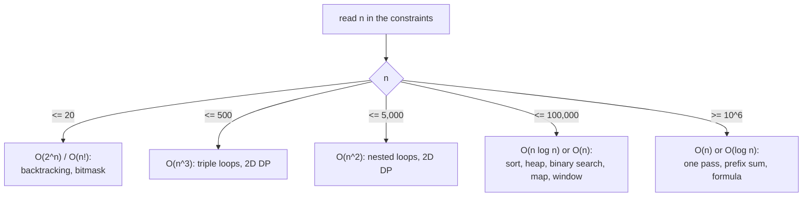

# Complexity & Constraints

> The input size tells you which complexity is allowed, and the complexity tells you which pattern to try.

**Go deeper:** `ALG 3.4` (recursion trees), `ALG 3.5` (recurrences and the Master Theorem), `ALG 11.1` (growth table and constraints to complexity), `ALG 10.7` (`Int` vs `Long` overflow).

#### 1. What Is It?

**Big-O** describes how time or extra memory grows when the input grows. Ignore constants and small terms: `3n² + 5n + 2` is `O(n²)`.

| Class | Name | Typical example |
|---|---|---|
| `O(1)` | constant | array index, hash map lookup |
| `O(log n)` | logarithmic | binary search, heap push/pop |
| `O(n)` | linear | one loop, one scan |
| `O(n log n)` | linearithmic | sorting, heap over all items |
| `O(n²)` | quadratic | two nested loops |
| `O(2ⁿ)` | exponential | all subsets |
| `O(n!)` | factorial | all permutations |

**Use the constraints as a hint.** LeetCode runs about `10⁸` simple operations per second.

| Input size `n` | Aim for | Likely approach |
|---|---|---|
| up to ~20 | `O(2ⁿ)`, `O(n!)` | backtracking, bitmask |
| up to ~500 | `O(n³)` | triple loops, some DP |
| up to ~5,000 | `O(n²)` | nested loops, 2D DP |
| up to ~100,000 | `O(n log n)` or `O(n)` | sort, heap, binary search, hash map, sliding window |
| up to ~1,000,000 | `O(n)` | one pass, hash map, prefix sum |
| up to `10⁹` or more | `O(log n)` or math | binary search, formula |

#### 2. How It Works

**How to count**

1. One loop over `n` items: `O(n)`.
2. Nested loops over `n`: multiply, `O(n²)`.
3. A loop that halves or doubles the variable: `O(log n)`.
4. Steps one after another: add them, keep the biggest.
5. Recursion: (number of calls) × (work per call). Two branches per call and depth `n` gives `O(2ⁿ)`.
6. Memory: count the extra structures you create (map, array, recursion stack).

**Recursion uses stack space.** Depth × frame size. A DFS on a skewed tree has depth `n`, so `O(n)` space.

**Cost of common operations in Kotlin/JVM**

| Operation | Cost |
|---|---|
| `IntArray[i]`, `ArrayList[i]` | `O(1)` |
| `ArrayList.add(x)` at the end | `O(1)` amortized |
| `ArrayList.add(0, x)` / remove from front | `O(n)` |
| `HashMap` / `HashSet` get, put, contains | `O(1)` average |
| `TreeMap` / `TreeSet` operations | `O(log n)` |
| `PriorityQueue` add / poll | `O(log n)` |
| `PriorityQueue` peek | `O(1)` |
| `ArrayDeque` add/remove at either end | `O(1)` |
| `String` `substring`, `+` | `O(length)` (copies) |
| `StringBuilder.append` | `O(1)` amortized |
| `sorted()`, `sort()` | `O(n log n)` |

**Amortized cost.** One `ArrayList.add` sometimes costs `O(n)` (when it grows), but averaged over many adds it is `O(1)`. Sliding window and monotonic stack are `O(n)` for the same reason: each element enters and leaves **once**, even with a loop inside a loop.

**Picture:** From the constraint to the complexity to the pattern.



#### 3. Brute Force vs Optimized

Typical reductions you will use again and again:

| Brute force | Optimized | How |
|---|---|---|
| `O(n²)` pair search | `O(n)` | hash map, or sort + two pointers |
| `O(n²)` all subarrays | `O(n)` | sliding window, prefix sum |
| `O(n)` search in sorted data | `O(log n)` | binary search |
| `O(n log n)` sort for top K | `O(n log k)` | heap of size `k` |
| `O(2ⁿ)` recursion with repeats | `O(n × m)` | DP / memoization |
| `O(n²)` string `+=` in a loop | `O(n)` | `StringBuilder` |

#### 4. Kotlin Code

```kotlin
// O(n²): checks every pair
fun hasDuplicateSlow(nums: IntArray): Boolean {
    for (i in nums.indices) {
        for (j in i + 1 until nums.size) {
            if (nums[i] == nums[j]) return true
        }
    }
    return false
}

// O(n) time, O(n) space: trade memory for time
fun hasDuplicateFast(nums: IntArray): Boolean {
    val seen = HashSet<Int>()
    for (x in nums) {
        if (!seen.add(x)) return true           // add returns false if already present
    }
    return false
}

// O(log n): the loop variable halves each step
fun countHalvings(n: Int): Int {
    var x = n
    var steps = 0
    while (x > 1) { x /= 2; steps++ }
    return steps
}

// O(n²) hidden cost: += on a String copies the whole string each time
fun buildSlow(n: Int): String {
    var s = ""
    repeat(n) { s += "a" }
    return s
}

// O(n)
fun buildFast(n: Int): String {
    val sb = StringBuilder()
    repeat(n) { sb.append('a') }
    return sb.toString()
}
```

Checks: `hasDuplicateFast([1,2,3,1])` → `true`. `hasDuplicateFast([1,2,3])` → `false`. `countHalvings(1024)` → `10`. `buildFast(3)` → `"aaa"`.

**Overflow (a complexity-adjacent trap)**

```kotlin
val big = Int.MAX_VALUE
val wrong = big + 1                    // -2147483648 (wraps around)
val right = big.toLong() + 1           // 2147483648
// binary search: left + right can overflow, so use
// val mid = left + (right - left) / 2
```

#### 5. Complexity

| Case | Time | Space |
|---|---|---|
| `hasDuplicateSlow` | `O(n²)` | `O(1)` |
| `hasDuplicateFast` | `O(n)` | `O(n)` |
| `countHalvings` | `O(log n)` | `O(1)` |
| `buildSlow` / `buildFast` | `O(n²)` / `O(n)` | `O(n)` |

Time vs space: you can often buy time with memory (map, set, DP table). Say the trade-off out loud.

Best / average / worst: quicksort is `O(n log n)` average, `O(n²)` worst. A hash map is `O(1)` average, `O(n)` worst with many collisions. Interviewers usually accept the average case if you name it.

#### 6. Common Mistakes

1. **Forgetting hidden costs:** `substring`, string `+=`, `list.contains` (`O(n)`), `list.add(0, x)`.
2. **Counting a loop inside a loop as `O(n²)` when it is amortized `O(n)`** (sliding window, monotonic stack).
3. **Forgetting recursion stack space.** Recursive DFS is `O(h)` extra space, not `O(1)`.
4. **Saying `O(n log n)` for building a heap from `n` items.** Heapify is `O(n)`; `n` pushes is `O(n log n)`.
5. **Ignoring the constraints.** `n = 10⁵` and an `O(n²)` plan is a time-limit failure.
6. **`Int` overflow** in sums, products, and `left + right`.

#### 7. Say This in the Interview

1. "The brute force is `O(n²)`. With `n` up to `10⁵` that is too slow, so I need `O(n log n)` or better."
2. "Each element is pushed and popped once, so even with the inner `while` the total is `O(n)`."
3. "I use `O(n)` extra space for the map to bring time down from `O(n²)` to `O(n)`."

#### 8. Quick Check

1. `n = 200,000`. Is an `O(n²)` solution OK?
2. A `while` loop sits inside a `for` loop, but `i` never moves backward. What is the total?
3. What is the space of recursive DFS on a path-shaped tree of `n` nodes?

<details>
<summary>Answers</summary>

1. No. That is `4 × 10¹⁰` steps. Aim for `O(n log n)` or `O(n)`.
2. `O(n)`, if the inner loop's index only moves forward and total movement is at most `n`.
3. `O(n)`, because the recursion depth is `n`.

</details>

#### 9. Related LeetCode Questions

| # | Question | Idea |
|---|---|---|
| 217 | [Contains Duplicate](https://leetcode.com/problems/contains-duplicate/) (Easy) | `O(n²)` to `O(n)` with a set |
| 242 | [Valid Anagram](https://leetcode.com/problems/valid-anagram/) (Easy) | counting array |
| 231 | [Power of Two](https://leetcode.com/problems/power-of-two/) (Easy) | log n or a bit trick |
| 278 | [First Bad Version](https://leetcode.com/problems/first-bad-version/) (Easy) | `O(log n)` |
| 69 | [Sqrt(x)](https://leetcode.com/problems/sqrtx/) (Easy) | binary search, overflow care |
| 204 | [Count Primes](https://leetcode.com/problems/count-primes/) (Medium) | sieve, `O(n log log n)` |
| 50 | [Pow(x, n)](https://leetcode.com/problems/powx-n/) (Medium) | halve the exponent |
