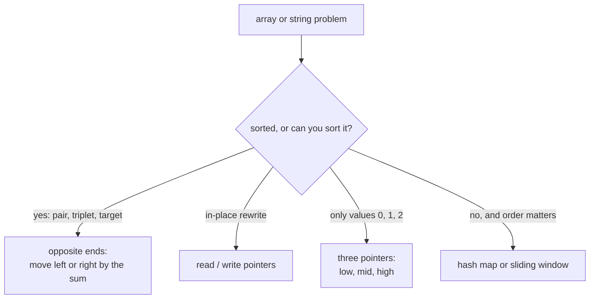

# Two Pointers

> Use two indexes instead of a nested loop. Sorted order (or a read/write split) tells you which pointer to move.

**Go deeper:** `ALG 1.12` (sort, then two pointers), `ALG 8.3` (pointers and windows on strings), `ALG 8.4` (palindromes). Cheat sheet: `ALG 8.99`.

#### 1. What Is It?

Two pointers walk through an array or string together. This turns many `O(n²)` pair searches into `O(n)`.

**Signals**

- A **sorted** array and a pair, triplet, or target sum
- A **palindrome** check
- **In-place** removal or rearrangement (remove duplicates, move zeroes)
- Merge or compare two sorted arrays
- "Without extra space"

**Three shapes**

| Shape | Pointers | Use |
|---|---|---|
| Opposite ends | `left = 0`, `right = n − 1`, move inward | pair sum, palindrome, container |
| Same direction (read/write) | `read` scans, `write` marks the next slot | remove duplicates, move zeroes |
| Three-way partition | `low`, `mid`, `high` | sort colors (Dutch flag) |

#### 2. How It Works

**Opposite ends, pair sum in a sorted array**

```text
[2, 7, 11, 15], target 9
left=0 (2), right=3 (15): 17 > 9  → right--
left=0 (2), right=2 (11): 13 > 9  → right--
left=0 (2), right=1 (7):   9 = 9  → found
```

Why it is safe: if the sum is too big, the biggest number can never pair with anything smaller to work, so drop it. Too small: drop the smallest.

**Read / write**

```text
[0, 0, 1, 1, 2]   remove duplicates
write=1. read scans: if nums[read] != nums[write-1], copy it to nums[write], write++.
Result prefix: [0, 1, 2], length 3
```

**3Sum:** sort, fix `i`, then run the opposite-ends search on the rest. Skip equal values for `i`, `left` and `right`.

**Dutch flag:** `low` is the end of the 0s, `high` the start of the 2s, `mid` scans. Swap 0 to the front, 2 to the back, leave 1.

**Picture:** Which two-pointer shape fits?



#### 3. Brute Force vs Optimized

| Problem | Brute force | Two pointers |
|---|---|---|
| Pair sum, sorted | all pairs `O(n²)` | `O(n)` |
| 3Sum | all triples `O(n³)` | sort + two pointers `O(n²)` |
| Container with most water | all pairs `O(n²)` | move the shorter wall `O(n)` |
| Remove duplicates | new list + copy `O(n)` space | in place `O(1)` space |

```kotlin
fun maxAreaBrute(height: IntArray): Int {
    var best = 0
    for (i in height.indices) {
        for (j in i + 1 until height.size) {
            best = maxOf(best, minOf(height[i], height[j]) * (j - i))
        }
    }
    return best
}
```

#### 4. Kotlin Code

```kotlin
// Valid Palindrome (LeetCode 125)
fun isPalindrome(s: String): Boolean {
    var left = 0
    var right = s.length - 1
    while (left < right) {
        while (left < right && !s[left].isLetterOrDigit()) left++
        while (left < right && !s[right].isLetterOrDigit()) right--
        if (s[left].lowercaseChar() != s[right].lowercaseChar()) return false
        left++
        right--
    }
    return true
}

// Two Sum II, sorted input (LeetCode 167): 1-indexed answer
fun twoSumSorted(numbers: IntArray, target: Int): IntArray {
    var left = 0
    var right = numbers.size - 1
    while (left < right) {
        val sum = numbers[left] + numbers[right]
        when {
            sum == target -> return intArrayOf(left + 1, right + 1)
            sum < target -> left++
            else -> right--
        }
    }
    return intArrayOf()
}

// 3Sum (LeetCode 15)
fun threeSum(nums: IntArray): List<List<Int>> {
    nums.sort()
    val result = mutableListOf<List<Int>>()
    for (i in 0 until nums.size - 2) {
        if (i > 0 && nums[i] == nums[i - 1]) continue          // skip duplicate first number
        var left = i + 1
        var right = nums.size - 1
        while (left < right) {
            val sum = nums[i] + nums[left] + nums[right]
            if (sum < 0) left++
            else if (sum > 0) right--
            else {
                result.add(listOf(nums[i], nums[left], nums[right]))
                left++
                right--
                while (left < right && nums[left] == nums[left - 1]) left++      // skip duplicates
                while (left < right && nums[right] == nums[right + 1]) right--
            }
        }
    }
    return result
}

// Container With Most Water (LeetCode 11)
fun maxArea(height: IntArray): Int {
    var left = 0
    var right = height.size - 1
    var best = 0
    while (left < right) {
        best = maxOf(best, minOf(height[left], height[right]) * (right - left))
        if (height[left] < height[right]) left++ else right--   // move the shorter wall
    }
    return best
}

// Remove Duplicates from Sorted Array (LeetCode 26): returns new length
fun removeDuplicates(nums: IntArray): Int {
    if (nums.isEmpty()) return 0
    var write = 1
    for (read in 1 until nums.size) {
        if (nums[read] != nums[write - 1]) {
            nums[write] = nums[read]
            write++
        }
    }
    return write
}

// Move Zeroes (LeetCode 283)
fun moveZeroes(nums: IntArray) {
    var write = 0
    for (read in nums.indices) {
        if (nums[read] != 0) {
            val tmp = nums[write]; nums[write] = nums[read]; nums[read] = tmp
            write++
        }
    }
}

// Sort Colors, Dutch national flag (LeetCode 75)
fun sortColors(nums: IntArray) {
    var low = 0
    var mid = 0
    var high = nums.size - 1
    while (mid <= high) {
        when (nums[mid]) {
            0 -> { val t = nums[low]; nums[low] = nums[mid]; nums[mid] = t; low++; mid++ }
            1 -> mid++
            else -> { val t = nums[mid]; nums[mid] = nums[high]; nums[high] = t; high-- }
        }
    }
}

// Trapping Rain Water (LeetCode 42)
fun trap(height: IntArray): Int {
    var left = 0
    var right = height.size - 1
    var leftMax = 0
    var rightMax = 0
    var water = 0
    while (left < right) {
        if (height[left] < height[right]) {
            if (height[left] >= leftMax) leftMax = height[left] else water += leftMax - height[left]
            left++
        } else {
            if (height[right] >= rightMax) rightMax = height[right] else water += rightMax - height[right]
            right--
        }
    }
    return water
}
```

Checks: `isPalindrome("A man, a plan, a canal: Panama")` → `true`. `isPalindrome("race a car")` → `false`. `twoSumSorted([2,7,11,15], 9)` → `[1, 2]`. `threeSum([-1,0,1,2,-1,-4])` → `[[-1,-1,2],[-1,0,1]]`. `maxArea([1,8,6,2,5,4,8,3,7])` → `49`. `removeDuplicates([0,0,1,1,1,2,2,3,3,4])` → `5`. `moveZeroes([0,1,0,3,12])` → `[1,3,12,0,0]`. `sortColors([2,0,2,1,1,0])` → `[0,0,1,1,2,2]`. `trap([0,1,0,2,1,0,1,3,2,1,2,1])` → `6`.

#### 5. Complexity

| Problem | Time | Space |
|---|---|---|
| Opposite ends scan | `O(n)` | `O(1)` |
| Read / write | `O(n)` | `O(1)` |
| 3Sum | `O(n²)` (sort is `O(n log n)`) | `O(1)` extra (ignoring the output) |
| Dutch flag | `O(n)` | `O(1)` |

#### 6. Common Mistakes

1. **Using opposite ends on unsorted data.** Sort first, or use a hash map.
2. **Not skipping duplicates in 3Sum** (repeated triplets in the answer).
3. **Skipping duplicates before using the match.** Record the triplet first, then skip.
4. **Dutch flag: moving `mid` after swapping with `high`.** The swapped-in value is unchecked.
5. **`left <= right` vs `left < right`.** A pair needs two different positions.
6. **Palindrome:** forgetting to ignore case and non-alphanumeric characters.
7. **Remove duplicates:** comparing with `nums[read - 1]` after overwriting. Compare with `nums[write − 1]`.

#### 7. Say This in the Interview

1. "The array is sorted, so if the sum is too small I move `left` up, and if it is too big I move `right` down. That is `O(n)` instead of `O(n²)`."
2. "I sort first. The sort costs `O(n log n)`, and the scan is `O(n)`."
3. "For in-place removal I use a read pointer and a write pointer, so extra space is `O(1)`."

#### 8. Quick Check

1. Why does 3Sum cost `O(n²)` and not `O(n³)`?
2. In `sortColors`, why is `mid` not incremented after swapping with `high`?

<details>
<summary>Answers</summary>

1. One loop for the first number, plus an `O(n)` two-pointer scan inside it.
2. The value that came from `high` has not been checked yet; it might be 0 or 1.

</details>

#### 9. Related LeetCode Questions

| # | Question | Idea |
|---|---|---|
| 125 | [Valid Palindrome](https://leetcode.com/problems/valid-palindrome/) (Easy) | opposite ends |
| 167 | [Two Sum II: Input Array Is Sorted](https://leetcode.com/problems/two-sum-ii-input-array-is-sorted/) (Medium) | sorted pair sum |
| 26 | [Remove Duplicates from Sorted Array](https://leetcode.com/problems/remove-duplicates-from-sorted-array/) (Easy) | read / write |
| 283 | [Move Zeroes](https://leetcode.com/problems/move-zeroes/) (Easy) | read / write |
| 11 | [Container With Most Water](https://leetcode.com/problems/container-with-most-water/) (Medium) | move the shorter wall |
| 15 | [3Sum](https://leetcode.com/problems/3sum/) (Medium) | sort + skip duplicates |
| 75 | [Sort Colors](https://leetcode.com/problems/sort-colors/) (Medium) | Dutch flag |
| 42 | [Trapping Rain Water](https://leetcode.com/problems/trapping-rain-water/) (Hard) | two pointers with max sides |
