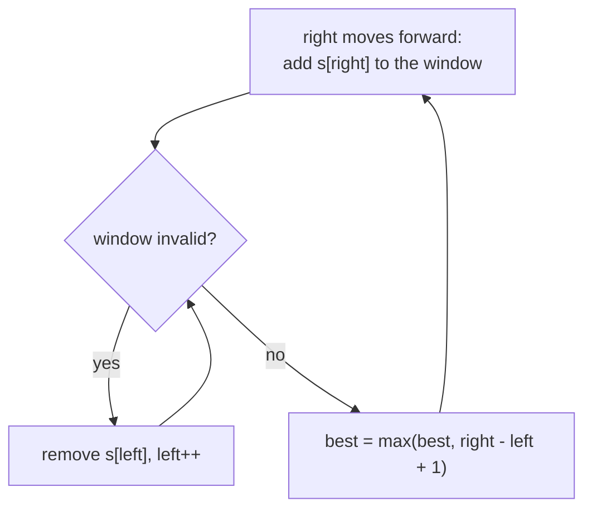

# Sliding Window

> A moving range over an array or string. Add on the right, remove on the left, and never recompute from scratch.

**Go deeper:** `ALG 8.3` (fixed and variable windows on strings, with the `O(n)` argument), `DS HashMap`, `ALG 8.6` (rolling hash).

#### 1. What Is It?

A **window** is a contiguous range `[left, right]`. You slide it along the data and update its state (sum, count, frequency map) in `O(1)` per move.

**Signals**

- "Longest / shortest **substring or subarray** that ..."
- "Contiguous", "at most K", "of size K"
- Condition on a **window**: no repeats, at most K distinct, sum ≥ target
- All elements are usually non-negative (for sum windows)

**Three templates**

| Type | Use | Shape |
|---|---|---|
| Fixed size `k` | max sum / average of size `k` | add right, remove `right − k` |
| Longest valid | longest substring that ... | expand right, shrink **while invalid**, update best after |
| Shortest valid | shortest subarray with sum ≥ target | expand right, shrink **while valid**, update best inside |

#### 2. How It Works

**Longest valid window**

```text
for right in 0..n-1:
    add s[right] to the window
    while window is invalid:
        remove s[left]; left++
    best = max(best, right - left + 1)
```

**Dry run: longest substring without repeats, "abcabcbb"**

```text
right=0 'a' → window "a"        best 1
right=1 'b' → "ab"             best 2
right=2 'c' → "abc"            best 3
right=3 'a' → repeat! left moves past old 'a' → "bca"    best 3
right=4 'b' → repeat → "cab"   best 3
...
answer 3
```

**Shortest valid window**

```text
for right in 0..n-1:
    add nums[right]
    while window is valid:
        best = min(best, right - left + 1)
        remove nums[left]; left++
```

**Why it is `O(n)`:** `left` and `right` each move forward at most `n` times. The inner `while` does not restart.

**"Exactly K" trick:** `atMost(K) − atMost(K − 1)`.

**Window maximum:** a monotonic deque of indexes (values decreasing from front to back). The front is always the max of the window.

**Picture:** The longest-valid-window loop.



#### 3. Brute Force vs Optimized

| Problem | Brute force | Sliding window |
|---|---|---|
| Max sum of size `k` | recompute each sum `O(n·k)` | slide `O(n)` |
| Longest substring with no repeats | check every substring `O(n³)` or `O(n²)` | `O(n)` |
| Min window substring | every substring `O(n²)` or worse | `O(n)` |
| Window maximum | scan each window `O(n·k)` | deque `O(n)` |

```kotlin
fun maxSumBrute(nums: IntArray, k: Int): Int {
    var best = Int.MIN_VALUE
    for (i in 0..nums.size - k) {
        var sum = 0
        for (j in i until i + k) sum += nums[j]
        best = maxOf(best, sum)
    }
    return best
}
```

#### 4. Kotlin Code

```kotlin
// Maximum Average Subarray I (LeetCode 643): fixed window
fun findMaxAverage(nums: IntArray, k: Int): Double {
    var sum = 0
    for (i in 0 until k) sum += nums[i]
    var best = sum
    for (i in k until nums.size) {
        sum += nums[i] - nums[i - k]                 // add new, remove old
        best = maxOf(best, sum)
    }
    return best.toDouble() / k
}

// Longest Substring Without Repeating Characters (LeetCode 3)
fun lengthOfLongestSubstring(s: String): Int {
    val last = HashMap<Char, Int>()                  // char -> last index
    var left = 0
    var best = 0
    for (right in s.indices) {
        val prev = last[s[right]]
        if (prev != null && prev >= left) left = prev + 1
        last[s[right]] = right
        best = maxOf(best, right - left + 1)
    }
    return best
}

// Longest Repeating Character Replacement (LeetCode 424)
fun characterReplacement(s: String, k: Int): Int {
    val count = IntArray(26)
    var left = 0
    var maxCount = 0                                 // highest frequency seen in any window
    var best = 0
    for (right in s.indices) {
        count[s[right] - 'A']++
        maxCount = maxOf(maxCount, count[s[right] - 'A'])
        while (right - left + 1 - maxCount > k) {    // replacements needed > k
            count[s[left] - 'A']--
            left++
        }
        best = maxOf(best, right - left + 1)
    }
    return best
}

// Permutation in String (LeetCode 567): fixed window of s1.length
fun checkInclusion(s1: String, s2: String): Boolean {
    if (s1.length > s2.length) return false
    val need = IntArray(26)
    val have = IntArray(26)
    for (c in s1) need[c - 'a']++
    for (i in s2.indices) {
        have[s2[i] - 'a']++
        if (i >= s1.length) have[s2[i - s1.length] - 'a']--
        if (need.contentEquals(have)) return true
    }
    return false
}

// Minimum Size Subarray Sum (LeetCode 209): shortest window
fun minSubArrayLen(target: Int, nums: IntArray): Int {
    var left = 0
    var sum = 0
    var best = Int.MAX_VALUE
    for (right in nums.indices) {
        sum += nums[right]
        while (sum >= target) {
            best = minOf(best, right - left + 1)
            sum -= nums[left]
            left++
        }
    }
    return if (best == Int.MAX_VALUE) 0 else best
}

// Minimum Window Substring (LeetCode 76)
fun minWindow(s: String, t: String): String {
    if (t.isEmpty() || s.length < t.length) return ""
    val need = IntArray(128)
    for (c in t) need[c.code]++
    var missing = t.length                           // characters of t still needed
    var left = 0
    var bestStart = 0
    var bestLen = Int.MAX_VALUE
    for (right in s.indices) {
        if (need[s[right].code] > 0) missing--
        need[s[right].code]--
        while (missing == 0) {                       // window is valid: try to shrink
            if (right - left + 1 < bestLen) { bestLen = right - left + 1; bestStart = left }
            need[s[left].code]++
            if (need[s[left].code] > 0) missing++
            left++
        }
    }
    return if (bestLen == Int.MAX_VALUE) "" else s.substring(bestStart, bestStart + bestLen)
}

// Sliding Window Maximum (LeetCode 239): monotonic deque of indexes
fun maxSlidingWindow(nums: IntArray, k: Int): IntArray {
    val result = IntArray(nums.size - k + 1)
    val dq = ArrayDeque<Int>()
    for (i in nums.indices) {
        if (dq.isNotEmpty() && dq.first() <= i - k) dq.removeFirst()          // out of window
        while (dq.isNotEmpty() && nums[dq.last()] < nums[i]) dq.removeLast()   // smaller can never win
        dq.addLast(i)
        if (i >= k - 1) result[i - k + 1] = nums[dq.first()]
    }
    return result
}
```

Checks: `findMaxAverage([1,12,-5,-6,50,3], 4)` → `12.75`. `lengthOfLongestSubstring("abcabcbb")` → `3`; `"bbbbb"` → `1`; `"pwwkew"` → `3`. `characterReplacement("AABABBA", 1)` → `4`; `("ABAB", 2)` → `4`. `checkInclusion("ab", "eidbaooo")` → `true`; `("ab", "eidboaoo")` → `false`. `minSubArrayLen(7, [2,3,1,2,4,3])` → `2`. `minWindow("ADOBECODEBANC", "ABC")` → `"BANC"`; `minWindow("a", "aa")` → `""`. `maxSlidingWindow([1,3,-1,-3,5,3,6,7], 3)` → `[3,3,5,5,6,7]`.

#### 5. Complexity

| Problem | Time | Space |
|---|---|---|
| Fixed / variable window | `O(n)` | `O(1)` or `O(alphabet)` |
| Min Window Substring | `O(n + m)` | `O(alphabet)` |
| Window maximum (deque) | `O(n)` | `O(k)` |

#### 6. Common Mistakes

1. **Using a sum window with negative numbers.** Shrinking no longer fixes the condition. Use prefix sum + hash map (note 07).
2. **Updating `best` at the wrong time.** For *longest* update after shrinking; for *shortest* update inside the shrink loop.
3. **Using `if` instead of `while` to shrink.** One removal may not make the window valid again.
4. **Window size off by one:** length is `right − left + 1`.
5. **Longest substring:** moving `left` backward. Use `prev >= left`.
6. **Min Window:** not counting a character only when it is still needed (`need > 0`).
7. **Deque stores values** instead of indexes, so you can't tell when an element expires.

#### 7. Say This in the Interview

1. "This asks for a contiguous range with a condition, so I'll use a sliding window. I grow the right end and shrink the left end while the window is invalid."
2. "Each pointer moves forward at most `n` times, so it is `O(n)` even with the inner `while`."
3. "For 'exactly K' I compute 'at most K' minus 'at most K − 1'."

#### 8. Quick Check

1. Longest or shortest window: where do you update `best`?
2. Why does a monotonic deque give the window maximum?

<details>
<summary>Answers</summary>

1. Longest: after the shrink loop. Shortest: inside the shrink loop, while the window is still valid.
2. It keeps indexes whose values are in decreasing order. The front is the largest in the window, and any smaller value behind a larger newcomer can never be the max again.

</details>

#### 9. Related LeetCode Questions

| # | Question | Idea |
|---|---|---|
| 643 | [Maximum Average Subarray I](https://leetcode.com/problems/maximum-average-subarray-i/) (Easy) | fixed window |
| 121 | [Best Time to Buy and Sell Stock](https://leetcode.com/problems/best-time-to-buy-and-sell-stock/) (Easy) | window as a running minimum |
| 3 | [Longest Substring Without Repeating Characters](https://leetcode.com/problems/longest-substring-without-repeating-characters/) (Medium) | longest valid |
| 209 | [Minimum Size Subarray Sum](https://leetcode.com/problems/minimum-size-subarray-sum/) (Medium) | shortest valid |
| 424 | [Longest Repeating Character Replacement](https://leetcode.com/problems/longest-repeating-character-replacement/) (Medium) | longest, `len − maxCount ≤ k` |
| 567 | [Permutation in String](https://leetcode.com/problems/permutation-in-string/) (Medium) | fixed window, count arrays |
| 76 | [Minimum Window Substring](https://leetcode.com/problems/minimum-window-substring/) (Hard) | shortest, `missing` counter |
| 239 | [Sliding Window Maximum](https://leetcode.com/problems/sliding-window-maximum/) (Hard) | monotonic deque |
