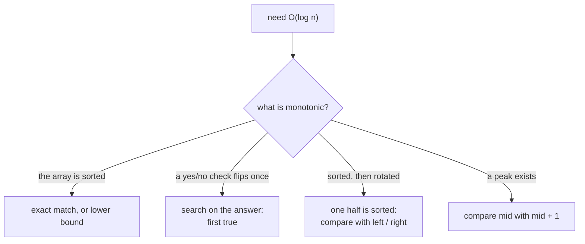

# Binary Search

> Halve the search space every step. It works on sorted data, and on any yes/no question that flips once.

**Go deeper:** `ALG 2` (all 15 notes): `2.3` binary search, `2.5` lower and upper bound, `2.7` and `2.8` rotated arrays, `2.11` search on the answer, `2.12` edge cases, `2.15` advanced. Cheat sheet: `ALG 2.99`.

#### 1. What Is It?

Binary search discards half of the candidates each step: `O(log n)`.

**Signals**

- Sorted array, or a **rotated** sorted array
- "Find the first / last position", "insert position"
- "**Minimum** value such that ...", "**maximum** value that still ...", with a yes/no check (search on the answer)
- `n` is huge (`10⁹`) or `O(log n)` is asked
- A peak or a pivot exists in the data

**Two templates (learn both)**

| Template | Loop | Use |
|---|---|---|
| Exact match | `while (left <= right)`, `mid`, `left = mid + 1` / `right = mid − 1` | find a value |
| First true (lower bound) | `while (left < right)`, `right = mid` or `left = mid + 1` | boundary, search on the answer |

#### 2. How It Works

**Exact match**

```text
[-1, 0, 3, 5, 9, 12], target 9
left=0 right=5 mid=2 (3)  < 9 → left=3
left=3 right=5 mid=4 (9)  = 9 → found at 4
```

**First true.** Imagine the answers are `F F F T T T`. You want the first `T`.

```text
left = 0, right = n            // right = n means "none are true"
while left < right:
    mid = left + (right - left) / 2
    if ok(mid): right = mid     // mid could be the answer, keep it
    else:       left = mid + 1
return left
```

**Search on the answer.** If you can write `canFinish(x)` (true for all `x` at or above some threshold), binary search `x` between the smallest and largest possible values.

```text
Koko eats bananas: piles [3,6,7,11], h = 8
speed 4: hours 1+2+2+3 = 8 ≤ 8 → ok.     speed 3: 1+2+3+4 = 10 > 8 → not ok.
answer 4
```

**Rotated array.** One half is always sorted. Check which half, then check if the target is inside it.

**Find minimum in rotated array.** Compare `nums[mid]` with `nums[right]`. If `nums[mid] > nums[right]`, the minimum is to the right.

**Picture:** What is monotonic in your problem?



#### 3. Brute Force vs Optimized

| Problem | Brute force | Binary search |
|---|---|---|
| Find in sorted array | linear `O(n)` | `O(log n)` |
| Min speed / capacity | try every value `O(n × range)` | `O(n log range)` |
| Rotated array | linear `O(n)` | `O(log n)` |

```kotlin
fun minEatingSpeedBrute(piles: IntArray, h: Int): Int {
    var speed = 1
    while (true) {
        var hours = 0L
        for (p in piles) hours += (p + speed - 1) / speed
        if (hours <= h) return speed
        speed++
    }
}
```

#### 4. Kotlin Code

```kotlin
// Binary Search (LeetCode 704)
fun search(nums: IntArray, target: Int): Int {
    var left = 0
    var right = nums.size - 1
    while (left <= right) {
        val mid = left + (right - left) / 2
        when {
            nums[mid] == target -> return mid
            nums[mid] < target -> left = mid + 1
            else -> right = mid - 1
        }
    }
    return -1
}

// Search Insert Position (LeetCode 35): lower bound
fun searchInsert(nums: IntArray, target: Int): Int {
    var left = 0
    var right = nums.size
    while (left < right) {
        val mid = left + (right - left) / 2
        if (nums[mid] >= target) right = mid else left = mid + 1
    }
    return left
}

// Find First and Last Position (LeetCode 34)
fun searchRange(nums: IntArray, target: Int): IntArray {
    fun lowerBound(x: Int): Int {                    // first index with nums[i] >= x
        var left = 0
        var right = nums.size
        while (left < right) {
            val mid = left + (right - left) / 2
            if (nums[mid] >= x) right = mid else left = mid + 1
        }
        return left
    }
    val first = lowerBound(target)
    if (first == nums.size || nums[first] != target) return intArrayOf(-1, -1)
    return intArrayOf(first, lowerBound(target + 1) - 1)
}

// Search in Rotated Sorted Array (LeetCode 33)
fun searchRotated(nums: IntArray, target: Int): Int {
    var left = 0
    var right = nums.size - 1
    while (left <= right) {
        val mid = left + (right - left) / 2
        if (nums[mid] == target) return mid
        if (nums[left] <= nums[mid]) {                                   // left half is sorted
            if (target >= nums[left] && target < nums[mid]) right = mid - 1 else left = mid + 1
        } else {                                                         // right half is sorted
            if (target > nums[mid] && target <= nums[right]) left = mid + 1 else right = mid - 1
        }
    }
    return -1
}

// Find Minimum in Rotated Sorted Array (LeetCode 153)
fun findMin(nums: IntArray): Int {
    var left = 0
    var right = nums.size - 1
    while (left < right) {
        val mid = left + (right - left) / 2
        if (nums[mid] > nums[right]) left = mid + 1 else right = mid
    }
    return nums[left]
}

// Koko Eating Bananas (LeetCode 875): search on the answer
fun minEatingSpeed(piles: IntArray, h: Int): Int {
    var left = 1
    var right = piles.maxOrNull()!!
    while (left < right) {
        val mid = left + (right - left) / 2
        var hours = 0L
        for (p in piles) hours += (p + mid - 1) / mid                     // ceil(p / mid)
        if (hours <= h) right = mid else left = mid + 1
    }
    return left
}

// Capacity To Ship Packages Within D Days (LeetCode 1011)
fun shipWithinDays(weights: IntArray, days: Int): Int {
    var left = weights.maxOrNull()!!                                              // must carry the heaviest
    var right = weights.sum()                                             // everything in one day
    while (left < right) {
        val mid = left + (right - left) / 2
        var need = 1
        var load = 0
        for (w in weights) {
            if (load + w > mid) { need++; load = 0 }
            load += w
        }
        if (need <= days) right = mid else left = mid + 1
    }
    return left
}

// Find Peak Element (LeetCode 162)
fun findPeakElement(nums: IntArray): Int {
    var left = 0
    var right = nums.size - 1
    while (left < right) {
        val mid = left + (right - left) / 2
        if (nums[mid] < nums[mid + 1]) left = mid + 1 else right = mid     // climb uphill
    }
    return left
}

// Search a 2D Matrix (LeetCode 74): treat as one sorted array
fun searchMatrix(matrix: Array<IntArray>, target: Int): Boolean {
    val cols = matrix[0].size
    var left = 0
    var right = matrix.size * cols - 1
    while (left <= right) {
        val mid = left + (right - left) / 2
        val value = matrix[mid / cols][mid % cols]
        when {
            value == target -> return true
            value < target -> left = mid + 1
            else -> right = mid - 1
        }
    }
    return false
}
```

Checks: `search([-1,0,3,5,9,12], 9)` → `4`; `(…, 2)` → `-1`. `searchInsert([1,3,5,6], 5)` → `2`; `2` → `1`; `7` → `4`; `0` → `0`. `searchRange([5,7,7,8,8,10], 8)` → `[3,4]`; `6` → `[-1,-1]`. `searchRotated([4,5,6,7,0,1,2], 0)` → `4`; `3` → `-1`. `findMin([3,4,5,1,2])` → `1`; `findMin([4,5,6,7,0,1,2])` → `0`; `findMin([11,13,15,17])` → `11`. `minEatingSpeed([3,6,7,11], 8)` → `4`; `([30,11,23,4,20], 5)` → `30`; `([30,11,23,4,20], 6)` → `23`. `shipWithinDays([1,2,3,4,5,6,7,8,9,10], 5)` → `15`. `findPeakElement([1,2,3,1])` → `2`. `searchMatrix([[1,3,5,7],[10,11,16,20],[23,30,34,60]], 3)` → `true`; `13` → `false`.

(Also know: **Time Based Key-Value Store** is a binary search for the last timestamp `≤ t` on a sorted list per key. **Median of Two Sorted Arrays** binary-searches the partition of the smaller array. It is `O(log min(m, n))` and is a Hard question.)

#### 5. Complexity

| Problem | Time | Space |
|---|---|---|
| Exact / lower bound / rotated | `O(log n)` | `O(1)` |
| Search on the answer | `O(n log range)` | `O(1)` |
| 2D matrix as 1D | `O(log(m·n))` | `O(1)` |

#### 6. Common Mistakes

1. **`mid = (left + right) / 2`.** It can overflow. Use `left + (right − left) / 2`.
2. **Infinite loop.** With `left < right` and `right = mid`, always use `left = mid + 1` on the other side.
3. **Mixing the two templates** (`<=` with `right = mid`).
4. **Wrong bounds for search on the answer.** The low end must be a feasible minimum (the heaviest package, speed 1).
5. **Rotated array:** `nums[left] <= nums[mid]` needs `<=` (one-element halves).
6. **Ceil division:** use `(p + k − 1) / k`, not `p / k`.
7. **A check function that isn't monotonic.** Binary search needs "false … false true … true".
8. **Overflow in the check** (`hours` as `Int`). Use `Long`.

#### 7. Say This in the Interview

1. "The data is sorted, so each comparison halves the range: `O(log n)`."
2. "I can't binary search the array, but the answer has a yes/no check that flips once. So I binary search the answer between `low` and `high`, and each check costs `O(n)`."
3. "In a rotated array one half is always sorted. I check if the target lies in the sorted half."

#### 8. Quick Check

1. `searchInsert([1,3,5,6], 4)` returns what?
2. For `shipWithinDays`, why is `left = max(weights)`?

<details>
<summary>Answers</summary>

1. `2` (the first element ≥ 4 is `5` at index 2).
2. A ship must carry the heaviest package at least once, so a smaller capacity is impossible.

</details>

#### 9. Related LeetCode Questions

| # | Question | Idea |
|---|---|---|
| 704 | [Binary Search](https://leetcode.com/problems/binary-search/) (Easy) | exact match |
| 35 | [Search Insert Position](https://leetcode.com/problems/search-insert-position/) (Easy) | lower bound |
| 278 | [First Bad Version](https://leetcode.com/problems/first-bad-version/) (Easy) | first true |
| 34 | [Find First and Last Position of Element in Sorted Array](https://leetcode.com/problems/find-first-and-last-position-of-element-in-sorted-array/) (Medium) | two lower bounds |
| 33 | [Search in Rotated Sorted Array](https://leetcode.com/problems/search-in-rotated-sorted-array/) (Medium) | find the sorted half |
| 153 | [Find Minimum in Rotated Sorted Array](https://leetcode.com/problems/find-minimum-in-rotated-sorted-array/) (Medium) | compare with `right` |
| 875 | [Koko Eating Bananas](https://leetcode.com/problems/koko-eating-bananas/) (Medium) | search on the answer |
| 1011 | [Capacity To Ship Packages Within D Days](https://leetcode.com/problems/capacity-to-ship-packages-within-d-days/) (Medium) | search on the answer |
| 162 | [Find Peak Element](https://leetcode.com/problems/find-peak-element/) (Medium) | go uphill |
| 74 | [Search a 2D Matrix](https://leetcode.com/problems/search-a-2d-matrix/) (Medium) | flatten the index |
| 981 | [Time Based Key-Value Store](https://leetcode.com/problems/time-based-key-value-store/) (Medium) | last value ≤ t |
| 4 | [Median of Two Sorted Arrays](https://leetcode.com/problems/median-of-two-sorted-arrays/) (Hard) | partition search |
