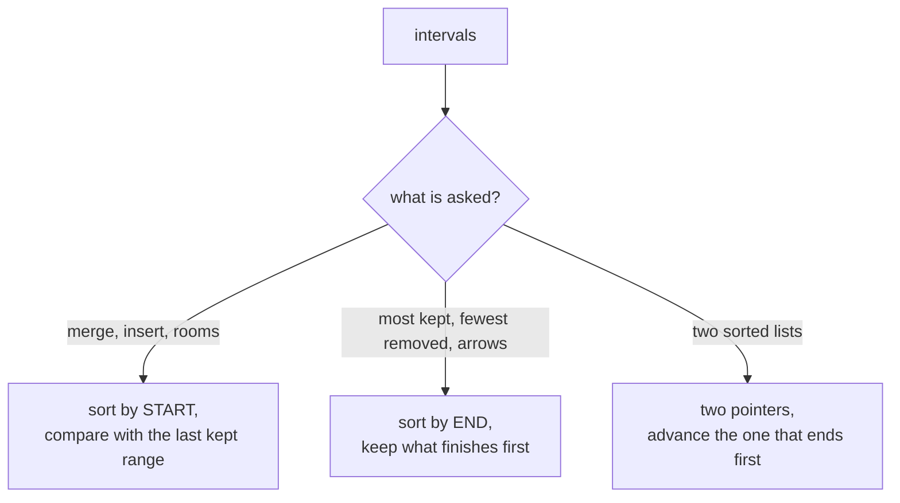

# Merge Intervals

> Sort the ranges, then scan once and compare each range with the one before it.

**Go deeper:** `ALG 1.12` (sort then sweep, meeting rooms), `ALG 4.4` (activity and interval selection), `ALG 4.3` (why sorting by end works).

#### 1. What Is It?

An interval is `[start, end]`. Most interval questions become easy after **sorting**.

**Signals**

- Meetings, bookings, schedules, ranges
- "Merge overlapping", "insert", "how many rooms", "remove the fewest to avoid overlap"
- Two lists of intervals to intersect

**Which sort?**

| Question | Sort by | Why |
|---|---|---|
| Merge, insert, rooms | **start** | overlap with the previous range is visible |
| Max non-overlapping, min removals, min arrows | **end** | keep the range that finishes first |

**Overlap test** (sorted by start): `next.start <= current.end`. Touching ranges `[1,4]` and `[4,5]` overlap for *merge*, but not for *meeting rooms* or *non-overlapping* (they use `<`). Read the statement.

#### 2. How It Works

**Merge**

```text
[[1,3],[2,6],[8,10],[15,18]]  (sorted by start)
current = [1,3]
[2,6]: 2 <= 3 → merge, end = max(3,6) = 6   → [1,6]
[8,10]: 8 > 6 → save [1,6], current = [8,10]
[15,18]: 15 > 10 → save [8,10], current = [15,18]
end → save [15,18]
answer [[1,6],[8,10],[15,18]]
```

**Min rooms with a heap.** Sort by start. Keep a min-heap of end times (the rooms in use). If the earliest end is `<=` the new start, reuse that room (pop). Push the new end. Heap size at the end is the answer.

**Sweep line.** Turn each interval into `+1` at start and `−1` at end. Sort events and keep a running total. The max total is the maximum overlap. (A difference array does the same for small ranges: Car Pooling.)

**Two lists (intersection).** Two pointers. The overlap is `[max(starts), min(ends)]` if `max(starts) <= min(ends)`. Then advance the pointer with the **smaller end**.

**Picture:** Pick the sort key from the question.



#### 3. Brute Force vs Optimized

| Problem | Brute force | Optimized |
|---|---|---|
| Merge | compare every pair repeatedly `O(n²)` | sort + scan `O(n log n)` |
| Min rooms | check overlap count at every start `O(n²)` | sort + heap `O(n log n)` |
| Max non-overlapping | all subsets `O(2ⁿ)` | sort by end, greedy `O(n log n)` |
| Intersection | all pairs `O(m·n)` | two pointers `O(m + n)` |

```kotlin
fun maxOverlapBrute(intervals: Array<IntArray>): Int {
    var best = 0
    for (a in intervals) {
        var count = 0
        for (b in intervals) if (b[0] <= a[0] && a[0] < b[1]) count++   // intervals alive at a's start
        best = maxOf(best, count)
    }
    return best
}
```

#### 4. Kotlin Code

```kotlin
import java.util.PriorityQueue

// Merge Intervals (LeetCode 56)
fun merge(intervals: Array<IntArray>): Array<IntArray> {
    if (intervals.isEmpty()) return arrayOf()
    val sorted = intervals.sortedBy { it[0] }
    val result = mutableListOf<IntArray>()
    var current = sorted[0].clone()
    for (i in 1 until sorted.size) {
        if (sorted[i][0] <= current[1]) {
            current[1] = maxOf(current[1], sorted[i][1])          // overlap: extend
        } else {
            result.add(current)
            current = sorted[i].clone()
        }
    }
    result.add(current)
    return result.toTypedArray()
}

// Insert Interval (LeetCode 57): input is already sorted
fun insert(intervals: Array<IntArray>, newInterval: IntArray): Array<IntArray> {
    val result = mutableListOf<IntArray>()
    var i = 0
    val n = intervals.size
    while (i < n && intervals[i][1] < newInterval[0]) result.add(intervals[i++])   // before
    var start = newInterval[0]
    var end = newInterval[1]
    while (i < n && intervals[i][0] <= end) {                                      // overlapping
        start = minOf(start, intervals[i][0])
        end = maxOf(end, intervals[i][1])
        i++
    }
    result.add(intArrayOf(start, end))
    while (i < n) result.add(intervals[i++])                                       // after
    return result.toTypedArray()
}

// Non-overlapping Intervals (LeetCode 435): fewest removals. Sort by END.
fun eraseOverlapIntervals(intervals: Array<IntArray>): Int {
    val sorted = intervals.sortedBy { it[1] }
    var kept = 0
    var lastEnd = Int.MIN_VALUE
    for (iv in sorted) {
        if (iv[0] >= lastEnd) { kept++; lastEnd = iv[1] }
    }
    return intervals.size - kept
}

// Minimum Number of Arrows to Burst Balloons (LeetCode 452). Sort by END.
fun findMinArrowShots(points: Array<IntArray>): Int {
    if (points.isEmpty()) return 0
    val sorted = points.sortedBy { it[1] }
    var arrows = 1
    var arrowAt = sorted[0][1]
    for (p in sorted) {
        if (p[0] > arrowAt) { arrows++; arrowAt = p[1] }
    }
    return arrows
}

// Interval List Intersections (LeetCode 986)
fun intervalIntersection(a: Array<IntArray>, b: Array<IntArray>): Array<IntArray> {
    val result = mutableListOf<IntArray>()
    var i = 0
    var j = 0
    while (i < a.size && j < b.size) {
        val lo = maxOf(a[i][0], b[j][0])
        val hi = minOf(a[i][1], b[j][1])
        if (lo <= hi) result.add(intArrayOf(lo, hi))
        if (a[i][1] < b[j][1]) i++ else j++                       // drop the one that ends first
    }
    return result.toTypedArray()
}

// Meeting Rooms II (LeetCode 253): heap of end times
fun minMeetingRooms(intervals: Array<IntArray>): Int {
    val sorted = intervals.sortedBy { it[0] }
    val ends = PriorityQueue<Int>()
    for (iv in sorted) {
        if (ends.isNotEmpty() && ends.peek() <= iv[0]) ends.poll()    // reuse a free room
        ends.add(iv[1])
    }
    return ends.size
}

// Car Pooling (LeetCode 1094): free alternative to Meeting Rooms II
fun carPooling(trips: Array<IntArray>, capacity: Int): Boolean {
    val diff = IntArray(1002)
    for ((passengers, from, to) in trips) {
        diff[from] += passengers
        diff[to] -= passengers                                    // they leave at `to`
    }
    var onBoard = 0
    for (d in diff) {
        onBoard += d
        if (onBoard > capacity) return false
    }
    return true
}
```

Checks: `merge([[1,3],[2,6],[8,10],[15,18]])` → `[[1,6],[8,10],[15,18]]`; `merge([[1,4],[4,5]])` → `[[1,5]]`. `insert([[1,3],[6,9]], [2,5])` → `[[1,5],[6,9]]`; `insert([[1,2],[3,5],[6,7],[8,10],[12,16]], [4,8])` → `[[1,2],[3,10],[12,16]]`. `eraseOverlapIntervals([[1,2],[2,3],[3,4],[1,3]])` → `1`. `findMinArrowShots([[10,16],[2,8],[1,6],[7,12]])` → `2`. `intervalIntersection([[0,2],[5,10],[13,23],[24,25]], [[1,5],[8,12],[15,24],[25,26]])` → `[[1,2],[5,5],[8,10],[15,23],[24,24],[25,25]]`. `minMeetingRooms([[0,30],[5,10],[15,20]])` → `2`. `carPooling([[2,1,5],[3,3,7]], 4)` → `false`; with capacity `5` → `true`.

#### 5. Complexity

| Problem | Time | Space |
|---|---|---|
| Merge / rooms / erase / arrows | `O(n log n)` | `O(n)` |
| Insert (sorted input) | `O(n)` | `O(n)` |
| Intersection | `O(m + n)` | `O(1)` extra |
| Car Pooling | `O(n + range)` | `O(range)` |

#### 6. Common Mistakes

1. **Sorting by start when the greedy needs end** (435, 452), or the reverse.
2. **Mutating the input interval** when extending the end. Clone first if you can't change the input.
3. **Forgetting to add the last merged interval** after the loop.
4. **Using `<` vs `<=`** wrongly on touching ranges. Check the problem statement.
5. **Updating the end with `end = next.end`** instead of `max(end, next.end)` (one interval can contain another).
6. **Subtracting in comparators** (`a[0] - b[0]`) can overflow. Use `sortedBy`.
7. **Insert Interval:** not handling a new interval that goes before everything or after everything.

#### 7. Say This in the Interview

1. "I'll sort by start time. Then any overlap is with the last interval I kept, so a single pass is enough: `O(n log n)`."
2. "To keep the most meetings I sort by end time and always take the one that finishes first. If I took a later-ending one, I could swap in the earlier one without losing anything."
3. "For the number of rooms I use a min-heap of end times. Its size is the number of rooms in use."

#### 8. Quick Check

1. What does `merge([[1,10],[2,3]])` return?
2. When do two intervals `[1,2]` and `[2,3]` count as overlapping?

<details>
<summary>Answers</summary>

1. `[[1,10]]`. The second is inside the first, so keep `max(10, 3) = 10`.
2. In Merge Intervals, yes (they share the point 2). In Non-overlapping Intervals and Meeting Rooms, no.

</details>

#### 9. Related LeetCode Questions

| # | Question | Idea |
|---|---|---|
| 56 | [Merge Intervals](https://leetcode.com/problems/merge-intervals/) (Medium) | sort by start |
| 57 | [Insert Interval](https://leetcode.com/problems/insert-interval/) (Medium) | before, overlap, after |
| 435 | [Non-overlapping Intervals](https://leetcode.com/problems/non-overlapping-intervals/) (Medium) | sort by end |
| 452 | [Minimum Number of Arrows to Burst Balloons](https://leetcode.com/problems/minimum-number-of-arrows-to-burst-balloons/) (Medium) | sort by end |
| 986 | [Interval List Intersections](https://leetcode.com/problems/interval-list-intersections/) (Medium) | two pointers |
| 1094 | [Car Pooling](https://leetcode.com/problems/car-pooling/) (Medium) | difference array |
| 253 | [Meeting Rooms II](https://leetcode.com/problems/meeting-rooms-ii/) (Medium, premium) | heap of end times |
