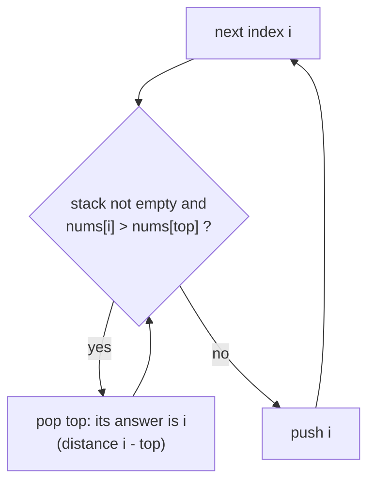

# Monotonic Stack

> A stack kept in sorted order. Each new value pops the items it beats, and every pop is an answer.

**Go deeper:** `DS Stack`, `ALG 3.7` (explicit stacks), `ALG 3.2` (the call stack and space).

#### 1. What Is It?

A **monotonic stack** keeps its values increasing (or decreasing) from bottom to top. Before pushing a new value, pop everything that breaks the order. The popped items have just found their "next greater / smaller" element: the new value.

**Signals**

- "**Next greater** element", "next smaller element"
- "How many days until a warmer temperature?"
- "Span" of consecutive smaller values (stock span)
- Largest rectangle, histogram, area between bars
- "Previous smaller", "nearest ... to the left or right"

| You want | Stack order (bottom → top) | Pop when |
|---|---|---|
| Next **greater** to the right | decreasing | `current > top` |
| Next **smaller** to the right | increasing | `current < top` |

**Store indexes, not values.** With an index you can get the value, and also the distance.

#### 2. How It Works

**Daily Temperatures** `[73, 74, 75, 71, 69, 72, 76, 73]`

```text
i=0 73: stack [0]
i=1 74: 74 > 73 → pop 0, answer[0] = 1.   stack [1]
i=2 75: pop 1, answer[1] = 1.             stack [2]
i=3 71: stack [2,3]
i=4 69: stack [2,3,4]
i=5 72: pop 4 (69) answer[4]=1, pop 3 (71) answer[3]=2.   stack [2,5]
i=6 76: pop 5 answer[5]=1, pop 2 answer[2]=4.             stack [6]
i=7 73: stack [6,7]   (never warmer → 0)
answer [1,1,4,2,1,1,0,0]
```

**Why it is `O(n)`:** every index is pushed once and popped once.

**Circular array:** loop `i` over `0 until 2n` and use `i % n`.

**Largest rectangle in a histogram.** Keep an increasing stack of bar indexes. When a shorter bar arrives, pop a taller bar: its right edge is the current index, its left edge is the new top of the stack. Width = `i − left − 1`. Add a final height of `0` to flush the stack.

**Basic stack problems first:** matching brackets and Min Stack are not monotonic, but they build the habit.

**Picture:** The monotonic stack loop. Every pop is an answer.



#### 3. Brute Force vs Optimized

| Problem | Brute force | Monotonic stack |
|---|---|---|
| Next greater / warmer day | scan right from each `i`, `O(n²)` | `O(n)` |
| Largest rectangle | try every pair of bars `O(n²)` | `O(n)` |
| Stock span | scan left for each price `O(n²)` | `O(n)` amortized |

```kotlin
fun dailyTemperaturesBrute(temps: IntArray): IntArray {
    val result = IntArray(temps.size)
    for (i in temps.indices) {
        for (j in i + 1 until temps.size) {
            if (temps[j] > temps[i]) { result[i] = j - i; break }
        }
    }
    return result
}
```

#### 4. Kotlin Code

```kotlin
// Valid Parentheses (LeetCode 20)
fun isValid(s: String): Boolean {
    val stack = ArrayDeque<Char>()
    for (c in s) {
        when (c) {
            '(', '[', '{' -> stack.addLast(c)
            else -> {
                if (stack.isEmpty()) return false
                val open = stack.removeLast()
                if ((c == ')' && open != '(') || (c == ']' && open != '[') || (c == '}' && open != '{')) return false
            }
        }
    }
    return stack.isEmpty()
}

// Daily Temperatures (LeetCode 739)
fun dailyTemperatures(temps: IntArray): IntArray {
    val result = IntArray(temps.size)
    val stack = ArrayDeque<Int>()                          // indexes with decreasing temperatures
    for (i in temps.indices) {
        while (stack.isNotEmpty() && temps[i] > temps[stack.last()]) {
            val j = stack.removeLast()
            result[j] = i - j
        }
        stack.addLast(i)
    }
    return result
}

// Next Greater Element I (LeetCode 496)
fun nextGreaterElement(nums1: IntArray, nums2: IntArray): IntArray {
    val next = HashMap<Int, Int>()                         // value -> next greater value
    val stack = ArrayDeque<Int>()
    for (x in nums2) {
        while (stack.isNotEmpty() && x > stack.last()) next[stack.removeLast()] = x
        stack.addLast(x)
    }
    return IntArray(nums1.size) { next[nums1[it]] ?: -1 }
}

// Next Greater Element II, circular (LeetCode 503)
fun nextGreaterElements(nums: IntArray): IntArray {
    val n = nums.size
    val result = IntArray(n) { -1 }
    val stack = ArrayDeque<Int>()
    for (i in 0 until 2 * n) {
        val x = nums[i % n]
        while (stack.isNotEmpty() && x > nums[stack.last()]) result[stack.removeLast()] = x
        if (i < n) stack.addLast(i)                        // push each index only once
    }
    return result
}

// Online Stock Span (LeetCode 901)
class StockSpanner {
    private val stack = ArrayDeque<IntArray>()             // [price, span]
    fun next(price: Int): Int {
        var span = 1
        while (stack.isNotEmpty() && stack.last()[0] <= price) span += stack.removeLast()[1]
        stack.addLast(intArrayOf(price, span))
        return span
    }
}

// Car Fleet (LeetCode 853)
fun carFleet(target: Int, position: IntArray, speed: IntArray): Int {
    val order = position.indices.sortedByDescending { position[it] }     // closest to target first
    var fleets = 0
    var slowestTime = 0.0
    for (i in order) {
        val time = (target - position[i]).toDouble() / speed[i]
        if (time > slowestTime) {                          // cannot catch the fleet ahead
            fleets++
            slowestTime = time
        }
    }
    return fleets
}

// Largest Rectangle in Histogram (LeetCode 84)
fun largestRectangleArea(heights: IntArray): Int {
    val stack = ArrayDeque<Int>()                          // indexes with increasing heights
    var best = 0
    for (i in 0..heights.size) {
        val h = if (i == heights.size) 0 else heights[i]   // final 0 flushes the stack
        while (stack.isNotEmpty() && heights[stack.last()] > h) {
            val height = heights[stack.removeLast()]
            val left = if (stack.isEmpty()) -1 else stack.last()
            best = maxOf(best, height * (i - left - 1))
        }
        stack.addLast(i)
    }
    return best
}
```

Checks: `isValid("()[]{}")` → `true`; `"(]"` → `false`; `"([)]"` → `false`. `dailyTemperatures([73,74,75,71,69,72,76,73])` → `[1,1,4,2,1,1,0,0]`. `nextGreaterElement([4,1,2], [1,3,4,2])` → `[-1,3,-1]`. `nextGreaterElements([1,2,1])` → `[2,-1,2]`. `StockSpanner` with prices `100, 80, 60, 70, 60, 75, 85` → `1, 1, 1, 2, 1, 4, 6`. `carFleet(12, [10,8,0,5,3], [2,4,1,1,3])` → `3`. `largestRectangleArea([2,1,5,6,2,3])` → `10`; `([2,4])` → `4`.

#### 5. Complexity

| Problem | Time | Space |
|---|---|---|
| Next greater / daily temps | `O(n)` | `O(n)` |
| Circular | `O(n)` (2n steps) | `O(n)` |
| Largest rectangle | `O(n)` | `O(n)` |

#### 6. Common Mistakes

1. **Wrong direction of the order.** Next *greater* needs a *decreasing* stack.
2. **Storing values when you need distances.** Store indexes.
3. **Using `>=` vs `>`** wrongly with equal values. Decide what equal means (Stock Span pops `<=`; Daily Temperatures pops only `>`).
4. **Forgetting to flush** remaining items at the end (histogram needs the `0` sentinel).
5. **Circular array:** pushing indexes in both rounds (duplicates).
6. **`pop` on an empty stack** (check `isNotEmpty()` first).
7. **Histogram width:** it is `i − left − 1`, not `i − popped`.

#### 7. Say This in the Interview

1. "I want the next greater element for every position. A decreasing stack of indexes does it: each new value pops all smaller values and is their answer."
2. "Each index is pushed and popped at most once, so the total is `O(n)` even though there is a `while` inside the `for`."
3. "For the histogram, when a bar is popped, the new top is its left boundary and the current index is its right boundary."

#### 8. Quick Check

1. For `[2, 1, 2]`, what is the next greater element of each (use `-1` if none)?
2. What goes wrong in the histogram if you skip the final `0` bar?

<details>
<summary>Answers</summary>

1. `[-1, 2, -1]`. The first `2` has no strictly greater element to the right.
2. Bars still on the stack never get their area calculated.

</details>

#### 9. Related LeetCode Questions

| # | Question | Idea |
|---|---|---|
| 20 | [Valid Parentheses](https://leetcode.com/problems/valid-parentheses/) (Easy) | plain stack |
| 155 | [Min Stack](https://leetcode.com/problems/min-stack/) (Medium) | stack with minimums |
| 496 | [Next Greater Element I](https://leetcode.com/problems/next-greater-element-i/) (Easy) | stack + map |
| 739 | [Daily Temperatures](https://leetcode.com/problems/daily-temperatures/) (Medium) | decreasing stack |
| 503 | [Next Greater Element II](https://leetcode.com/problems/next-greater-element-ii/) (Medium) | circular, `2n` |
| 901 | [Online Stock Span](https://leetcode.com/problems/online-stock-span/) (Medium) | stack of (price, span) |
| 853 | [Car Fleet](https://leetcode.com/problems/car-fleet/) (Medium) | sort by position, compare times |
| 84 | [Largest Rectangle in Histogram](https://leetcode.com/problems/largest-rectangle-in-histogram/) (Hard) | increasing stack |
