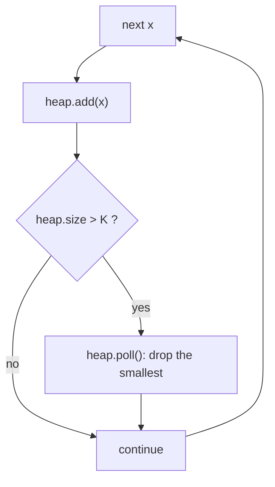

# Top K Elements

> Keep only the best K items in a heap of size K. Do not sort everything.

**Go deeper:** `DS Heap`, `ALG 1.7` (heap sort), `ALG 2.13` (quickselect), `ALG 1.10` (bucket sort: Top K Frequent in `O(n)`).

#### 1. What Is It?

A **heap** (priority queue) always gives you the smallest (min-heap) or largest (max-heap) item in `O(1)`, and updates in `O(log n)`.

**Signals**

- "**K largest**", "K smallest", "Kth largest"
- "K **most frequent**", "top K words"
- "K **closest** points"
- "Merge K sorted lists / arrays"
- "**Running median**" of a stream

**The size-K rule (this is the trick)**

| You want | Use a heap that is | Why |
|---|---|---|
| K **largest** | **min**-heap of size K | the top is the smallest of the K, so it is the one to evict |
| K **smallest** | **max**-heap of size K | the top is the largest of the K, so it is the one to evict |

After every `add`, if `size > K`, `poll()` the top. At the end the heap holds the answer. The Kth largest is the **top** of the min-heap.

#### 2. How It Works

```text
nums = [3, 2, 1, 5, 6, 4], K = 2   (2nd largest)
min-heap: add 3 → [3]
          add 2 → [2,3]
          add 1 → [1,2,3] → size 3 > 2 → poll 1 → [2,3]
          add 5 → [2,3,5] → poll 2 → [3,5]
          add 6 → poll 3 → [5,6]
          add 4 → poll 4 → [5,6]
top = 5  → the 2nd largest is 5
```

**Top K frequent.** Count with a hash map, then use a min-heap of size K ordered by count. (Or bucket sort: index = count, `O(n)`.)

**Running median: two heaps.** `low` is a max-heap for the smaller half, `high` is a min-heap for the larger half. Keep `low.size == high.size` or `low.size == high.size + 1`. The median is `low.top` (odd) or the average of both tops (even).

**Merge K sorted lists.** Put the head of each list in a min-heap, pop the smallest, push that node's next. (Code in `DS LinkedList` note 23.)

**Quickselect.** Partition like quicksort and recurse into one side only. `O(n)` average, `O(n²)` worst. Good to name, rarely required to write.

**Picture:** Top K largest with a min-heap of size K.



#### 3. Brute Force vs Optimized

| | Brute force | Heap |
|---|---|---|
| Kth largest | sort `O(n log n)` | min-heap of size K, `O(n log K)` |
| Top K frequent | sort the map `O(n log n)` | heap `O(n log K)` or buckets `O(n)` |
| Running median | re-sort after each insert `O(n log n)` per insert | two heaps `O(log n)` per insert |

```kotlin
fun findKthLargestSort(nums: IntArray, k: Int): Int = nums.sortedDescending()[k - 1]
```

#### 4. Kotlin Code

```kotlin
import java.util.PriorityQueue

// Kth Largest Element in an Array (LeetCode 215)
fun findKthLargest(nums: IntArray, k: Int): Int {
    val heap = PriorityQueue<Int>()                       // min-heap
    for (x in nums) {
        heap.add(x)
        if (heap.size > k) heap.poll()
    }
    return heap.peek()
}

// Top K Frequent Elements (LeetCode 347)
fun topKFrequent(nums: IntArray, k: Int): IntArray {
    val count = HashMap<Int, Int>()
    for (x in nums) count[x] = (count[x] ?: 0) + 1
    val heap = PriorityQueue<Int>(compareBy<Int> { count[it]!! })   // smallest count on top
    for (x in count.keys) {
        heap.add(x)
        if (heap.size > k) heap.poll()
    }
    return IntArray(k) { heap.poll() }.reversedArray()
}

// Top K Frequent Elements, bucket sort version: O(n)
fun topKFrequentBuckets(nums: IntArray, k: Int): IntArray {
    val count = HashMap<Int, Int>()
    for (x in nums) count[x] = (count[x] ?: 0) + 1
    val buckets = Array(nums.size + 1) { mutableListOf<Int>() }     // index = frequency
    for ((value, freq) in count) buckets[freq].add(value)
    val result = mutableListOf<Int>()
    for (freq in nums.size downTo 1) {
        for (v in buckets[freq]) {
            result.add(v)
            if (result.size == k) return result.toIntArray()
        }
    }
    return result.toIntArray()
}

// K Closest Points to Origin (LeetCode 973)
fun kClosest(points: Array<IntArray>, k: Int): Array<IntArray> {
    fun dist(p: IntArray) = p[0] * p[0] + p[1] * p[1]               // no sqrt needed
    val heap = PriorityQueue<IntArray>(compareByDescending<IntArray> { dist(it) })   // max-heap
    for (p in points) {
        heap.add(p)
        if (heap.size > k) heap.poll()
    }
    return heap.toTypedArray()
}

// Find Median from Data Stream (LeetCode 295)
class MedianFinder {
    private val low = PriorityQueue<Int>(compareByDescending<Int> { it })   // max-heap: smaller half
    private val high = PriorityQueue<Int>()                                 // min-heap: larger half

    fun addNum(num: Int) {
        low.add(num)
        high.add(low.poll())                              // move the largest of low to high
        if (high.size > low.size) low.add(high.poll())    // keep low the same size or one bigger
    }

    fun findMedian(): Double =
        if (low.size > high.size) low.peek().toDouble() else (low.peek() + high.peek()) / 2.0
}

// Last Stone Weight (LeetCode 1046)
fun lastStoneWeight(stones: IntArray): Int {
    val heap = PriorityQueue<Int>(compareByDescending<Int> { it })
    for (s in stones) heap.add(s)
    while (heap.size > 1) {
        val a = heap.poll()
        val b = heap.poll()
        if (a != b) heap.add(a - b)
    }
    return if (heap.isEmpty()) 0 else heap.peek()
}
```

Checks: `findKthLargest([3,2,1,5,6,4], 2)` → `5`; `([3,2,3,1,2,4,5,5,6], 4)` → `4`. `topKFrequent([1,1,1,2,2,3], 2)` → `[1, 2]` (any order is accepted). `kClosest([[1,3],[-2,2]], 1)` → `[[-2,2]]` (distances 10 and 8). `MedianFinder`: add `1`, add `2` → median `1.5`; add `3` → median `2.0`. `lastStoneWeight([2,7,4,1,8,1])` → `1`.

(Task Scheduler and Reorganize String use a max-heap of counts. See `ALG 4.13`.)

#### 5. Complexity

| Problem | Time | Space |
|---|---|---|
| Kth largest (heap) | `O(n log K)` | `O(K)` |
| Quickselect | `O(n)` average | `O(1)` |
| Top K frequent (heap) / (buckets) | `O(n log K)` / `O(n)` | `O(n)` |
| Median finder | `O(log n)` add, `O(1)` median | `O(n)` |
| Merge K lists | `O(N log K)` for `N` total nodes | `O(K)` |

#### 6. Common Mistakes

1. **Wrong heap type.** K largest needs a **min**-heap, K smallest needs a **max**-heap.
2. **Building a heap of all `n` items** when a heap of size `K` is enough.
3. **Comparator mistakes.** Max-heap by distance means `compareByDescending`.
4. **`sqrt` for distance.** Compare squared distances.
5. **Median finder:** not rebalancing, or rebalancing in the wrong direction.
6. **Heap order is not sorted order.** Iterating a `PriorityQueue` does not give sorted output. `poll()` repeatedly.
7. **Using `a - b` in a comparator**, which can overflow.

#### 7. Say This in the Interview

1. "Sorting is `O(n log n)`. A min-heap of size K gives `O(n log K)`, which is better when K is small."
2. "The heap's top is the smallest of my K largest, so it's the first to go when something bigger arrives."
3. "For a streaming median I keep two heaps: a max-heap for the lower half and a min-heap for the upper half, balanced in size."

#### 8. Quick Check

1. Which heap finds the 3 smallest numbers?
2. In `MedianFinder`, what do you return when both heaps have the same size?

<details>
<summary>Answers</summary>

1. A max-heap of size 3, so the largest of the 3 is evicted when a smaller number arrives.
2. The average of the two tops.

</details>

#### 9. Related LeetCode Questions

| # | Question | Idea |
|---|---|---|
| 1046 | [Last Stone Weight](https://leetcode.com/problems/last-stone-weight/) (Easy) | max-heap warm-up |
| 215 | [Kth Largest Element in an Array](https://leetcode.com/problems/kth-largest-element-in-an-array/) (Medium) | min-heap of size K |
| 347 | [Top K Frequent Elements](https://leetcode.com/problems/top-k-frequent-elements/) (Medium) | map + heap or buckets |
| 973 | [K Closest Points to Origin](https://leetcode.com/problems/k-closest-points-to-origin/) (Medium) | max-heap of size K |
| 621 | [Task Scheduler](https://leetcode.com/problems/task-scheduler/) (Medium) | max-heap of counts |
| 767 | [Reorganize String](https://leetcode.com/problems/reorganize-string/) (Medium) | max-heap, two letters |
| 23 | [Merge k Sorted Lists](https://leetcode.com/problems/merge-k-sorted-lists/) (Hard) | min-heap of heads |
| 295 | [Find Median from Data Stream](https://leetcode.com/problems/find-median-from-data-stream/) (Hard) | two heaps |
