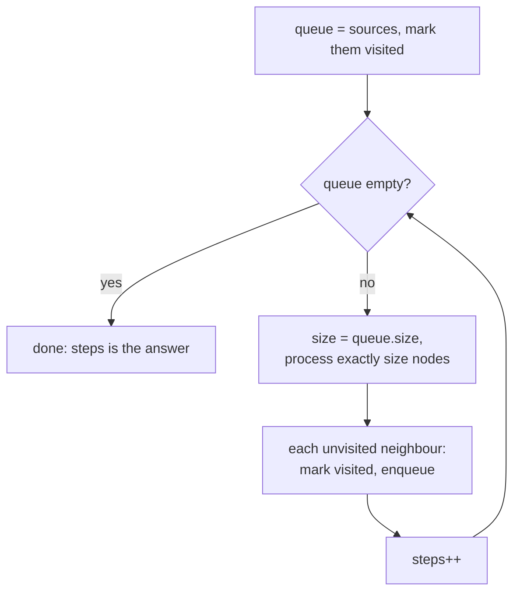

# BFS

> Explore level by level with a queue. The first time BFS reaches a node is the shortest way (when every step costs the same).

**Go deeper:** `DS Graph` (BFS, multi-source BFS, grid as a graph), `DS Queue`, `ALG 7.3` (0-1 BFS and choosing by weights), `ALG 7.6` (A* and bidirectional ideas).

#### 1. What Is It?

**Breadth-first search** visits all nodes at distance 1, then distance 2, and so on, using a **queue**.

**Signals**

- "**Shortest path**" or "minimum number of steps" with **equal** costs
- "Level order", "by level", "right side view"
- A grid with moves up, down, left, right (or 8 directions)
- "Spreads" every minute (rotting oranges, fire, flood)
- A puzzle with states (word ladder, open the lock, sliding puzzle)

**Template**

```text
queue = [start];  visited = {start}
steps = 0
while queue not empty:
    repeat size-of-queue times:          // process one whole level
        node = queue.removeFirst()
        for each neighbour not visited:
            mark visited NOW
            queue.add(neighbour)
    steps++
```

**Mark visited when you add to the queue**, not when you remove. Otherwise the same node enters the queue many times.

#### 2. How It Works

**Tree level order**

```text
      3
     / \
    9   20
       /  \
      15   7
levels: [3] → [9,20] → [15,7]
```

**Grid (Rotting Oranges).** Put **all** rotten oranges in the queue at time 0 (multi-source BFS). Each level is one minute. Count the fresh oranges and subtract as they rot.

```text
[[2,1,1],
 [1,1,0],
 [0,1,1]]
minute 1: (0,1) and (1,0) rot. minute 2: (0,2),(1,1). minute 3: (2,1). minute 4: (2,2).   → 4
```

**State BFS.** The nodes are *states* (a word, a lock combination) and the edges are the allowed moves (change one letter, turn one wheel). Same template.

**Other flavours**

| Variant | Idea |
|---|---|
| Multi-source BFS | queue starts with many sources, e.g. 01 Matrix |
| 0-1 BFS | deque: push 0-cost moves at the front, 1-cost at the back |
| Weighted edges | use Dijkstra (note 15) |
| Bidirectional BFS | search from both ends and stop when they meet |

**Picture:** BFS processes one whole level per round.



#### 3. Brute Force vs Optimized

| Problem | Brute force | BFS |
|---|---|---|
| Shortest path in a grid | try all paths with DFS, exponential | BFS, `O(rows × cols)` |
| 01 Matrix | BFS from each cell, `O((rc)²)` | one multi-source BFS, `O(rc)` |
| Word ladder | try all sequences of words, exponential | BFS over words |

DFS can find *a* path but not the *shortest* one without exploring them all.

```kotlin
fun distanceToZeroBrute(mat: Array<IntArray>, r: Int, c: Int): Int {
    var best = Int.MAX_VALUE
    for (i in mat.indices) for (j in mat[0].indices) {
        if (mat[i][j] == 0) best = minOf(best, Math.abs(i - r) + Math.abs(j - c))
    }
    return best
}
```

#### 4. Kotlin Code

```kotlin
class TreeNode(var `val`: Int) {
    var left: TreeNode? = null
    var right: TreeNode? = null
}

// Build a tree from LeetCode's level-order format. Used for checks in notes 12 and 13.
fun buildTree(vararg v: Int?): TreeNode? {
    if (v.isEmpty() || v[0] == null) return null
    val root = TreeNode(v[0]!!)
    val queue = ArrayDeque<TreeNode>()
    queue.addLast(root)
    var i = 1
    while (queue.isNotEmpty() && i < v.size) {
        val node = queue.removeFirst()
        v[i]?.let { node.left = TreeNode(it); queue.addLast(node.left!!) }
        i++
        if (i < v.size) {
            v[i]?.let { node.right = TreeNode(it); queue.addLast(node.right!!) }
            i++
        }
    }
    return root
}

// Binary Tree Level Order Traversal (LeetCode 102)
fun levelOrder(root: TreeNode?): List<List<Int>> {
    val result = mutableListOf<List<Int>>()
    if (root == null) return result
    val queue = ArrayDeque<TreeNode>()
    queue.addLast(root)
    while (queue.isNotEmpty()) {
        val level = mutableListOf<Int>()
        repeat(queue.size) {                                  // size is fixed before the loop starts
            val node = queue.removeFirst()
            level.add(node.`val`)
            node.left?.let { queue.addLast(it) }
            node.right?.let { queue.addLast(it) }
        }
        result.add(level)
    }
    return result
}

// Binary Tree Right Side View (LeetCode 199): last node of each level
fun rightSideView(root: TreeNode?): List<Int> {
    val result = mutableListOf<Int>()
    if (root == null) return result
    val queue = ArrayDeque<TreeNode>()
    queue.addLast(root)
    while (queue.isNotEmpty()) {
        val size = queue.size
        for (i in 0 until size) {
            val node = queue.removeFirst()
            if (i == size - 1) result.add(node.`val`)
            node.left?.let { queue.addLast(it) }
            node.right?.let { queue.addLast(it) }
        }
    }
    return result
}

private val DIRS = arrayOf(intArrayOf(0, 1), intArrayOf(1, 0), intArrayOf(0, -1), intArrayOf(-1, 0))

// Rotting Oranges (LeetCode 994): multi-source BFS
fun orangesRotting(grid: Array<IntArray>): Int {
    val rows = grid.size
    val cols = grid[0].size
    val queue = ArrayDeque<IntArray>()
    var fresh = 0
    for (r in 0 until rows) for (c in 0 until cols) {
        if (grid[r][c] == 2) queue.addLast(intArrayOf(r, c))
        else if (grid[r][c] == 1) fresh++
    }
    var minutes = 0
    while (queue.isNotEmpty() && fresh > 0) {
        repeat(queue.size) {
            val (r, c) = queue.removeFirst()
            for ((dr, dc) in DIRS) {
                val nr = r + dr
                val nc = c + dc
                if (nr in 0 until rows && nc in 0 until cols && grid[nr][nc] == 1) {
                    grid[nr][nc] = 2                           // rot it = mark visited
                    fresh--
                    queue.addLast(intArrayOf(nr, nc))
                }
            }
        }
        minutes++
    }
    return if (fresh == 0) minutes else -1
}

// 01 Matrix (LeetCode 542): distance to the nearest 0
fun updateMatrix(mat: Array<IntArray>): Array<IntArray> {
    val rows = mat.size
    val cols = mat[0].size
    val dist = Array(rows) { IntArray(cols) { -1 } }
    val queue = ArrayDeque<IntArray>()
    for (r in 0 until rows) for (c in 0 until cols) {
        if (mat[r][c] == 0) { dist[r][c] = 0; queue.addLast(intArrayOf(r, c)) }
    }
    while (queue.isNotEmpty()) {
        val (r, c) = queue.removeFirst()
        for ((dr, dc) in DIRS) {
            val nr = r + dr
            val nc = c + dc
            if (nr in 0 until rows && nc in 0 until cols && dist[nr][nc] == -1) {
                dist[nr][nc] = dist[r][c] + 1
                queue.addLast(intArrayOf(nr, nc))
            }
        }
    }
    return dist
}

// Shortest Path in Binary Matrix (LeetCode 1091): 8 directions
fun shortestPathBinaryMatrix(grid: Array<IntArray>): Int {
    val n = grid.size
    if (grid[0][0] == 1 || grid[n - 1][n - 1] == 1) return -1
    val visited = Array(n) { BooleanArray(n) }
    val queue = ArrayDeque<IntArray>()
    queue.addLast(intArrayOf(0, 0))
    visited[0][0] = true
    var length = 1                                             // count cells, not moves
    while (queue.isNotEmpty()) {
        repeat(queue.size) {
            val (r, c) = queue.removeFirst()
            if (r == n - 1 && c == n - 1) return length
            for (dr in -1..1) for (dc in -1..1) {
                val nr = r + dr
                val nc = c + dc
                if (nr in 0 until n && nc in 0 until n && grid[nr][nc] == 0 && !visited[nr][nc]) {
                    visited[nr][nc] = true
                    queue.addLast(intArrayOf(nr, nc))
                }
            }
        }
        length++
    }
    return -1
}

// Word Ladder (LeetCode 127): BFS over words
fun ladderLength(beginWord: String, endWord: String, wordList: List<String>): Int {
    val words = wordList.toHashSet()
    if (endWord !in words) return 0
    val queue = ArrayDeque<String>()
    queue.addLast(beginWord)
    words.remove(beginWord)
    var steps = 1
    while (queue.isNotEmpty()) {
        repeat(queue.size) {
            val word = queue.removeFirst()
            if (word == endWord) return steps
            val chars = word.toCharArray()
            for (i in chars.indices) {
                val original = chars[i]
                for (c in 'a'..'z') {
                    chars[i] = c
                    val next = String(chars)
                    if (next in words) { words.remove(next); queue.addLast(next) }   // remove = visited
                }
                chars[i] = original
            }
        }
        steps++
    }
    return 0
}

// Open the Lock (LeetCode 752): BFS over 4-digit states
fun openLock(deadends: Array<String>, target: String): Int {
    val dead = deadends.toHashSet()
    if ("0000" in dead) return -1
    val visited = hashSetOf("0000")
    val queue = ArrayDeque<String>()
    queue.addLast("0000")
    var turns = 0
    while (queue.isNotEmpty()) {
        repeat(queue.size) {
            val state = queue.removeFirst()
            if (state == target) return turns
            for (i in 0 until 4) {
                for (delta in intArrayOf(1, 9)) {                  // +1 or -1 (mod 10)
                    val chars = state.toCharArray()
                    chars[i] = '0' + ((chars[i] - '0' + delta) % 10)
                    val next = String(chars)
                    if (next !in dead && visited.add(next)) queue.addLast(next)
                }
            }
        }
        turns++
    }
    return -1
}
```

Checks: `levelOrder(buildTree(3,9,20,null,null,15,7))` → `[[3],[9,20],[15,7]]`. `rightSideView(buildTree(1,2,3,null,5,null,4))` → `[1,3,4]`. `orangesRotting([[2,1,1],[1,1,0],[0,1,1]])` → `4`; `[[2,1,1],[0,1,1],[1,0,1]]` → `-1`; `[[0,2]]` → `0`. `updateMatrix([[0,0,0],[0,1,0],[1,1,1]])` → `[[0,0,0],[0,1,0],[1,2,1]]`. `shortestPathBinaryMatrix([[0,1],[1,0]])` → `2`; `[[0,0,0],[1,1,0],[1,1,0]]` → `4`; `[[1,0,0],[1,1,0],[1,1,0]]` → `-1`. `ladderLength("hit","cog",["hot","dot","dog","lot","log","cog"])` → `5`; without `"cog"` in the list → `0`. `openLock(["0201","0101","0102","1212","2002"], "0202")` → `6`; `openLock(["8888"], "0009")` → `1`.

#### 5. Complexity

| Problem | Time | Space |
|---|---|---|
| Graph BFS | `O(V + E)` | `O(V)` |
| Grid BFS | `O(rows × cols)` | `O(rows × cols)` |
| Word Ladder | `O(N × L × 26)` for `N` words of length `L` | `O(N × L)` |
| Tree level order | `O(n)` | `O(width)` |

#### 6. Common Mistakes

1. **Marking visited on removal** instead of on adding. The queue explodes with duplicates.
2. **Not fixing the level size** before the inner loop. Read `queue.size` once, then loop.
3. **Using BFS for weighted graphs.** It is only the shortest path when every edge costs the same.
4. **Grid bounds:** check `nr in 0 until rows` before reading the cell.
5. **Rotting Oranges:** counting minutes after the last orange rots. Stop when `fresh == 0`.
6. **Binary matrix:** counting moves vs cells. The answer counts cells (start = 1).
7. **Word Ladder / lock:** forgetting that start may equal the target, or may be a dead end.
8. **Using a `List` as a queue** (`removeAt(0)` is `O(n)`). Use `ArrayDeque`.

#### 7. Say This in the Interview

1. "Every move costs 1 and I want the minimum number of moves, so BFS gives the shortest path."
2. "I add the source nodes first and process level by level. The number of levels is the answer."
3. "I mark a cell visited when I enqueue it, so each cell enters the queue once: `O(rows × cols)`."

#### 8. Quick Check

1. Why is multi-source BFS correct for the 01 Matrix?
2. In `levelOrder`, why use `repeat(queue.size)` instead of `while (queue.isNotEmpty())` inside?

<details>
<summary>Answers</summary>

1. All zeros are at distance 0, so starting from all of them at once makes the first visit to every cell the shortest distance.
2. The queue grows while you process. Fixing the size at the start of each level keeps levels separate.

</details>

#### 9. Related LeetCode Questions

| # | Question | Idea |
|---|---|---|
| 102 | [Binary Tree Level Order Traversal](https://leetcode.com/problems/binary-tree-level-order-traversal/) (Medium) | level loop |
| 199 | [Binary Tree Right Side View](https://leetcode.com/problems/binary-tree-right-side-view/) (Medium) | last of each level |
| 994 | [Rotting Oranges](https://leetcode.com/problems/rotting-oranges/) (Medium) | multi-source BFS |
| 542 | [01 Matrix](https://leetcode.com/problems/01-matrix/) (Medium) | multi-source BFS |
| 1091 | [Shortest Path in Binary Matrix](https://leetcode.com/problems/shortest-path-in-binary-matrix/) (Medium) | 8-direction grid BFS |
| 752 | [Open the Lock](https://leetcode.com/problems/open-the-lock/) (Medium) | state BFS |
| 127 | [Word Ladder](https://leetcode.com/problems/word-ladder/) (Hard) | state BFS over words |
