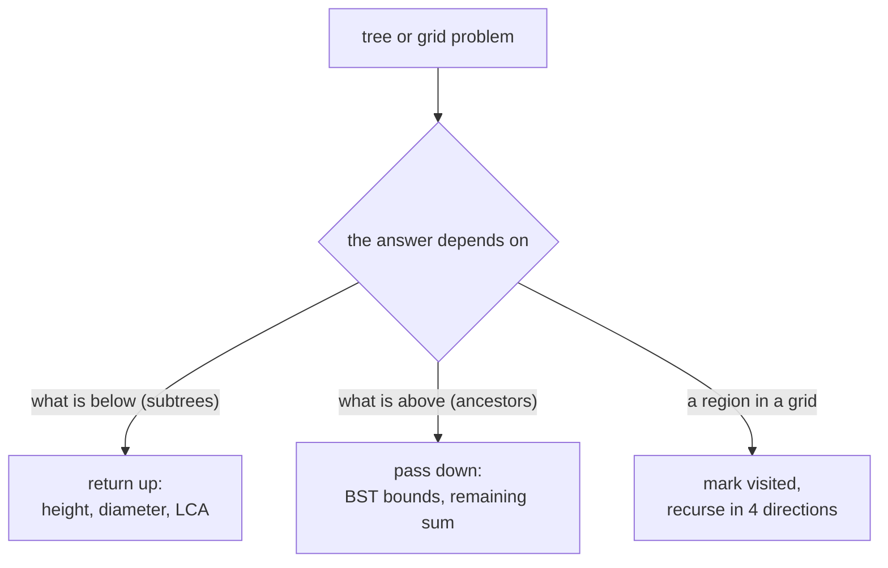

# DFS

> Go as deep as you can, then come back. Recursion does the bookkeeping for you.

**Go deeper:** `DS Tree`, `ALG 3.10` (top-down vs bottom-up recursion on trees), `ALG 3.7` (explicit stack), `ALG 3.2` (stack depth and overflow).

#### 1. What Is It?

**Depth-first search** follows one path to its end before trying another. On trees it is plain recursion. On grids and graphs it needs a `visited` set.

**Signals**

- Tree **depth, height, diameter**, path sums, "all root-to-leaf paths"
- A value computed from the **children's results** (postorder)
- **Validate** a BST, lowest common ancestor
- Grid: count or mark **regions** (islands, flood fill)
- "Does a path exist?" (not the *shortest* path)

**Two ways to pass information**

| | How | Example |
|---|---|---|
| Return up | the function returns a value about the subtree | height, sum, boolean |
| Pass down | parameters carry state from the parents | remaining sum, lower/upper bounds |

**Traversal orders**

| Order | Visit | Typical use |
|---|---|---|
| Preorder | node, left, right | copy a tree, serialize |
| Inorder | left, node, right | BST gives sorted order |
| Postorder | left, right, node | height, diameter, delete (needs children first) |

#### 2. How It Works

**Recursive template for trees**

```text
fun dfs(node):
    if node == null: return base value
    left  = dfs(node.left)
    right = dfs(node.right)
    return combine(node, left, right)
```

**Always write the base case first.** For a tree it is usually `node == null`.

**Global result.** Some answers (diameter, max path sum) are not what the function returns. The function returns the best *downward* path, and a variable outside updates the best *through-this-node* answer.

```text
Diameter: height(node) returns 1 + max(left, right)
          at each node, best = max(best, left + right)
```

**Grid DFS (Number of Islands).** For each unvisited land cell, run DFS to mark the whole island, and count 1. Mark in place (change `'1'` to `'0'`) or use a `visited` set.

**Iterative DFS.** Use an explicit stack when depth can reach `10⁵` (a skewed tree or a long chain), because deep recursion can overflow the JVM stack.

**BST.** Inorder is sorted. For validation, pass `(low, high)` bounds down.

**Picture:** Which way does the information flow?



#### 3. Brute Force vs Optimized

| Problem | Brute force | Better |
|---|---|---|
| Diameter | compute height at every node separately, `O(n²)` | one postorder pass, `O(n)` |
| Validate BST | check only `left < node < right` (wrong), or compare against every ancestor | pass `low` and `high` bounds, `O(n)` |
| Max path sum | try every pair of nodes | postorder with a global best, `O(n)` |

```kotlin
fun height(node: TreeNode?): Int =
    if (node == null) 0 else 1 + maxOf(height(node.left), height(node.right))

// Diameter, brute force: recomputes heights at every node, O(n²) on a skewed tree
fun diameterBrute(node: TreeNode?): Int {
    if (node == null) return 0
    val through = height(node.left) + height(node.right)
    return maxOf(through, diameterBrute(node.left), diameterBrute(node.right))
}
```

#### 4. Kotlin Code

`TreeNode` and `buildTree` are in note 12.

```kotlin
// Maximum Depth of Binary Tree (LeetCode 104)
fun maxDepth(root: TreeNode?): Int {
    if (root == null) return 0
    return 1 + maxOf(maxDepth(root.left), maxDepth(root.right))
}

// Invert Binary Tree (LeetCode 226)
fun invertTree(root: TreeNode?): TreeNode? {
    if (root == null) return null
    val left = invertTree(root.left)
    val right = invertTree(root.right)
    root.left = right
    root.right = left
    return root
}

fun preorder(root: TreeNode?): List<Int> =
    if (root == null) emptyList() else listOf(root.`val`) + preorder(root.left) + preorder(root.right)

// Path Sum (LeetCode 112): pass the remaining sum down
fun hasPathSum(root: TreeNode?, target: Int): Boolean {
    if (root == null) return false
    if (root.left == null && root.right == null) return root.`val` == target     // leaf
    val remaining = target - root.`val`
    return hasPathSum(root.left, remaining) || hasPathSum(root.right, remaining)
}

// Validate Binary Search Tree (LeetCode 98): pass bounds down (Long avoids Int.MIN/MAX issues)
fun isValidBST(root: TreeNode?): Boolean {
    fun check(node: TreeNode?, low: Long, high: Long): Boolean {
        if (node == null) return true
        if (node.`val` <= low || node.`val` >= high) return false
        return check(node.left, low, node.`val`.toLong()) && check(node.right, node.`val`.toLong(), high)
    }
    return check(root, Long.MIN_VALUE, Long.MAX_VALUE)
}

// Lowest Common Ancestor of a Binary Tree (LeetCode 236)
// LeetCode passes nodes; we compare values to keep the demo short.
fun lowestCommonAncestor(root: TreeNode?, p: Int, q: Int): TreeNode? {
    if (root == null || root.`val` == p || root.`val` == q) return root
    val left = lowestCommonAncestor(root.left, p, q)
    val right = lowestCommonAncestor(root.right, p, q)
    return if (left != null && right != null) root else left ?: right
}

// Diameter of Binary Tree (LeetCode 543): global best, function returns height
fun diameterOfBinaryTree(root: TreeNode?): Int {
    var best = 0
    fun height(node: TreeNode?): Int {
        if (node == null) return 0
        val left = height(node.left)
        val right = height(node.right)
        best = maxOf(best, left + right)               // longest path through this node
        return 1 + maxOf(left, right)
    }
    height(root)
    return best
}

// Binary Tree Maximum Path Sum (LeetCode 124)
fun maxPathSum(root: TreeNode?): Int {
    var best = Int.MIN_VALUE
    fun gain(node: TreeNode?): Int {
        if (node == null) return 0
        val left = maxOf(0, gain(node.left))           // ignore a negative branch
        val right = maxOf(0, gain(node.right))
        best = maxOf(best, node.`val` + left + right)  // path that bends at this node
        return node.`val` + maxOf(left, right)         // path that continues upward
    }
    gain(root)
    return best
}

// Kth Smallest Element in a BST (LeetCode 230): iterative inorder
fun kthSmallest(root: TreeNode?, k: Int): Int {
    val stack = ArrayDeque<TreeNode>()
    var cur = root
    var remaining = k
    while (cur != null || stack.isNotEmpty()) {
        while (cur != null) { stack.addLast(cur); cur = cur.left }
        val node = stack.removeLast()
        remaining--
        if (remaining == 0) return node.`val`
        cur = node.right
    }
    return -1
}

// Number of Islands (LeetCode 200): grid DFS, mark in place
fun numIslands(grid: Array<CharArray>): Int {
    val rows = grid.size
    val cols = grid[0].size
    fun sink(r: Int, c: Int) {
        if (r !in 0 until rows || c !in 0 until cols || grid[r][c] != '1') return
        grid[r][c] = '0'
        sink(r + 1, c); sink(r - 1, c); sink(r, c + 1); sink(r, c - 1)
    }
    var count = 0
    for (r in 0 until rows) for (c in 0 until cols) {
        if (grid[r][c] == '1') { count++; sink(r, c) }
    }
    return count
}
```

Checks (trees from `buildTree`): `maxDepth(buildTree(3,9,20,null,null,15,7))` → `3`. `preorder(invertTree(buildTree(4,2,7,1,3,6,9)))` → `[4,7,9,6,2,3,1]`. `hasPathSum(buildTree(5,4,8,11,null,13,4,7,2,null,null,null,1), 22)` → `true`; with `5` → `false`. `isValidBST(buildTree(2,1,3))` → `true`; `buildTree(5,1,4,null,null,3,6)` → `false`. `lowestCommonAncestor(buildTree(3,5,1,6,2,0,8,null,null,7,4), 5, 1).val` → `3`; with `(5, 4)` → `5`. `diameterOfBinaryTree(buildTree(1,2,3,4,5))` → `3`. `maxPathSum(buildTree(-10,9,20,null,null,15,7))` → `42`; `buildTree(1,2,3)` → `6`. `kthSmallest(buildTree(3,1,4,null,2), 1)` → `1`. `numIslands` of `["11000","11000","00100","00011"]` as `CharArray` rows → `3`.

#### 5. Complexity

| Problem | Time | Space |
|---|---|---|
| Tree DFS | `O(n)` | `O(h)` stack, `h` = height (`O(n)` worst, `O(log n)` balanced) |
| Grid DFS | `O(rows × cols)` | `O(rows × cols)` worst-case stack |
| Kth smallest (inorder) | `O(h + k)` | `O(h)` |

#### 6. Common Mistakes

1. **No base case**, or a base case in the wrong order (leaf check before `null` check).
2. **Path Sum:** returning `true` at a `null` child. Only a **leaf** counts.
3. **Validate BST:** comparing only with the parent. Pass bounds.
4. **BST bounds with `Int.MIN_VALUE` / `MAX_VALUE`** as sentinels. Use `Long`, or `null`.
5. **Diameter:** returning the diameter from the recursive function instead of the height.
6. **Max path sum:** not ignoring negative branches (`max(0, ...)`).
7. **Grid:** reading `grid[r][c]` before the bounds check.
8. **Stack overflow** on a skewed tree of `10⁵` nodes. Convert to an explicit stack.
9. **Copying state** in each call when you only need a parameter.

#### 7. Say This in the Interview

1. "I'll use recursion. The base case is a null node. For each node I combine the results of the left and right subtrees."
2. "The function returns the height. A separate variable tracks the best path through each node, so each node is visited once: `O(n)`."
3. "Space is `O(h)` for the recursion stack: `O(log n)` if balanced, `O(n)` if skewed."

#### 8. Quick Check

1. What is the diameter of a single node?
2. Why does `isValidBST` pass `low` and `high` instead of checking children only?

<details>
<summary>Answers</summary>

1. `0` edges (the diameter here counts edges).
2. A node deep in the left subtree must also be smaller than every ancestor above it. Parent-only checks miss that.

</details>

#### 9. Related LeetCode Questions

| # | Question | Idea |
|---|---|---|
| 104 | [Maximum Depth of Binary Tree](https://leetcode.com/problems/maximum-depth-of-binary-tree/) (Easy) | return up |
| 226 | [Invert Binary Tree](https://leetcode.com/problems/invert-binary-tree/) (Easy) | swap children |
| 112 | [Path Sum](https://leetcode.com/problems/path-sum/) (Easy) | pass down |
| 543 | [Diameter of Binary Tree](https://leetcode.com/problems/diameter-of-binary-tree/) (Easy) | global best |
| 98 | [Validate Binary Search Tree](https://leetcode.com/problems/validate-binary-search-tree/) (Medium) | bounds |
| 236 | [Lowest Common Ancestor of a Binary Tree](https://leetcode.com/problems/lowest-common-ancestor-of-a-binary-tree/) (Medium) | postorder |
| 200 | [Number of Islands](https://leetcode.com/problems/number-of-islands/) (Medium) | grid DFS |
| 230 | [Kth Smallest Element in a BST](https://leetcode.com/problems/kth-smallest-element-in-a-bst/) (Medium) | inorder |
| 124 | [Binary Tree Maximum Path Sum](https://leetcode.com/problems/binary-tree-maximum-path-sum/) (Hard) | gain + global best |
