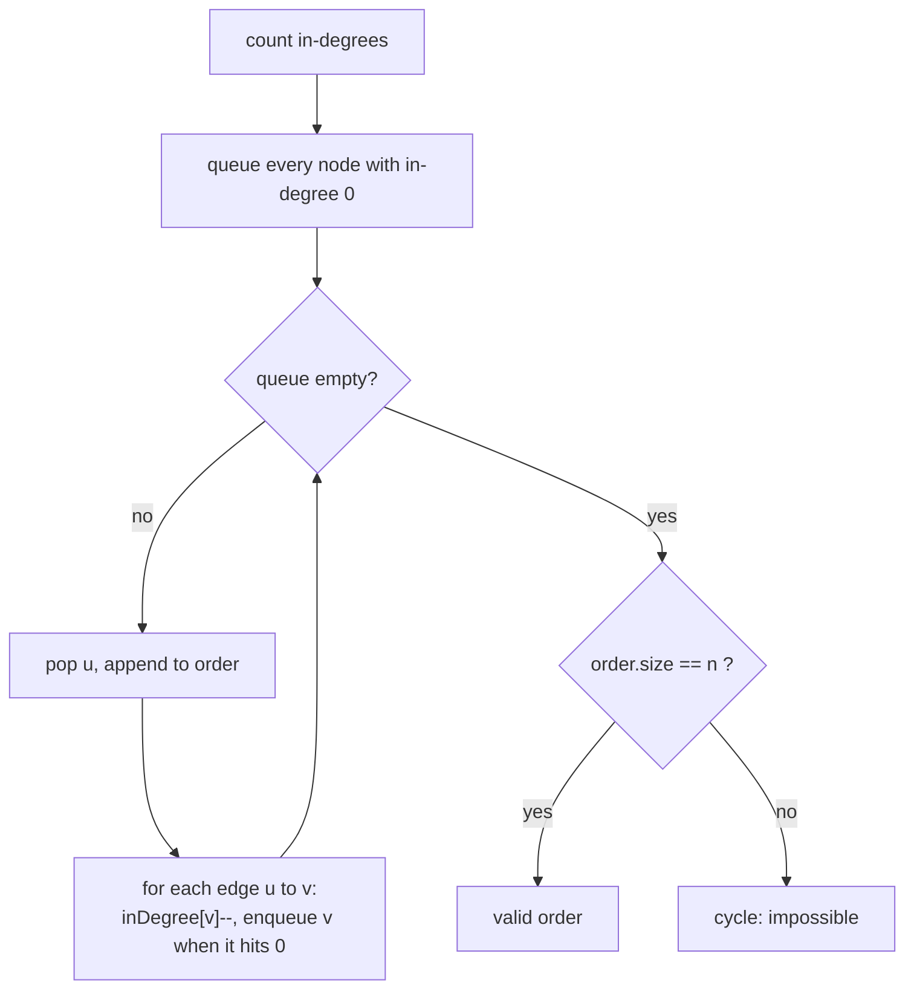

# Topological Sort

> Order the nodes so every dependency comes before the thing that needs it. If you can't, there is a cycle.

**Go deeper:** `DS Graph` (topological sort, Kahn's algorithm, DAG problems, dependency graphs). Shortest path in a DAG: `ALG 7.3`.

#### 1. What Is It?

A **topological order** of a directed graph lists the nodes so that for every edge `a → b`, `a` comes before `b`. It exists only for a **DAG** (directed acyclic graph).

**Signals**

- "Prerequisites", "dependencies", "build order"
- "Can all courses be finished?" (is there a cycle?)
- "Return a valid order of tasks"
- "Order the letters of an alien language"
- Layers of work that can run in parallel

**Two methods**

| Method | Idea |
|---|---|
| **Kahn's algorithm (BFS)** | repeat: take nodes with **in-degree 0**, output them, remove their outgoing edges |
| **DFS (reverse postorder)** | finish a node after all its dependants, then reverse the finish order. Needs cycle colours |

#### 2. How It Works

**Kahn's algorithm**

```text
Edges: 0→1, 0→2, 1→3, 2→3        in-degree: 0:0  1:1  2:1  3:2
queue = [0]
take 0 → order [0];   1 and 2 drop to 0 → queue [1,2]
take 1 → order [0,1]; 3 drops to 1
take 2 → order [0,1,2]; 3 drops to 0 → queue [3]
take 3 → order [0,1,2,3]
```

**Cycle test.** If the output has fewer than `n` nodes, some nodes never reached in-degree 0, so there is a cycle.

**Building the graph.** For prerequisite pair `[a, b]` ("take `b` before `a`") add the edge `b → a` and `inDegree[a]++`.

**Variants**

| Variant | Change |
|---|---|
| Lexicographically smallest order | use a min-heap instead of a queue |
| Number of levels / parallel steps (Parallel Courses) | process one whole queue level per step, count levels |
| Alien Dictionary | compare adjacent words, the first differing letters give an edge |
| Minimum Height Trees | trim leaves layer by layer; the last 1 or 2 nodes are the roots |

**DFS version.** Run DFS. After visiting all neighbours, push the node on a stack. Reverse the finish order. Use colours (0 new, 1 in path, 2 done) to detect a cycle.

**Picture:** Kahn's algorithm.



#### 3. Brute Force vs Optimized

| Problem | Brute force | Topological sort |
|---|---|---|
| Can all courses finish? | try every order, `O(n!)` | Kahn / DFS cycle check, `O(V + E)` |
| Find a valid order | repeatedly scan all nodes for one with no remaining prerequisites, `O(V² + VE)` | queue of in-degree 0, `O(V + E)` |

```kotlin
// Brute force: scan for a free node over and over
fun findOrderBrute(n: Int, prerequisites: Array<IntArray>): IntArray {
    val done = BooleanArray(n)
    val order = mutableListOf<Int>()
    repeat(n) {
        var picked = -1
        for (course in 0 until n) {
            if (done[course]) continue
            val free = prerequisites.none { it[0] == course && !done[it[1]] }
            if (free) { picked = course; break }
        }
        if (picked == -1) return intArrayOf()
        done[picked] = true
        order.add(picked)
    }
    return order.toIntArray()
}
```

#### 4. Kotlin Code

```kotlin
import java.util.PriorityQueue

// Course Schedule II (LeetCode 210): Kahn's algorithm. Returns empty if there is a cycle.
fun findOrder(numCourses: Int, prerequisites: Array<IntArray>): IntArray {
    val graph = Array(numCourses) { mutableListOf<Int>() }
    val inDegree = IntArray(numCourses)
    for ((course, pre) in prerequisites) {
        graph[pre].add(course)                       // pre -> course
        inDegree[course]++
    }
    val queue = ArrayDeque<Int>()
    for (i in 0 until numCourses) if (inDegree[i] == 0) queue.addLast(i)
    val order = IntArray(numCourses)
    var count = 0
    while (queue.isNotEmpty()) {
        val node = queue.removeFirst()
        order[count++] = node
        for (next in graph[node]) {
            if (--inDegree[next] == 0) queue.addLast(next)
        }
    }
    return if (count == numCourses) order else intArrayOf()
}

// Course Schedule (LeetCode 207)
fun canFinish(numCourses: Int, prerequisites: Array<IntArray>): Boolean =
    findOrder(numCourses, prerequisites).size == numCourses

// DFS version of Course Schedule II: reverse postorder with colours
fun findOrderDfs(numCourses: Int, prerequisites: Array<IntArray>): IntArray {
    val graph = Array(numCourses) { mutableListOf<Int>() }
    for ((course, pre) in prerequisites) graph[pre].add(course)
    val state = IntArray(numCourses)                 // 0 new, 1 in path, 2 done
    val finished = mutableListOf<Int>()
    fun dfs(node: Int): Boolean {                    // returns false on a cycle
        state[node] = 1
        for (next in graph[node]) {
            if (state[next] == 1) return false
            if (state[next] == 0 && !dfs(next)) return false
        }
        state[node] = 2
        finished.add(node)
        return true
    }
    for (i in 0 until numCourses) if (state[i] == 0 && !dfs(i)) return intArrayOf()
    return finished.reversed().toIntArray()
}

// Alien Dictionary (LeetCode 269, premium)
fun alienOrder(words: Array<String>): String {
    val present = BooleanArray(26)
    for (w in words) for (c in w) present[c - 'a'] = true
    val graph = Array(26) { mutableSetOf<Int>() }
    val inDegree = IntArray(26)
    for (i in 0 until words.size - 1) {
        val a = words[i]
        val b = words[i + 1]
        if (a.length > b.length && a.startsWith(b)) return ""          // "abc" before "ab" is invalid
        for (j in 0 until minOf(a.length, b.length)) {
            if (a[j] != b[j]) {
                if (graph[a[j] - 'a'].add(b[j] - 'a')) inDegree[b[j] - 'a']++
                break                                                  // only the first difference counts
            }
        }
    }
    val queue = ArrayDeque<Int>()
    var letters = 0
    for (c in 0 until 26) if (present[c]) { letters++; if (inDegree[c] == 0) queue.addLast(c) }
    val sb = StringBuilder()
    while (queue.isNotEmpty()) {
        val c = queue.removeFirst()
        sb.append('a' + c)
        for (next in graph[c]) if (--inDegree[next] == 0) queue.addLast(next)
    }
    return if (sb.length == letters) sb.toString() else ""
}

// Minimum Height Trees (LeetCode 310): trim leaves
fun findMinHeightTrees(n: Int, edges: Array<IntArray>): List<Int> {
    if (n <= 2) return (0 until n).toList()
    val graph = Array(n) { mutableListOf<Int>() }
    val degree = IntArray(n)
    for ((a, b) in edges) { graph[a].add(b); graph[b].add(a); degree[a]++; degree[b]++ }
    var leaves = ArrayDeque<Int>()
    for (i in 0 until n) if (degree[i] == 1) leaves.addLast(i)
    var remaining = n
    while (remaining > 2) {
        remaining -= leaves.size
        val nextLeaves = ArrayDeque<Int>()
        for (leaf in leaves) {
            for (nb in graph[leaf]) {
                if (--degree[nb] == 1) nextLeaves.addLast(nb)
            }
        }
        leaves = nextLeaves
    }
    return leaves.toList()
}

// Lexicographically smallest topological order: heap instead of queue
fun smallestOrder(n: Int, edges: Array<IntArray>): List<Int> {
    val graph = Array(n) { mutableListOf<Int>() }
    val inDegree = IntArray(n)
    for ((a, b) in edges) { graph[a].add(b); inDegree[b]++ }
    val heap = PriorityQueue<Int>()
    for (i in 0 until n) if (inDegree[i] == 0) heap.add(i)
    val order = mutableListOf<Int>()
    while (heap.isNotEmpty()) {
        val node = heap.poll()
        order.add(node)
        for (next in graph[node]) if (--inDegree[next] == 0) heap.add(next)
    }
    return if (order.size == n) order else emptyList()
}
```

Checks: `canFinish(2, [[1,0]])` → `true`; `canFinish(2, [[1,0],[0,1]])` → `false`. `findOrder(4, [[1,0],[2,0],[3,1],[3,2]])` → `[0,1,2,3]`. `findOrderDfs(4, [[1,0],[2,0],[3,1],[3,2]])` → `[0,2,1,3]` (also valid; any topological order is accepted). `alienOrder(["wrt","wrf","er","ett","rftt"])` → `"wertf"`; `alienOrder(["abc","ab"])` → `""`. `findMinHeightTrees(4, [[1,0],[1,2],[1,3]])` → `[1]`; `findMinHeightTrees(6, [[3,0],[3,1],[3,2],[3,4],[5,4]])` → `[3,4]`. `smallestOrder(4, [[2,0],[3,1]])` → `[2,0,3,1]`.

(Find All Possible Recipes, LeetCode 2115, is Kahn's algorithm where recipes depend on ingredients. Count a recipe when its in-degree reaches 0.)

#### 5. Complexity

| Problem | Time | Space |
|---|---|---|
| Kahn / DFS topological sort | `O(V + E)` | `O(V + E)` |
| With a min-heap | `O((V + E) log V)` | `O(V + E)` |
| Alien Dictionary | `O(total characters)` | `O(1)` (26 letters) |
| Minimum Height Trees | `O(V + E)` | `O(V + E)` |

#### 6. Common Mistakes

1. **Edge direction reversed.** For `[a, b]` ("`b` first") the edge is `b → a`.
2. **Not checking the cycle.** Compare the output size to `n`.
3. **Starting with one node.** Put every in-degree-0 node in the queue first.
4. **Using the undirected "parent" trick** for cycles. Directed graphs need colours or in-degrees.
5. **Alien Dictionary:** using more than the *first* differing letter, missing the invalid-prefix case, or ignoring letters that appear in no edge.
6. **Duplicate edges** increase the in-degree twice. Use a set per node.
7. **Assuming the order is unique.** Many orders can be valid. Don't compare exact output unless the problem says so.

#### 7. Say This in the Interview

1. "This is a dependency problem on a directed graph, so I want a topological order. If there is a cycle, no order exists."
2. "I count in-degrees, start from nodes with zero, and remove edges as I go (Kahn). If I output fewer than `n` nodes there is a cycle."
3. "Time and space are `O(V + E)`."

#### 8. Quick Check

1. For `numCourses = 3`, `prerequisites = [[1,0],[2,1]]`, what order does Kahn give?
2. What does it mean if the output has fewer than `n` nodes?

<details>
<summary>Answers</summary>

1. `[0, 1, 2]` (edges `0→1`, `1→2`).
2. The remaining nodes are on or behind a cycle, so the graph is not a DAG and the answer is "impossible".

</details>

#### 9. Related LeetCode Questions

| # | Question | Idea |
|---|---|---|
| 207 | [Course Schedule](https://leetcode.com/problems/course-schedule/) (Medium) | cycle check |
| 210 | [Course Schedule II](https://leetcode.com/problems/course-schedule-ii/) (Medium) | Kahn's order |
| 310 | [Minimum Height Trees](https://leetcode.com/problems/minimum-height-trees/) (Medium) | trim leaves |
| 2115 | [Find All Possible Recipes from Given Supplies](https://leetcode.com/problems/find-all-possible-recipes-from-given-supplies/) (Medium) | Kahn on ingredients |
| 269 | [Alien Dictionary](https://leetcode.com/problems/alien-dictionary/) (Hard, premium) | letters as nodes |
