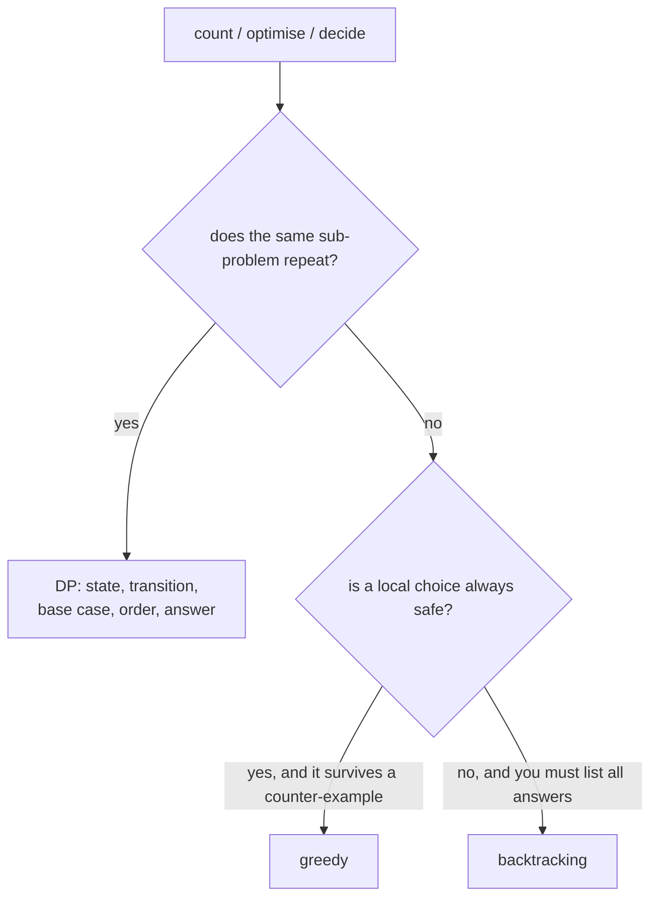

# Dynamic Programming

> Solve a big problem from smaller ones, and remember each answer so you never solve the same small problem twice.

**Go deeper:** `ALG 5` (all 15 notes): `5.3` the four steps, `5.13` LIS, `5.14` unbounded knapsack, `5.15` DP vs greedy vs backtracking; `ALG 3.8` (memoization). Cheat sheet: `ALG 5.99`.

#### 1. What Is It?

**Dynamic programming (DP)** works when a problem has:

- **Overlapping subproblems:** the same smaller problem appears many times.
- **Optimal substructure:** the best answer is built from best answers to smaller parts.

**Signals**

- "**Count the ways** to ..."
- "**Minimum / maximum** cost / length / profit" with choices at each step
- "Is it **possible** to ...?" (true/false DP)
- A brute-force recursion that repeats the same arguments
- Greedy fails on a small example (note 19)

**Five steps (say these out loud)**

1. **State:** what does `dp[i]` (or `dp[i][j]`) mean? Write it in one sentence.
2. **Transition:** how does a state come from smaller states?
3. **Base case:** the smallest states you know directly.
4. **Order:** fill so that the states you need already exist.
5. **Answer:** which cell holds the result?

**Families**

| Family | State | Examples |
|---|---|---|
| 1D linear | `dp[i]` = best using the first `i` items | stairs, house robber, coin change |
| Grid | `dp[r][c]` | unique paths, min path sum |
| Two strings | `dp[i][j]` = first `i` of A, first `j` of B | LCS, edit distance |
| Knapsack / subset | `dp[w]` = reachable or best with capacity `w` | partition, coin change II, target sum |
| Subsequence | `dp[i]` = best ending at `i` | LIS |
| State machine | `hold`, `sold`, `rest` | stock with cooldown |
| Interval / bitmask | `dp[l][r]`, `dp[mask]` | names only for interviews at this level |

#### 2. How It Works

**From recursion to DP: Climbing Stairs.** You climb 1 or 2 steps. Ways to reach step `n`?

```text
ways(n) = ways(n−1) + ways(n−2)           base: ways(1)=1, ways(2)=2
```

| Version | Idea | Time | Space |
|---|---|---|---|
| Plain recursion | recompute every call | `O(2ⁿ)` | `O(n)` stack |
| Top-down (memoization) | cache each `ways(i)` | `O(n)` | `O(n)` |
| Bottom-up (tabulation) | fill `dp[1..n]` | `O(n)` | `O(n)` |
| Space-optimized | keep only the last two values | `O(n)` | `O(1)` |

**Knapsack style (Coin Change).** `dp[a]` = fewest coins to make amount `a`.

```text
coins [1,2,5], amount 11
dp[0]=0
dp[a] = 1 + min(dp[a − coin]) over coins ≤ a
dp: 0 1 1 2 2 1 2 2 3 3 2 3        → dp[11] = 3 (5+5+1)
```

**Two strings (LCS).** If `a[i] == b[j]`, `dp[i][j] = dp[i−1][j−1] + 1`. Else `max(dp[i−1][j], dp[i][j−1])`.

**Space optimization.** If `dp[i]` depends only on the previous row or the last two values, keep only those.

**Why greedy is not enough:** coins `{1,3,4}`, amount 6. Greedy picks 4+1+1 (3 coins). DP finds 3+3 (2 coins).

**Picture:** DP, greedy or backtracking?



#### 3. Brute Force vs Optimized

| Problem | Brute force | DP |
|---|---|---|
| Climbing stairs | `O(2ⁿ)` recursion | `O(n)`, `O(1)` space |
| Coin change | try all combinations, `O(coins^amount)` | `O(amount × coins)` |
| LCS | all subsequences `O(2ⁿ)` | `O(m × n)` |
| House robber | try all subsets without adjacent houses | `O(n)` |

```kotlin
// Brute force recursion: ways(n) = ways(n-1) + ways(n-2). O(2^n)
fun climbStairsRecursive(n: Int): Int =
    if (n <= 2) n else climbStairsRecursive(n - 1) + climbStairsRecursive(n - 2)

// Top-down: same recursion plus a cache. O(n)
fun climbStairsMemo(n: Int, memo: IntArray = IntArray(n + 1)): Int {
    if (n <= 2) return n
    if (memo[n] != 0) return memo[n]
    memo[n] = climbStairsMemo(n - 1, memo) + climbStairsMemo(n - 2, memo)
    return memo[n]
}

// Coin change brute force: try every coin at every step. Exponential.
fun coinChangeBrute(coins: IntArray, amount: Int): Int {
    if (amount == 0) return 0
    if (amount < 0) return -1
    var best = -1
    for (c in coins) {
        val sub = coinChangeBrute(coins, amount - c)
        if (sub >= 0 && (best == -1 || sub + 1 < best)) best = sub + 1
    }
    return best
}
```

#### 4. Kotlin Code

```kotlin
// Climbing Stairs (LeetCode 70): bottom-up, O(1) space
fun climbStairs(n: Int): Int {
    if (n <= 2) return n
    var a = 1
    var b = 2
    for (i in 3..n) { val c = a + b; a = b; b = c }
    return b
}

// House Robber (LeetCode 198): dp[i] = max(dp[i-1], dp[i-2] + nums[i])
fun rob(nums: IntArray): Int {
    var prev2 = 0
    var prev1 = 0
    for (x in nums) {
        val cur = maxOf(prev1, prev2 + x)
        prev2 = prev1
        prev1 = cur
    }
    return prev1
}

// Coin Change (LeetCode 322)
fun coinChange(coins: IntArray, amount: Int): Int {
    val dp = IntArray(amount + 1) { amount + 1 }               // amount + 1 = "impossible"
    dp[0] = 0
    for (a in 1..amount) {
        for (c in coins) if (c <= a) dp[a] = minOf(dp[a], dp[a - c] + 1)
    }
    return if (dp[amount] > amount) -1 else dp[amount]
}

// Coin Change II (LeetCode 518): number of combinations
fun change(amount: Int, coins: IntArray): Int {
    val dp = IntArray(amount + 1)
    dp[0] = 1
    for (c in coins) {                                         // coins in the OUTER loop = combinations
        for (a in c..amount) dp[a] += dp[a - c]
    }
    return dp[amount]
}

// Maximum Subarray, Kadane (LeetCode 53)
fun maxSubArray(nums: IntArray): Int {
    var cur = nums[0]
    var best = nums[0]
    for (i in 1 until nums.size) {
        cur = maxOf(nums[i], cur + nums[i])                    // extend or restart
        best = maxOf(best, cur)
    }
    return best
}

// Unique Paths (LeetCode 62): one row of dp
fun uniquePaths(m: Int, n: Int): Int {
    val dp = IntArray(n) { 1 }
    for (i in 1 until m) for (j in 1 until n) dp[j] += dp[j - 1]
    return dp[n - 1]
}

// Minimum Path Sum (LeetCode 64)
fun minPathSum(grid: Array<IntArray>): Int {
    val n = grid[0].size
    val dp = IntArray(n)
    for (i in grid.indices) {
        for (j in 0 until n) {
            dp[j] = when {
                i == 0 && j == 0 -> grid[0][0]
                i == 0 -> dp[j - 1] + grid[0][j]
                j == 0 -> dp[0] + grid[i][0]
                else -> minOf(dp[j], dp[j - 1]) + grid[i][j]
            }
        }
    }
    return dp[n - 1]
}

// Longest Increasing Subsequence (LeetCode 300): O(n^2)
fun lengthOfLIS(nums: IntArray): Int {
    val dp = IntArray(nums.size) { 1 }                         // best length ending at i
    for (i in nums.indices) {
        for (j in 0 until i) if (nums[j] < nums[i]) dp[i] = maxOf(dp[i], dp[j] + 1)
    }
    return dp.maxOrNull() ?: 0
}

// LIS in O(n log n): tails[k] = smallest tail of an increasing subsequence of length k + 1
fun lengthOfLISFast(nums: IntArray): Int {
    val tails = IntArray(nums.size)
    var size = 0
    for (x in nums) {
        var lo = 0
        var hi = size
        while (lo < hi) {
            val mid = (lo + hi) / 2
            if (tails[mid] < x) lo = mid + 1 else hi = mid
        }
        tails[lo] = x
        if (lo == size) size++
    }
    return size
}

// Word Break (LeetCode 139)
fun wordBreak(s: String, wordDict: List<String>): Boolean {
    val dp = BooleanArray(s.length + 1)
    dp[0] = true
    for (i in 1..s.length) {
        for (w in wordDict) {
            val start = i - w.length
            if (start >= 0 && dp[start] && s.startsWith(w, start)) { dp[i] = true; break }
        }
    }
    return dp[s.length]
}

// Longest Common Subsequence (LeetCode 1143)
fun longestCommonSubsequence(a: String, b: String): Int {
    val dp = Array(a.length + 1) { IntArray(b.length + 1) }
    for (i in 1..a.length) {
        for (j in 1..b.length) {
            dp[i][j] = if (a[i - 1] == b[j - 1]) dp[i - 1][j - 1] + 1 else maxOf(dp[i - 1][j], dp[i][j - 1])
        }
    }
    return dp[a.length][b.length]
}

// Partition Equal Subset Sum (LeetCode 416): 0/1 knapsack, "can we reach sum/2?"
fun canPartition(nums: IntArray): Boolean {
    val total = nums.sum()
    if (total % 2 != 0) return false
    val target = total / 2
    val dp = BooleanArray(target + 1)
    dp[0] = true
    for (x in nums) {
        for (s in target downTo x) if (dp[s - x]) dp[s] = true  // backwards: each number used once
    }
    return dp[target]
}

// Decode Ways (LeetCode 91)
fun numDecodings(s: String): Int {
    if (s[0] == '0') return 0
    var prev2 = 1                                              // ways for the prefix two back
    var prev1 = 1                                              // ways for the prefix one back
    for (i in 1 until s.length) {
        var cur = 0
        if (s[i] != '0') cur += prev1                          // single digit 1..9
        val two = s.substring(i - 1, i + 1).toInt()
        if (two in 10..26) cur += prev2                        // two digits 10..26
        prev2 = prev1
        prev1 = cur
    }
    return prev1
}

// Longest Palindromic Substring (LeetCode 5): expand around each center
fun longestPalindrome(s: String): String {
    var start = 0
    var bestLen = 0
    fun expand(l: Int, r: Int) {
        var i = l
        var j = r
        while (i >= 0 && j < s.length && s[i] == s[j]) { i--; j++ }
        val len = j - i - 1
        if (len > bestLen) { bestLen = len; start = i + 1 }
    }
    for (c in s.indices) { expand(c, c); expand(c, c + 1) }    // odd and even centers
    return s.substring(start, start + bestLen)
}

// Edit Distance (LeetCode 72)
fun minDistance(a: String, b: String): Int {
    val dp = Array(a.length + 1) { IntArray(b.length + 1) }
    for (i in 0..a.length) dp[i][0] = i                        // delete everything
    for (j in 0..b.length) dp[0][j] = j                        // insert everything
    for (i in 1..a.length) {
        for (j in 1..b.length) {
            dp[i][j] = if (a[i - 1] == b[j - 1]) dp[i - 1][j - 1]
            else 1 + minOf(dp[i - 1][j - 1], dp[i - 1][j], dp[i][j - 1])   // replace, delete, insert
        }
    }
    return dp[a.length][b.length]
}

// Best Time to Buy and Sell Stock with Cooldown (LeetCode 309): state machine
fun maxProfitCooldown(prices: IntArray): Int {
    var hold = -prices[0]                                      // best profit while holding a stock
    var sold = 0                                               // best profit the day we just sold
    var rest = 0                                               // best profit while free and not holding
    for (i in 1 until prices.size) {
        val prevSold = sold
        sold = hold + prices[i]
        hold = maxOf(hold, rest - prices[i])
        rest = maxOf(rest, prevSold)
    }
    return maxOf(sold, rest)
}
```

Checks: `climbStairs(2)` → `2`; `(3)` → `3`; `(10)` → `89`. `rob([1,2,3,1])` → `4`; `([2,7,9,3,1])` → `12`. `coinChange([1,2,5], 11)` → `3`; `([2], 3)` → `-1`; `([1,3,4], 6)` → `2`. `change(5, [1,2,5])` → `4`. `maxSubArray([-2,1,-3,4,-1,2,1,-5,4])` → `6`. `uniquePaths(3, 7)` → `28`; `(3, 2)` → `3`. `minPathSum([[1,3,1],[1,5,1],[4,2,1]])` → `7`. `lengthOfLIS([10,9,2,5,3,7,101,18])` → `4` (both versions). `wordBreak("leetcode", ["leet","code"])` → `true`; `("catsandog", ["cats","dog","sand","and","cat"])` → `false`. `longestCommonSubsequence("abcde", "ace")` → `3`. `canPartition([1,5,11,5])` → `true`; `([1,2,3,5])` → `false`. `numDecodings("12")` → `2`; `("226")` → `3`; `("06")` → `0`. `longestPalindrome("babad")` → `"bab"`; `("cbbd")` → `"bb"`. `minDistance("horse", "ros")` → `3`; `("intention", "execution")` → `5`. `maxProfitCooldown([1,2,3,0,2])` → `3`.

(Target Sum, LeetCode 494, is a subset-sum count: find subsets with sum `(total + target) / 2`.)

#### 5. Complexity

| Problem | Time | Space |
|---|---|---|
| 1D (stairs, robber) | `O(n)` | `O(1)` |
| Coin change | `O(amount × coins)` | `O(amount)` |
| Grid (paths, min path) | `O(m × n)` | `O(n)` |
| LCS / edit distance | `O(m × n)` | `O(m × n)` (or `O(n)` with two rows) |
| LIS | `O(n²)` or `O(n log n)` | `O(n)` |
| Subset sum / partition | `O(n × sum)` | `O(sum)` |

General rule: **time = (number of states) × (work per state).**

#### 6. Common Mistakes

1. **Unclear state.** Write one sentence for what `dp[i]` means before coding.
2. **Wrong base case** (`dp[0]`), especially empty prefix or amount 0.
3. **Wrong loop order.** 0/1 knapsack goes backwards over the capacity. Unbounded goes forwards. For counting combinations, loop coins in the outer loop.
4. **"Impossible" values:** using `Int.MAX_VALUE` then adding 1 (overflow). Use `amount + 1`.
5. **Off-by-one with strings:** `dp[i][j]` uses `a[i − 1]`, `b[j − 1]`.
6. **Using greedy** when a small counter-example breaks it (`{1,3,4}`, amount 6).
7. **Memo key missing a parameter**, so different states share a cache slot.
8. **Not optimizing space** when asked (rolling row, two variables).

#### 7. Say This in the Interview

1. "A brute-force recursion here repeats the same subproblems, so this is DP. Let `dp[i]` be ..."
2. "The transition is ... and the base case is ..."
3. "That's `n × m` states with `O(1)` work each, so `O(n·m)` time. Each row only needs the previous row, so I can cut space to `O(m)`."
4. "Greedy fails on `{1,3,4}` with 6, which is why I use DP."

#### 8. Quick Check

1. What is `dp[a]` in Coin Change?
2. Why does 0/1 knapsack loop capacity **backwards**?

<details>
<summary>Answers</summary>

1. The fewest coins needed to make amount `a`.
2. Going backwards means `dp[s − x]` still holds the value from *before* this item, so each item is used at most once.

</details>

#### 9. Related LeetCode Questions

| # | Question | Idea |
|---|---|---|
| 70 | [Climbing Stairs](https://leetcode.com/problems/climbing-stairs/) (Easy) | 1D, Fibonacci |
| 198 | [House Robber](https://leetcode.com/problems/house-robber/) (Medium) | take or skip |
| 53 | [Maximum Subarray](https://leetcode.com/problems/maximum-subarray/) (Medium) | Kadane |
| 322 | [Coin Change](https://leetcode.com/problems/coin-change/) (Medium) | min coins |
| 62 | [Unique Paths](https://leetcode.com/problems/unique-paths/) (Medium) | grid |
| 64 | [Minimum Path Sum](https://leetcode.com/problems/minimum-path-sum/) (Medium) | grid min |
| 300 | [Longest Increasing Subsequence](https://leetcode.com/problems/longest-increasing-subsequence/) (Medium) | subsequence |
| 139 | [Word Break](https://leetcode.com/problems/word-break/) (Medium) | prefix reachable |
| 91 | [Decode Ways](https://leetcode.com/problems/decode-ways/) (Medium) | one or two digits |
| 1143 | [Longest Common Subsequence](https://leetcode.com/problems/longest-common-subsequence/) (Medium) | two strings |
| 416 | [Partition Equal Subset Sum](https://leetcode.com/problems/partition-equal-subset-sum/) (Medium) | 0/1 knapsack |
| 518 | [Coin Change II](https://leetcode.com/problems/coin-change-ii/) (Medium) | combinations |
| 494 | [Target Sum](https://leetcode.com/problems/target-sum/) (Medium) | subset sum count |
| 5 | [Longest Palindromic Substring](https://leetcode.com/problems/longest-palindromic-substring/) (Medium) | expand around center |
| 309 | [Best Time to Buy and Sell Stock with Cooldown](https://leetcode.com/problems/best-time-to-buy-and-sell-stock-with-cooldown/) (Medium) | state machine |
| 72 | [Edit Distance](https://leetcode.com/problems/edit-distance/) (Medium) | insert, delete, replace |
