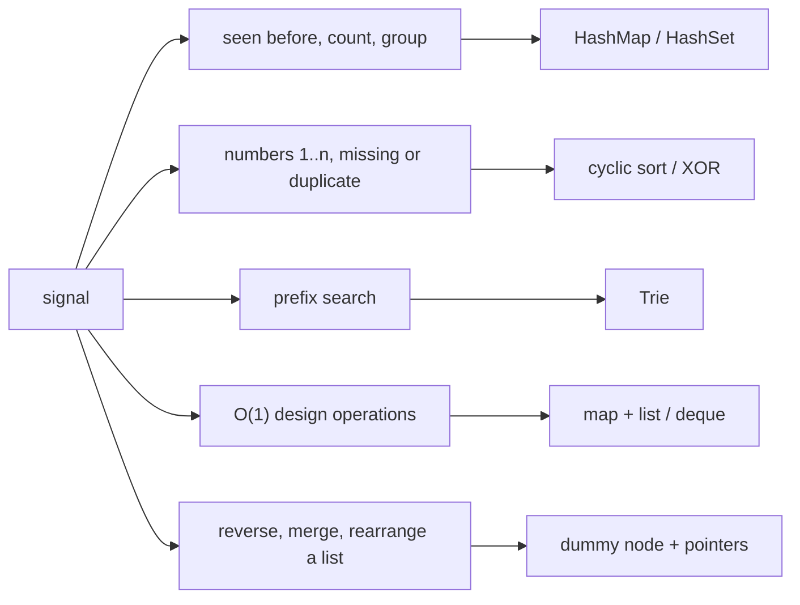

# More Patterns to Know

> The smaller patterns that still show up in interviews: hash map, linked-list moves, design, bits, cyclic sort, matrix.

**Go deeper:** `DS Trie`, `DS LinkedList` note 25 (LRU cache), `ALG 1.11` (cyclic sort), `ALG 9` (bit manipulation), `ALG 10.10` (math tricks), `ALG 8.5` to `8.7` (KMP, Rabin-Karp, Z).

#### 1. What Is It?

These are not big topics, but each one solves a whole group of questions.

| Pattern | Signal | Tool |
|---|---|---|
| Hash map / set | "have I seen this?", count, group, `O(1)` lookup | `HashMap`, `HashSet` |
| Linked-list moves | reverse, merge, rearrange in place | dummy node, 3 pointers |
| Design | "implement a class with `O(1)` operations" | map + list/deque, two stacks |
| Kadane | max sum of a contiguous subarray | running best (note 18) |
| Trie | prefix search, autocomplete, word dictionary | 26-way tree |
| Bit manipulation | "single number", "missing number", powers of two | XOR, `n and (n−1)` |
| Cyclic sort | numbers in `1..n`, "first missing", "find duplicates" | swap into the right index |
| Matrix | rotate, spiral, set zeroes | transpose, boundaries |
| Names only | segment tree, Fenwick tree, KMP, rolling hash (`ALG 8.5`, `8.6`), sweep line, math: gcd, primes, mod, fast power (`ALG 10`) | know what they are for |

#### 2. How It Works

**Hash map.** Turn a nested search into a lookup. Group by a *key* (sorted letters for anagrams). For "longest consecutive sequence", put every number in a set and start counting only from numbers with no `x − 1`.

**Bit tricks**

| Trick | Meaning |
|---|---|
| `x xor x = 0`, `x xor 0 = x` | pairs cancel, the single one remains |
| `n and (n − 1)` | clears the lowest set bit |
| `n and (n − 1) == 0` and `n > 0` | `n` is a power of two |
| `1 shl i` | a mask with bit `i` set |

**Cyclic sort.** For an array holding `1..n` (with some missing or repeated), put value `v` at index `v − 1` by swapping. Afterwards, the first index where `nums[i] != i + 1` shows the missing number.

**Matrix.** Rotate 90° clockwise = transpose, then reverse each row. Spiral = four shrinking boundaries `top, bottom, left, right`.

**Design problems.**

| Need | Structure |
|---|---|
| `O(1)` get/put with eviction (LRU) | hash map + doubly linked list (or `LinkedHashMap`) |
| `O(1)` min of a stack | stack of `(value, min so far)` |
| `O(1)` insert, delete, random | `ArrayList` + `HashMap` (swap with last on delete) |
| Prefix search | trie |

**Picture:** From the signal to the tool.



#### 3. Brute Force vs Optimized

| Problem | Brute force | Optimized |
|---|---|---|
| Longest consecutive sequence | sort `O(n log n)` | set + start only at sequence starts `O(n)` |
| Group anagrams | compare every pair `O(n² · k)` | sorted-letters key in a map `O(n · k log k)` |
| Missing number | sort or set | sum formula or XOR, `O(n)` time, `O(1)` space |
| First missing positive | sort, or a set `O(n)` space | cyclic sort `O(n)`, `O(1)` space |
| Rotate image | copy into a new matrix `O(n²)` space | in-place transpose + reverse |
| Random set | list only: delete is `O(n)` | list + map: delete is `O(1)` |

```kotlin
fun longestConsecutiveSort(nums: IntArray): Int {
    if (nums.isEmpty()) return 0
    val sorted = nums.distinct().sorted()
    var best = 1
    var run = 1
    for (i in 1 until sorted.size) {
        run = if (sorted[i] == sorted[i - 1] + 1) run + 1 else 1
        best = maxOf(best, run)
    }
    return best
}
```

#### 4. Kotlin Code

```kotlin
// Group Anagrams (LeetCode 49)
fun groupAnagrams(strs: Array<String>): List<List<String>> =
    strs.groupBy { word -> String(word.toCharArray().also { it.sort() }) }.values.toList()

// Longest Consecutive Sequence (LeetCode 128)
fun longestConsecutive(nums: IntArray): Int {
    val set = nums.toHashSet()
    var best = 0
    for (x in set) {
        if (x - 1 in set) continue                    // not the start of a sequence
        var end = x
        while (end + 1 in set) end++
        best = maxOf(best, end - x + 1)
    }
    return best
}

// Reverse Linked List (LeetCode 206): ListNode is in note 06
fun reverseList(head: ListNode?): ListNode? {
    var prev: ListNode? = null
    var cur = head
    while (cur != null) {
        val next = cur.next
        cur.next = prev
        prev = cur
        cur = next
    }
    return prev
}

// Merge Two Sorted Lists (LeetCode 21)
fun mergeTwoLists(a: ListNode?, b: ListNode?): ListNode? {
    val dummy = ListNode(0)
    var tail = dummy
    var x = a
    var y = b
    while (x != null && y != null) {
        if (x.`val` <= y.`val`) { tail.next = x; x = x.next } else { tail.next = y; y = y.next }
        tail = tail.next!!
    }
    tail.next = x ?: y
    return dummy.next
}

// Min Stack (LeetCode 155)
class MinStack {
    private val stack = ArrayDeque<IntArray>()           // [value, minimum so far]
    fun push(x: Int) {
        val min = if (stack.isEmpty()) x else minOf(x, stack.last()[1])
        stack.addLast(intArrayOf(x, min))
    }
    fun pop() { stack.removeLast() }
    fun top(): Int = stack.last()[0]
    fun getMin(): Int = stack.last()[1]
}

// LRU Cache (LeetCode 146): LinkedHashMap in access order. The manual version is in `DS LinkedList` note 25.
class LRUCache(private val capacity: Int) {
    private val map = object : LinkedHashMap<Int, Int>(capacity, 0.75f, true) {
        override fun removeEldestEntry(eldest: MutableMap.MutableEntry<Int, Int>?): Boolean = size > capacity
    }
    fun get(key: Int): Int = map[key] ?: -1
    fun put(key: Int, value: Int) { map[key] = value }
}

// Implement Trie (LeetCode 208)
class Trie {
    private class TrieNode {
        val next = arrayOfNulls<TrieNode>(26)
        var isWord = false
    }
    private val root = TrieNode()

    fun insert(word: String) {
        var node = root
        for (c in word) {
            val i = c - 'a'
            if (node.next[i] == null) node.next[i] = TrieNode()
            node = node.next[i]!!
        }
        node.isWord = true
    }

    private fun find(prefix: String): TrieNode? {
        var node: TrieNode? = root
        for (c in prefix) node = node?.next?.get(c - 'a') ?: return null
        return node
    }

    fun search(word: String): Boolean = find(word)?.isWord == true
    fun startsWith(prefix: String): Boolean = find(prefix) != null
}

// Single Number (LeetCode 136)
fun singleNumber(nums: IntArray): Int {
    var result = 0
    for (x in nums) result = result xor x
    return result
}

// Missing Number (LeetCode 268)
fun missingNumber(nums: IntArray): Int {
    var result = nums.size
    for (i in nums.indices) result = result xor i xor nums[i]
    return result
}

// Number of 1 Bits (LeetCode 191)
fun hammingWeight(n: Int): Int {
    var x = n
    var count = 0
    while (x != 0) { x = x and (x - 1); count++ }
    return count
}

// First Missing Positive (LeetCode 41): cyclic sort
fun firstMissingPositive(nums: IntArray): Int {
    val n = nums.size
    var i = 0
    while (i < n) {
        val v = nums[i]
        if (v in 1..n && nums[v - 1] != v) {
            nums[i] = nums[v - 1]; nums[v - 1] = v        // put v where it belongs
        } else {
            i++
        }
    }
    for (j in 0 until n) if (nums[j] != j + 1) return j + 1
    return n + 1
}

// Rotate Image (LeetCode 48): transpose, then reverse each row
fun rotate(matrix: Array<IntArray>) {
    val n = matrix.size
    for (i in 0 until n) for (j in i + 1 until n) {
        val t = matrix[i][j]; matrix[i][j] = matrix[j][i]; matrix[j][i] = t
    }
    for (row in matrix) row.reverse()
}

// Spiral Matrix (LeetCode 54)
fun spiralOrder(matrix: Array<IntArray>): List<Int> {
    val result = mutableListOf<Int>()
    var top = 0
    var bottom = matrix.size - 1
    var left = 0
    var right = matrix[0].size - 1
    while (top <= bottom && left <= right) {
        for (c in left..right) result.add(matrix[top][c])
        top++
        for (r in top..bottom) result.add(matrix[r][right])
        right--
        if (top <= bottom) { for (c in right downTo left) result.add(matrix[bottom][c]); bottom-- }
        if (left <= right) { for (r in bottom downTo top) result.add(matrix[r][left]); left++ }
    }
    return result
}

// Insert Delete GetRandom O(1) (LeetCode 380)
class RandomizedSet {
    private val list = ArrayList<Int>()
    private val index = HashMap<Int, Int>()               // value -> position in list

    fun insert(v: Int): Boolean {
        if (v in index) return false
        index[v] = list.size
        list.add(v)
        return true
    }

    fun remove(v: Int): Boolean {
        val pos = index[v] ?: return false
        val last = list[list.size - 1]
        list[pos] = last                                  // overwrite with the last element
        index[last] = pos
        list.removeAt(list.size - 1)
        index.remove(v)
        return true
    }

    fun getRandom(): Int = list[kotlin.random.Random.nextInt(list.size)]
}
```

Checks: `groupAnagrams(["eat","tea","tan","ate","nat","bat"])` → `[["eat","tea","ate"],["tan","nat"],["bat"]]` (group order may differ). `longestConsecutive([100,4,200,1,3,2])` → `4`; `([0,3,7,2,5,8,4,6,0,1])` → `9`. `reverseList(1→2→3)` → `3→2→1`. `mergeTwoLists(1→2→4, 1→3→4)` → `1→1→2→3→4→4`. `MinStack`: `push(-2)`, `push(0)`, `push(-3)` → `getMin()` is `-3`; after `pop()`, `top()` is `0` and `getMin()` is `-2`. `LRUCache(2)`: `put(1,1)`, `put(2,2)`, `get(1)` → `1`, `put(3,3)`, `get(2)` → `-1`, `put(4,4)`, `get(1)` → `-1`, `get(3)` → `3`, `get(4)` → `4`. Trie: `insert("apple")`, `search("apple")` → `true`, `search("app")` → `false`, `startsWith("app")` → `true`, `insert("app")`, `search("app")` → `true`. `singleNumber([4,1,2,1,2])` → `4`. `missingNumber([3,0,1])` → `2`. `hammingWeight(11)` → `3`. `firstMissingPositive([3,4,-1,1])` → `2`; `([1,2,0])` → `3`; `([7,8,9,11,12])` → `1`. `rotate([[1,2,3],[4,5,6],[7,8,9]])` → `[[7,4,1],[8,5,2],[9,6,3]]`. `spiralOrder([[1,2,3],[4,5,6],[7,8,9]])` → `[1,2,3,6,9,8,7,4,5]`. `RandomizedSet`: `insert(1)` → `true`, `remove(2)` → `false`, `insert(2)` → `true`, `remove(1)` → `true`, `insert(2)` → `false`, `getRandom()` → `2`.

#### 5. Complexity

| Problem | Time | Space |
|---|---|---|
| Group anagrams | `O(n · k log k)` | `O(n · k)` |
| Longest consecutive | `O(n)` | `O(n)` |
| Reverse / merge list | `O(n)` / `O(m + n)` | `O(1)` |
| Min Stack, RandomizedSet, LRU | `O(1)` per operation | `O(n)` |
| Trie insert/search | `O(L)` for word length `L` | `O(total characters)` |
| XOR tricks, cyclic sort | `O(n)` | `O(1)` |
| Rotate, spiral | `O(n²)` | `O(1)` extra |

#### 6. Common Mistakes

1. **Longest consecutive:** starting a count from every number (becomes `O(n²)`).
2. **Anagram key:** using the word itself, or an unsorted `CharArray` (arrays compare by reference).
3. **Linked lists:** losing `next` before re-pointing; no dummy node when the head can change.
4. **LRU:** a `get` must also mark the key as recently used.
5. **RandomizedSet remove:** forgetting to update the moved element's index, or deleting before overwriting when `v` is the last element.
6. **Bits:** `Int` has 32 bits; `shr` keeps the sign, so use `ushr` for unsigned shifts.
7. **Cyclic sort:** `while` with a swap and no `i++`, which loops forever on duplicates. Check `nums[v − 1] != v`.
8. **Rotate:** transposing the whole matrix (both triangles) swaps twice and undoes itself.

#### 7. Say This in the Interview

1. "A hash set gives `O(1)` lookup, so I only start counting when `x − 1` is missing. Each number is visited at most twice: `O(n)`."
2. "XOR cancels equal pairs, so the one number left is the answer, with `O(1)` space."
3. "To get `O(1)` random delete I keep a list and a map from value to index, and swap the deleted element with the last one."

#### 8. Quick Check

1. What is `5 xor 5 xor 7`?
2. Why does Rotate Image need transposing only the upper triangle?

<details>
<summary>Answers</summary>

1. `7`.
2. Swapping `(i, j)` with `(j, i)` for every pair happens once for `j > i`. Doing both triangles would swap each pair twice and restore the original.

</details>

#### 9. Related LeetCode Questions

| # | Question | Idea |
|---|---|---|
| 1 | [Two Sum](https://leetcode.com/problems/two-sum/) (Easy) | hash map |
| 206 | [Reverse Linked List](https://leetcode.com/problems/reverse-linked-list/) (Easy) | three pointers |
| 21 | [Merge Two Sorted Lists](https://leetcode.com/problems/merge-two-sorted-lists/) (Easy) | dummy node |
| 136 | [Single Number](https://leetcode.com/problems/single-number/) (Easy) | XOR |
| 268 | [Missing Number](https://leetcode.com/problems/missing-number/) (Easy) | XOR or sum |
| 191 | [Number of 1 Bits](https://leetcode.com/problems/number-of-1-bits/) (Easy) | `n and (n−1)` |
| 49 | [Group Anagrams](https://leetcode.com/problems/group-anagrams/) (Medium) | key = sorted letters |
| 128 | [Longest Consecutive Sequence](https://leetcode.com/problems/longest-consecutive-sequence/) (Medium) | set, start only at starts |
| 155 | [Min Stack](https://leetcode.com/problems/min-stack/) (Medium) | stack of pairs |
| 146 | [LRU Cache](https://leetcode.com/problems/lru-cache/) (Medium) | map + linked list |
| 208 | [Implement Trie (Prefix Tree)](https://leetcode.com/problems/implement-trie-prefix-tree/) (Medium) | 26-way tree |
| 380 | [Insert Delete GetRandom O(1)](https://leetcode.com/problems/insert-delete-getrandom-o1/) (Medium) | list + map |
| 143 | [Reorder List](https://leetcode.com/problems/reorder-list/) (Medium) | middle, reverse, merge |
| 48 | [Rotate Image](https://leetcode.com/problems/rotate-image/) (Medium) | transpose + reverse |
| 54 | [Spiral Matrix](https://leetcode.com/problems/spiral-matrix/) (Medium) | four boundaries |
| 41 | [First Missing Positive](https://leetcode.com/problems/first-missing-positive/) (Hard) | cyclic sort |
| 212 | [Word Search II](https://leetcode.com/problems/word-search-ii/) (Hard) | trie + backtracking |
