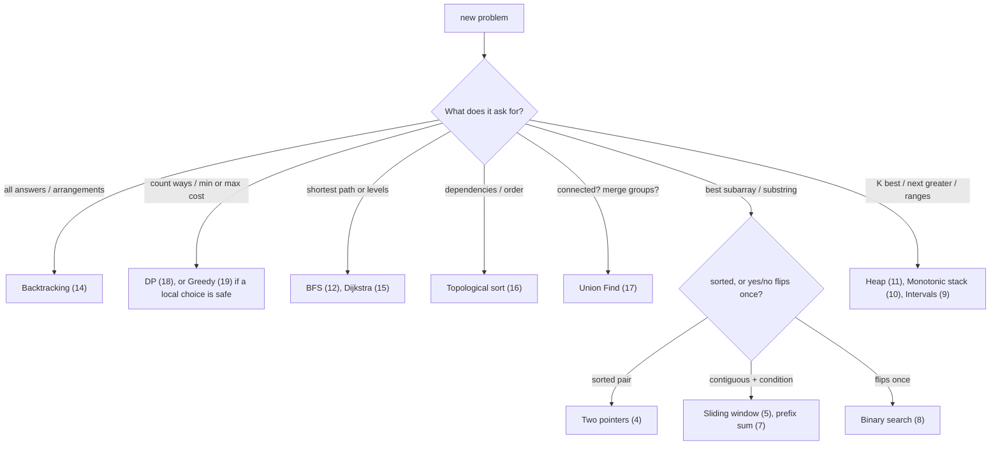

# LeetCode Patterns Cheat Sheet

> One-page revision for the night before an interview. Full explanations are in notes 01–22.

#### 1. Key Takeaways

1. **Pattern first, code second.** Read the signals, name the pattern, then apply the template.
2. **Say the brute force and its Big-O** before you improve it. The gap is your story.
3. **Constraints pick the complexity:** `n ≤ 10⁵` means `O(n log n)` or `O(n)`. `n ≤ 20` means backtracking.
4. **Contiguous + condition** → sliding window. **Sorted + pair** → two pointers. **Sorted or yes/no flips once** → binary search.
5. **Shortest path, equal cost** → BFS. **All answers** → backtracking. **Count ways / min cost with repeats** → DP.
6. **Always test** with a normal case, empty, one element, duplicates.
7. State **time and space** at the end.

#### 2. Signal to Pattern

| If you see... | Try | Note |
|---|---|---|
| Sorted array, pair or triplet with a target, palindrome, in-place removal | Two pointers | 04 |
| Longest / shortest contiguous subarray or substring with a condition | Sliding window | 05 |
| Cycle in a list, middle of a list, repeated value in a sequence | Fast and slow pointers | 06 |
| Many range-sum queries, "subarray sum equals K" | Prefix sum (+ hash map) | 07 |
| Sorted / rotated data, "minimum X such that...", `O(log n)` | Binary search | 08 |
| Overlapping ranges, meetings, merge or insert | Merge intervals | 09 |
| Next greater / smaller, temperatures, histogram | Monotonic stack | 10 |
| K largest / smallest / most frequent / closest, running median | Heap (top K) | 11 |
| Shortest path with equal weights, level order, spreading | BFS | 12 |
| Tree depth, paths, subtree values, regions | DFS | 13 |
| All combinations, permutations, subsets, place with rules | Backtracking | 14 |
| Nodes and edges, islands, components, cycles, clone, bipartite | Graph traversal | 15 |
| Prerequisites, dependencies, build order | Topological sort | 16 |
| "Are these connected?", merging groups, redundant edge | Union Find | 17 |
| Count ways, min or max cost, overlapping subproblems | Dynamic programming | 18 |
| Local best choice looks globally best (and survives a counter-example) | Greedy | 19 |
| `O(1)` lookup, count, group, "seen before?" | Hash map or set | 20 |
| Missing/duplicate in `1..n`, single number | Cyclic sort, XOR | 20 |
| Prefix search | Trie | 20 |
| Answer "modulo 10⁹ + 7", huge exponent, divisible subarrays | modular arithmetic, fast power (`ALG 10.4`, `10.5`) | 7, 20 |
| `n ≤ 20` and "visit every node" / "split into k groups" | bitmask DP or backtracking (`ALG 9.7`, `ALG 11.4`) | 14 |
| Reverse / merge / rearrange list | Pointer manipulation | 20 |

**Picture:** a first pass over the signals.



#### 3. Constraints Hint

| Input size `n` | Aim for | Likely approach |
|---|---|---|
| up to ~20 | `O(2ⁿ)`, `O(n!)` | backtracking, bitmask |
| up to ~500 | `O(n³)` | triple loops, some DP |
| up to ~5,000 | `O(n²)` | nested loops, 2D DP |
| up to ~100,000 | `O(n log n)` or `O(n)` | sort, heap, binary search, hash map, sliding window |
| up to ~1,000,000 | `O(n)` | one pass, hash map, prefix sum |
| `10⁹` or more | `O(log n)` or math | binary search, formula |

#### 4. Complexity Table

| Pattern | Time | Space |
|---|---|---|
| Two pointers | `O(n)` (+ sort `O(n log n)`) | `O(1)` |
| Sliding window | `O(n)` | `O(1)` or `O(alphabet)` |
| Fast and slow | `O(n)` | `O(1)` |
| Prefix sum (+ map) | build `O(n)`, query `O(1)` | `O(n)` |
| Binary search | `O(log n)`; search on answer `O(n log range)` | `O(1)` |
| Intervals | `O(n log n)` | `O(n)` |
| Monotonic stack | `O(n)` | `O(n)` |
| Top K (heap of size K) | `O(n log K)` | `O(K)` |
| BFS / DFS on graph | `O(V + E)` | `O(V)` |
| BFS / DFS on grid | `O(rows × cols)` | `O(rows × cols)` |
| Tree DFS | `O(n)` | `O(h)` |
| Backtracking | `O(2ⁿ)` / `O(n!)` | `O(n)` |
| Topological sort | `O(V + E)` | `O(V + E)` |
| Union Find | `O(α(n))` per op | `O(n)` |
| Dijkstra | `O((V + E) log V)` | `O(V + E)` |
| DP | states × work per state | table size |
| Greedy | `O(n log n)` or `O(n)` | `O(1)` to `O(n)` |

#### 5. Templates to Memorise

**Two pointers (sorted pair)**

```kotlin
var l = 0; var r = a.size - 1
while (l < r) {
    val sum = a[l] + a[r]
    if (sum == target) return true
    if (sum < target) l++ else r--
}
```

**Sliding window (longest valid)**

```kotlin
var left = 0; var best = 0
for (right in s.indices) {
    // add s[right]
    while (/* window invalid */) { /* remove s[left] */ left++ }
    best = maxOf(best, right - left + 1)
}
```

**Fast and slow**

```kotlin
var slow = head; var fast = head
while (fast != null && fast.next != null) {
    slow = slow!!.next; fast = fast.next!!.next
    if (slow === fast) return true
}
```

**Prefix sum + map (subarray sum = K)**

```kotlin
val seen = HashMap<Int, Int>(); seen[0] = 1
var sum = 0; var count = 0
for (x in nums) { sum += x; count += seen[sum - k] ?: 0; seen[sum] = (seen[sum] ?: 0) + 1 }
```

**Binary search (first true) and search on the answer**

```kotlin
var lo = 0; var hi = n               // answer in [lo, hi]
while (lo < hi) {
    val mid = lo + (hi - lo) / 2
    if (ok(mid)) hi = mid else lo = mid + 1
}
return lo
```

**Merge intervals**

```kotlin
val sorted = intervals.sortedBy { it[0] }
val out = mutableListOf<IntArray>(); var cur = sorted[0].clone()
for (i in 1 until sorted.size) {
    if (sorted[i][0] <= cur[1]) cur[1] = maxOf(cur[1], sorted[i][1])
    else { out.add(cur); cur = sorted[i].clone() }
}
out.add(cur)
```

**Monotonic stack (next greater)**

```kotlin
val stack = ArrayDeque<Int>()
for (i in nums.indices) {
    while (stack.isNotEmpty() && nums[i] > nums[stack.last()]) res[stack.removeLast()] = nums[i]
    stack.addLast(i)
}
```

**Top K largest**

```kotlin
val heap = PriorityQueue<Int>()      // min-heap
for (x in nums) { heap.add(x); if (heap.size > k) heap.poll() }
```

**BFS (levels)**

```kotlin
val q = ArrayDeque<Int>(); q.addLast(start); visited[start] = true
var steps = 0
while (q.isNotEmpty()) {
    repeat(q.size) {
        val u = q.removeFirst()
        for (v in graph[u]) if (!visited[v]) { visited[v] = true; q.addLast(v) }
    }
    steps++
}
```

**DFS (tree)**

```kotlin
fun dfs(node: TreeNode?): Int {
    if (node == null) return 0
    return 1 + maxOf(dfs(node.left), dfs(node.right))
}
```

**Backtracking**

```kotlin
fun backtrack(start: Int) {
    result.add(path.toList())
    for (i in start until n) {
        path.add(nums[i]); backtrack(i + 1); path.removeAt(path.size - 1)
    }
}
```

**Topological sort (Kahn)**

```kotlin
for (i in 0 until n) if (inDegree[i] == 0) q.addLast(i)
while (q.isNotEmpty()) {
    val u = q.removeFirst(); order.add(u)
    for (v in graph[u]) if (--inDegree[v] == 0) q.addLast(v)
}
// cycle if order.size < n
```

**Union Find**

```kotlin
fun find(x: Int): Int { var r = x; while (parent[r] != r) { parent[r] = parent[parent[r]]; r = parent[r] }; return r }
fun union(a: Int, b: Int): Boolean {
    val ra = find(a); val rb = find(b)
    if (ra == rb) return false
    parent[rb] = ra; return true
}
```

**DP (1D)**

```kotlin
val dp = IntArray(amount + 1) { amount + 1 }; dp[0] = 0
for (a in 1..amount) for (c in coins) if (c <= a) dp[a] = minOf(dp[a], dp[a - c] + 1)
```

**Greedy (intervals, sort by end)**

```kotlin
var kept = 0; var lastEnd = Int.MIN_VALUE
for (iv in intervals.sortedBy { it[1] }) if (iv[0] >= lastEnd) { kept++; lastEnd = iv[1] }
```

#### 6. Brute Force to Optimized

| Problem | Brute force | Optimized |
|---|---|---|
| Pair with target | all pairs `O(n²)` | hash map `O(n)`, or sorted two pointers |
| Longest substring | all substrings `O(n²)` | sliding window `O(n)` |
| Subarray sum = K | all subarrays `O(n²)` | prefix + map `O(n)` |
| Find in sorted data | scan `O(n)` | binary search `O(log n)` |
| Merge ranges | compare all pairs | sort + scan `O(n log n)` |
| Next greater | scan right each time `O(n²)` | monotonic stack `O(n)` |
| Kth largest | sort `O(n log n)` | heap `O(n log K)` |
| Shortest path in grid | all paths (DFS) | BFS `O(rows × cols)` |
| All subsets | `O(2ⁿ)` is the answer size | prune early |
| Overlapping recursion | `O(2ⁿ)` | memo / DP `O(states)` |
| Connected? after each edge | rerun DFS | Union Find |

#### 7. Common Mistakes and Edge Cases

1. **Not naming the pattern** or ignoring the constraints.
2. **Two pointers on unsorted data**; sliding window sums with negatives (use prefix + map).
3. **Binary search:** `mid` overflow, infinite loop (`left < right` with `right = mid`), wrong template mixing.
4. **Intervals:** wrong sort key; touching ranges; forgetting the last interval.
5. **BFS:** marking visited on dequeue; not fixing the level size.
6. **DFS:** missing base case; leaf vs null; BST bounds with `Int` limits.
7. **Backtracking:** saving the path itself (copy it); not undoing; duplicate skip with `i > start`.
8. **Graph:** disconnected graphs; directed cycle needs colours; Dijkstra with negative edges.
9. **DP:** unclear state, wrong base case, wrong loop direction, `Int.MAX_VALUE + 1`.
10. **Greedy:** trusting the sample; no counter-example test.
11. **Kotlin:** `==` on arrays, `a - b` comparators, `Int` overflow, modifying a list while iterating.
12. **Edge cases:** empty, one element, all equal, duplicates, negatives, very large, already sorted.

#### 8. What to Say Out Loud

1. "Let me restate the problem and check the constraints."
2. "The brute force is ..., `O(...)`. We can do better by ..."
3. "I see ... so I'll use ... (pattern)."
4. "Here's the plan. Does that sound right?"
5. "I'll trace this example, then an edge case."
6. "Time `O(...)`, space `O(...)`. A possible improvement is ..."

#### 9. Practice Order (Easy → Medium)

| Level | Question | Pattern |
|---|---|---|
| Easy | [Two Sum](https://leetcode.com/problems/two-sum/) | hash map |
| Easy | [Valid Palindrome](https://leetcode.com/problems/valid-palindrome/) | two pointers |
| Easy | [Best Time to Buy and Sell Stock](https://leetcode.com/problems/best-time-to-buy-and-sell-stock/) | running minimum |
| Easy | [Linked List Cycle](https://leetcode.com/problems/linked-list-cycle/) | fast and slow |
| Easy | [Binary Search](https://leetcode.com/problems/binary-search/) | binary search |
| Easy | [Valid Parentheses](https://leetcode.com/problems/valid-parentheses/) | stack |
| Easy | [Maximum Depth of Binary Tree](https://leetcode.com/problems/maximum-depth-of-binary-tree/) | DFS |
| Easy | [Climbing Stairs](https://leetcode.com/problems/climbing-stairs/) | DP |
| Medium | [3Sum](https://leetcode.com/problems/3sum/) | two pointers |
| Medium | [Longest Substring Without Repeating Characters](https://leetcode.com/problems/longest-substring-without-repeating-characters/) | sliding window |
| Medium | [Subarray Sum Equals K](https://leetcode.com/problems/subarray-sum-equals-k/) | prefix sum |
| Medium | [Search in Rotated Sorted Array](https://leetcode.com/problems/search-in-rotated-sorted-array/) | binary search |
| Medium | [Merge Intervals](https://leetcode.com/problems/merge-intervals/) | intervals |
| Medium | [Daily Temperatures](https://leetcode.com/problems/daily-temperatures/) | monotonic stack |
| Medium | [Top K Frequent Elements](https://leetcode.com/problems/top-k-frequent-elements/) | heap |
| Medium | [Binary Tree Level Order Traversal](https://leetcode.com/problems/binary-tree-level-order-traversal/) | BFS |
| Medium | [Number of Islands](https://leetcode.com/problems/number-of-islands/) | DFS on grid |
| Medium | [Subsets](https://leetcode.com/problems/subsets/) | backtracking |
| Medium | [Course Schedule](https://leetcode.com/problems/course-schedule/) | topological sort |
| Medium | [Number of Provinces](https://leetcode.com/problems/number-of-provinces/) | Union Find |
| Medium | [Coin Change](https://leetcode.com/problems/coin-change/) | DP |
| Medium | [Jump Game](https://leetcode.com/problems/jump-game/) | greedy |
| Medium | [LRU Cache](https://leetcode.com/problems/lru-cache/) | design |

#### 10. Cheat Sheets to Read Next

The night before an interview, read this page first, then the cheat sheet of your weakest area.

| Area | Page |
|---|---|
| Sorting, searching | `ALG 1.99`, `ALG 2.99` |
| Recursion, divide and conquer | `ALG 3.99` |
| Greedy, DP, backtracking | `ALG 4.99`, `ALG 5.99`, `ALG 6.99` |
| Graphs (shortest path, MST) | `ALG 7.99`, and `DS Graph` `99-Graph Cheat Sheet` |
| Strings, bits, math | `ALG 8.99`, `ALG 9.99`, `ALG 10.99` |
| "This looks impossible" | `ALG 11.99` |
| Data structures | the `99-… Cheat Sheet` in each `DS` folder |
