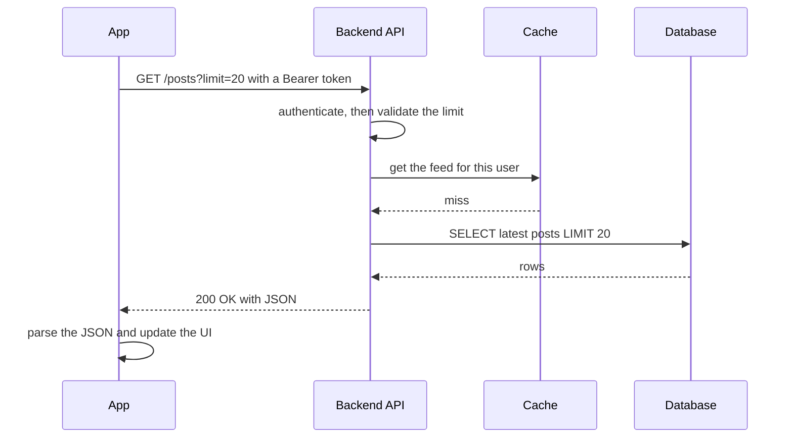
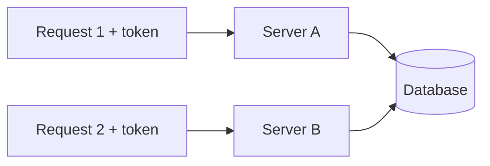

# Client, Server & Request Flow

> The app asks, the backend does the work and answers. Interviews test whether you can explain this whole trip, and what can go wrong on the way.

Roadmap topic 1 · Stage 1: Foundations

**Go deeper:** `02` Networking & HTTP (what the network step really does) · `03` API Design · `05` Authentication · `09` Connecting API to Database · `05-system-design/15-Caching` · `05-system-design/21-Queues-Events-and-Background-Jobs` · `06-mobile-engineering/08-Networking` (the client side).

**Marks:** 🟢 must know · 🟡 good to know

---

#### 1. What Is It?

*Think of a restaurant: the app is the customer, the API is the menu, the backend is the kitchen, and the database is the pantry.*

| Term | Meaning |
|---|---|
| **Client** | the program that sends requests: your Android, iOS or web app |
| **Server** | a computer that receives requests, does the work and sends back a response |
| **Backend** | all the code on the server side: APIs, business rules, login, data access |
| **API** | the list of requests the backend accepts (`GET /posts`). The contract between app and backend |
| **Database** | where data is stored permanently (users, posts, orders) |

```text
Mobile App  →  API  →  Backend logic  →  Database
(client)                (server)
```

**Why client-server at all?**

1. One backend serves Android, iOS and web.
2. Rules and data live in **one place**, not copied into every app.
3. You can fix the backend without waiting for users to update the app.
4. Apps and backend **scale separately**.

**What this note covers**

| 🟢 Must know | 🟡 Good to know |
|---|---|
| request → response lifecycle, the feed example | Firebase / Supabase and "direct" database access |
| why the app never talks to the database | |
| network failures and latency, timeouts and safe retries | |
| stateless requests | |
| synchronous vs background work | |
| client vs server responsibilities | |

**Signals in an interview:** "what happens when you open the app?", "trace this screen", "where should this check live?", "why is the user waiting so long?"

---

#### 2. How It Works

Every screen that loads data makes the same trip. Short version to remember:

**Request → Validate → Logic → Data → Response → UI**



**Example: load a feed of posts** (use this one in interviews).

```http
GET /posts?limit=20
Authorization: Bearer <token>
```

```text
1. Read the token → find the user                    (401 if missing or expired)
2. Validate limit (for example 1..50)                 (400 if bad)
3. Check the cache for this user's feed
4. Cache miss → query the database
5. Build the JSON
6. Return 200 OK
```

```json
{ "posts": [ { "id": 1, "title": "Hello", "author": "Asha" },
             { "id": 2, "title": "System Design", "author": "Ravi" } ] }
```

App side: `show loading → send request → success: show the list / error: show retry or cached data`.

**Why the app must not talk to the database directly**

1. **Security:** a database password inside the app can be pulled out by anyone who decompiles it.
2. **No rules:** the database cannot check login, permissions or validation per user.
3. **Connections:** thousands of phones opening connections would overload it.
4. **Coupling:** if the app knows the table layout, you cannot change the database without breaking old app versions.
5. **No control:** no rate limiting, logging or caching.

The API is the only door to the data. The database is never exposed to the internet.

🟡 **Firebase / Supabase** look like direct access, but a managed API sits in front, and **security rules** (Firebase rules, Supabase row-level security) decide who can read or write each row. The app never gets raw database credentials. Wrong rules leak data, so "the server must check everything" still holds.

**Stateless requests.** The server keeps no memory of your previous request. Each request carries what it needs (mainly the token). Data is still saved, but in the **database**, not in server memory.



Any server can handle any request, adding servers is easy, and if one dies the next request goes elsewhere.

**Synchronous vs background work.** Do the must-have work now, reply, and finish the rest later.

```text
Synchronous:   validate → save post → return 201 Created
Background:    notify followers, resize image, update search, send email
```

The user gets a fast response, a slow email service cannot make the app hang, and background work can be retried. **Mobile view:** the same idea as not blocking the main thread.

**Client vs server responsibilities**

| Client (app) | Server (backend) |
|---|---|
| show UI, collect input | validate every request |
| basic input checks (for a better experience) | check login and permissions |
| send requests, handle errors | business rules |
| keep screen state, cache | read and write the database |

**Golden rule:** never trust the client. Checks in the app are for experience, checks on the server are for security.

---

#### 3. Naive vs Better Approach

| Situation | Naive | Better |
|---|---|---|
| Data access | app connects to the database | app calls an API that guards the database |
| Slow side work | send the email before replying | save, reply `201`, send the email in the background |
| Network call | no timeout, assume success | timeout, error state, retry only when safe |
| Validation | only in the app | in the app for UX, **and** on the server for security |
| Session | server remembers users in memory | stateless: token on every request |

```kotlin
// Naive: the user waits for the email, and a slow mail server hangs the response
fun publishNaive(post: NewPost, db: PostStore, mail: Mailer): Int {
    val id = db.save(post)
    mail.sendToFollowers(id)          // may take seconds, may throw
    return id
}
```

---

#### 4. Code

Plain Kotlin for the server logic, so you can run it without a framework. The Ktor or Spring route only calls this service.

```kotlin
import kotlinx.coroutines.*
import java.io.IOException

data class Post(val id: Int, val title: String, val author: String)
interface PostRepository { fun latest(limit: Int): List<Post> }

// The "feed" request: authenticate → validate → cache → database
class FeedService(
    private val repo: PostRepository,
    private val cache: MutableMap<Int, List<Post>> = HashMap()
) {
    fun feed(userId: Int?, limit: Int): Result<List<Post>> {
        if (userId == null) return Result.failure(IllegalStateException("401 Unauthorized"))
        if (limit !in 1..50) return Result.failure(IllegalArgumentException("400 limit must be 1..50"))
        cache[userId]?.let { return Result.success(it.take(limit)) }      // cache hit
        val posts = repo.latest(50)                                        // cache miss → database
        cache[userId] = posts
        return Result.success(posts.take(limit))
    }
}

class FakeRepo : PostRepository {
    var calls = 0
    override fun latest(limit: Int): List<Post> {
        calls++
        return listOf(Post(1, "Hello", "Asha"), Post(2, "System Design", "Ravi")).take(limit)
    }
}

// Client side: retry ONLY safe (idempotent) calls such as GET, with exponential backoff
suspend fun <T> retrySafe(times: Int = 3, baseDelayMs: Long = 100, block: suspend () -> T): T {
    var attempt = 0
    while (true) {
        try {
            return block()
        } catch (e: IOException) {
            attempt++
            if (attempt >= times) throw e
            delay(baseDelayMs * (1L shl (attempt - 1)))                    // 100 ms, 200 ms, 400 ms ...
        }
    }
}

// Synchronous part first, slow part in the background
interface PostStore { fun save(title: String): Int }
interface Notifier { suspend fun notifyFollowers(postId: Int) }

suspend fun publish(title: String, db: PostStore, notifier: Notifier, scope: CoroutineScope): Int {
    val id = db.save(title)                                // must finish before we reply 201
    scope.launch { notifier.notifyFollowers(id) }          // the reply does not wait for this
    return id
}
```

Checks: `FeedService(repo).feed(null, 20)` → failure `401 Unauthorized`. `feed(7, 0)` → failure `400 limit must be 1..50`. `feed(7, 20)` → two posts, `repo.calls == 1`; calling `feed(7, 20)` again still gives `repo.calls == 1` (cache hit); `feed(7, 1)` → one post. `retrySafe { if (++n < 3) throw IOException() else "ok" }` → `"ok"` after two waits (about 300 ms total); a block that always throws `IOException` → rethrows after the 3rd attempt. In `publish`, the function returns the new id even if `notifyFollowers` is still running.

---

#### 5. Performance & Limits

Response time is a sum:

```text
network time + server processing + database / cache time
e.g.   80 ms        10 ms                15 ms         = about 105 ms
```

| Part | Typical size | What to do |
|---|---|---|
| Mobile network round trip | tens to hundreds of ms | fewer calls, smaller payloads, reuse connections |
| Server processing | milliseconds | keep handlers short, no blocking work |
| Database | milliseconds with an index, seconds without | index, cache (topics 9, 10) |
| Slow side work | seconds | move to the background |

Timeouts are the defence against "waiting forever": always set a connect timeout and a read timeout.

---

#### 6. Common Mistakes & Edge Cases

1. Thinking the app reads the database directly.
2. Assuming every request succeeds. Offline, timeout, `5xx`, `401` (expired login) and `429` (too many requests) all happen.
3. Trusting checks done only in the app.
4. Putting secrets (API keys, database passwords) inside the app.
5. Making the user wait for slow work (emails, notifications).
6. Confusing "stateless" with "no data is stored".
7. **Retrying a POST** that charged a card. Retry only safe calls, or use idempotency keys (topic 3).
8. Keeping per-user state in server memory, so the next request on another server fails.

Edge cases to mention: empty feed (return `[]`, not `404`), token expired mid-session (refresh, then retry once), request succeeded on the server but the response was lost (the app times out, so a retry must not double-apply).

---

#### 7. Say This in the Interview

1. "The app sends an HTTPS request. The server authenticates, validates, runs the business logic, reads or writes the database, and returns a status code and JSON. The app then updates the UI."
2. "The app never gets database access: security, permissions, connection count and schema coupling all argue for an API in front."
3. "The backend is stateless: every request carries its token, so any server can handle it and scaling is just adding servers."
4. "I'd keep the response path short and push email, notifications and image processing to a background job."
5. "On the client I set timeouts, show an error state with retry, and retry only idempotent calls."

---

#### 8. Quick Check

1. What are the steps from tap to screen update?
2. Why is a stateless server easier to scale?
3. What should happen synchronously when a user publishes a post?
4. Is it safe to retry a failed `POST /payments`?

<details>
<summary>Answers</summary>

1. Request → authenticate → validate → logic → cache/database → response → parse → update the UI.
2. Any server can serve any request, so you add or remove servers freely.
3. Validate and save the post, then return `201`. Notifications and emails go to the background.
4. Not blindly. The first attempt may have succeeded. Use an idempotency key so a repeat does not charge twice.

</details>

---

#### 9. Practice

**Interview questions**

1. What happens when a mobile app calls an API? (Section 2.)
2. Why shouldn't the app connect to the database directly?
3. What does stateless mean, and why does it help?
4. What can go wrong with a network call, and how do you handle it?
5. What is synchronous and what is background work?
6. Trace loading a list of posts from app to database and back.
7. Firebase and Supabase seem to talk to the database directly. Is that the same thing? (No: a managed API with security rules sits in front.)

**Hands-on**

1. Call a public API with `curl -v` and read the request and response headers.
2. Write the `FeedService` above behind a Ktor or Spring route and hit it with `curl`.
3. In your Android app, add a timeout and an offline state to one screen.

**Remember:** client sends, server processes and responds · the app never gets raw database access · networks fail, so timeouts and safe retries · stateless means each request carries its identity · keep the response fast, move slow work to the background · never trust the client.
