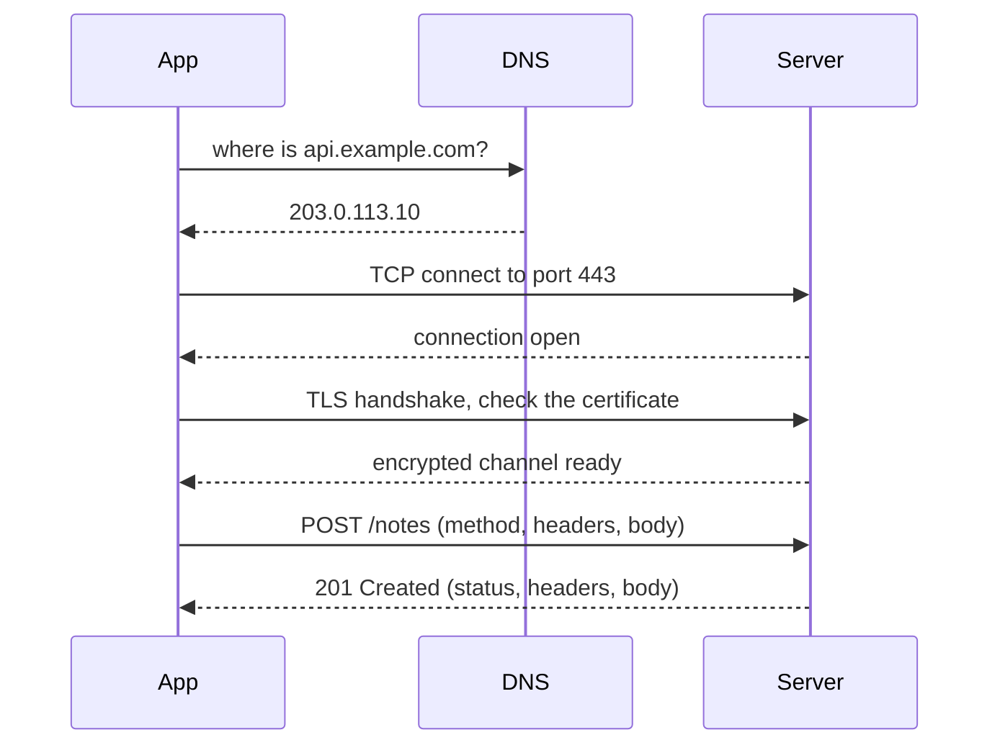
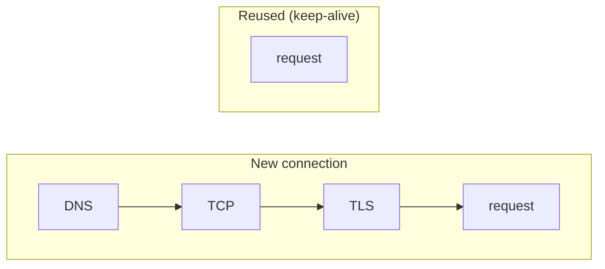

# Networking & HTTP

> The road your request travels on. DNS finds the server, TCP and TLS build a safe connection, and HTTP is the language spoken on it.

Roadmap topic 2 · Stage 1: Foundations

**Go deeper:** `01` Client, Server & Request Flow · `03` API Design · `05` Authentication · `06` Backend Security · `05-system-design/14-Scaling-and-Load-Balancing` · `05-system-design/16-File-Storage-and-CDN` · `06-mobile-engineering/08-Networking` (OkHttp, Retrofit).

**Marks:** 🟢 must know · 🟡 good to know

---

#### 1. What Is It?

*IP = house address. Port = which door of the house. Domain = the name in your contacts. DNS = the phone book that turns the name into the address.*

| Term | Meaning |
|---|---|
| **IP address** | identifies a machine (`142.250.183.14`); IPv6 is the newer, larger format |
| **Domain name** | human-friendly name (`api.example.com`) |
| **Port** | which program on that machine gets the traffic: `80` HTTP, `443` HTTPS, `22` SSH |
| **DNS** | turns a domain into an IP address; answers are cached for a while (**TTL**) |
| **TCP** | reliable, ordered delivery. HTTP/1.1 and HTTP/2 run on it |
| **UDP** | fast, may lose or reorder packets: video calls, games, HTTP/3 (QUIC) |
| **TLS** | encryption + server identity + tamper protection. HTTPS = HTTP + TLS |

| 🟢 Must know | 🟡 Good to know |
|---|---|
| IP, domain, port, DNS | HTTP/2 and HTTP/3 |
| TCP vs UDP | cookies, content types, compression |
| HTTP vs HTTPS | reverse proxy |
| request: method, headers, body | |
| response: status codes (401 vs 403) | |
| timeouts and connection reuse | |

**Signals in an interview:** "what happens when you type a URL / call an API?", "401 vs 403", "why is the first request slow?", "is this method safe to retry?"

---

#### 2. How It Works



Short version: **DNS → TCP → TLS → HTTP**.

**HTTP request.** Method and URL (what do you want), headers (who am I, what format), body (the data).

```http
POST /notes HTTP/1.1
Host: api.example.com
Authorization: Bearer <token>
Content-Type: application/json

{ "title": "Buy milk" }
```

| Method | Use | Safe? | Idempotent? |
|---|---|---|---|
| GET | read | yes | yes |
| POST | create | no | no |
| PUT | replace | no | yes |
| PATCH | partial update | no | not guaranteed |
| DELETE | delete | no | yes |

*Safe = does not change data. Idempotent = repeating gives the same final result.*

**HTTP response.**

```http
HTTP/1.1 201 Created
Content-Type: application/json

{ "id": 42, "title": "Buy milk" }
```

| Code | Meaning | Client should |
|---|---|---|
| 200 / 201 / 204 | OK / created / success with no body | use the result |
| 400 | bad request (invalid input) | fix the request |
| 401 | not logged in, or bad token | log in or refresh the token |
| 403 | logged in, but not allowed | show "no access" |
| 404 | not found | show not found |
| 409 | conflict (duplicate) | tell the user |
| 429 | too many requests | wait (`Retry-After`), then retry |
| 500 | server bug | retry later if safe |
| 503 | unavailable or overloaded | retry with backoff |

**2xx** success · **3xx** redirect · **4xx** the client's mistake · **5xx** the server's problem.
**401 vs 403:** 401 = "I don't know who you are." 403 = "I know who you are, but you can't do this."
**Retry rule:** `5xx`, `429` and timeouts may be retried if the operation is safe or idempotent. Other `4xx` will fail again, so fix the request.

**Timeouts and connection reuse.** Never wait forever, and don't rebuild the phone line for every sentence.



- **Connect timeout:** the longest you wait to open a connection. **Read timeout:** the longest you wait for the response. Set both.
- **Keep-alive** reuses one connection for many requests and saves the setup round trips.

🟡 **HTTP/1.1** handles one request at a time per connection. **HTTP/2** sends many at once on one connection with smaller headers. **HTTP/3** runs on UDP (QUIC): faster connect, and it survives switching between Wi-Fi and mobile data, which is good for mobile.

🟡 **Cookies, content types, compression.** A *cookie* is data the server sets and the browser sends back automatically (mostly web; mobile apps usually send a token in `Authorization`). `Content-Type` is the body format (`application/json`), `Accept` is the format the client wants. With `Accept-Encoding: gzip` the server replies `Content-Encoding: gzip`, which saves mobile data.

🟡 **Reverse proxy** (for example Nginx) sits in front of your servers and handles TLS, routing, compression, load balancing and caching. Clients never see the real servers.

```text
App → Reverse proxy → Server A / Server B
```

---

#### 3. Naive vs Better Approach

| Situation | Naive | Better |
|---|---|---|
| Transport | plain HTTP | HTTPS everywhere (modern Android and iOS block plain HTTP by default) |
| Waiting | no timeout, a screen can hang | connect, read and overall call timeouts |
| Connections | new connection per request | pooled, kept alive, HTTP/2 |
| Errors | treat every failure the same | decide by status code |
| Retries | retry everything | retry only safe or idempotent calls |
| Payload | uncompressed JSON | gzip, smaller fields, pagination |
| Changing data | `GET /deleteNote?id=1` | `DELETE /notes/1` |

```kotlin
// Naive: GET that changes data. A prefetcher, a crawler or a retry can delete notes.
// GET /deleteNote?id=1
// Better: DELETE /notes/1  (idempotent: deleting twice leaves the same final state)
```

---

#### 4. Code

```kotlin
import okhttp3.*
import okhttp3.MediaType.Companion.toMediaType
import okhttp3.RequestBody.Companion.toRequestBody
import java.net.URI
import java.util.concurrent.TimeUnit

// One shared client: it owns the connection pool, so connections are reused
val client: OkHttpClient = OkHttpClient.Builder()
    .connectTimeout(10, TimeUnit.SECONDS)         // open the connection
    .readTimeout(20, TimeUnit.SECONDS)            // wait for the response
    .callTimeout(30, TimeUnit.SECONDS)            // the whole call
    .connectionPool(ConnectionPool(5, 5, TimeUnit.MINUTES))
    .build()

fun createNoteRequest(token: String, json: String): Request =
    Request.Builder()
        .url("https://api.example.com/notes")
        .header("Authorization", "Bearer $token")
        .header("Accept-Encoding", "gzip")        // OkHttp adds and decodes gzip by itself; shown for clarity
        .post(json.toRequestBody("application/json".toMediaType()))
        .build()

// What should the client do with a response? Decide by status code.
enum class Action { USE_RESULT, FOLLOW_REDIRECT, FIX_REQUEST, LOGIN_OR_REFRESH, SHOW_NO_ACCESS, WAIT_AND_RETRY, RETRY_WITH_BACKOFF }

fun classify(status: Int): Action = when (status) {
    in 200..299 -> Action.USE_RESULT
    in 300..399 -> Action.FOLLOW_REDIRECT
    401 -> Action.LOGIN_OR_REFRESH
    403 -> Action.SHOW_NO_ACCESS
    429 -> Action.WAIT_AND_RETRY                  // honour the Retry-After header
    in 400..499 -> Action.FIX_REQUEST
    in 500..599 -> Action.RETRY_WITH_BACKOFF
    else -> Action.FIX_REQUEST
}

// Retry only when repeating cannot do harm. status == null means a timeout or IOException.
fun isRetryable(method: String, status: Int?): Boolean {
    val idempotent = method.uppercase() in setOf("GET", "HEAD", "OPTIONS", "PUT", "DELETE")
    return idempotent && (status == null || status == 429 || status in 500..599)
}

// Take a URL apart
fun describe(url: String): Map<String, String?> {
    val u = URI(url)
    return mapOf(
        "scheme" to u.scheme, "host" to u.host,
        "port" to (if (u.port == -1) null else u.port.toString()),
        "path" to u.path, "query" to u.query
    )
}

// Round trips before the first response byte (with DNS not cached, TLS 1.3 by default)
fun roundTripsBeforeResponse(newConnection: Boolean, tls13: Boolean = true): Int =
    if (!newConnection) 1 else 1 /* DNS */ + 1 /* TCP */ + (if (tls13) 1 else 2) /* TLS */ + 1 /* HTTP */
```

```bash
# See the whole trip: DNS, TCP, TLS, request and response headers
curl -v https://api.example.com/notes
# POST with a body and a token
curl -X POST https://api.example.com/notes \
  -H "Authorization: Bearer $TOKEN" -H "Content-Type: application/json" \
  -d '{"title":"Buy milk"}'
```

Checks: `classify(200)` → `USE_RESULT`; `(301)` → `FOLLOW_REDIRECT`; `(401)` → `LOGIN_OR_REFRESH`; `(403)` → `SHOW_NO_ACCESS`; `(404)` → `FIX_REQUEST`; `(429)` → `WAIT_AND_RETRY`; `(503)` → `RETRY_WITH_BACKOFF`. `isRetryable("GET", 503)` → `true`; `("POST", 503)` → `false`; `("GET", 404)` → `false`; `("PUT", null)` → `true`; `("POST", null)` → `false`; `("DELETE", 429)` → `true`. `describe("https://api.example.com/notes?limit=20")` → scheme `https`, host `api.example.com`, port `null` (the default 443), path `/notes`, query `limit=20`. `roundTripsBeforeResponse(false)` → `1`; `(true)` → `4`; `(true, tls13 = false)` → `5`. At 100 ms per round trip that is 400 ms for the first call against 100 ms on a reused connection.

---

#### 5. Performance & Limits

| Cost | Why | Remedy |
|---|---|---|
| DNS lookup | one round trip, cached by TTL | reuse the connection, keep the TTL sensible |
| TCP + TLS setup | 2 to 3 round trips | keep-alive, HTTP/2, HTTP/3 |
| Payload size | mobile data is slow and expensive | gzip, pagination, only the fields needed |
| Many small requests | each pays latency | batch, or HTTP/2 multiplexing |
| Head-of-line blocking | one lost TCP packet stalls everything on that connection | HTTP/3 (QUIC) |

Typical numbers: a same-region round trip is about 1 ms, a mobile network round trip tens to hundreds of ms, and a cross-ocean round trip 100 ms or more.

---

#### 6. Common Mistakes & Edge Cases

1. Using HTTP instead of HTTPS.
2. No timeouts in the app.
3. Confusing 401 and 403.
4. Using GET to change data.
5. Retrying non-idempotent requests (payments) blindly.
6. Thinking a domain and an IP are the same thing.
7. Creating a new `OkHttpClient` for every request, so no connection is ever reused.
8. Ignoring `Retry-After` on a `429`.

Edge cases: redirects (`301`/`302`) to another host; certificate expired or mismatched (the TLS step fails before HTTP starts); DNS change not yet visible because of the TTL; a `204` has no body, so parsing JSON will fail.

---

#### 7. Say This in the Interview

1. "A call to `https://api.example.com/notes` does a DNS lookup, opens a TCP connection, does the TLS handshake, sends the HTTP request, and the server answers with a status, headers and a body."
2. "TCP is reliable and ordered, so APIs use it. UDP is faster but may lose data: calls, games, and HTTP/3 builds its own reliability on top."
3. "HTTPS gives encryption, server identity and integrity."
4. "`401` means I don't know who you are; `403` means I know you, but you can't do this."
5. "I set connect and read timeouts, reuse connections, and retry only `5xx`, `429` and timeouts on idempotent calls."

---

#### 8. Quick Check

1. Which status code means "logged in, but not allowed"?
2. Why does the first request on a new connection take longer?
3. Is `PUT` idempotent? `POST`?
4. Which timeouts should every client set?

<details>
<summary>Answers</summary>

1. `403`.
2. DNS, TCP and TLS must happen first (about 3 extra round trips).
3. `PUT` yes (replacing twice gives the same result). `POST` no.
4. Connect timeout and read timeout (and optionally an overall call timeout).

</details>

---

#### 9. Practice

**Interview questions**

1. What happens when you call `https://api.example.com/notes`?
2. TCP vs UDP?
3. What does HTTPS give you over HTTP?
4. 401 vs 403?
5. What is DNS, and why does the TTL matter?
6. Why set timeouts, and which ones?
7. What is a safe method? An idempotent method?

**Hands-on**

1. Run `curl -v` on a public HTTPS site. Find the DNS, TLS and HTTP lines.
2. Call the same URL twice with `curl --http2 -v` and compare to a fresh connection.
3. Configure an OkHttp client with timeouts and observe a timeout by pointing it at a slow endpoint.

**Remember:** DNS → TCP → TLS → HTTP · TCP for APIs, UDP for speed · HTTPS = HTTP + TLS · request: method, URL, headers, body; response: status, headers, body · 4xx is the client's fault, 5xx the server's · set timeouts and reuse connections.
