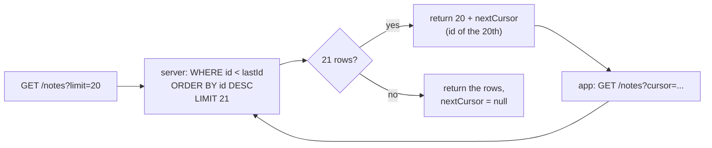
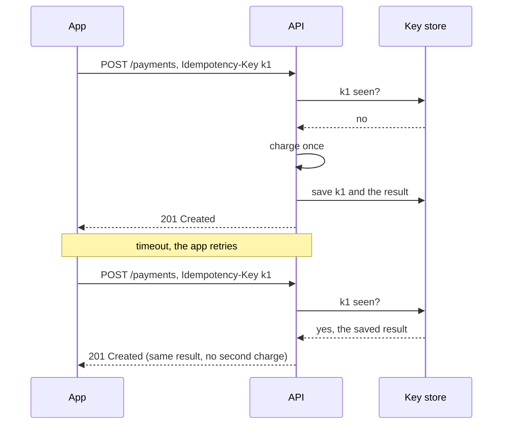

# API Design

> The contract between the app and the backend. Good APIs are predictable, hard to misuse, and never break old app versions.

Roadmap topic 3 · Stage 1: Foundations

**Go deeper:** `02` Networking & HTTP (methods, status codes) · `05` Authentication · `06` Backend Security · `10` Indexes (why cursor pagination is fast) · `05-system-design/22-Reliable-Requests-and-External-Services` (idempotency, retries) · `06-mobile-engineering/08-Networking`.

**Marks:** 🟢 must know · 🟡 good to know

---

#### 1. What Is It?

*Endpoints are nouns (things). The HTTP method is the verb (action).*

```text
GET     /notes          → list notes
POST    /notes          → create a note
GET     /notes/42       → get one note
PATCH   /notes/42       → update a note
DELETE  /notes/42       → delete a note
GET     /users/7/notes  → notes of user 7
```

Rules: use **plural nouns** (`/notes`, not `/getNotes`), let the **method** carry the action, keep nesting to one or two levels, use JSON with one field-name style (`camelCase` or `snake_case`), return `201 Created` for create and `204 No Content` for delete.

| 🟢 Must know | 🟡 Good to know |
|---|---|
| REST, endpoints, JSON | PUT vs PATCH |
| one response and error format | long-running work: `202 Accepted` + status endpoint |
| pagination: offset vs cursor | OpenAPI docs |
| filtering and sorting | REST vs GraphQL vs gRPC |
| input validation | ETag and conditional requests |
| idempotency | |
| versioning and backward compatibility | |

**Signals in an interview:** "design the API for a notes / feed / payments app", "how do you page a feed?", "the user double-tapped Pay", "how do you change the API without breaking old apps?"

---

#### 2. How It Works

**One error shape everywhere**, so the app parses every failure the same way.

```json
{ "id": 42, "title": "Buy milk", "createdAt": "2025-01-10T09:30:00Z" }
```

```json
{
  "error": {
    "code": "VALIDATION_ERROR",
    "message": "Title is required",
    "fields": { "title": "must not be empty" }
  }
}
```

The app uses the machine-readable `code`; humans read `message`. Never leak stack traces or SQL errors.

**Pagination.** Never return everything. Send a page and let the app ask for the next one.

| | Offset (`?limit=20&offset=40`) | Cursor (`?limit=20&cursor=eyJpZCI6NDJ9`) |
|---|---|---|
| Idea | skip N, give me M | give me the items after this one |
| Speed | slow on big tables (walks past skipped rows) | fast (an index seek) |
| Data changes while scrolling | duplicates or gaps | stable |
| Jump to page 50 | easy | not possible |
| Use for | small admin tables | feeds, infinite scroll |

```json
{ "items": [ ... ], "nextCursor": "eyJpZCI6MjJ9" }
```

`nextCursor = null` means no more data. The cursor is opaque to the client (Base64 of the last id, or a signed token).



Ask for **limit + 1** rows: the extra row tells you whether another page exists without a second query.

**Filtering and sorting.** `GET /notes?status=active&sort=-createdAt&limit=20`. Allow only **known fields**, and always apply a **max page size**.

**Input validation.** Check required fields, types, length, range and format on the server. Reply `400` (or `422`) and name the bad field. Accept only the fields you expect (a user must not be able to send `"role": "admin"`). Validate path and query parameters too (`limit` must be 1 to 50).

**Idempotency.** Doing it twice has the same effect as doing it once. `GET`, `PUT`, `DELETE` are idempotent. `POST` is not. The problem: the user double-taps "Pay", or a timeout makes the app retry. The fix: the app sends an **Idempotency-Key**, the server stores `key → result` and, if the same key comes again, returns the saved result without charging twice.



**Versioning and backward compatibility.** Old app versions stay installed for years.

1. **Only add** (new fields, new endpoints). Never remove, rename or change the meaning of existing fields.
2. The app **ignores unknown fields**.
3. If you must break the contract, make `/v2/notes` and keep `/v1` until old apps are gone.
4. Use a **force-update** screen for versions you cannot support.

🟡 **PUT vs PATCH.** PUT replaces the whole resource (send all fields). PATCH changes some fields (send only what changed); mobile apps mostly use PATCH to save bandwidth.

🟡 **Long-running work.** Don't keep the request open.

```text
POST /reports          → 202 Accepted  { "jobId": "abc" }
GET  /reports/jobs/abc → { "status": "processing" } ... { "status": "done", "url": "..." }
```

The app polls the status endpoint, or gets a push notification when it is done.

🟡 **OpenAPI** (Swagger) is a machine-readable description of all endpoints, inputs, outputs and errors. It drives docs, tests and generated Kotlin/Swift clients.

🟡 **REST vs GraphQL vs gRPC**

| | REST | GraphQL | gRPC |
|---|---|---|---|
| Idea | resources + HTTP methods | the client asks for the exact fields | typed remote calls, binary format |
| Good for | the default, simple, cacheable | complex screens, many clients | service-to-service, low latency |
| Watch out | over/under-fetching | server complexity, harder caching | not browser-friendly, harder to debug |

🟡 **ETag and conditional requests.** The server sends `ETag: "v7"`. Next time the app sends `If-None-Match: "v7"`. If nothing changed the server replies `304 Not Modified` with no body, which saves bandwidth and battery.

---

#### 3. Naive vs Better Approach

| Situation | Naive | Better |
|---|---|---|
| URLs | `/getNotes`, `/createNote` | `GET /notes`, `POST /notes` |
| Errors | `200` with `{"error": "..."}`; a different shape per endpoint | the right status code and one error envelope |
| Lists | return all rows | cursor pagination with a max page size |
| Retries | retry `POST` blindly | `Idempotency-Key` |
| Changing a field | rename `title` to `name` | add `name`, keep `title` until old apps are gone |
| Updates | resend the whole object | `PATCH` the changed fields |
| Unchanged data | download it again | `ETag` + `304` |

```kotlin
// Naive offset page: skips rows by walking past them, and shifts when new rows arrive
fun pageByOffset(items: List<Long>, offset: Int, limit: Int): List<Long> = items.drop(offset).take(limit)
```

---

#### 4. Code

```kotlin
import kotlinx.serialization.Serializable
import kotlinx.serialization.json.Json
import java.security.MessageDigest
import java.util.Base64
import java.util.concurrent.ConcurrentHashMap

// ---------- one error shape ----------
@Serializable data class ErrorBody(val code: String, val message: String, val fields: Map<String, String> = emptyMap())
@Serializable data class ApiError(val error: ErrorBody)

// ---------- validation (server side, always) ----------
fun validateCreate(title: String?, limit: Int?): Map<String, String> {
    val errors = LinkedHashMap<String, String>()
    if (title.isNullOrBlank()) errors["title"] = "must not be empty"
    else if (title.length > 200) errors["title"] = "must be at most 200 characters"
    if (limit != null && limit !in 1..50) errors["limit"] = "must be between 1 and 50"
    return errors                                         // empty means valid; otherwise reply 400 with these fields
}

fun validateLimit(limit: Int): Map<String, String> = validateCreate("ok", limit)   // list endpoints have no title

// ---------- cursor pagination ----------
data class Page<T>(val items: List<T>, val nextCursor: String?)

fun encodeCursor(id: Long): String =
    Base64.getUrlEncoder().withoutPadding().encodeToString("""{"id":$id}""".toByteArray())

fun decodeCursor(cursor: String): Long =
    Regex("""\d+""").find(String(Base64.getUrlDecoder().decode(cursor)))!!.value.toLong()

// idsDesc is the table ordered by id descending (the SQL would be: WHERE id < :last ORDER BY id DESC LIMIT :limit+1)
fun pageByCursor(idsDesc: List<Long>, cursor: String?, limit: Int): Page<Long> {
    val last = cursor?.let(::decodeCursor) ?: Long.MAX_VALUE
    val rows = idsDesc.filter { it < last }.take(limit + 1)      // one extra row: is there a next page?
    val items = rows.take(limit)
    return Page(items, if (rows.size > limit) encodeCursor(items.last()) else null)
}

// ---------- idempotency ----------
data class Payment(val id: String, val amount: Int)

class PaymentService {
    private val results = ConcurrentHashMap<String, Payment>()   // key -> saved result
    var charges = 0
        private set
    fun pay(idempotencyKey: String, amount: Int): Payment =
        results.computeIfAbsent(idempotencyKey) { charges++; Payment("pay_$charges", amount) }   // runs once per key
}

// ---------- PATCH: change only what was sent ----------
data class Note(val id: Int, val title: String, val body: String)
data class NotePatch(val title: String? = null, val body: String? = null)
fun Note.patchedWith(p: NotePatch) = copy(title = p.title ?: title, body = p.body ?: body)

// ---------- ETag ----------
fun etagOf(json: String): String =
    "\"" + MessageDigest.getInstance("SHA-256").digest(json.toByteArray())
        .joinToString("") { "%02x".format(it) }.take(16) + "\""

fun conditionalGet(json: String, ifNoneMatch: String?): Pair<Int, String?> =
    if (ifNoneMatch == etagOf(json)) 304 to null else 200 to json

// ---------- tolerant reader: old and new clients keep working ----------
val tolerantJson = Json { ignoreUnknownKeys = true }
```

SQL for the same cursor page, and the Ktor shape:

```sql
-- first page
SELECT id, title FROM notes WHERE user_id = :me ORDER BY id DESC LIMIT 21;
-- next page: the cursor held the last id seen
SELECT id, title FROM notes WHERE user_id = :me AND id < :last ORDER BY id DESC LIMIT 21;
```

```kotlin
// Shape of a route (Ktor). It only parses, calls the service and maps the result to a status.
get("/notes") {
    val limit = call.request.queryParameters["limit"]?.toIntOrNull() ?: 20
    val errors = validateLimit(limit)
    if (errors.isNotEmpty()) return@get call.respond(HttpStatusCode.BadRequest, ApiError(ErrorBody("VALIDATION_ERROR", "Invalid query", errors)))
    call.respond(noteService.list(call.principalId(), limit, call.request.queryParameters["cursor"]))
}
```

Checks: `validateCreate("", 20)` → `{title=must not be empty}`; `validateCreate("Buy milk", 99)` → `{limit=must be between 1 and 50}`; `validateCreate("Buy milk", 20)` → `{}`. `encodeCursor(42)` → `"eyJpZCI6NDJ9"`; `decodeCursor("eyJpZCI6NDJ9")` → `42`. With `ids = [10, 9, ..., 1]`: `pageByCursor(ids, null, 3)` → items `[10, 9, 8]` with a cursor for id `8`; with that cursor → `[7, 6, 5]`; with the cursor for id `2` → `[1]` and `nextCursor = null`. Insert id `11` while the user scrolls (`ids = [11, 10, ..., 1]`): `pageByOffset(ids, 3, 3)` → `[8, 7, 6]` (8 appears twice), but `pageByCursor(ids, cursorFor8, 3)` → `[7, 6, 5]`. `PaymentService.pay("k1", 500)` twice returns the same `Payment` and `charges == 1`; `pay("k2", 500)` makes `charges == 2`. `Note(1, "a", "b").patchedWith(NotePatch(title = "c"))` → `Note(1, "c", "b")`. `conditionalGet(body, etagOf(body))` → `304 to null`; after the body changes → `200 to newBody`. `tolerantJson` decodes a JSON object with an extra field without failing.

---

#### 5. Performance & Limits

| Choice | Cost |
|---|---|
| Offset page `N` | the database reads and discards `offset` rows: `O(offset + limit)` |
| Cursor page | an index seek: `O(log n + limit)` |
| `limit + 1` trick | one query instead of two (no `COUNT(*)`) |
| `COUNT(*)` for "page 3 of 50" | scans a lot on big tables, so avoid it on feeds |
| Payload size | project only needed fields; gzip; paginate |
| `ETag` / `304` | saves the body, but the server still runs the query (cache the entity if it is hot) |

Cap `limit` (for example 50) so a client cannot ask for a million rows.

---

#### 6. Common Mistakes & Edge Cases

1. Verbs in URLs (`/getNotes`).
2. Different error shapes in different endpoints.
3. Returning `200` with an error message inside.
4. No pagination, or no max page size.
5. Removing or renaming a field, so old apps crash.
6. Changing data with GET.
7. Retrying POST without an idempotency key.
8. Offset pagination on a live feed (duplicates and gaps).
9. Sorting by a non-unique column with a cursor: use a tie-breaker (`ORDER BY created_at DESC, id DESC`) or items repeat or vanish.
10. Idempotency keys that are not stored with the request body: the same key with a different payload must be rejected (`422`/`409`).

Edge cases: empty list (`[]` with `200`, not `404`); a deleted item that the cursor points to (fine for `id < last`); PATCH that sets a field to `null` on purpose vs "field not sent" (use JSON Merge Patch rules or a wrapper type).

---

#### 7. Say This in the Interview

1. "Nouns in the URL, the action in the HTTP method, one error format, and correct status codes."
2. "For a feed I use cursor pagination: it is an index seek, and it stays stable while new items arrive. Offset gives duplicates and gets slower with depth."
3. "To make a `POST` safe to retry, the client sends an Idempotency-Key and the server stores the result under that key."
4. "I never remove or rename a field. I add, keep old fields until old apps are gone, and use `/v2` or a force-update as a last resort."
5. "All validation happens on the server, with a max page size and only known fields accepted."

---

#### 8. Quick Check

1. Which pagination fits an infinite-scroll feed, and why?
2. What status code and body does a successful `DELETE` return?
3. Why fetch `limit + 1` rows?
4. A user sends `{"title":"x","role":"admin"}` to `POST /notes`. What should happen?

<details>
<summary>Answers</summary>

1. Cursor: fast (index seek) and stable when data changes.
2. `204 No Content`, with no body.
3. The extra row tells you whether a next page exists, with no second query.
4. Ignore or reject `role`. Only whitelisted fields are accepted, and permissions are never taken from the client.

</details>

---

#### 9. Practice

**Interview questions**

1. Design the API for a notes app (endpoints, methods, status codes, pagination, validation, one error format).
2. Offset vs cursor pagination?
3. What is idempotency, and how do you make a POST idempotent?
4. How do you change an API without breaking old apps?
5. PUT vs PATCH?
6. REST vs GraphQL?

**Hands-on**

1. Write the Notes API contract in OpenAPI before coding (topic 12).
2. Add cursor pagination to a list endpoint and test it while inserting rows.
3. Add an `Idempotency-Key` header to `POST /payments` and show that two identical requests charge once.

**LeetCode-style practice for API building blocks**

| # | Question | Link to this topic |
|---|---|---|
| 359 | [Logger Rate Limiter](https://leetcode.com/problems/logger-rate-limiter/) (Easy, premium) | per-key limit, like rate limiting |
| 706 | [Design HashMap](https://leetcode.com/problems/design-hashmap/) (Easy) | a key-value store |
| 981 | [Time Based Key-Value Store](https://leetcode.com/problems/time-based-key-value-store/) (Medium) | versioned values |
| 146 | [LRU Cache](https://leetcode.com/problems/lru-cache/) (Medium) | a cache for responses |

**Remember:** nouns in URLs, actions in methods · one error format with correct status codes · feeds use cursor pagination · validate on the server · Idempotency-Key for safe POST retries · never break old app versions.
