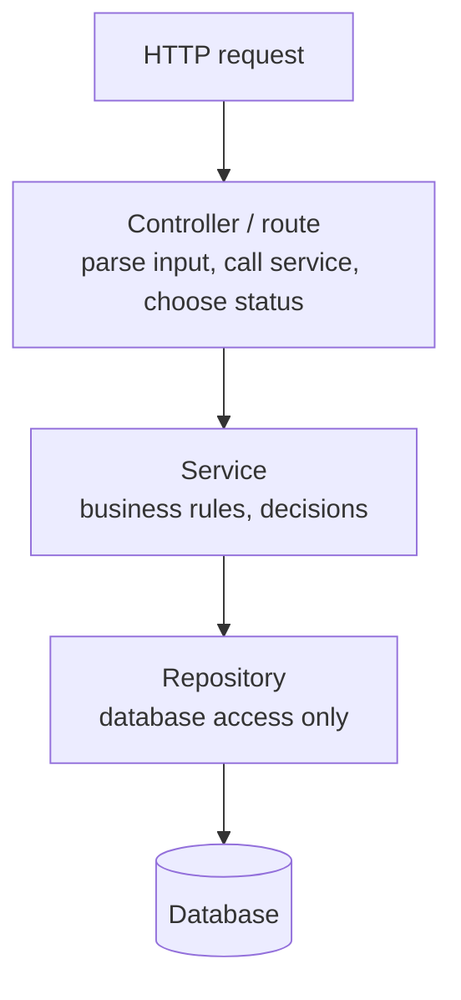
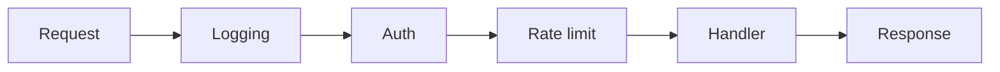
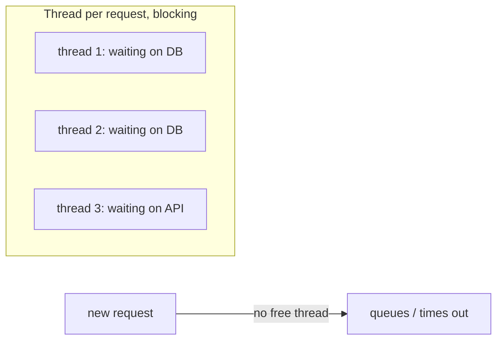

# Backend Building Blocks

> The parts every backend is made of: layers, middleware, config, error handling, and a way to serve many requests at once without blocking.

Roadmap topic 4 · Stage 2: Build a Backend

**Go deeper:** `01` Request Flow · `03` API Design · `07` Testing & Debugging · `09` Connecting API to Database · `06-mobile-engineering/03-Coroutines-and-Flow` (the same coroutine ideas) · `06-mobile-engineering/07-Dependency-Injection-and-Modularization` · `05-system-design/21-Queues-Events-and-Background-Jobs` · `05-system-design/27-Observability`.

**Marks:** 🟢 must know · 🟡 good to know

---

#### 1. What Is It?

*Interviewers test concepts, not the framework. Pick one language and one framework (for you: Kotlin with Ktor or Spring Boot) and go deep.*

| Building block | In one line |
|---|---|
| **Layers** | Controller → Service → Repository. Same idea as View → ViewModel → Repository in your app |
| **Middleware** | code that runs around every request: logging, auth, rate limiting (like OkHttp interceptors) |
| **Config and secrets** | settings come from environment variables, not from code |
| **Central error handling** | one place turns exceptions into status codes and the standard error JSON |
| **Blocking vs non-blocking** | does a waiting request hold a thread, or free it? |
| **Threads, pools, coroutines** | how one server handles many requests at once |
| **Logging** | how you see what happened on a server you can't debug live |
| **Tools** | terminal, Git, `curl`/Postman, running and debugging locally |

| 🟢 Must know | 🟡 Good to know |
|---|---|
| language + framework, layers | dependency injection |
| middleware | memory, garbage collection, thread safety |
| config, environment variables, secrets | serialization, null handling, date/time |
| central error handling | timeouts, cancellation, resource cleanup |
| blocking vs non-blocking | |
| threads, pools, async / coroutines | |
| logging basics, terminal / Git / curl | |

**Signals in an interview:** "how do you structure a backend project?", "what is middleware?", "where do secrets live?", "why is the server slow under load?", "how does your framework handle many requests?"

---

#### 2. How It Works

**Layers.**



| Layer | Does | Must not |
|---|---|---|
| Controller | parse input, call the service, choose the status code | contain business rules or SQL |
| Service | business rules; knows nothing about HTTP | touch HTTP types |
| Repository | read and write the database | contain business rules |

Why: easy to test (fake the repository), easy to change, easy to read.

**Middleware.** A chain around the handler. **Order matters**: log first, authenticate before the handler.



**Config, environment variables, secrets.** Same code, different settings for dev, test and production. Put settings (database URL, keys, port) in environment variables. A `.env` file is for local development only and is **never committed**. In production use a secrets manager or the platform's secret settings. If a secret leaks, **rotate it**.

**Central error handling.** Code throws meaningful errors (`NotFound`, `Validation`, `Conflict`). One handler maps them to a status code and the standard error format. Unknown errors: log the details, send a safe `500`.

**Blocking vs non-blocking.** A server has a limited number of threads. If all of them wait on slow calls, new requests wait too.



| Model | How it works | Examples |
|---|---|---|
| Thread per request | each request takes a thread from a pool | Spring MVC, Tomcat |
| Event loop | one thread serves many requests with async I/O | Node.js |
| Coroutines | lightweight tasks on a few threads | Kotlin: Ktor, Spring WebFlux |

Know which model your framework uses. Use a **bounded** thread pool (unlimited threads crash the server). Never block an event-loop or coroutine thread with slow blocking calls; switch to `Dispatchers.IO`. Database connections are limited too (topic 9). Long work (reports, video) goes to a **background job**, not inside the request.

**Logging.** Levels: `DEBUG` (detail), `INFO` (normal events), `WARN` (odd), `ERROR` (failure). Log each request with a **request ID** so you can follow one request. **Never** log passwords, tokens or personal data. Log the stack trace on the server only.

**Tools.** Terminal (`cd`, `ls`, `cat`, `grep`, `ps`, `kill`, permissions), Git (branch, commit, pull request, resolve conflicts), `curl` or Postman to call the API without the app, breakpoints and logs locally.

```bash
curl -X POST http://localhost:8080/notes \
  -H "Content-Type: application/json" \
  -H "Authorization: Bearer $TOKEN" \
  -d '{"title":"Buy milk"}'
```

🟡 **Dependency injection.** A class receives what it needs (repository, clients) instead of creating it. Testing is easy: pass a fake. Same idea as Hilt or Koin on Android.

🟡 **Memory, garbage collection, thread safety.** Many requests run at once in one server. Shared **mutable** data causes race conditions, so prefer stateless services and immutable data; if you must share, use locks or concurrent types. Things kept forever (caches without a limit) leak memory. Garbage collection can cause short pauses.

🟡 **Serialization, null handling, date/time.** Decide how to treat *missing* vs `null`. Send dates as ISO 8601 in UTC (`2025-01-10T09:30:00Z`) and let the app convert to local time.

🟡 **Timeouts, cancellation, cleanup.** Put a timeout on every call to another service or database. Stop work nobody waits for. Always close connections, files and streams (`use { }`).

---

#### 3. Naive vs Better Approach

| Situation | Naive | Better |
|---|---|---|
| Structure | SQL and business rules inside the controller | controller → service → repository |
| Cross-cutting code | copy the auth check into every handler | one middleware |
| Secrets | in the code or in Git | environment variables, a secrets manager, rotate on leak |
| Errors | `try/catch` in every handler, raw exceptions to the client | throw typed errors, one central mapper |
| Slow I/O | blocking call on the request thread | `withContext(Dispatchers.IO)` or non-blocking client |
| Threads | `Executors.newCachedThreadPool()` (unbounded) | bounded pool sized for the work |
| Shared state | a plain `var counter` used by every request | `AtomicInteger`, or no shared state |
| Waiting | no timeout | `withTimeout`, client and database timeouts |

```kotlin
// Naive controller: business rule, SQL and error text all in one place
post("/notes") {
    val title = call.receive<Map<String, String>>()["title"]
    if (title == null || title.isBlank()) { call.respondText("bad"); return@post }       // 200 with an error
    db.createStatement().execute("INSERT INTO notes(title) VALUES ('$title')")          // SQL injection too
    call.respondText("ok")
}
```

---

#### 4. Code

```kotlin
import kotlinx.coroutines.*
import java.util.concurrent.atomic.AtomicInteger

// ---------- layers ----------
data class Note(val id: Long, val ownerId: Long, val title: String)

interface NoteRepository {
    fun find(id: Long): Note?
    fun insert(ownerId: Long, title: String): Note
}

class InMemoryNoteRepository : NoteRepository {
    private val notes = HashMap<Long, Note>()
    private var nextId = 1L
    override fun find(id: Long) = notes[id]
    override fun insert(ownerId: Long, title: String): Note =
        Note(nextId++, ownerId, title).also { notes[it.id] = it }
}

sealed class AppException(val status: Int, val code: String, message: String) : RuntimeException(message) {
    class NotFound(what: String) : AppException(404, "NOT_FOUND", "$what not found")
    class Validation(msg: String) : AppException(400, "VALIDATION_ERROR", msg)
    class Conflict(msg: String) : AppException(409, "CONFLICT", msg)
}

// Service: business rules, no HTTP types, receives its repository (dependency injection)
class NoteService(private val repo: NoteRepository) {
    fun create(userId: Long, title: String): Note {
        if (title.isBlank()) throw AppException.Validation("title must not be empty")
        return repo.insert(userId, title.trim())
    }
    fun get(userId: Long, id: Long): Note {
        val note = repo.find(id)
        if (note == null || note.ownerId != userId) throw AppException.NotFound("note $id")   // do not reveal other users' ids
        return note
    }
}

// ---------- one central place maps errors to responses ----------
fun toResponse(e: Throwable): Pair<Int, String> = when (e) {
    is AppException -> e.status to """{"error":{"code":"${e.code}","message":"${e.message}"}}"""
    else -> 500 to """{"error":{"code":"INTERNAL","message":"Something went wrong"}}"""    // details go to the log only
}

// ---------- middleware as function composition ----------
data class Request(val path: String, val headers: Map<String, String> = emptyMap())
data class Response(val status: Int, val body: String)
typealias Handler = (Request) -> Response
typealias Middleware = (Handler) -> Handler

fun logging(log: MutableList<String>): Middleware = { next -> { req ->
    log += "-> ${req.path}"
    val res = next(req)
    log += "<- ${res.status}"
    res
} }

val auth: Middleware = { next -> { req ->
    if (req.headers["Authorization"] == null) Response(401, "unauthorized") else next(req)
} }

fun chain(vararg middleware: Middleware, handler: Handler): Handler =
    middleware.foldRight(handler) { m, acc -> m(acc) }          // the first one listed is the outermost

// ---------- config: fail fast, never print secrets ----------
data class AppConfig(val port: Int, val dbUrl: String, val jwtSecret: String) {
    override fun toString() = "AppConfig(port=$port, dbUrl=$dbUrl, jwtSecret=***)"
    companion object {
        fun fromEnv(env: Map<String, String> = System.getenv()) = AppConfig(
            port = env["PORT"]?.toIntOrNull() ?: 8080,
            dbUrl = env["DATABASE_URL"] ?: error("DATABASE_URL is required"),
            jwtSecret = env["JWT_SECRET"] ?: error("JWT_SECRET is required")
        )
    }
}

// ---------- blocking, timeouts, thread safety, cleanup ----------
suspend fun slowQuery(): Int = withContext(Dispatchers.IO) { Thread.sleep(100); 42 }       // blocking call moved off the request thread

suspend fun callWithTimeout(): String? = withTimeoutOrNull(200) { delay(500); "late" }     // null means it timed out

fun maxRequestsPerSecond(threads: Int, avgSeconds: Double) = threads / avgSeconds           // threads / time each request holds one

class SafeCounter {
    private val n = AtomicInteger()
    fun inc() = n.incrementAndGet()
    fun get() = n.get()
}

fun readFirstLine(path: String): String? =
    java.io.File(path).bufferedReader().use { it.readLine() }                               // closed even if it throws
```

Logging with a request ID (SLF4J + MDC), and what never to log:

```kotlin
MDC.put("requestId", UUID.randomUUID().toString().take(8))
log.info("created note id={}", note.id)
// never: log.info("login email={} password={}", email, password)
```

Checks: `NoteService(InMemoryNoteRepository()).create(1, "  Buy milk ")` → `Note(1, 1, "Buy milk")`; `create(1, "  ")` throws `Validation`. `get(2, 1)` (another user's note) and `get(1, 99)` both throw `NotFound`. `toResponse(AppException.NotFound("note 9"))` → `404` and `{"error":{"code":"NOT_FOUND","message":"note 9 not found"}}`; `toResponse(IllegalStateException("db password is x"))` → `500` with the safe message only. `chain(logging(log), auth) { Response(200, "ok") }`: without an `Authorization` header it returns `Response(401, "unauthorized")` and `log == ["-> /notes", "<- 401"]`; with the header it returns `Response(200, "ok")`. `AppConfig.fromEnv(mapOf("DATABASE_URL" to "db", "JWT_SECRET" to "s")).port` → `8080`; without `JWT_SECRET` it throws `IllegalStateException` at startup, and printing the config shows `jwtSecret=***`. `callWithTimeout()` → `null`. `maxRequestsPerSecond(200, 0.1)` → `2000.0`; `maxRequestsPerSecond(200, 1.0)` → `200.0`. 1000 threads each calling `SafeCounter.inc()` 1000 times give exactly `1000000`; the same loop on a plain `var n` usually gives less.

---

#### 5. Performance & Limits

**Little's law, in simple form:** `requests per second ≈ threads ÷ seconds each request holds a thread`.

| Threads | Each request holds a thread for | Max throughput |
|---|---|---|
| 200 | 100 ms | about 2,000 per second |
| 200 | 1 s (slow dependency) | about 200 per second |
| 200 | 10 s (no timeout, dependency down) | about 20 per second, and requests pile up |

So a slow dependency quietly divides your capacity. That is why we set **timeouts**, use **non-blocking I/O**, and keep thread pools and database connection pools **bounded**. Every extra middleware adds a little time to every request, so keep each one cheap.

---

#### 6. Common Mistakes & Edge Cases

1. Business logic inside controllers, SQL inside controllers.
2. Secrets committed to Git (rotate them if it happened).
3. Blocking calls on a non-blocking (event-loop or coroutine) thread.
4. Unlimited threads or connections.
5. Returning raw exceptions or stack traces to the client.
6. Logging sensitive data (passwords, tokens, personal data).
7. Middleware in the wrong order (authentication after the handler).
8. Mutable state shared between requests (a global list, a counter).
9. A `catch` that swallows `CancellationException`, so cancelling a coroutine does nothing.
10. Reading config on every request instead of once at startup.

Edge cases: a missing environment variable should stop startup immediately, not fail on the first request; a client that disconnects mid-request should stop the work; the same error can reach the central handler from many layers, so it must not reveal internals.

---

#### 7. Say This in the Interview

1. "I split the code into controller, service and repository. The controller handles HTTP, the service holds business rules and never sees HTTP types, and the repository only talks to the database."
2. "Middleware handles cross-cutting concerns such as logging, auth and rate limiting once, in a defined order."
3. "Config and secrets come from environment variables or a secrets manager, never from Git or from the app."
4. "I throw typed errors and one central handler maps them to status codes and the standard error JSON, while details go to the logs."
5. "Throughput is roughly threads divided by time per request, so I avoid blocking calls on request threads, bound the pools, and set timeouts."

---

#### 8. Quick Check

1. Which layer chooses the HTTP status code?
2. Where should the database password live?
3. 200 threads, each request waits 2 s on a slow API. About how many requests per second?
4. Why must authentication middleware run before the handler?

<details>
<summary>Answers</summary>

1. The controller (or the central error handler, for errors).
2. In an environment variable or a secrets manager, never in Git or in the app.
3. About 100 per second (200 ÷ 2).
4. Otherwise the handler runs for anonymous users.

</details>

---

#### 9. Practice

**Interview questions**

1. How do you structure a backend project?
2. What is middleware, and why does the order matter?
3. Where do you keep secrets and config?
4. Blocking vs non-blocking?
5. How does your framework handle many requests at once?
6. How do you handle errors?
7. Why is dependency injection useful for testing?

**Hands-on**

1. Build the layered `NoteService` above and call it from a Ktor route.
2. Write a logging middleware that adds a request ID to every log line.
3. Make the server fail on startup if a required environment variable is missing.
4. Add `withTimeout` to one outgoing call and test it with a slow fake.

**LeetCode-style practice for backend building blocks**

| # | Question | Link to this topic |
|---|---|---|
| 1114 | [Print in Order](https://leetcode.com/problems/print-in-order/) (Easy) | ordering work across threads |
| 1188 | [Design Bounded Blocking Queue](https://leetcode.com/problems/design-bounded-blocking-queue/) (Medium, premium) | a bounded work queue |
| 146 | [LRU Cache](https://leetcode.com/problems/lru-cache/) (Medium) | a bounded cache |
| 362 | [Design Hit Counter](https://leetcode.com/problems/design-hit-counter/) (Medium, premium) | request counting |

**Remember:** controller → service → repository · middleware runs on every request, and order matters · config and secrets in environment variables · one central error handler · don't block worker threads, use bounded pools · know your runtime's concurrency model.
