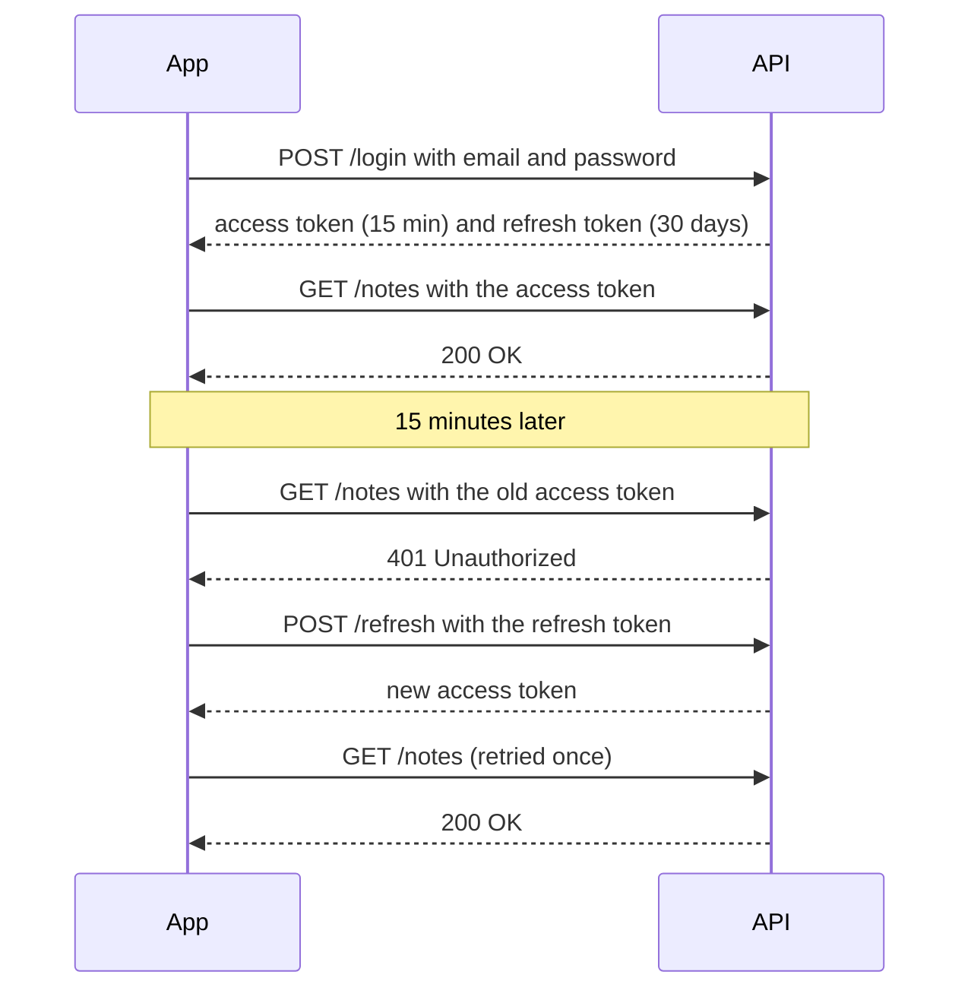

# Authentication & Authorization

> Authentication proves who you are. Authorization decides what you may do. Most real API bugs are missing authorization checks, not broken login.

Roadmap topic 5 · Stage 2: Build a Backend

**Go deeper:** `02` Networking & HTTP (401 vs 403) · `03` API Design · `06` Backend Security Essentials · `07` Testing (test permissions) · `06-mobile-engineering/13-Security` (token storage on the device) · `05-system-design/29-Backup-Recovery-Security-and-Cost`.

**Marks:** 🟢 must know · 🟡 good to know

---

#### 1. What Is It?

*At the airport: the passport check is authentication. The boarding pass that decides which gate you may enter is authorization.*

| | Authentication (AuthN) | Authorization (AuthZ) |
|---|---|---|
| Question | who are you? | what are you allowed to do? |
| Example | log in with email and password | can this user delete this note? |
| Failure | `401 Unauthorized` | `403 Forbidden` (or `404` to hide the record) |

```text
Request → AuthN (who?) → AuthZ (allowed?) → Handler
```

| 🟢 Must know | 🟡 Good to know |
|---|---|
| AuthN vs AuthZ | OAuth 2.0, OpenID Connect, PKCE |
| password hashing | JWT pitfalls |
| sessions vs tokens (JWT) | MFA, API keys |
| access token + refresh token, expiry, logout | |
| ownership check on every record | |
| roles and permissions | |
| secure token storage on mobile | |

**Signals in an interview:** "how do you store passwords?", "session vs JWT?", "user A read user B's note, why?", "what happens when the access token expires?", "where does the app keep the token?"

---

#### 2. How It Works

**Password hashing.** Store a fingerprint of the password, never the password.

1. A **hash** is one-way: you cannot get the password back from it. Hashing is not encryption.
2. Use a slow, password-specific algorithm: **bcrypt, argon2 or scrypt**. Not plain SHA-256 (too fast, so attackers try billions of guesses per second).
3. A **salt** (a random value per password) makes identical passwords produce different hashes. The library does this for you.
4. Login: hash the typed password with the stored salt and compare it with the stored hash, in constant time.
5. Use a trusted library. Never write your own.

**Sessions vs tokens (JWT).** After login the client must prove who it is on every request without sending the password again.

| | Session | Token (JWT) |
|---|---|---|
| Where is the state? | on the server (session ID → user) | inside the signed token |
| Client sends | session ID (usually a cookie) | `Authorization: Bearer <token>` |
| Revoke | easy: delete the session | hard until it expires |
| Scaling | needs a shared session store | stateless: any server can verify |
| Common in | web apps | mobile apps and APIs |

A **JWT** has three parts, `header.payload.signature`. The server checks the **signature**, the **expiry** and the **algorithm**. The payload is only encoded (Base64), **not secret**.

**Access token + refresh token.** A short-lived key for daily use, and a long-lived key only for getting new short-lived keys. If an access token leaks, it stops working soon.



**Logout:** delete the tokens on the device **and** revoke the refresh token on the server. **Mobile tip:** when several calls fail with `401` at once, refresh **only once**, let the others wait, then retry them all.

**Ownership checks on every record.** Logged in is not enough: does this record belong to you?

```text
GET /notes/99
→ find note 99 where user_id = (user from the TOKEN)
→ found: return it   |   not found: 404
```

1. Take the user from the **token**, never from a request field like `userId`.
2. Check ownership on **read, update and delete**.
3. Missing this is the most common real API bug (IDOR / BOLA): a user changes `99` to `100` and reads someone else's data.
4. Returning `404` for "not yours" avoids revealing that the record exists.

**Roles and permissions (RBAC).** Users have roles (`user`, `admin`), roles have permissions. Check them on the server for each action (hiding a button in the app is not security). Give the **least** access needed.

**Secure token storage on mobile.** The token is the key to the account. iOS: **Keychain**. Android: **Android Keystore**-backed encrypted storage. Not plain `SharedPreferences` or `UserDefaults`. Never log tokens or put them in URLs. Clear them on logout.

🟡 **OAuth 2.0** lets an app get limited access to your data at another service without your password. **OpenID Connect (OIDC)** adds *login* (identity) on top: "Sign in with Google / Apple". **PKCE** protects mobile apps, which cannot keep a client secret safe; always use it. Use a trusted library or provider.

🟡 **JWT pitfalls:** hard to revoke before expiry; no secrets in the payload; always verify signature, expiry **and algorithm** (reject `alg: none`). **MFA** adds a second proof (code, authenticator app). **API keys** identify an *app or service*, not a user; keep them secret and rotate them.

---

#### 3. Naive vs Better Approach

| Situation | Naive | Better |
|---|---|---|
| Password storage | plain text, or `SHA-256(password)` | bcrypt / argon2 / scrypt with a salt |
| Access token life | 30 days | 15 minutes + refresh token |
| Who is the user? | `userId` from the request body | user from the verified token |
| Reading a note | `SELECT * FROM notes WHERE id = ?` | `... WHERE id = ? AND user_id = ?` |
| Admin actions | hide the button | check the role on the server |
| Token on the device | `SharedPreferences` in plain text | Keystore-encrypted storage |
| Login error | "No such user" | "Invalid email or password" |
| Many 401s at once | each call refreshes | refresh once, the rest wait |

```kotlin
// Naive: trusts a field from the client, so changing 99 to 100 reads someone else's note
get("/notes/{id}") {
    val note = db.query("SELECT * FROM notes WHERE id = ${call.parameters["id"]}")   // no owner check, and SQL injection too
    call.respond(note)
}
```

---

#### 4. Code

JDK-only code, so you can run it. In production use a maintained library (bcrypt or argon2, and a JWT library such as `java-jwt` or Ktor's built-in JWT auth). The hand-written JWT below is **to show the structure**.

```kotlin
import java.security.MessageDigest
import java.security.SecureRandom
import java.time.Instant
import java.util.Base64
import javax.crypto.Mac
import javax.crypto.SecretKeyFactory
import javax.crypto.spec.PBEKeySpec
import javax.crypto.spec.SecretKeySpec
import kotlinx.coroutines.sync.Mutex
import kotlinx.coroutines.sync.withLock

// ---------- password hashing: PBKDF2 (JDK). bcrypt / argon2 are the usual libraries ----------
private fun pbkdf2(password: CharArray, salt: ByteArray, iterations: Int, bits: Int): ByteArray =
    SecretKeyFactory.getInstance("PBKDF2WithHmacSHA256")
        .generateSecret(PBEKeySpec(password, salt, iterations, bits)).encoded

fun hashPassword(password: CharArray, iterations: Int = 210_000): String {
    val salt = ByteArray(16).also { SecureRandom().nextBytes(it) }          // random salt per password
    val hash = pbkdf2(password, salt, iterations, 256)
    val b64 = Base64.getEncoder()
    return "pbkdf2:$iterations:${b64.encodeToString(salt)}:${b64.encodeToString(hash)}"
}

fun verifyPassword(password: CharArray, stored: String): Boolean {
    val (scheme, iterations, saltB64, hashB64) = stored.split(":")
    if (scheme != "pbkdf2") return false
    val expected = Base64.getDecoder().decode(hashB64)
    val actual = pbkdf2(password, Base64.getDecoder().decode(saltB64), iterations.toInt(), expected.size * 8)
    return MessageDigest.isEqual(expected, actual)                           // constant-time comparison
}

// ---------- JWT (HS256): header.payload.signature ----------
private val b64url = Base64.getUrlEncoder().withoutPadding()

private fun hmac(data: String, secret: String): String {
    val mac = Mac.getInstance("HmacSHA256")
    mac.init(SecretKeySpec(secret.toByteArray(), "HmacSHA256"))
    return b64url.encodeToString(mac.doFinal(data.toByteArray()))
}

fun createToken(userId: Long, ttlSeconds: Long, secret: String, now: Long = Instant.now().epochSecond): String {
    val header = b64url.encodeToString("""{"alg":"HS256","typ":"JWT"}""".toByteArray())
    val payload = b64url.encodeToString("""{"sub":"$userId","exp":${now + ttlSeconds}}""".toByteArray())
    return "$header.$payload.${hmac("$header.$payload", secret)}"
}

sealed class TokenResult {
    data class Valid(val userId: Long) : TokenResult()
    object Invalid : TokenResult()
    object Expired : TokenResult()
}

fun verifyToken(token: String, secret: String, now: Long = Instant.now().epochSecond): TokenResult {
    val parts = token.split(".")
    if (parts.size != 3) return TokenResult.Invalid
    val (h, p, sig) = parts
    val header = try { String(Base64.getUrlDecoder().decode(h)) } catch (e: IllegalArgumentException) { return TokenResult.Invalid }
    if (!header.contains("\"HS256\"")) return TokenResult.Invalid            // reject alg "none" and anything unexpected
    if (!MessageDigest.isEqual(hmac("$h.$p", secret).toByteArray(), sig.toByteArray())) return TokenResult.Invalid
    val payload = String(Base64.getUrlDecoder().decode(p))
    val exp = Regex(""""exp":(\d+)""").find(payload)?.groupValues?.get(1)?.toLong() ?: return TokenResult.Invalid
    val sub = Regex(""""sub":"(\d+)"""").find(payload)?.groupValues?.get(1)?.toLong() ?: return TokenResult.Invalid
    return if (now >= exp) TokenResult.Expired else TokenResult.Valid(sub)
}

// ---------- ownership: the user comes from the token, the owner is part of the query ----------
data class Note(val id: Long, val ownerId: Long, val title: String)

fun findNote(notes: List<Note>, userId: Long, id: Long): Note? =
    notes.firstOrNull { it.id == id && it.ownerId == userId }                // SQL: WHERE id = ? AND user_id = ?

// ---------- roles and permissions ----------
enum class Role { USER, ADMIN }
enum class Permission { READ_OWN, WRITE_OWN, DELETE_ANY }

private val rolePermissions = mapOf(
    Role.USER to setOf(Permission.READ_OWN, Permission.WRITE_OWN),
    Role.ADMIN to setOf(Permission.READ_OWN, Permission.WRITE_OWN, Permission.DELETE_ANY)
)
fun can(role: Role, permission: Permission) = permission in rolePermissions.getValue(role)

// ---------- client: refresh the access token once, even if ten calls get a 401 ----------
class TokenRefresher(initial: String, private val refresh: suspend () -> String) {
    private val mutex = Mutex()
    private var accessToken = initial
    suspend fun tokenAfter401(failedToken: String): String = mutex.withLock {
        if (accessToken != failedToken) accessToken                          // someone already refreshed
        else refresh().also { accessToken = it }
    }
}
```

Android only: keep the token encrypted with a Keystore key (the key never leaves secure hardware).

```kotlin
val keyGen = KeyGenerator.getInstance(KeyProperties.KEY_ALGORITHM_AES, "AndroidKeyStore")
keyGen.init(
    KeyGenParameterSpec.Builder("token_key", KeyProperties.PURPOSE_ENCRYPT or KeyProperties.PURPOSE_DECRYPT)
        .setBlockModes(KeyProperties.BLOCK_MODE_GCM)
        .setEncryptionPaddings(KeyProperties.ENCRYPTION_PADDING_NONE)
        .build()
)
val key = keyGen.generateKey()
val cipher = Cipher.getInstance("AES/GCM/NoPadding").apply { init(Cipher.ENCRYPT_MODE, key) }
val encrypted = cipher.doFinal(token.toByteArray())        // store `encrypted` and `cipher.iv`
```

Checks: `hashPassword("hunter2".toCharArray())` called twice gives two different strings (different salts), and `verifyPassword("hunter2".toCharArray(), each)` → `true`, `verifyPassword("hunter3".toCharArray(), each)` → `false`. With `t = createToken(42, 900, "secret", now = 1000)`: `verifyToken(t, "secret", now = 1000)` → `Valid(42)`; `verifyToken(t, "secret", now = 1900)` → `Expired`; `verifyToken(t, "other-secret", now = 1000)` → `Invalid`; a token whose payload was edited (say `sub` changed to 43) → `Invalid`; a token with header `{"alg":"none"}` → `Invalid`. `findNote(listOf(Note(99, 1, "mine")), userId = 2, id = 99)` → `null` (reply `404`); with `userId = 1` → the note. `can(Role.USER, Permission.DELETE_ANY)` → `false`; `can(Role.ADMIN, Permission.DELETE_ANY)` → `true`. Ten coroutines calling `tokenAfter401("t0")` on `TokenRefresher("t0") { counter++; "t1" }` all receive `"t1"` and `counter == 1`.

---

#### 5. Performance & Limits

| Choice | Cost and why |
|---|---|
| Password hash | deliberately slow: aim for about 100 to 500 ms per hash (bcrypt cost 10 to 12, PBKDF2 hundreds of thousands of iterations). That makes guessing expensive, but also means a login endpoint is CPU-heavy, so rate limit it |
| JWT verify | one HMAC or signature check: microseconds, no database call (the main benefit) |
| Session lookup | one read from a shared store (Redis or database) per request |
| Revocation | sessions: instant. JWT: wait for expiry, or keep a small deny list (which brings state back) |
| Token size | JWT in every request header: keep the payload small |

Typical lifetimes: access token 5 to 15 minutes, refresh token days to weeks, rotated on each use.

---

#### 6. Common Mistakes & Edge Cases

1. Plain-text or fast-hash passwords.
2. Missing ownership checks (IDOR / BOLA).
3. Trusting `userId` from the request body.
4. Long-lived access tokens.
5. Tokens in plain storage, logs or URLs.
6. Only hiding buttons in the app instead of checking on the server.
7. Building your own crypto or login protocol.
8. Not checking the JWT algorithm (accepting `none`) or the expiry.
9. Putting secrets or personal data in the JWT payload.
10. Different error messages for "unknown email" and "wrong password" (tells attackers which emails exist).

Edge cases: refresh token stolen (rotate refresh tokens and detect reuse); user changes password (revoke old refresh tokens); clock skew between servers (allow a few seconds of leeway); user deleted but the access token is still valid until it expires.

---

#### 7. Say This in the Interview

1. "Authentication is who you are (`401`). Authorization is what you may do (`403`). I check both on the server."
2. "Passwords are hashed with bcrypt or argon2 and a per-user salt. Never plain text, never a fast hash."
3. "The app holds a short-lived access token and a long-lived refresh token. On a `401` it refreshes once and retries the call."
4. "Every query that touches a user's data includes the owner from the token: `WHERE id = ? AND user_id = ?`. That stops one user reading another's records."
5. "On the phone the tokens live in Keychain or Keystore-backed storage, never in plain preferences or logs."
6. "I use established libraries and providers. I don't invent crypto."

---

#### 8. Quick Check

1. A user is logged in but is not allowed to delete this note. Which status code?
2. Why is `SHA-256(password)` a bad way to store passwords?
3. Why return `404` instead of `403` for another user's note?
4. Five API calls fail with `401` at the same time. How many refresh requests should the app make?

<details>
<summary>Answers</summary>

1. `403` (or `404` to hide the record's existence).
2. It is fast, so attackers can try billions of guesses per second. Use a slow, salted password hash.
3. `403` confirms the record exists; `404` reveals nothing.
4. One. The others wait for it and then retry with the new token.

</details>

---

#### 9. Practice

**Interview questions**

1. AuthN vs AuthZ?
2. How do you store passwords?
3. Session vs JWT?
4. How do access and refresh tokens work, and how does logout work?
5. How do you stop user A reading user B's note?
6. Where does a mobile app store tokens?
7. OAuth vs OIDC? Why PKCE?

**Hands-on**

1. Implement register and login with a hashed password and a 15-minute access token.
2. Add an ownership check to `GET /notes/{id}`, and write a test where user B requests user A's note.
3. Add an OkHttp `Authenticator` that refreshes the token once and retries.

**Remember:** AuthN is who, AuthZ is what (401 vs 403) · hash passwords with bcrypt or argon2 and a salt · short access token + long refresh token · ownership check on every record, with the user taken from the token · tokens go in Keychain / Keystore · use established libraries, never your own crypto.
