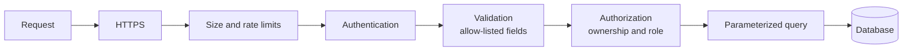

# Backend Security Essentials

> Assume every input is hostile and every secret will leak one day. A few habits stop most real attacks.

Roadmap topic 6 · Stage 2: Build a Backend

**Go deeper:** `03` API Design (validation) · `05` Authentication & Authorization · `08` SQL · `09` Connecting API to Database · `10-database/18-Database-Security-and-Privacy` · `05-system-design/25-Overload-and-Failure-Handling` (rate limiting) · `06-mobile-engineering/13-Security`.

**Marks:** 🟢 must know · 🟡 good to know

---

#### 1. What Is It?

*Security is a set of layers. If one fails, the next one still protects you.*

| 🟢 Must know | 🟡 Good to know |
|---|---|
| input validation and size limits | CORS, CSRF, XSS |
| SQL injection and parameterized queries | SSRF |
| HTTPS and secret handling | encryption at rest, personal data privacy |
| no sensitive data in logs or errors | OWASP API Top 10 |
| login rate limiting | |

**Signals in an interview:** "how do you prevent SQL injection?", "what are common API security mistakes?", "how do you protect a login endpoint?", "is CORS a security feature?", "what is SSRF?"

---

#### 2. How It Works



**Input validation and size limits.** Never trust anything from outside.

1. Validate type, length, range and format on the server.
2. Set a **maximum request body size** and a **maximum page size**, and **upload limits** (size and file type).
3. Accept only the fields you expect. A user must not be able to send `"role": "admin"` or `"isPaid": true`. This attack is called **mass assignment**.

**SQL injection.** Never glue user text into a SQL string.

```text
query = "SELECT * FROM users WHERE email = '" + email + "'"
email = ' OR '1'='1      → the condition is always true, so every user is returned
```

Good: a **parameterized query**. The database treats the value as data, never as SQL.

```sql
SELECT * FROM users WHERE email = ?;   -- the value is sent separately
```

ORMs are safe by default, but **raw queries built with string concatenation are not**. You cannot parameterize identifiers (table or column names, `ORDER BY`), so allow-list them.

**HTTPS and secret handling.** HTTPS everywhere; never send tokens over plain HTTP. Secrets (database password, API keys) live in **environment variables or a secrets manager**, not in code or Git. **Never put secrets inside the mobile app**: anyone can extract them. Rotate a secret if it leaks.

**No sensitive data in logs or errors.** Never log passwords, tokens, full card numbers or personal data. Never send stack traces or SQL errors to the client: return a safe message and log the details on the server. Login errors are generic: "Invalid email or password", not "No such user".

**Login rate limiting.** Limit attempts per account and per IP, slow down or temporarily lock after repeated failures, and return `429 Too Many Requests`. Limit other expensive endpoints too (password reset, OTP, search).

🟡 **CORS, CSRF, XSS** are mostly web-browser problems.

| | What it is | Note |
|---|---|---|
| **CORS** | a browser rule about which websites may call your API | **not authentication**; mobile apps ignore it |
| **CSRF** | a malicious site makes the browser send your cookies to your API | affects cookie logins; Bearer-token headers are not affected |
| **XSS** | an attacker injects a script into a web page | fix: escape output |

🟡 **SSRF** (server-side request forgery): your server fetches a URL a user gave you ("import image from URL"). An attacker supplies an internal address (`http://localhost/admin`, `http://169.254.169.254/` for cloud metadata) and your server fetches it. Fix: allow only expected hosts and `https`, resolve the name and block loopback, private and link-local addresses, set timeouts.

🟡 **Encryption and privacy.** In transit = HTTPS. At rest = encrypted disks and backups. Collect only the personal data you need, protect it, allow deletion on request, and mask sensitive data in the app and in logs.

🟡 **OWASP API Top 10** (know the names; these show up most):

1. **Broken object-level authorization:** missing ownership checks (topic 5).
2. **Broken authentication:** weak login, token or password handling.
3. **Unrestricted resource consumption:** no rate or size limits.
4. **Broken function-level authorization:** normal users calling admin endpoints.
5. **Security misconfiguration:** debug mode on, open ports, default passwords.

Also: keep dependencies updated to receive security fixes.

---

#### 3. Naive vs Better Approach

| Situation | Naive | Better |
|---|---|---|
| Database access | `"... WHERE email = '$email'"` | `PreparedStatement` with `?` |
| Request body | accept any size and any field | size limit, a request class with only allowed fields |
| Login | unlimited attempts, "no such user" | rate limit, generic error, hashed passwords |
| Errors | return the exception text | safe message, details in the log |
| Secrets | in the repo or in the app | environment variable or secrets manager |
| Fetching a user URL | `fetch(url)` | allow-listed host, https only, no private addresses |
| Logs | `log.info("login $email $password")` | never log credentials; mask personal data |

```kotlin
// Naive: injectable
fun findUserUnsafe(conn: java.sql.Connection, email: String): List<String> =
    conn.createStatement().use { st ->
        st.executeQuery("SELECT email FROM users WHERE email = '$email'").use { rs ->
            buildList { while (rs.next()) add(rs.getString(1)) }
        }
    }
```

---

#### 4. Code

```kotlin
import kotlinx.serialization.Serializable
import kotlinx.serialization.json.Json
import java.net.InetAddress
import java.net.URI
import java.sql.Connection

// ---------- SQL injection: the safe version ----------
fun findUserSafe(conn: Connection, email: String): List<String> =
    conn.prepareStatement("SELECT email FROM users WHERE email = ?").use { ps ->
        ps.setString(1, email)                                   // sent as data, never parsed as SQL
        ps.executeQuery().use { rs -> buildList { while (rs.next()) add(rs.getString(1)) } }
    }

// Identifiers cannot be parameters, so allow-list them
fun orderByClause(sort: String?): String = when (sort) {
    "createdAt" -> "created_at ASC"
    "-createdAt" -> "created_at DESC"
    else -> "id ASC"                                             // unknown values fall back to a safe default
}

// ---------- mass assignment: the request class lists only the allowed fields ----------
@Serializable data class CreateUserRequest(val email: String, val name: String)   // no role, no isAdmin
val lenientJson = Json { ignoreUnknownKeys = true }              // extra fields like "role" are dropped, never applied

fun withinBodyLimit(contentLength: Long?, maxBytes: Long = 1_000_000): Boolean =
    contentLength != null && contentLength in 0..maxBytes        // reject a missing or oversized body early

// ---------- login rate limiting: token bucket per key (account or IP) ----------
class TokenBucket(private val capacity: Int, private val refillPerSecond: Double, private val now: () -> Long) {
    private var tokens = capacity.toDouble()
    private var last = now()
    fun tryTake(): Boolean {
        val t = now()
        tokens = minOf(capacity.toDouble(), tokens + (t - last) / 1000.0 * refillPerSecond)
        last = t
        return if (tokens >= 1.0) { tokens -= 1.0; true } else false      // false → reply 429
    }
}

const val LOGIN_ERROR = "Invalid email or password"             // the same text for "no such user" and "wrong password"

// ---------- SSRF: only https, only allow-listed hosts, never internal addresses ----------
fun isSafeImportUrl(url: String, allowedHosts: Set<String>): Boolean {
    val uri = try { URI(url) } catch (e: Exception) { return false }
    if (uri.scheme != "https") return false
    val host = uri.host ?: return false
    if (host !in allowedHosts) return false
    val address = InetAddress.getByName(host)                    // resolve, then check the real address
    return !(address.isLoopbackAddress || address.isSiteLocalAddress ||
             address.isLinkLocalAddress || address.isAnyLocalAddress)
}

// ---------- mask personal data before logging ----------
fun maskEmail(email: String): String {
    val at = email.indexOf('@')
    return if (at <= 1) "***" else email.first() + "***" + email.substring(at)
}
```

CORS for a web client (shape only; mobile apps do not need it):

```kotlin
install(CORS) {
    allowHost("app.example.com", schemes = listOf("https"))
    allowHeader(HttpHeaders.Authorization)
    // not anyHost() in production
}
```

Checks (with a `users` table holding `a@x.com` and `b@x.com`): `findUserUnsafe(conn, "' OR '1'='1")` → `[a@x.com, b@x.com]` (the attack worked), while `findUserSafe(conn, "' OR '1'='1")` → `[]` and `findUserSafe(conn, "a@x.com")` → `[a@x.com]`. `orderByClause("-createdAt")` → `created_at DESC`; `orderByClause("id; DROP TABLE users")` → `id ASC`. `lenientJson.decodeFromString<CreateUserRequest>("""{"email":"a@x.com","name":"A","role":"admin"}""")` → `CreateUserRequest("a@x.com", "A")` (the role is ignored). `withinBodyLimit(500_000)` → `true`; `(5_000_000)` → `false`; `(null)` → `false`. A `TokenBucket(capacity = 5, refillPerSecond = 1.0)` with a fixed clock: the first 5 calls to `tryTake()` return `true`, the 6th `false`; after the clock moves 2 seconds, two more calls succeed. `isSafeImportUrl("http://localhost/admin", setOf("images.example.com"))` → `false` (not https); `("https://169.254.169.254/latest/meta-data", ...)` → `false` (not an allowed host); `("https://images.example.com/a.png", setOf("images.example.com"))` → `true` only when the name resolves to a public address. `maskEmail("asha@example.com")` → `"a***@example.com"`.

---

#### 5. Performance & Limits

| Defence | Cost |
|---|---|
| Parameterized query | none noticeable (and prepared statements can be cached) |
| Validation, size limits | microseconds, and they protect memory |
| Rate limiter (in memory) | `O(1)` per request; for many servers keep counters in Redis |
| Password hashing | 100 to 500 ms per login by design, so rate limit logins first |
| TLS | small CPU cost; connection reuse removes most of it |
| Per-request logging | keep it small; never log bodies of sensitive endpoints |

Typical limits to pick explicitly: body size (1 MB for JSON, more for uploads with their own cap), page size (50 to 100), login attempts (5 per minute per account, 20 per minute per IP).

---

#### 6. Common Mistakes & Edge Cases

1. Building SQL from strings.
2. No ownership checks.
3. Trusting the client's fields (mass assignment).
4. Secrets in Git or inside the app.
5. Detailed error messages sent to the client.
6. No rate limit on login.
7. Logging tokens or passwords.
8. Treating CORS as protection for the API.
9. `ORDER BY` built from a request parameter without an allow list.
10. Rate limiting only by IP (many users share one IP; an attacker rotates IPs). Use account + IP.

Edge cases: SSRF through redirects (re-check every redirect target) or through DNS rebinding (resolve once and connect to that address); `X-Forwarded-For` can be forged unless set by your own proxy; leaking user existence through response time or messages on password reset.

---

#### 7. Say This in the Interview

1. "I stop SQL injection with parameterized queries. User input is never concatenated into SQL, and column names come from an allow list."
2. "I validate type, length and range on the server, cap body and page sizes, and accept only the fields I expect."
3. "Login is rate limited per account and per IP, passwords are hashed, and errors are generic."
4. "Secrets live in environment variables or a secrets manager. Nothing sensitive goes into the app, the logs or error responses."
5. "CORS only controls browsers; it does not replace authentication."
6. "For features that fetch user-supplied URLs I defend against SSRF with an allow list and by blocking internal addresses."

---

#### 8. Quick Check

1. Why does a parameterized query stop injection?
2. Can you parameterize a column name in `ORDER BY`?
3. Does CORS protect your API from a mobile attacker?
4. What status code does a rate-limited login return?

<details>
<summary>Answers</summary>

1. The value is sent separately from the SQL text, so it is always treated as data.
2. No. Use an allow list that maps the request value to a fixed clause.
3. No. CORS is enforced only by browsers.
4. `429 Too Many Requests` (with a `Retry-After` header if possible).

</details>

---

#### 9. Practice

**Interview questions**

1. How do you prevent SQL injection?
2. What are common API security mistakes?
3. Is CORS a security feature for APIs?
4. What is SSRF, and how do you defend against it?
5. How do you protect a login endpoint?
6. Where should secrets live?
7. What is mass assignment?

**Hands-on**

1. Reproduce the `' OR '1'='1` attack against a toy endpoint, then fix it with a prepared statement.
2. Add a body-size limit and a login rate limiter to the Notes API.
3. Review one endpoint against the OWASP API Top 10 and write down which items apply.

**Remember:** validate all input and limit sizes · parameterized queries stop SQL injection · HTTPS, and secrets outside code · no sensitive data in logs or errors · rate limit login and expensive endpoints · CORS is not authentication.
