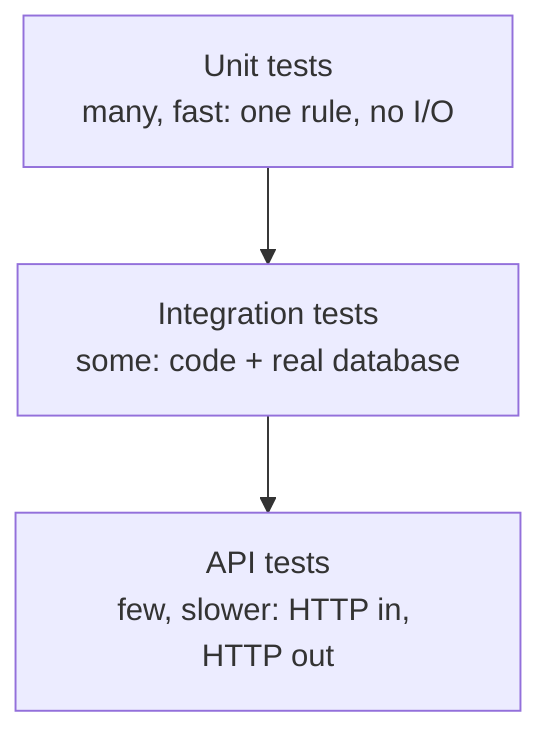
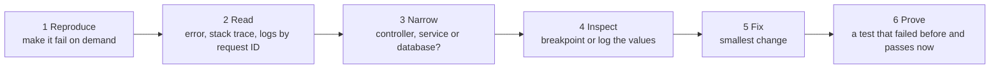

# Testing & Debugging

> Tests prove the code works today and keeps working tomorrow. A calm debugging routine finds bugs without guessing.

Roadmap topic 7 · Stage 2: Build a Backend

**Go deeper:** `04` Backend Building Blocks (dependency injection makes tests easy) · `05` Authentication (test permissions) · `09` Connecting API to Database · `11` Transactions & Concurrency · `06-mobile-engineering/12-Testing` (the same ideas on the client) · `05-system-design/27-Observability` (logs, metrics, traces).

**Marks:** 🟢 must know · 🟡 good to know

---

#### 1. What Is It?

*Like unit tests and UI tests in your app, but for the server.*

| Type | Tests | Real database or network? | Speed |
|---|---|---|---|
| **Unit** | one function or business rule | no | milliseconds |
| **Integration** | your code + a real database | yes (a test database) | seconds |
| **API** | a full HTTP request → response | yes (test server + database) | seconds |

| 🟢 Must know | 🟡 Good to know |
|---|---|
| unit, integration and API tests | mocking external services |
| debugging with logs, breakpoints, a failing test | load testing and profiling |
| test failures and permissions, not only success | |
| independent, repeatable tests | |

**Signals in an interview:** "what tests would you write for this endpoint?", "what do you mock?", "how do you debug a failing endpoint?", "why is this test flaky?"

---

#### 2. How It Works



**Unit tests.** Fast tests for one piece of logic: no database, no network. Test the **business rules** ("a user can't book a seat that is taken") and the edge cases (empty, null, limits, invalid). Pattern: **Arrange** (set up) → **Act** (call) → **Assert** (check).

**Integration tests.** Check your code works with a **real database**: queries, constraints, transactions. Use a separate test database (often a temporary container), and reset the data between tests. They catch what unit tests can't: wrong SQL, a missing column, a constraint error.

**API tests.** Send real requests and check the answers. Test every endpoint for:

| Case | Expected |
|---|---|
| valid request | `200` / `201` + the correct body |
| invalid input | `400` + the error format |
| no token | `401` |
| another user's record | `403` / `404` |
| not found | `404` |
| duplicate | `409` |

The permissions row is the one interviewers like to hear.

**Good test habits.**

1. **Independent:** no test depends on another or on their order.
2. **Repeatable:** same result every time (no random data, no real clock, no internet).
3. One clear reason to fail, and a descriptive name (`rejects booking when the seat is taken`).
4. Test failure cases, not only success.

**Debugging process.** A calm, repeatable way to find a bug.



Logs show *what* happened; breakpoints show *why*. A bug fixed without a test can come back. Check the simple causes first: wrong input, missing config, expired token.

🟡 **Mocking external services.** Replace what you don't control (payment API, email, SMS) with a fake or mock so tests are fast and repeatable. Don't mock everything: too many mocks let tests pass while real code is broken. Prefer a real database in integration tests.

🟡 **Load testing and profiling.** A **load test** sends many requests (k6, JMeter) and watches **p95 latency** and errors. A **profiler** shows which code or query uses the most time. Measure first, then optimize.

---

#### 3. Naive vs Better Approach

| Situation | Naive | Better |
|---|---|---|
| What to test | only the happy path | failures, permissions, edge cases |
| Test data | shared rows, tests run in order | each test builds and cleans its own data |
| "Integration" test | mocks the database and calls it done | a real database in a container |
| Time and randomness | `Instant.now()`, `Random()` in logic | inject a `Clock` and a random source |
| External API | hits the real payment sandbox | a fake that records calls and can fail on demand |
| Bug found | fix it and move on | write the failing test first, then fix |
| Slow endpoint | guess and optimize | load test, profile, then change one thing |

```kotlin
// Naive test: depends on the real clock and on test order, and checks nothing about failure
@Test fun `token works`() {
    val token = service.issue(1)
    Thread.sleep(1000)
    assertNotNull(service.verify(token))
}
```

---

#### 4. Code

```kotlin
import kotlin.test.*
import java.time.Clock
import java.time.Duration
import java.time.Instant
import java.time.ZoneOffset

// ---------- unit test: a business rule, fake repository, Arrange-Act-Assert ----------
interface SeatRepository { fun isTaken(seat: String): Boolean; fun save(userId: Long, seat: String) }
class SeatAlreadyTaken : RuntimeException("seat taken")

class BookingService(private val repo: SeatRepository) {
    fun book(userId: Long, seat: String) {
        if (repo.isTaken(seat)) throw SeatAlreadyTaken()
        repo.save(userId, seat)
    }
}

class FakeSeatRepository : SeatRepository {
    val taken = mutableMapOf<String, Long>()
    override fun isTaken(seat: String) = seat in taken
    override fun save(userId: Long, seat: String) { taken[seat] = userId }
}

class BookingServiceTest {
    private val repo = FakeSeatRepository()
    private val service = BookingService(repo)

    @Test fun `books a free seat`() {
        service.book(1, "A1")                                   // act
        assertEquals(1L, repo.taken["A1"])                      // assert
    }

    @Test fun `rejects booking when the seat is taken`() {
        service.book(1, "A1")                                   // arrange
        assertFailsWith<SeatAlreadyTaken> { service.book(2, "A1") }
        assertEquals(1L, repo.taken["A1"])                      // the first booking is untouched
    }
}

// ---------- time is injected, so a test controls it ----------
class ExpiringToken(private val clock: Clock, private val ttl: Duration) {
    private val issuedAt = clock.instant()
    fun isValid(): Boolean = clock.instant().isBefore(issuedAt.plus(ttl))
}

// ---------- fake for an external service: records calls, can be told to fail ----------
interface PaymentGateway { fun charge(userId: Long, cents: Long): Boolean }

class FakeGateway(var shouldFail: Boolean = false) : PaymentGateway {
    val charges = mutableListOf<Pair<Long, Long>>()
    override fun charge(userId: Long, cents: Long): Boolean {
        if (shouldFail) return false
        charges += userId to cents
        return true
    }
}

// ---------- p95 / p99 from measured latencies (nearest-rank method) ----------
fun percentile(latenciesMs: List<Int>, p: Double): Int {
    val sorted = latenciesMs.sorted()
    val rank = Math.ceil(p / 100.0 * sorted.size).toInt().coerceIn(1, sorted.size)
    return sorted[rank - 1]
}
```

API test (Ktor 2 shape): the full request, no real network.

```kotlin
@Test fun `returns 401 without a token`() = testApplication {
    application { module() }
    val response = client.get("/notes")
    assertEquals(HttpStatusCode.Unauthorized, response.status)
}

@Test fun `user B cannot read user A's note`() = testApplication {
    application { module() }
    val noteId = createNoteAs(tokenOfA, "secret")
    val response = client.get("/notes/$noteId") { bearerAuth(tokenOfB) }
    assertEquals(HttpStatusCode.NotFound, response.status)       // 404 hides that it exists
}
```

Integration test shape: a real PostgreSQL in a container, cleaned for each test.

```kotlin
@Testcontainers
class NoteRepositoryIT {
    @Container val postgres = PostgreSQLContainer("postgres:16")

    @BeforeEach fun clean() { db.exec("TRUNCATE notes RESTART IDENTITY") }

    @Test fun `duplicate title for the same user violates the unique constraint`() {
        repo.insert(userId = 1, title = "a")
        assertFailsWith<ConstraintViolation> { repo.insert(userId = 1, title = "a") }
    }
}
```

Load test with k6 (JavaScript): 50 virtual users for 30 seconds, fail if p95 is slow.

```javascript
import http from 'k6/http';
export const options = {
  vus: 50, duration: '30s',
  thresholds: { http_req_duration: ['p(95)<300'], http_req_failed: ['rate<0.01'] },
};
export default function () {
  http.get('http://localhost:8080/notes', { headers: { Authorization: `Bearer ${__ENV.TOKEN}` } });
}
```

Checks: `BookingServiceTest` has two passing tests; remove the `isTaken` check from `book` and the second test fails (so the test really guards the rule). With `Clock.fixed(Instant.parse("2025-01-01T00:00:00Z"), ZoneOffset.UTC)` an `ExpiringToken(clock, Duration.ofMinutes(15))` is valid; a token created from a clock and then checked with a second clock moved forward 16 minutes is not, with no `sleep`. `FakeGateway(shouldFail = true).charge(1, 500)` → `false` and `charges` stays empty. `percentile(listOf(10, 20, 30, 40, 50, 60, 70, 80, 90, 100), 50.0)` → `50`; `(…, 95.0)` → `100`; `(…, 90.0)` → `90`.

---

#### 5. Performance & Limits

| Test kind | Typical cost | How many |
|---|---|---|
| Unit | milliseconds | hundreds, run on every save |
| Integration | seconds (container start is the cost: share one per test class) | tens |
| API | seconds | a few per endpoint (success, 400, 401, 403/404, 409) |
| Load | minutes, run on a staging copy | before big releases |

Latency is judged by percentiles, not the average: **p50** is the typical user, **p95** and **p99** are the slow tail. If 1 request in 20 takes 2 s, the average looks fine and p95 shows it.

---

#### 6. Common Mistakes & Edge Cases

1. Testing only the happy path.
2. Tests that depend on each other or on shared data.
3. Mocking the database and calling it an integration test.
4. Not testing permissions.
5. Fixing a bug without adding a test.
6. Tests that call real external services.
7. Flaky tests: they depend on time, randomness, order, threads or the network.
8. Asserting on too much (the whole JSON) so every small change breaks the test.
9. Using `Thread.sleep` to wait for async work (poll with a timeout, or inject a scheduler).

Edge cases worth a test: empty list, maximum page size, a body just over the size limit, expired token, deleted user, two requests at once (topic 11), a timeout from the database.

---

#### 7. Say This in the Interview

1. "I write unit tests for business rules with fakes, integration tests with a real database in a container, and API tests for each endpoint's success, validation, authentication, permission, not-found and conflict cases."
2. "I mock only the boundaries I don't control, such as payments or email. The database stays real in integration tests."
3. "Time and randomness are injected, so tests are repeatable."
4. "To debug: reproduce, read the logs by request ID, narrow to a layer, inspect, fix with the smallest change, and add a test that failed before."
5. "Before optimizing I load test and look at p95 and the profiler."

---

#### 8. Quick Check

1. Which tests should be the most numerous?
2. A test sometimes passes and sometimes fails. Name two likely causes.
3. What is the first step when a bug is reported?
4. Why is p95 more useful than the average?

<details>
<summary>Answers</summary>

1. Unit tests: they are fast and cheap.
2. Real time or randomness, test order or shared data, threads and timing, the network.
3. Reproduce it, ideally as a failing test.
4. The average hides the slow tail that real users feel; p95 shows how bad the slow requests are.

</details>

---

#### 9. Practice

**Interview questions**

1. What kinds of tests do you write for a backend?
2. What would you test for one endpoint?
3. What do you mock, and what do you not?
4. How do you debug a failing endpoint?
5. What makes a test flaky, and how do you fix it?
6. How do you find out why an endpoint is slow?

**Hands-on**

1. Write the five API tests for `GET /notes/{id}` from the table in section 2.
2. Replace `Instant.now()` in your token code with an injected `Clock` and test expiry without sleeping.
3. Run the k6 script against your Notes API and read the p95 value.

**Remember:** unit → integration → API tests · test failures and permissions, not only success · tests are independent and repeatable · debug: reproduce → logs → narrow → fix → add a test · mock only external boundaries.
