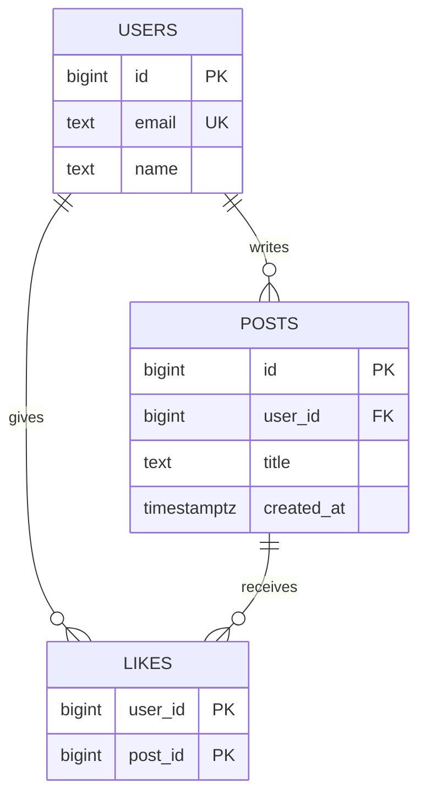

# Databases, SQL & Data Modeling

> Tables, keys, joins and a schema designed from the queries. SQL is asked in almost every backend interview.

Roadmap topic 8 · Stage 3: Data

**Go deeper:** `10-database/02-Relational-Model-and-Data-Modeling` · `10-database/03-SQL-Fundamentals` · `10-database/04-Advanced-SQL` · `10-database/10-Schema-Migrations-and-Evolution` · `09` Connecting API to Database · `10` Indexes · `11` Transactions.

**Marks:** 🟢 must know · 🟡 good to know

---

#### 1. What Is It?

*Think of a spreadsheet: a table is a sheet, a row is one record, a column is one field.*

| Term | Meaning |
|---|---|
| **Table** | one kind of thing (`users`, `posts`) |
| **Row** / **column** | one record / one field with a data type |
| **Primary key (PK)** | unique ID of a row |
| **Foreign key (FK)** | a column that points to a row in another table |
| **Constraint** | a rule the database enforces even if the app has a bug |

| 🟢 Must know | 🟡 Good to know |
|---|---|
| tables, rows, columns, PK, FK | subqueries, CTEs, window functions |
| constraints | schema migrations |
| CRUD, joins, group by, NULL | soft delete |
| 1-1, 1-many, many-many | |
| design the schema from the queries | |
| normalization vs denormalization | |
| money and time zones | |

**Signals in an interview:** "design a schema for users, posts and likes", "INNER vs LEFT JOIN", "count posts per user including users with none", "how do you store money?", "what does NULL do in a comparison?"

---

#### 2. How It Works



```sql
CREATE TABLE users (
  id         BIGSERIAL PRIMARY KEY,
  email      TEXT NOT NULL UNIQUE,
  name       TEXT NOT NULL,
  created_at TIMESTAMPTZ NOT NULL DEFAULT now()
);

CREATE TABLE posts (
  id         BIGSERIAL PRIMARY KEY,
  user_id    BIGINT NOT NULL REFERENCES users(id),     -- foreign key
  title      TEXT NOT NULL,
  created_at TIMESTAMPTZ NOT NULL DEFAULT now()
);

CREATE TABLE likes (
  user_id BIGINT NOT NULL REFERENCES users(id),
  post_id BIGINT NOT NULL REFERENCES posts(id),
  PRIMARY KEY (user_id, post_id)                        -- one like per user per post
);
```

**Constraints.**

| Constraint | Meaning |
|---|---|
| `PRIMARY KEY` | unique and not null |
| `FOREIGN KEY` | must point to an existing row |
| `UNIQUE` | no duplicates (an email) |
| `NOT NULL` | value required |
| `CHECK` | custom rule (`price_cents >= 0`) |
| `DEFAULT` | value used when none is given |

The app validates for a good user experience. The constraints are the last safety net.

**CRUD.**

```sql
INSERT INTO posts (user_id, title) VALUES (1, 'Hello');                       -- Create
SELECT id, title FROM posts WHERE user_id = 1 ORDER BY created_at DESC LIMIT 20;  -- Read
UPDATE posts SET title = 'Hi' WHERE id = 5;                                   -- Update
DELETE FROM posts WHERE id = 5;                                               -- Delete
```

Always use `WHERE` with `UPDATE` and `DELETE`, or you change every row. Select only the columns you need (avoid `SELECT *`). Pass values as parameters (topic 6).

**Joins and group by.** A join combines rows from two tables on a matching column. **INNER JOIN** keeps only matches; **LEFT JOIN** keeps everything from the left table, with `NULL` where there is no match.

```sql
-- INNER JOIN
SELECT p.id, p.title, u.name FROM posts p JOIN users u ON u.id = p.user_id ORDER BY p.created_at DESC LIMIT 20;

-- LEFT JOIN: every user, even with no posts
SELECT u.name, COUNT(p.id) AS post_count
FROM users u LEFT JOIN posts p ON p.user_id = u.id
GROUP BY u.id, u.name;
```

`GROUP BY` with aggregates `COUNT`, `SUM`, `AVG`, `MIN`, `MAX`. `WHERE` filters rows **before** grouping; `HAVING` filters **after**.

**NULL.** `NULL` means "unknown / no value", not zero and not an empty string. Use `IS NULL` / `IS NOT NULL` (`= NULL` never works). `NULL = NULL` is not true. `COUNT(*)` counts rows; `COUNT(column)` skips `NULL`s.

**Relationships.**

| Type | Example | How |
|---|---|---|
| one-to-one | user ↔ profile | FK with `UNIQUE` |
| one-to-many | user → posts | FK on the "many" side |
| many-to-many | users ↔ liked posts | a **join table** with two FKs |

**Design the schema from the queries.** List the screens and their questions ("recent posts of people I follow", "like count per post", "notes of this user"), design tables so those queries are simple and fast, then add constraints and indexes (topic 10).

**Normalization vs denormalization.** *Normalization* stores each fact once (the author's name lives only in `users`): no duplication, easy updates, more joins. *Denormalization* copies data on purpose for faster reads (a `like_count` on `posts`): faster, but you must keep the copy in sync. Start normalized; denormalize only for a measured need.

**Money and time zones.** Money: integer **cents** (`1999`) or `DECIMAL`, **never** `FLOAT`; store the currency too. Time: store timestamps in **UTC** (`TIMESTAMPTZ`); the app converts to local time.

🟡 **Subqueries, CTEs, window functions.**

```sql
-- Latest post per user: a CTE plus ROW_NUMBER
WITH ranked AS (
  SELECT user_id, title,
         ROW_NUMBER() OVER (PARTITION BY user_id ORDER BY created_at DESC) AS rn
  FROM posts
)
SELECT user_id, title FROM ranked WHERE rn = 1;
```

A *subquery* is a query inside a query; a *CTE* (`WITH`) is a named subquery; a *window function* calculates across related rows without collapsing them (`ROW_NUMBER`, `RANK`).

🟡 **Schema migrations.** A versioned script that changes the schema (`001_create_users.sql`), kept in Git and run automatically on deploy. Never edit production by hand. Make changes **backward compatible**: add the new column first, move the data and the code, remove the old column later.

🟡 **Soft delete.** Set `deleted_at` instead of deleting the row: good for undo and audit. Cost: every query must filter deleted rows, and unique rules get harder. In PostgreSQL use a partial index: `CREATE UNIQUE INDEX uq_users_email_active ON users(email) WHERE deleted_at IS NULL;`.

---

#### 3. Naive vs Better Approach

| Situation | Naive | Better |
|---|---|---|
| Money | `FLOAT` (`0.1 + 0.2 ≠ 0.3`) | integer cents or `DECIMAL`, plus a currency |
| Time | local time strings | UTC `TIMESTAMPTZ` |
| Integrity | rely on the app only | PK, FK, `UNIQUE`, `NOT NULL`, `CHECK` |
| Per-user counts | `JOIN` then `COUNT(*)` | `LEFT JOIN` + `COUNT(p.id)` |
| Many-to-many | a comma-separated list in one column | a join table |
| Reads | fetch rows then loop in code | one `JOIN` or one grouped query |
| Schema change | edit the live database | versioned, backward-compatible migrations |
| `SELECT *` | everywhere | only the needed columns |

```sql
-- Naive: COUNT(*) counts the NULL-extended row, so a user with no posts shows 1
SELECT u.name, COUNT(*) FROM users u LEFT JOIN posts p ON p.user_id = u.id GROUP BY u.id, u.name;
```

---

#### 4. Code

SQL results below were produced on this data (`users`: Asha, Ravi, Meera; `posts`: 1 Hello and 2 Kotlin by Asha, 3 System Design by Ravi; `likes`: Ravi→post 1, Meera→post 1, Asha→post 3).

```sql
SELECT p.id, p.title, u.name FROM posts p JOIN users u ON u.id = p.user_id ORDER BY p.created_at DESC;
-- (2, Kotlin, Asha) (3, System Design, Ravi) (1, Hello, Asha)

SELECT u.name, COUNT(p.id) FROM users u LEFT JOIN posts p ON p.user_id = u.id GROUP BY u.id, u.name;
-- Asha 2, Ravi 1, Meera 0

SELECT u.name FROM users u JOIN posts p ON p.user_id = u.id GROUP BY u.id, u.name HAVING COUNT(*) >= 2;
-- Asha

SELECT p.id, COUNT(l.user_id) AS likes FROM posts p LEFT JOIN likes l ON l.post_id = p.id GROUP BY p.id;
-- post 1: 2, post 2: 0, post 3: 1

SELECT u.name FROM users u WHERE NOT EXISTS (SELECT 1 FROM posts p WHERE p.user_id = u.id);
-- Meera
```

Kotlin side: money, time and a typed row.

```kotlin
import java.time.Instant
import java.time.ZoneId
import java.time.ZonedDateTime

@JvmInline
value class Money(val cents: Long) {                     // never Double
    operator fun plus(other: Money) = Money(cents + other.cents)
    override fun toString() = "%d.%02d".format(cents / 100, cents % 100)
}

fun toLocal(utc: Instant, zone: String): ZonedDateTime = utc.atZone(ZoneId.of(zone))

data class Post(val id: Long, val userId: Long, val title: String, val createdAt: Instant)
```

A backward-compatible migration, in two deploys:

```sql
-- V2__add_display_name.sql  (deploy 1: add the column, nullable; the app writes both)
ALTER TABLE users ADD COLUMN display_name TEXT;
UPDATE users SET display_name = name WHERE display_name IS NULL;
-- V3__drop_name.sql  (deploy 2, after every app version reads display_name)
ALTER TABLE users DROP COLUMN name;
```

Checks (SQL run on SQLite with the data above): the `LEFT JOIN … COUNT(p.id)` query returns `Asha 2, Ravi 1, Meera 0`, while the naive `COUNT(*)` version returns `Meera 1`. `SELECT 1 WHERE NULL = NULL` returns no rows. `SELECT COUNT(*), COUNT(col)` over two rows where one `col` is `NULL` gives `2, 1`. Inserting a post with `user_id = 99` fails with a foreign-key error; inserting a second user with the same email fails with a unique error. `UPDATE posts SET title = 'X'` without `WHERE` changes all 3 rows. In Kotlin: `Money(1999) + Money(1)` prints `20.00`; `0.1 + 0.2 == 0.3` is `false`; `toLocal(Instant.parse("2025-01-10T09:30:00Z"), "Asia/Kolkata")` is `2025-01-10T15:00+05:30[Asia/Kolkata]`.

---

#### 5. Performance & Limits

| Choice | Effect |
|---|---|
| Join on an indexed foreign key | fast; unindexed FKs make joins and cascading deletes slow (topic 10) |
| Normalized schema | more joins, but each join on keys is cheap |
| Denormalized counter (`like_count`) | `O(1)` read, but every like must also update it, atomically (topic 11) |
| `SELECT *` | more bytes over the wire and no covering index |
| `COUNT(*)` on a huge table | scans many rows; avoid for "page 3 of 50" |
| Soft delete | tables only grow; every query pays the `deleted_at IS NULL` filter |

Rule of thumb: model for correctness first (normalized, constrained), measure, then add indexes or denormalize where a query is proven slow.

---

#### 6. Common Mistakes & Edge Cases

1. `UPDATE` or `DELETE` without `WHERE`.
2. Using `FLOAT` for money.
3. Storing local time instead of UTC.
4. No constraints, so duplicates and orphan rows appear.
5. Designing tables without thinking about the queries.
6. Comparing with `= NULL`.
7. Using `SELECT *` everywhere.
8. `COUNT(*)` after a `LEFT JOIN` (counts the empty match).
9. Putting a filter on the right table in the `WHERE` of a `LEFT JOIN`, which turns it into an `INNER JOIN` (put it in the `ON`).
10. Storing a list in one column (`"1,2,3"`).

Edge cases: users with no posts; a `NULL` in a `NOT IN (subquery)` makes the whole condition unknown (prefer `NOT EXISTS`); ties in `ROW_NUMBER` (add a tie-breaker); two users registering the same email at once (the `UNIQUE` constraint decides, topic 11).

---

#### 7. Say This in the Interview

1. "I start from the queries the screens need, then design normalized tables with primary keys, foreign keys and constraints, and add indexes for the hot queries."
2. "One-to-many is a foreign key on the many side. Many-to-many needs a join table with a composite primary key."
3. "To count posts per user including users with none, I use a `LEFT JOIN` with `COUNT(p.id)`, not `COUNT(*)`."
4. "Money is integer cents or `DECIMAL`, never float. Time is stored in UTC and converted on the client."
5. "I change schemas with versioned, backward-compatible migrations: add first, remove later."

---

#### 8. Quick Check

1. INNER vs LEFT JOIN?
2. What does `COUNT(*)` return for a user with no posts after a `LEFT JOIN`?
3. How do you model users liking posts?
4. Why not `FLOAT` for prices?

<details>
<summary>Answers</summary>

1. INNER returns only matching rows. LEFT returns all left rows, with `NULL` where nothing matches.
2. `1` (the row with `NULL` columns). Use `COUNT(p.id)` to get `0`.
3. A `likes` join table with two foreign keys and a composite primary key `(user_id, post_id)`.
4. Binary floats round (`0.1 + 0.2 ≠ 0.3`). Use integer cents or `DECIMAL`.

</details>

---

#### 9. Practice

**Interview questions**

1. Design a schema for users, posts and likes.
2. INNER vs LEFT JOIN?
3. One-to-many vs many-to-many?
4. Normalization vs denormalization?
5. How do you store money and time?
6. What does NULL do in comparisons?
7. Write a query to count posts per user, including users with none.

**Hands-on**

1. Create the three tables in a local PostgreSQL or SQLite, insert the sample data and reproduce the results above.
2. Add a `follows` table and write "recent posts of people I follow".
3. Write a two-step migration that renames a column without breaking the running app.

**LeetCode SQL practice**

| # | Question | Skill |
|---|---|---|
| 175 | [Combine Two Tables](https://leetcode.com/problems/combine-two-tables/) (Easy) | LEFT JOIN |
| 181 | [Employees Earning More Than Their Managers](https://leetcode.com/problems/employees-earning-more-than-their-managers/) (Easy) | self join |
| 182 | [Duplicate Emails](https://leetcode.com/problems/duplicate-emails/) (Easy) | GROUP BY + HAVING |
| 183 | [Customers Who Never Order](https://leetcode.com/problems/customers-who-never-order/) (Easy) | LEFT JOIN / NOT EXISTS |
| 197 | [Rising Temperature](https://leetcode.com/problems/rising-temperature/) (Easy) | self join on dates |
| 176 | [Second Highest Salary](https://leetcode.com/problems/second-highest-salary/) (Medium) | subquery, NULL |
| 184 | [Department Highest Salary](https://leetcode.com/problems/department-highest-salary/) (Medium) | join + subquery |
| 180 | [Consecutive Numbers](https://leetcode.com/problems/consecutive-numbers/) (Medium) | window functions |
| 185 | [Department Top Three Salaries](https://leetcode.com/problems/department-top-three-salaries/) (Hard) | `DENSE_RANK` |

**Remember:** PK, FK and constraints keep data correct · joins and GROUP BY are asked in almost every interview · one-to-many = FK, many-to-many = join table · design from the queries · normalize first, denormalize only when measured · money = cents / DECIMAL, time = UTC.
