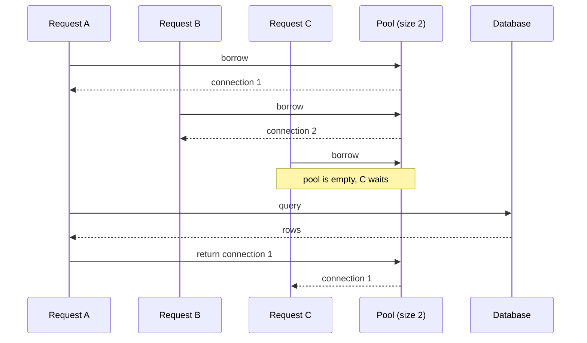
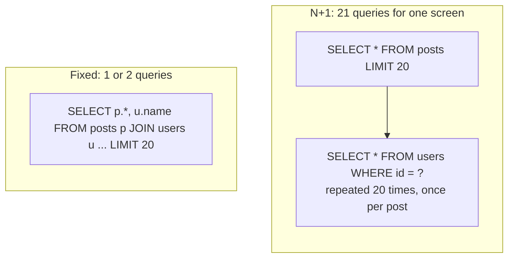

# Connecting API to Database

> Follow one request from the controller to the database and back, and learn the three things that go wrong: too few connections, too many queries, and raw database errors.

Roadmap topic 9 · Stage 3: Data

**Go deeper:** `04` Backend Building Blocks (layers) · `08` SQL & Data Modeling · `10` Indexes · `11` Transactions · `10-database/06-Query-Performance-and-Execution-Plans` · `10-database/14-Replication-and-High-Availability` · `05-system-design/14-Scaling-and-Load-Balancing`.

**Marks:** 🟢 must know · 🟡 good to know

---

#### 1. What Is It?

```text
Controller → Service → Repository → Connection pool → Database
```

| Piece | Job |
|---|---|
| **Repository** | the only layer that talks to the database (topic 4) |
| **Driver / ORM** | sends the SQL and returns rows (JDBC, Exposed, Hibernate/JPA) |
| **Connection pool** | keeps a few connections open and lends them to requests |
| **Error mapping** | turns database failures into clear API errors |

| 🟢 Must know | 🟡 Good to know |
|---|---|
| the path of a request to the database | connection limits with many servers |
| connection pool | connection poolers (PgBouncer) |
| ORM basics | |
| the N+1 query problem | |
| missing records and constraint errors | |

**Signals in an interview:** "why use a connection pool?", "what is N+1?", "ORM or raw SQL?", "how do you handle a duplicate email?", "the endpoint is slow, what do you check first?", "we added servers and the database fell over."

---

#### 2. How It Works

**Connection pool.** Opening a connection (network + login) is slow. Keep a few open and reuse them, like a set of shared taxis.



1. The pool keeps `N` connections open. A request **borrows** one and **returns** it.
2. Pool size is **small and limited** (for example 10 to 20 per server), because the database can only handle so many.
3. If all connections are busy, new requests **wait**, and can time out.
4. Always release connections (`use { }` does it). A leak means a slowly frozen server.

**ORM basics.** An ORM maps rows to objects (Hibernate/JPA, Exposed, Prisma, SQLAlchemy). Room on Android is the same idea on the app side. Benefits: less boilerplate, type safety, easy simple queries. Risks: hidden slow queries (N+1) and forgetting SQL. **Learn SQL first**, turn on SQL logging and read what your ORM sends, and write raw (still parameterized) SQL for complex or performance-critical queries.

**N+1 query problem.** One query for the list, then one more for every item.



```sql
-- Fix 1: one JOIN
SELECT p.id, p.title, u.name FROM posts p JOIN users u ON u.id = p.user_id LIMIT 20;
-- Fix 2: two queries, the second with IN (...)
SELECT * FROM users WHERE id IN (1, 2, 3);
```

It is invisible in small tests and painful with real data. Spot it by counting queries per request. ORM fixes: eager loading, `JOIN FETCH`, batch loading.

**Missing records and constraint errors.** Turn database errors into clear API errors.

| Database situation | API response |
|---|---|
| no row found | `404 Not Found` |
| unique violation (email exists) | `409 Conflict` |
| foreign key violation (parent doesn't exist) | `400` or `409` |
| not-null violation | `400` (validate earlier) |
| connection or timeout error | `503` / `500` |

Catch database exceptions in the repository or the central error handler, and never send raw SQL errors to the client. Prefer catching the **unique violation** over "check first, then insert": the check can race with another request (topic 11).

🟡 **Connection limits with many servers.** The database has a **maximum number of connections** (PostgreSQL defaults to 100). `servers × pool size` must stay below it. Adding servers can suddenly exhaust the connections. Fix: smaller pools, or a **connection pooler** (PgBouncer) between the servers and the database.

---

#### 3. Naive vs Better Approach

| Situation | Naive | Better |
|---|---|---|
| Connections | open one per request | a bounded pool, reused |
| Lists with related data | one query per item | `JOIN` or `IN (...)` batch |
| Duplicate email | `SELECT` first, then `INSERT` | `UNIQUE` constraint, catch the violation → `409` |
| Errors | raw SQL error to the client | mapped to `404`, `409`, `503` |
| Big pools everywhere | `maximumPoolSize = 200` | small per server, total under the database limit |
| ORM | trust it blindly | read the generated SQL, count queries |
| Filtering | fetch the whole table, filter in the app | `WHERE` in SQL |

```kotlin
// Naive N+1: one query for the list, one more for every author
fun feedNPlusOne(repo: CountingRepo): List<Pair<String, String>> =
    repo.latestPosts(20).map { post -> post.title to repo.userById(post.userId).name }
```

---

#### 4. Code

```kotlin
import com.zaxxer.hikari.HikariConfig
import com.zaxxer.hikari.HikariDataSource
import java.sql.SQLException
import javax.sql.DataSource

// ---------- a pool: small, with timeouts ----------
fun createPool(url: String, user: String, password: String): HikariDataSource =
    HikariDataSource(HikariConfig().apply {
        jdbcUrl = url
        username = user
        this.password = password
        maximumPoolSize = 10              // per server; servers × this must fit the database limit
        connectionTimeout = 3_000         // wait at most 3 s for a free connection, then fail
        maxLifetime = 1_800_000           // recycle connections every 30 min
        leakDetectionThreshold = 10_000   // log a warning if a connection is held for 10 s
    })

// ---------- repository: SQL lives here, connections always go back to the pool ----------
data class Note(val id: Long, val userId: Long, val title: String)

class NoteRepository(private val ds: DataSource) {
    fun find(userId: Long, id: Long): Note? = ds.connection.use { conn ->           // use { } returns it to the pool
        conn.prepareStatement("SELECT id, user_id, title FROM notes WHERE id = ? AND user_id = ?").use { ps ->
            ps.setLong(1, id); ps.setLong(2, userId)
            ps.executeQuery().use { rs -> if (rs.next()) Note(rs.getLong(1), rs.getLong(2), rs.getString(3)) else null }
        }
    }
}

// ---------- map database errors to API errors (PostgreSQL SQLSTATE codes) ----------
fun mapSqlError(e: SQLException): Pair<Int, String> = when (e.sqlState) {
    "23505" -> 409 to "CONFLICT"            // unique_violation
    "23503" -> 409 to "CONFLICT"            // foreign_key_violation
    "23502" -> 400 to "VALIDATION_ERROR"    // not_null_violation
    "40001", "40P01" -> 503 to "RETRY"      // serialization failure, deadlock: safe to retry the transaction
    else -> 500 to "INTERNAL"               // log the details, send a safe message
}

// ---------- N+1 made visible: count the queries ----------
data class User(val id: Long, val name: String)
data class Post(val id: Long, val userId: Long, val title: String)

class CountingRepo(private val posts: List<Post>, private val users: Map<Long, User>) {
    var queries = 0
        private set
    fun latestPosts(limit: Int): List<Post> { queries++; return posts.take(limit) }
    fun userById(id: Long): User { queries++; return users.getValue(id) }
    fun usersByIds(ids: Set<Long>): Map<Long, User> { queries++; return users.filterKeys { it in ids } }
}

fun feedBatched(repo: CountingRepo): List<Pair<String, String>> {
    val posts = repo.latestPosts(20)                               // query 1
    val authors = repo.usersByIds(posts.map { it.userId }.toSet()) // query 2: all authors at once
    return posts.map { it.title to authors.getValue(it.userId).name }
}

// ---------- pool arithmetic ----------
fun maxServers(dbMaxConnections: Int, poolPerServer: Int, reserved: Int = 10): Int =
    (dbMaxConnections - reserved) / poolPerServer                   // keep some connections for admins and migrations

fun maxQueriesPerSecond(poolSize: Int, avgQuerySeconds: Double) = poolSize / avgQuerySeconds
```

ORM fix for N+1 in JPA: `SELECT p FROM Post p JOIN FETCH p.author`.

Checks: with 20 posts by 5 authors, `feedNPlusOne(repo)` → `repo.queries == 21`, while `feedBatched(repo)` → `repo.queries == 2` and the same 20 pairs. `mapSqlError(SQLException("dup", "23505"))` → `409 to "CONFLICT"`; with `"40P01"` → `503 to "RETRY"`; with an unknown state → `500 to "INTERNAL"`. `maxServers(100, 10)` → `9`; `maxServers(100, 20)` → `4`. `maxQueriesPerSecond(10, 0.02)` → `500.0`, so a pool of 10 with 20 ms queries tops out at about 500 queries per second per server; a slow 200 ms query drops that to 50. `find(userId = 2, id = 99)` for a note owned by user 1 returns `null`, which the service turns into `404`.

---

#### 5. Performance & Limits

| Item | Number to remember |
|---|---|
| New connection | tens of milliseconds (TCP + TLS + login); the pool removes it |
| Pool size per server | 10 to 20 is typical. More is not faster: the database has limited CPU and disk |
| Throughput per pool | `pool size ÷ average query time` |
| PostgreSQL default `max_connections` | 100 |
| N+1 | `1 + N` round trips; at 2 ms per query and 50 items that is 100 ms instead of 4 ms |

If requests wait for a connection, either queries are too slow (fix them first), the pool is too small for the load, or connections are leaking.

---

#### 6. Common Mistakes & Edge Cases

1. N+1 queries.
2. No pool limits, or a pool that is too big.
3. Not releasing connections (forgetting `use { }`), or holding a connection while calling a slow external API.
4. Exposing raw database errors.
5. Checking for duplicates in code only, with no unique constraint.
6. Fetching whole tables and filtering in the app.
7. Scaling the number of servers without recomputing `servers × pool size`.
8. Opening a transaction at the start of a request and holding it while doing other work.

Edge cases: the database restarts (the pool must discard dead connections and reconnect); a query that never returns (set a statement timeout); pool exhausted at peak (fail fast with `503`, don't queue forever).

---

#### 7. Say This in the Interview

1. "A connection pool reuses a small set of connections, because opening one is expensive and the database can only handle so many."
2. "N+1 is one query for the list plus one per item. I fix it with a join, an `IN` batch, or eager loading, and I find it by counting queries per request."
3. "I know the SQL my ORM generates, and I write raw parameterized SQL when the query is complex or hot."
4. "A duplicate email is a unique constraint violation that I catch and return as `409`, not a check-then-insert that can race."
5. "`servers × pool size` has to fit inside the database's connection limit; otherwise I shrink the pools or add a pooler."

---

#### 8. Quick Check

1. 8 servers, pool of 20 each, database limit 100. What happens?
2. How many queries does a list of 50 posts with their authors take when you have N+1?
3. A duplicate-email insert fails. Which status code?
4. Why is `servers × pool` too big a problem?

<details>
<summary>Answers</summary>

1. 160 connections are wanted but 100 exist. Some servers cannot connect. Shrink the pools or use a pooler.
2. 51 (1 for the list + 50 for authors).
3. `409 Conflict`.
4. The database refuses new connections, so every new request fails.

</details>

---

#### 9. Practice

**Interview questions**

1. Why use a connection pool?
2. What is N+1, and how do you fix it?
3. ORM vs raw SQL?
4. How do you handle a duplicate email?
5. What if the database is slow or down?
6. The endpoint is slow. What do you check first?

**Hands-on**

1. Turn on SQL logging in your ORM, load a feed, and count the queries. Then remove the N+1.
2. Shrink the pool to 2 and run 10 parallel requests to see requests wait.
3. Map a unique violation to `409` in the central error handler.

**Remember:** a pool reuses a limited set of connections · N+1 is the classic hidden slowness · learn SQL first, and know what your ORM generates · not found → 404, duplicate → 409 · `servers × pool size` must fit the database limit.
