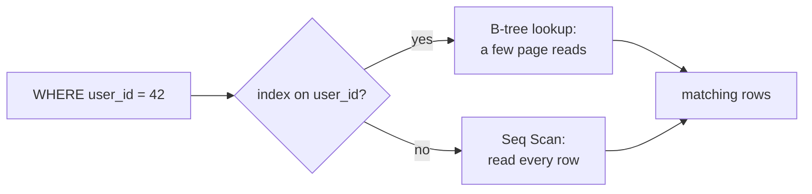

# Indexes & Query Performance

> An index is the back-of-the-book lookup that lets the database jump to the rows instead of reading all of them. Faster reads are paid for with slower writes.

Roadmap topic 10 · Stage 3: Data

**Go deeper:** `10-database/05-Indexes` · `10-database/06-Query-Performance-and-Execution-Plans` · `10-database/07-Storage-Engines-and-Internals` · `03` API Design (cursor pagination) · `09` Connecting API to Database (N+1) · `05-system-design/15-Caching`.

**Marks:** 🟢 must know · 🟡 good to know

---

#### 1. What Is It?

*Like the index at the back of a book: jump to the page instead of reading every page.*

1. Without an index the database does a **full table scan**: it reads every row.
2. An index is a sorted structure (usually a **B-tree**) that finds rows in a few steps.
3. Primary keys and unique constraints are indexed automatically.

```text
No index:  1,000,000 rows → check all of them
Index:     about 3 steps  → find the row
```

| 🟢 Must know | 🟡 Good to know |
|---|---|
| what an index is, read benefit vs write cost | covering index |
| what to index | measure before optimizing |
| composite indexes and column order | |
| `EXPLAIN` and query plans | |
| common causes of slow queries | |

**Signals in an interview:** "a query is slow, what do you do?", "composite index order", "why isn't my index used?", "why is `OFFSET 100000` slow?", "is more indexes always better?"

---

#### 2. How It Works



**The trade-off.**

| Benefit | Cost |
|---|---|
| faster reads (`WHERE`, `JOIN`, `ORDER BY`) | slower writes (every index must be updated) |
| | extra storage |

Don't index everything. Index what your queries use. Tables with heavy writes feel every extra index.

**What to index.**

1. Columns in `WHERE` filters.
2. Columns used in `JOIN` (foreign keys). PostgreSQL does **not** index FK columns automatically.
3. Columns in `ORDER BY`.
4. Columns with many different values (`email`, `user_id`). A boolean on its own is a poor index (low selectivity).

**Composite index.** One index on several columns. **The column order matters.**

```sql
CREATE INDEX idx_notes_user_created ON notes (user_id, created_at DESC);
```

```sql
SELECT * FROM notes WHERE user_id = 42 ORDER BY created_at DESC LIMIT 20;   -- uses the index fully
```

| Query filters on | Uses `(user_id, created_at)`? |
|---|---|
| `user_id` | yes |
| `user_id` and `created_at` | yes |
| `user_id`, sorted by `created_at` | yes (no extra sort) |
| only `created_at` | **no**: the index is used from the left |

Put equality columns first (`user_id = ?`), then the range or sort column.

**EXPLAIN.** Ask the database how it will run the query.

```sql
EXPLAIN ANALYZE
SELECT * FROM notes WHERE user_id = 42 ORDER BY created_at DESC LIMIT 20;
```

Look for **Seq Scan** (full scan, probably needs an index) versus **Index Scan** (the index is used), the estimated vs actual rows, and the time.

**Common causes of slow queries.** Check these first when an endpoint is slow.

1. **Missing index** on the filter or join column.
2. **N+1 queries** (topic 9).
3. **`SELECT *`** and returning too much data.
4. **Large `OFFSET`**: `OFFSET 100000` reads and throws away 100,000 rows. Use cursor pagination.
5. **A function on an indexed column**: `WHERE lower(email) = ...` cannot use the plain index on `email`.
6. **Leading wildcard**: `LIKE '%text'` cannot use a normal index.
7. Joining or sorting huge results.

🟡 **Covering index.** An index that holds **all** the columns the query needs, so the database never reads the table (an *index-only scan*). Faster reads, bigger index.

🟡 **Measure before optimizing.** Find slow queries first (slow query log, monitoring, p95 latency). Use `EXPLAIN`. Change one thing. Measure again. Don't add indexes "just in case".

---

#### 3. Naive vs Better Approach

| Situation | Naive | Better |
|---|---|---|
| Slow query | add an index on every column | `EXPLAIN`, then one targeted index |
| Filter + sort | two single-column indexes | one composite `(user_id, created_at DESC)` |
| Case-insensitive email | `WHERE lower(email) = ?` on a plain index | an expression index on `lower(email)` (or store lowercase) |
| Search | `LIKE '%word%'` | full-text or trigram index |
| Deep pages | `OFFSET 100000` | cursor: `WHERE id < :last` |
| Foreign keys | no index | index the FK used by joins and deletes |
| Wide rows | `SELECT *` | only the needed columns, maybe a covering index |

```sql
-- Naive: the function hides the column from the index → full scan
SELECT * FROM users WHERE lower(email) = 'asha@x.com';
-- Better: an index on the same expression
CREATE INDEX idx_users_email_lower ON users (lower(email));
```

---

#### 4. Code

Query plans below were produced with SQLite's `EXPLAIN QUERY PLAN` on a table of 200,000 notes; PostgreSQL shows the same ideas with `Seq Scan` / `Index Scan`.

```sql
SELECT * FROM notes WHERE user_id = 42 ORDER BY created_at DESC LIMIT 20;
-- no index:   SCAN notes + USE TEMP B-TREE FOR ORDER BY     (full scan and a sort)
CREATE INDEX idx_user_created ON notes (user_id, created_at DESC);
-- with index: SEARCH notes USING INDEX idx_user_created (user_id=?)   (no sort needed)

SELECT * FROM notes WHERE created_at = 500;
-- SCAN notes      (created_at is not the leftmost column of the composite index)

CREATE INDEX idx_email ON notes (email);
SELECT * FROM notes WHERE email = 'U5@x.com';          -- SEARCH ... USING INDEX idx_email
SELECT * FROM notes WHERE lower(email) = 'u5@x.com';   -- SCAN notes   (function on the column)
SELECT * FROM notes WHERE email LIKE '%x.com';         -- SCAN notes   (leading wildcard)

CREATE INDEX idx_cov ON notes (user_id, created_at, title);
SELECT title FROM notes WHERE user_id = 42 AND created_at > 10;
-- SEARCH notes USING COVERING INDEX idx_cov (user_id=? AND created_at>?)   (table never read)
```

Offset vs cursor on the same table (`LIMIT 20`, rows near the end), measured once on SQLite: `OFFSET 190000` about 0.9 ms, `WHERE id > 190000` about 0.01 ms. The gap grows with table size.

```kotlin
// A test helper: fail the build if a hot query does a full scan
fun usesFullScan(planLines: List<String>): Boolean =
    planLines.any { it.startsWith("SCAN") || "Seq Scan" in it }

// How deep is a B-tree? Each level multiplies the reachable rows by the fan-out
fun btreeLevels(rows: Long, fanOut: Int = 100): Int {
    var levels = 0
    var reach = 1L
    while (reach < rows) { reach *= fanOut; levels++ }          // each level multiplies the rows we can reach
    return levels
}

// Cost model: rows the database must read for a page
fun rowsReadOffset(offset: Int, limit: Int) = offset + limit
fun rowsReadCursor(limit: Int) = limit
```

Checks: `usesFullScan(listOf("SCAN notes", "USE TEMP B-TREE FOR ORDER BY"))` → `true`; `usesFullScan(listOf("SEARCH notes USING INDEX idx_user_created (user_id=?)"))` → `false`; `usesFullScan(listOf("SEARCH notes USING COVERING INDEX idx_cov (user_id=?)"))` → `false`. `btreeLevels(1_000_000)` → `3`; `btreeLevels(1_000_000_000)` → `5`. `rowsReadOffset(100_000, 20)` → `100020` against `rowsReadCursor(20)` → `20`.

---

#### 5. Performance & Limits

| Fact | Detail |
|---|---|
| Lookup cost | `O(log n)` for a B-tree, about 3 to 5 page reads even for billions of rows; a scan is `O(n)` |
| Write cost | each index adds work to every `INSERT`, `UPDATE` and `DELETE` that touches its columns |
| Storage | every index is a copy of the indexed columns plus pointers; wide composite indexes get large |
| Selectivity | an index on a column with few distinct values (a boolean, a status) returns too many rows to help |
| Sort | an index in the right order removes the sort step |
| Small tables | a full scan can be faster than an index; the planner decides |

The planner chooses plans from statistics. After big data loads run `ANALYZE` so it knows the table's shape.

---

#### 6. Common Mistakes & Edge Cases

1. Indexing every column.
2. Wrong column order in a composite index.
3. Not indexing foreign keys or filter columns.
4. Wrapping the indexed column in a function.
5. Optimizing without measuring.
6. Using `OFFSET` for deep pages.
7. Leading wildcard `LIKE '%x'`.
8. Assuming the index is used: always check the plan.
9. Forgetting that an index on `(a, b)` makes a separate index on `(a)` redundant.

Edge cases: implicit type conversion (`WHERE phone = 12345` against a text column can disable the index); `OR` conditions across different columns; `NULL` handling (`IS NULL` may or may not use the index, depending on the database); very large `IN (...)` lists.

---

#### 7. Say This in the Interview

1. "An index is a sorted structure, usually a B-tree, that lets the database find rows without scanning the table. Reads get faster, writes get slower, and storage grows."
2. "I index the columns used in `WHERE`, `JOIN` and `ORDER BY`. A composite index is used from the left, so equality columns come first, then the sort or range column."
3. "When a query is slow I run `EXPLAIN`, look for a full scan, check for N+1, reduce the columns and rows returned, and measure again after each change."
4. "A large `OFFSET` reads and discards all earlier rows, so for feeds I use cursor pagination."
5. "If the index isn't used, I check for a function on the column, a leading wildcard, the wrong column order, or low selectivity."

---

#### 8. Quick Check

1. Index on `(user_id, created_at)`. Does `WHERE created_at > ?` use it?
2. Why can `WHERE lower(email) = ?` ignore an index on `email`?
3. Are more indexes always better?
4. Roughly how many B-tree levels for a billion rows with fan-out 100?

<details>
<summary>Answers</summary>

1. No. The index is used from the left, and `created_at` is the second column.
2. The index is sorted by `email`, not by `lower(email)`. Use an expression index on `lower(email)`.
3. No. Every index slows writes and uses storage.
4. About 5.

</details>

---

#### 9. Practice

**Interview questions**

1. What is an index, and why use one?
2. What is a composite index? Does column order matter?
3. A query is slow. What do you do?
4. Why doesn't the database use my index?
5. Why is a big `OFFSET` slow?
6. Is more indexes always better?

**Hands-on**

1. Create a table with 200,000 rows in SQLite or PostgreSQL. Run `EXPLAIN` on a filtered, sorted query before and after adding the composite index.
2. Break the index on purpose with `lower(column)`, then fix it with an expression index.
3. Compare `OFFSET` and cursor pagination timings on the same table.

**Remember:** an index means faster reads, slower writes, more storage · index columns used in WHERE, JOIN and ORDER BY · composite index order matters (left to right) · use EXPLAIN to see scans vs index use · slow endpoint checklist: N+1, missing index, too much data, big OFFSET · measure before optimizing.
