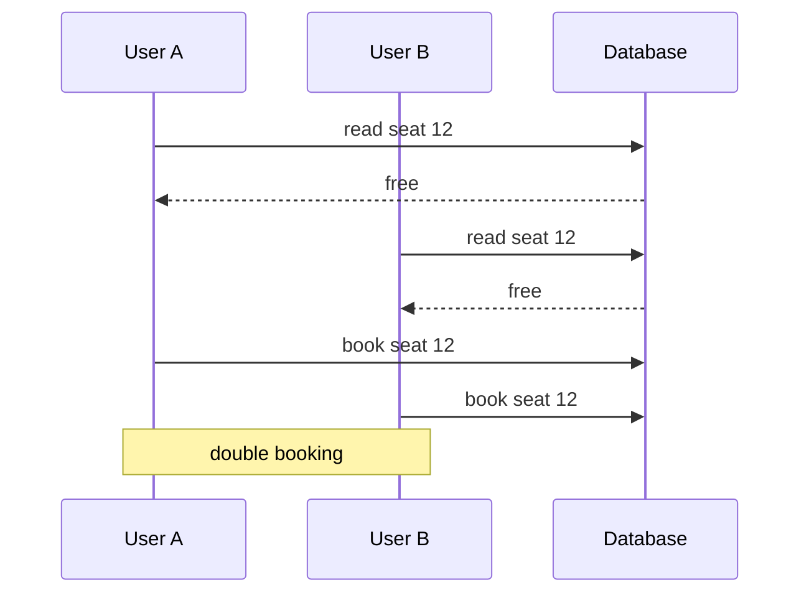
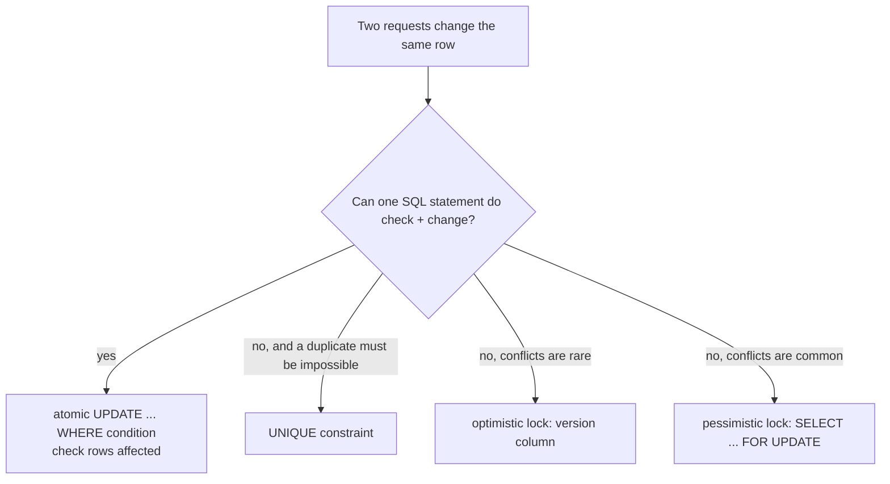

# Transactions & Concurrency

> Many requests touch the same data at the same time. Transactions keep multi-step changes all-or-nothing, and the right guard (atomic update, constraint, lock) stops two users winning the same last seat.

Roadmap topic 11 · Stage 3: Data

**Go deeper:** `10-database/08-Transactions-and-ACID` · `10-database/09-Concurrency-and-Isolation` · `08` SQL & Data Modeling (constraints) · `09` Connecting API to Database · `03` API Design (idempotency, `409`) · `05-system-design/23-Consistency-and-CAP` · `05-system-design/22-Reliable-Requests-and-External-Services`.

**Marks:** 🟢 must know · 🟡 good to know

---

#### 1. What Is It?

*A transaction is a group of steps that succeed together or fail together.*

```sql
BEGIN;
UPDATE accounts SET balance = balance - 100 WHERE id = 1;
UPDATE accounts SET balance = balance + 100 WHERE id = 2;
COMMIT;      -- both changes are saved
-- if anything fails: ROLLBACK;  → nothing is saved
```

Without a transaction, a crash between the two updates loses money.

| Letter | Meaning | Simple example |
|---|---|---|
| **A**tomicity | all or nothing | both transfer steps happen, or neither |
| **C**onsistency | rules stay true | a balance cannot go below zero if that is a rule |
| **I**solation | concurrent transactions don't disturb each other | two transfers don't see each other's half-done state |
| **D**urability | committed data survives a crash | after `COMMIT`, a power cut loses nothing |

| 🟢 Must know | 🟡 Good to know |
|---|---|
| transaction, commit, rollback | isolation levels and anomalies |
| ACID | deadlocks and retries |
| race conditions (double booking, negative stock) | |
| atomic updates and unique constraints | |
| optimistic vs pessimistic locking | |

**Signals in an interview:** "two users book the last seat", "stock went negative", "a coupon was used twice", "two people edit the same note", "what is ACID?", "what is a deadlock?"

---

#### 2. How It Works

**Race condition.** Two requests read the same value, both decide it is fine, and both write. The pattern is **read → check in code → write**.



Same bug: stock goes negative, a coupon is used twice, a balance is overwritten.

**Fix 1: atomic update.** Let the database do the check and the change in **one** statement.

```sql
-- Book the seat only if it is still free
UPDATE seats SET booked_by = 7 WHERE id = 12 AND booked_by IS NULL;
-- 1 row updated → success    0 rows → already taken → return 409

-- Reduce stock, never below zero
UPDATE products SET stock = stock - 1 WHERE id = 5 AND stock > 0;
```

**Fix 2: unique constraint.**

```sql
UNIQUE (show_id, seat_id)      -- the database rejects a second booking
```

Catch the violation and return `409 Conflict`. Simple and very reliable.

**Fix 3: optimistic locking.** Assume there is no conflict; check when saving. Add a `version` column, read it with the row, and save only if it is unchanged.

```sql
UPDATE notes SET title = 'New', version = version + 1 WHERE id = 5 AND version = 3;
-- 0 rows updated → someone else changed it → retry or return 409
```

Good when conflicts are **rare** (editing your own note). No waiting.

**Fix 4: pessimistic locking.** Lock the row first, so others must wait.

```sql
BEGIN;
SELECT * FROM seats WHERE id = 12 FOR UPDATE;    -- locks the row
-- check and update safely
COMMIT;                                          -- releases the lock
```

Good when conflicts are **common** (a popular ticket). Cost: waiting and the risk of deadlocks. Keep the transaction short.

| | Optimistic | Pessimistic |
|---|---|---|
| Idea | detect the conflict at save | prevent it with a lock |
| Waiting | no | yes |
| Best when | conflicts are rare | conflicts are common |



🟡 **Isolation levels.** How much can concurrent transactions see of each other? Higher is safer but slower.

| Level | Dirty read | Non-repeatable read | Phantom read |
|---|---|---|---|
| Read uncommitted | possible | possible | possible |
| Read committed (PostgreSQL default) | prevented | possible | possible |
| Repeatable read (MySQL InnoDB default) | prevented | prevented | possible in the standard |
| Serializable | prevented | prevented | prevented |

- **Dirty read:** reading data that was not yet committed.
- **Non-repeatable read:** the same row changes between two reads.
- **Phantom read:** new rows appear between two reads.
- **Lost update / write skew:** two transactions read, then write different rows based on what they read. Higher isolation, a lock, or an atomic statement is needed.

For most cases an atomic update or a constraint is simpler than raising the isolation level.

🟡 **Deadlocks and retries.** A deadlock is A waiting for B while B waits for A. The database stops one with an error.

1. **Retry** the failed transaction a **limited** number of times, with a small random delay.
2. Reduce deadlocks: lock rows in the **same order** everywhere, keep transactions short.
3. Don't call slow external services (payment API, email) **inside** a transaction: it holds locks too long and cannot be rolled back.

---

#### 3. Naive vs Better Approach

| Situation | Naive | Better |
|---|---|---|
| Last seat | `SELECT` free, then `UPDATE` | `UPDATE ... WHERE booked_by IS NULL`, check rows |
| Stock | read stock, subtract in code, write | `SET stock = stock - 1 WHERE stock > 0` |
| Duplicate registration | check email in code | `UNIQUE (email)`, catch the violation |
| Two editors | last write wins silently | `version` column; `409` on conflict |
| Hot row (popular ticket) | optimistic retries that keep failing | `FOR UPDATE` in a short transaction |
| Payment | charge inside the transaction | commit first, charge outside, make it idempotent |
| Deadlock | crash or retry forever | bounded retries, consistent lock order |

```kotlin
// Naive in-memory version of the same bug: read, check, write
class NaiveStock(var stock: Int) {
    fun buy(): Boolean {
        if (stock <= 0) return false      // two threads can both pass this check
        stock -= 1
        return true
    }
}
```

---

#### 4. Code

```kotlin
import java.sql.Connection
import java.sql.SQLException
import java.util.concurrent.atomic.AtomicInteger
import javax.sql.DataSource
import kotlin.concurrent.thread
import kotlin.random.Random

// ---------- one transaction: commit on success, roll back on any failure ----------
fun <T> DataSource.transaction(block: (Connection) -> T): T = connection.use { conn ->
    conn.autoCommit = false
    try {
        val result = block(conn)
        conn.commit()
        result
    } catch (e: Throwable) {
        conn.rollback()
        throw e
    }
}

class InsufficientFunds : RuntimeException("insufficient funds")

// Transfer: the debit is an atomic conditional UPDATE, both steps in one transaction
fun transfer(ds: DataSource, from: Long, to: Long, cents: Long) = ds.transaction { conn ->
    val debited = conn.prepareStatement("UPDATE accounts SET balance = balance - ? WHERE id = ? AND balance >= ?").use {
        it.setLong(1, cents); it.setLong(2, from); it.setLong(3, cents)
        it.executeUpdate()                                      // 0 rows → not enough money
    }
    if (debited == 0) throw InsufficientFunds()
    conn.prepareStatement("UPDATE accounts SET balance = balance + ? WHERE id = ?").use {
        it.setLong(1, cents); it.setLong(2, to)
        it.executeUpdate()
    }
}

// ---------- atomic booking: the row count is the answer ----------
fun bookSeat(conn: Connection, seatId: Long, userId: Long): Boolean =
    conn.prepareStatement("UPDATE seats SET booked_by = ? WHERE id = ? AND booked_by IS NULL").use {
        it.setLong(1, userId); it.setLong(2, seatId)
        it.executeUpdate() == 1                                 // false → reply 409 Conflict
    }

// ---------- optimistic locking ----------
fun updateTitle(conn: Connection, id: Long, newTitle: String, expectedVersion: Int): Boolean =
    conn.prepareStatement("UPDATE notes SET title = ?, version = version + 1 WHERE id = ? AND version = ?").use {
        it.setString(1, newTitle); it.setLong(2, id); it.setInt(3, expectedVersion)
        it.executeUpdate() == 1                                 // false → someone else changed it
    }

// ---------- pessimistic locking (short transaction!) ----------
fun bookWithLock(ds: DataSource, seatId: Long, userId: Long): Boolean = ds.transaction { conn ->
    val free = conn.prepareStatement("SELECT booked_by FROM seats WHERE id = ? FOR UPDATE").use { ps ->
        ps.setLong(1, seatId)
        ps.executeQuery().use { rs -> rs.next() && rs.getObject(1) == null }
    }
    if (!free) false else {
        conn.prepareStatement("UPDATE seats SET booked_by = ? WHERE id = ?").use { it.setLong(1, userId); it.setLong(2, seatId); it.executeUpdate() }
        true
    }
}

// ---------- retry only the errors that are safe to retry, a limited number of times ----------
fun <T> retryTransaction(maxAttempts: Int = 3, block: () -> T): T {
    var attempt = 0
    while (true) {
        try {
            return block()
        } catch (e: SQLException) {
            attempt++
            val retryable = e.sqlState == "40001" || e.sqlState == "40P01"      // serialization failure, deadlock
            if (!retryable || attempt >= maxAttempts) throw e
            Thread.sleep(10L * attempt + Random.nextLong(10))                   // backoff + jitter
        }
    }
}

// ---------- the same race, in memory ----------
fun buySafely(stock: AtomicInteger): Boolean {
    while (true) {                                    // compare-and-set loop: the check and the change are one step
        val s = stock.get()
        if (s <= 0) return false
        if (stock.compareAndSet(s, s - 1)) return true
    }
}

fun sell(buyers: Int, stock: Int, safe: Boolean): Int {
    val naive = NaiveStock(stock)
    val atomic = AtomicInteger(stock)
    val sold = AtomicInteger()
    val threads = List(buyers) {
        thread {
            val bought = if (safe) buySafely(atomic) else naive.buy()
            if (bought) sold.incrementAndGet()
        }
    }
    threads.forEach { it.join() }
    return sold.get()
}
```

Checks (SQL run on SQLite): the first `UPDATE seats ... WHERE booked_by IS NULL` affects `1` row, the second `0` rows (reply `409`). Two stock decrements on `stock = 1`: first `1` row, second `0` rows, stock ends at `0`. `UPDATE notes ... WHERE id = 5 AND version = 3` affects `1` row and sets `version = 4`; repeating it with the stale version `3` affects `0` rows. A second `INSERT` into `UNIQUE (show_id, seat_id)` fails with a unique-constraint error. `UPDATE accounts SET balance = balance - 150 WHERE id = 1 AND balance >= 150` on a balance of 100 affects `0` rows, so `transfer` throws `InsufficientFunds` and nothing changes. Kotlin: `sell(buyers = 1000, stock = 10, safe = true)` → exactly `10`; `sell(1000, 10, safe = false)` can return more than `10` (a different number on each run). `retryTransaction { … }` with a block that throws `SQLException("x", "40P01")` twice and then succeeds returns on the 3rd call; a block that always throws with state `23505` is not retried (thrown at once).

---

#### 5. Performance & Limits

| Choice | Effect |
|---|---|
| Atomic `UPDATE ... WHERE` | one statement and one row lock held for microseconds; the best default |
| Unique constraint | an index lookup; cheap and always correct |
| Optimistic lock | no waiting, but under heavy conflict many retries (wasted work) |
| `SELECT ... FOR UPDATE` | serializes access to that row; throughput of a hot row is limited to about `1 ÷ transaction time` (a 20 ms transaction allows about 50 updates per second on that row) |
| Long transactions | hold locks, block others, keep old row versions alive |
| Higher isolation | more aborts or waiting; use only when the simpler tools don't fit |

Hot-row tip: for counters (likes, views), batch the updates, use a queue, or shard the counter instead of locking one row for every request.

---

#### 6. Common Mistakes & Edge Cases

1. Read → check in code → write (a race condition).
2. Relying only on app-level checks and no database constraint.
3. Long transactions.
4. External calls inside transactions.
5. Retrying forever.
6. Forgetting to handle the "0 rows updated" case.
7. Retrying a non-idempotent side effect (sending an email twice) along with the transaction.
8. Locking rows in a different order in two code paths (deadlock).
9. Assuming `READ COMMITTED` prevents lost updates.
10. A `SELECT ... FOR UPDATE` outside a transaction (the lock is released at once).

Edge cases: the "0 rows" result can mean *taken*, *not found* or *version changed*, so decide which status each one maps to; a crash after commit but before the response (the client retries, so use an idempotency key, topic 3); two different unique constraints violated at once.

---

#### 7. Say This in the Interview

1. "A transaction is all-or-nothing. ACID: atomicity, consistency, isolation, durability."
2. "The double-booking bug is read, check in code, write. I make the check and the change one atomic statement with `WHERE booked_by IS NULL`, and back it with a unique constraint, then return `409` when no row was updated."
3. "For rare conflicts, like editing your own note, I use optimistic locking with a version column. For hot rows, I use `SELECT ... FOR UPDATE` in a short transaction."
4. "I keep transactions short and never call external services inside them. Deadlocks are retried a limited number of times, and rows are locked in a consistent order."
5. "Atomic updates and constraints are simpler and cheaper than raising the isolation level."

---

#### 8. Quick Check

1. The `UPDATE seats ... WHERE booked_by IS NULL` returns 0 rows. What does your API return?
2. Optimistic or pessimistic for two people editing their own note?
3. Why is a payment API call inside a transaction a bad idea?
4. What prevents two users registering with the same email at the same moment?

<details>
<summary>Answers</summary>

1. `409 Conflict` (the seat is already taken).
2. Optimistic: conflicts are rare, so a version check is enough and nobody waits.
3. It is slow, it holds locks while waiting, and it cannot be rolled back with the transaction.
4. A `UNIQUE` constraint on the email; the second insert fails and you return `409`.

</details>

---

#### 9. Practice

**Interview questions**

1. What is a transaction? What is ACID?
2. Two users book the last seat at the same time. How do you prevent a double booking?
3. Optimistic vs pessimistic locking?
4. How do you stop stock going negative?
5. What is a deadlock, and how do you handle it?
6. Why not call an external API inside a transaction?
7. What do isolation levels change?

**Hands-on**

1. Write a test that books the same seat from 50 threads and asserts exactly one winner.
2. Add a `version` column to notes, make `PATCH` require it, and return `409` on a stale version.
3. Reproduce a deadlock with two transactions that update rows in opposite order, then fix it by ordering the locks.

**LeetCode-style practice for concurrency**

| # | Question | Link to this topic |
|---|---|---|
| 1114 | [Print in Order](https://leetcode.com/problems/print-in-order/) (Easy) | ordering with locks / latches |
| 1115 | [Print FooBar Alternately](https://leetcode.com/problems/print-foobar-alternately/) (Medium) | two threads taking turns |
| 1226 | [The Dining Philosophers](https://leetcode.com/problems/the-dining-philosophers/) (Medium) | deadlock and lock ordering |
| 1188 | [Design Bounded Blocking Queue](https://leetcode.com/problems/design-bounded-blocking-queue/) (Medium, premium) | a safe shared queue |

**Remember:** ACID, commit and rollback · a race condition is read-check-write with two users · fixes: atomic update, unique constraint, optimistic lock, pessimistic lock · optimistic = version column, pessimistic = `FOR UPDATE` · keep transactions short, no external calls inside · retry deadlocks a limited number of times.
