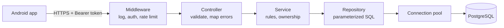
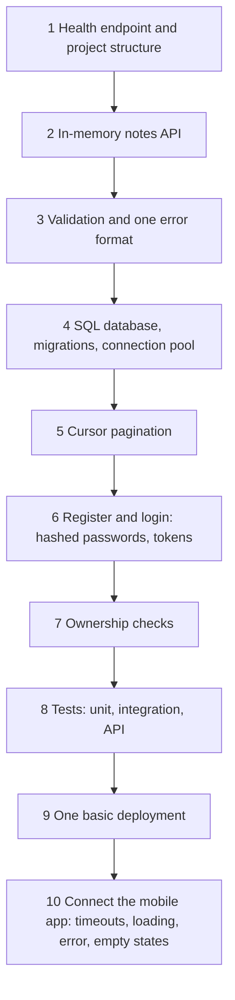

# Checkpoint Project: Notes API

> One server, one SQL database, login, tests, and a mobile app on top. A small finished project beats many half-done ones, and it gives you a real story to tell in every backend interview.

Roadmap topic 12 · Stage 3: Data

**Go deeper:** this project uses topics `01` to `11`. After it, continue with `05-system-design` (scaling, caching, queues, deployment) · `10-database` (indexes, transactions, migrations in depth) · `06-mobile-engineering/08-Networking` (the app side).

**Marks:** 🟢 must know · 🟡 good to know

---

#### 1. What Is It?

*The goal: users register and log in, and manage **only their own** notes.*

| Piece | Choice |
|---|---|
| Server | one backend (Kotlin with Ktor or Spring Boot) |
| Database | one SQL database (PostgreSQL) |
| Clients | your Android app |
| Must have | layers, validation, one error format, cursor pagination, hashed passwords, tokens, ownership checks, tests, one deployment |

| 🟢 Must know | 🟡 Good to know (stretch goals) |
|---|---|
| CRUD APIs on one server and one SQL database | refresh tokens and logout |
| validation, errors, pagination | rate limiting on login |
| login and ownership checks | search notes by title |
| tests and one basic deployment | optimistic locking on updates (`version`) |
| connect a mobile app | OpenAPI docs, Docker, CI |
| explain the full flow without looking at code | |

**Signals in an interview:** "walk me through a project you built", "how did you handle auth and permissions?", "how is pagination done?", "how would this change with a million users?"

---

#### 2. How It Works



**API**

| Method | Path | Purpose |
|---|---|---|
| GET | `/health` | is the server alive? |
| POST | `/auth/register` | create an account |
| POST | `/auth/login` | get a token |
| POST | `/notes` | create a note |
| GET | `/notes?limit=20&cursor=...` | list my notes (paginated) |
| GET | `/notes/{id}` | get one note |
| PATCH | `/notes/{id}` | update a note |
| DELETE | `/notes/{id}` | delete a note |

**Data model**

```sql
CREATE TABLE users (
  id            BIGSERIAL PRIMARY KEY,
  email         TEXT NOT NULL UNIQUE,
  password_hash TEXT NOT NULL,
  created_at    TIMESTAMPTZ NOT NULL DEFAULT now()
);

CREATE TABLE notes (
  id         BIGSERIAL PRIMARY KEY,
  user_id    BIGINT NOT NULL REFERENCES users(id),
  title      TEXT NOT NULL,
  body       TEXT NOT NULL DEFAULT '',
  version    INT  NOT NULL DEFAULT 1,
  created_at TIMESTAMPTZ NOT NULL DEFAULT now(),
  updated_at TIMESTAMPTZ NOT NULL DEFAULT now()
);

CREATE INDEX idx_notes_user_created ON notes (user_id, created_at DESC, id DESC);
```

**Build steps, in order**



Topics used: layers and error handling (04), validation, pagination and idempotency (03), authentication (05), security (06), tests (07), schema (08), pool and N+1 (09), index (10), conflicts (11).

---

#### 3. Naive vs Better Approach

| Situation | Naive | Better |
|---|---|---|
| Order of work | start with the mobile UI | finish a stable API first |
| Ownership | `GET /notes/{id}` returns any note | `WHERE id = ? AND user_id = ?` from the token |
| Lists | return all notes | cursor pagination with a max page size |
| Secrets | in the repo | environment variables |
| Passwords | stored as typed | bcrypt / argon2 hash |
| Tests | none, or happy path only | success, validation, `401`, other user's note, not found |
| Deployment | "works on my machine" | deploy once, call it from the phone |
| Scope | many features, none finished | the basics, finished and explained |

```kotlin
// Naive: every user can read every note, and the list is unbounded
get("/notes") { call.respond(db.query("SELECT * FROM notes")) }
```

---

#### 4. Code

A compact, runnable core: the service, a repository interface with an in-memory version, cursor pagination and optimistic locking. It reuses `AppException` (topic 4) and `encodeCursor`, `decodeCursor`, `Page` (topic 3). Swap the in-memory repository for the JDBC one when you add PostgreSQL.

```kotlin
data class Note(val id: Long, val userId: Long, val title: String, val body: String, val version: Int = 1)
data class NotePatch(val title: String? = null, val body: String? = null)

interface NotesRepository {
    fun insert(userId: Long, title: String, body: String): Note
    fun find(userId: Long, id: Long): Note?                          // the owner is part of the lookup
    fun page(userId: Long, beforeId: Long, limit: Int): List<Note>   // newest first
    fun update(note: Note, expectedVersion: Int): Boolean            // false → version changed
    fun delete(userId: Long, id: Long): Boolean
}

class InMemoryNotesRepository : NotesRepository {
    private val notes = LinkedHashMap<Long, Note>()
    private var nextId = 1L
    override fun insert(userId: Long, title: String, body: String) =
        Note(nextId++, userId, title, body).also { notes[it.id] = it }
    override fun find(userId: Long, id: Long) = notes[id]?.takeIf { it.userId == userId }
    override fun page(userId: Long, beforeId: Long, limit: Int) =
        notes.values.filter { it.userId == userId && it.id < beforeId }.sortedByDescending { it.id }.take(limit)
    override fun update(note: Note, expectedVersion: Int): Boolean {
        val current = notes[note.id] ?: return false
        if (current.version != expectedVersion) return false
        notes[note.id] = note
        return true
    }
    override fun delete(userId: Long, id: Long) = find(userId, id)?.let { notes.remove(id) != null } ?: false
}

class NotesService(private val repo: NotesRepository) {
    fun create(userId: Long, title: String, body: String = ""): Note {
        if (title.isBlank()) throw AppException.Validation("title must not be empty")
        if (title.length > 200) throw AppException.Validation("title must be at most 200 characters")
        return repo.insert(userId, title.trim(), body)
    }

    fun list(userId: Long, limit: Int, cursor: String?): Page<Note> {
        if (limit !in 1..50) throw AppException.Validation("limit must be between 1 and 50")
        val before = cursor?.let(::decodeCursor) ?: Long.MAX_VALUE
        val rows = repo.page(userId, before, limit + 1)                         // one extra row = is there a next page?
        val items = rows.take(limit)
        return Page(items, if (rows.size > limit) encodeCursor(items.last().id) else null)
    }

    fun get(userId: Long, id: Long): Note = repo.find(userId, id) ?: throw AppException.NotFound("note $id")

    fun update(userId: Long, id: Long, patch: NotePatch, expectedVersion: Int): Note {
        val note = get(userId, id)
        val updated = note.copy(title = patch.title ?: note.title, body = patch.body ?: note.body, version = note.version + 1)
        if (!repo.update(updated, expectedVersion)) throw AppException.Conflict("note was changed by someone else")
        return updated
    }

    fun delete(userId: Long, id: Long) {
        if (!repo.delete(userId, id)) throw AppException.NotFound("note $id")
    }
}
```

The SQL behind the list and the ownership check:

```sql
-- list (first page, then add: AND id < :cursor)
SELECT id, title, version FROM notes WHERE user_id = :me ORDER BY id DESC LIMIT 21;
-- get one
SELECT id, title, body, version FROM notes WHERE id = :id AND user_id = :me;
-- update with optimistic locking
UPDATE notes SET title = :t, body = :b, version = version + 1, updated_at = now()
WHERE id = :id AND user_id = :me AND version = :expected;      -- 0 rows → 409 (or 404 if the note is gone)
```

Ktor routes: thin, they parse, call the service and let the central handler map errors.

```kotlin
authenticate("jwt") {
    route("/notes") {
        post { val u = call.userId(); val r = call.receive<CreateNote>(); call.respond(HttpStatusCode.Created, notes.create(u, r.title, r.body)) }
        get {
            val limit = call.request.queryParameters["limit"]?.toIntOrNull() ?: 20
            call.respond(notes.list(call.userId(), limit, call.request.queryParameters["cursor"]))
        }
        get("/{id}") { call.respond(notes.get(call.userId(), call.parameters["id"]!!.toLong())) }
        patch("/{id}") { /* read expected version from If-Match or the body, call notes.update */ }
        delete("/{id}") { notes.delete(call.userId(), call.parameters["id"]!!.toLong()); call.respond(HttpStatusCode.NoContent) }
    }
}
```

Checks (user 1 creates three notes, ids 1, 2 and 3; user 2 creates id 4): `list(1, 2, null)` → ids `[3, 2]` and a `nextCursor` for id `2`; with that cursor → `[1]` and `nextCursor = null`. `list(1, 0, null)` → `Validation`. `get(2, 1)` (another user's note) and `get(1, 99)` → `NotFound`. `update(1, 1, NotePatch(title = "B"), expectedVersion = 1)` → the note with `version = 2`; repeating it with `expectedVersion = 1` → `Conflict`. `delete(1, 1)` succeeds, then `get(1, 1)` → `NotFound`; `delete(1, 1)` again → `NotFound`. `create(1, "   ")` → `Validation`.

---

#### 5. Performance & Limits

| Question | Answer to prepare |
|---|---|
| Is the list fast? | the composite index `(user_id, created_at DESC, id DESC)` makes it an index seek; check with `EXPLAIN` |
| How many notes can one user list? | cursor pagination, max page size 50 |
| How many requests per second? | threads or coroutines ÷ time per request; about 10 pool connections ÷ 5 ms query ≈ 2,000 queries/s per server |
| What is the slowest part? | measure with a load test and look at p95; usually the database, so the index and N+1 matter first |
| Password hashing | about 100 to 500 ms per login by design; rate limit login |
| Size of the database | a note of about 1 KB × 10 million notes ≈ 10 GB plus indexes; one PostgreSQL handles it |

With 1 million users: add a cache for hot reads, read replicas, and more stateless servers behind a load balancer (system design roadmap).

---

#### 6. Common Mistakes & Edge Cases

1. Starting the mobile app before the API is stable.
2. Skipping ownership checks and tests.
3. Committing secrets.
4. Adding features before finishing the basics.
5. Using an ORM without knowing the SQL it generates.
6. Not deploying it once.
7. No `Idempotency-Key` or version check on updates that can be repeated.
8. Returning different error shapes from different routes.

Edge cases to test: empty list, page boundary (exactly `limit` rows), title at 200 and 201 characters, a deleted note requested again, an expired token, two devices editing one note.

---

#### 7. Say This in the Interview

Practise saying this in two minutes:

```text
1. The app sends GET /notes over HTTPS with a Bearer token.
2. Middleware checks the token and finds the user.
3. The controller validates limit and cursor, and calls the service.
4. The service asks the repository for this user's notes.
5. The repository runs a parameterized SQL query that uses the composite index.
6. The result becomes JSON with a nextCursor.
7. The app shows the list, or an error or retry state.
```

Then add what happens if the token expired (`401`, refresh, retry once), the database is slow (timeout, `503`, pool limits), or the user asks for someone else's note (`404`, because the owner is part of the query).

---

#### 8. Quick Check

1. Which three things stop user A reading user B's note?
2. Why does the list ask for `limit + 1` rows?
3. A `PATCH` returns `409`. What happened?
4. What would you add first for 1 million users?

<details>
<summary>Answers</summary>

1. The user comes from the token, the query includes `user_id`, and a missing result becomes `404`.
2. The extra row tells you whether another page exists without a second query.
3. The note's `version` changed since the client read it: someone else edited it. The client should reload and retry.
4. A cache for hot reads and more stateless servers behind a load balancer, then read replicas.

</details>

---

#### 9. Practice

**Definition of done**

- [ ] All endpoints work with correct status codes.
- [ ] Invalid input returns `400` with the standard error shape.
- [ ] No token → `401`. Someone else's note → `404` or `403`.
- [ ] Passwords are hashed. Secrets are in environment variables.
- [ ] The list uses cursor pagination with a max page size.
- [ ] An index exists for the list query, and `EXPLAIN` was checked.
- [ ] Tests cover success, validation and permissions.
- [ ] Deployed once, and the mobile app talks to it.
- [ ] You can explain the whole flow **without looking at the code**.

**Stretch goals**

1. Refresh tokens and logout.
2. Rate limiting on login.
3. Search notes by title.
4. Optimistic locking on note updates (the `version` column above).
5. OpenAPI documentation.
6. A Docker image and a CI pipeline that runs the tests.

**Interview questions**

1. Walk me through a project you built.
2. How did you handle authentication and permissions?
3. How is pagination done, and why that choice?
4. How would this design change with 1 million users?
5. What would you test?

**Remember:** one server + one SQL database + auth + tests · layers, validation, one error format, cursor pagination · hashed passwords, tokens, ownership checks · explain the full flow without code · finish it and deploy it once.
