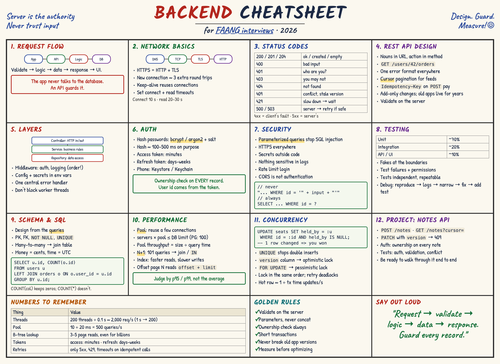
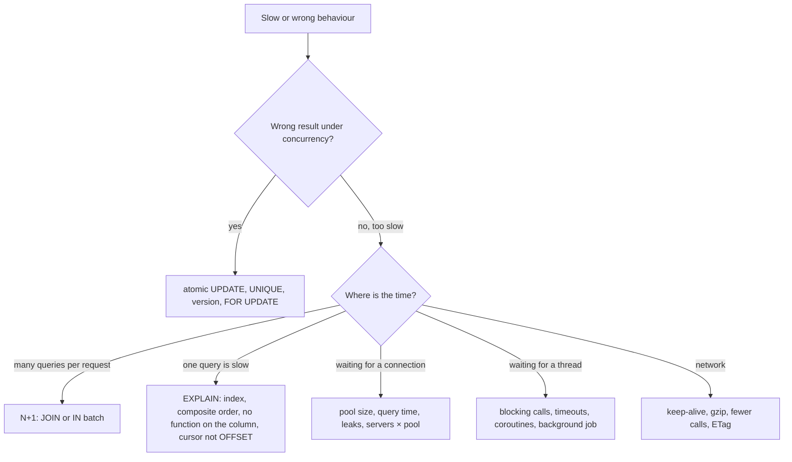

# Backend Engineering Cheat Sheet

> One-page revision for the night before an interview. The full explanations are in notes 01–12.



---

#### 1. Key Takeaways

1. **Request → Validate → Logic → Data → Response → UI.** The app never talks to the database; an API guards it.
2. **DNS → TCP → TLS → HTTP.** HTTPS = HTTP + TLS. Set connect and read timeouts. Reuse connections.
3. **4xx = the client's fault, 5xx = the server's.** `401` = who are you? `403` = you may not. Retry only `5xx`, `429` and timeouts, and only on idempotent calls.
4. **Nouns in the URL, action in the method.** One error format. Cursor pagination for feeds. Validate on the server. `Idempotency-Key` for safe `POST` retries. Never break old app versions.
5. **Controller → Service → Repository.** Middleware for cross-cutting work (order matters). Config and secrets in environment variables. One central error handler. Don't block worker threads.
6. **Hash passwords** (bcrypt / argon2 + salt). **Short access token + long refresh token.** **Ownership check on every record**, with the user from the token. Keychain / Keystore on the phone.
7. **Parameterized queries** stop SQL injection. HTTPS, secrets outside code, nothing sensitive in logs, rate limit login. CORS is not authentication.
8. **Unit → integration → API tests.** Test failures and permissions. Tests are independent and repeatable. Debug: reproduce → logs → narrow → fix → add a test.
9. **Design the schema from the queries.** PK, FK, constraints. Joins and GROUP BY. Money = cents, time = UTC. Normalize first.
10. **Pool** reuses a few connections (`servers × pool ≤ DB limit`). **N+1** is the classic hidden slowness. **Index** = faster reads, slower writes. **Atomic update / unique constraint / version column / `FOR UPDATE`** stop races.

---

#### 2. Numbers and Rules of Thumb

| Topic | Remember |
|---|---|
| First request on a new connection | DNS + TCP + TLS ≈ 3 extra round trips; keep-alive removes them |
| Throughput | `threads ÷ seconds per request` (200 threads at 100 ms ≈ 2,000 req/s; at 1 s ≈ 200 req/s) |
| Pool throughput | `pool size ÷ query time` (10 ÷ 20 ms = 500 queries/s) |
| Database connection limit | PostgreSQL default 100; `servers × pool` must fit |
| Password hash | deliberately 100 to 500 ms |
| Access / refresh token life | minutes / days to weeks |
| B-tree lookup | 3 to 5 page reads, even for billions of rows |
| Offset page `N` | reads `offset + limit` rows; cursor reads `limit` |
| Latency | judge by p95 / p99, not the average |
| Hot-row update rate | about `1 ÷ transaction time` |

| Status | Meaning | Client should |
|---|---|---|
| 200 / 201 / 204 | OK / created / no content | use it |
| 400 | invalid input | fix the request |
| 401 | not authenticated | log in or refresh |
| 403 | not allowed | show no access |
| 404 | not found (or hidden) | show not found |
| 409 | conflict (duplicate, stale version) | tell the user, reload |
| 429 | too many requests | wait, then retry |
| 500 / 503 | server bug / overloaded | retry with backoff if safe |

---

#### 3. Patterns and How to Identify Them

| Signal in the question | Think of | Note |
|---|---|---|
| "what happens when the app calls an API?" | the request flow | 01 |
| "why is the first request slow?", "401 vs 403" | DNS/TCP/TLS, status codes | 02 |
| "design the API for ..." | REST resources, error format, pagination | 03 |
| "user double-tapped Pay" | idempotency key | 03 |
| "change the API without breaking old apps" | add only, version, force-update | 03 |
| "how do you structure the project?" | layers, middleware, DI | 04 |
| "server slows down under load" | blocking calls, thread pool, timeouts | 04 |
| "how do you store passwords / tokens?" | hashing, access + refresh token | 05 |
| "user A can read user B's data" | ownership check (IDOR) | 05 |
| "prevent SQL injection / protect login" | parameterized queries, rate limit | 06 |
| "what tests, what to mock?" | test pyramid, fakes for boundaries | 07 |
| "design a schema for ..." | tables, keys, join table | 08 |
| "count per user including none" | LEFT JOIN + COUNT(col) | 08 |
| "endpoint is slow" | N+1, missing index, big OFFSET, too much data | 09, 10 |
| "two users book the last seat" | atomic UPDATE, unique constraint, lock | 11 |
| "walk me through a project" | the Notes API | 12 |



---

#### 4. Templates to Memorise

**Error format**

```json
{ "error": { "code": "VALIDATION_ERROR", "message": "Title is required", "fields": { "title": "must not be empty" } } }
```

**Cursor pagination**

```sql
SELECT id, title FROM notes WHERE user_id = :me AND id < :last ORDER BY id DESC LIMIT :limit + 1;
-- got limit + 1 rows → there is a next page; nextCursor = id of the last returned row
```

**Idempotency**

```http
POST /payments
Idempotency-Key: 7c9e-4f2a-91b0     → the server stores key → result and replays it
```

**Ownership check**

```sql
SELECT * FROM notes WHERE id = :id AND user_id = :userFromToken;    -- no row → 404
```

**Atomic update, unique, optimistic, pessimistic**

```sql
UPDATE seats SET booked_by = :u WHERE id = :id AND booked_by IS NULL;               -- 0 rows → 409
UPDATE products SET stock = stock - 1 WHERE id = :id AND stock > 0;
UPDATE notes SET title = :t, version = version + 1 WHERE id = :id AND version = :v;  -- 0 rows → 409
SELECT * FROM seats WHERE id = :id FOR UPDATE;                                       -- inside a short transaction
```

**Transaction**

```kotlin
conn.autoCommit = false
try { /* steps */ conn.commit() } catch (e: Throwable) { conn.rollback(); throw e }
```

**Parameterized query and connection use**

```kotlin
ds.connection.use { c -> c.prepareStatement("SELECT ... WHERE email = ?").use { ps -> ps.setString(1, email); ps.executeQuery() } }
```

**Middleware order:** logging → auth → rate limit → handler. **Layers:** controller (HTTP) → service (rules) → repository (SQL).

**Token refresh on the client:** on `401`, refresh once (a mutex), then retry the call once.

**Composite index:** equality columns first, then the sort or range column: `(user_id, created_at DESC)`.

---

#### 5. Naive to Better

| Naive | Better |
|---|---|
| app → database | app → API → database |
| `/getNotes`, `200` with an error inside | `GET /notes`, real status codes, one error shape |
| offset paging on a live feed | cursor paging |
| retry `POST` blindly | idempotency key |
| business rules in controllers | service layer |
| secrets in Git or in the app | environment variables, secrets manager |
| plain or fast-hash passwords | bcrypt / argon2 + salt |
| `userId` from the body | user from the verified token |
| SQL by string concatenation | parameterized queries |
| read → check in code → write | atomic `UPDATE ... WHERE`, unique constraint |
| one query per item | JOIN or `IN` batch |
| index every column | `EXPLAIN`, one targeted index |
| `FLOAT` money, local time | cents / DECIMAL, UTC |
| mock the database in "integration" tests | a real database in a container |
| optimize by guessing | load test, profile, change one thing |

---

#### 6. Common Mistakes and Edge Cases

1. Trusting the client: validation, `userId`, role, prices.
2. Missing ownership checks.
3. No timeouts, no pool limits, blocking the worker threads.
4. Raw exceptions or SQL errors returned to the client; tokens and passwords in logs.
5. Renaming or removing a field (old apps crash).
6. Offset pagination on a feed; sorting by a non-unique column with a cursor (add `id` as a tie-breaker).
7. `COUNT(*)` after a `LEFT JOIN`; `= NULL`; `UPDATE` without `WHERE`.
8. N+1, a function on an indexed column, `LIKE '%x'`.
9. Retrying non-idempotent calls, retrying forever, external calls inside a transaction.
10. Edge cases: empty list, page boundary, expired token mid-request, duplicate submit, the response lost after commit, two devices editing one record.

---

#### 7. What to Say Out Loud

1. "The app sends an HTTPS request; the backend authenticates, validates, runs the business logic, reads or writes the database, and returns a status and JSON."
2. "I'd use cursor pagination, one error format, server-side validation, and an idempotency key for the payment."
3. "Every query for user data includes the owner from the token."
4. "Passwords are hashed with bcrypt or argon2; the app holds a short access token and a refresh token in Keystore."
5. "I'd find the slow query with `EXPLAIN`, check for N+1 and a missing index, and measure again."
6. "To avoid a double booking I make the check and the change one atomic statement with a unique constraint backing it."
7. "I keep transactions short and never call external services inside them."

---

#### 8. Practice Order

| Step | Do |
|---|---|
| 1 | Trace the feed request out loud (01) |
| 2 | `curl -v` an HTTPS API and read every header (02) |
| 3 | Write the OpenAPI contract for the Notes API (03) |
| 4 | Build layers, middleware, config and the central error handler (04) |
| 5 | Add register, login, refresh and ownership checks (05, 06) |
| 6 | Write the API tests from the table in note 07 |
| 7 | Create the schema, load 200,000 rows, `EXPLAIN` the list query (08, 10) |
| 8 | Remove an N+1 and a race condition (09, 11) |
| 9 | Deploy once and call it from the app (12) |

| # | LeetCode SQL practice | Skill |
|---|---|---|
| 175 | [Combine Two Tables](https://leetcode.com/problems/combine-two-tables/) (Easy) | LEFT JOIN |
| 182 | [Duplicate Emails](https://leetcode.com/problems/duplicate-emails/) (Easy) | GROUP BY + HAVING |
| 183 | [Customers Who Never Order](https://leetcode.com/problems/customers-who-never-order/) (Easy) | NOT EXISTS |
| 176 | [Second Highest Salary](https://leetcode.com/problems/second-highest-salary/) (Medium) | subquery, NULL |
| 184 | [Department Highest Salary](https://leetcode.com/problems/department-highest-salary/) (Medium) | join + subquery |
| 180 | [Consecutive Numbers](https://leetcode.com/problems/consecutive-numbers/) (Medium) | window functions |
| 185 | [Department Top Three Salaries](https://leetcode.com/problems/department-top-three-salaries/) (Hard) | `DENSE_RANK` |
