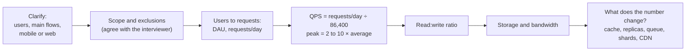

# Requirements & Estimation

> Before drawing boxes, find out what you are building and how big it must be. Ask questions, then do quick math, but only the math that changes the design.

Roadmap topic 13 · Stage 4: Scale

**Go deeper:** `14` Scaling · `15` Caching · `19` Partitioning & Sharding · `31` Interview Answer Structure · `04-backend-engineering/10-Indexes-and-Query-Performance` (latency percentiles) · `10-database/11-Choosing-a-Database`.

**Marks:** 🟢 must know · 🟡 good to know · (New) added beyond the original roadmaps

---

#### 1. What Is It?

*Functional = what the system does. Non-functional = how well it does it.*

| Functional | Non-functional |
|---|---|
| upload a photo | a photo loads in under 300 ms |
| follow a user | 99.9% available |
| see a feed | never lose an uploaded photo |
| send a message | handles 10M users |

Common non-functional needs: **latency, availability, durability, scalability, consistency, security, cost**.

| 🟢 Must know | 🟡 Good to know |
|---|---|
| functional vs non-functional requirements | (New) numbers to remember |
| scope and exclusions | |
| DAU, concurrent users, QPS, peak traffic | |
| read-heavy vs write-heavy | |
| storage and bandwidth estimates | |
| latency vs throughput, p50 / p95 / p99 | |
| availability vs durability | |

**Signals in an interview:** every system design question starts here. "Design a photo app / chat / URL shortener" means: clarify, scope, estimate.

---

#### 2. How It Works



**Scope.** You can't design everything in 45 minutes. Ask who the users are, which 2 or 3 flows matter, how many users, and mobile or web. Say what is **out of scope** ("no video in v1, no admin panel") and confirm it before designing.

**Users and traffic.**

1. **DAU**: daily active users. **Concurrent users**: online at the same moment (much smaller than DAU).
2. **QPS** (queries per second) = requests per day ÷ 86,400.
3. **Peak traffic** is usually 2 to 10 × the average. Design for the peak.

```text
10M DAU × 10 requests/day = 100M requests/day
100M ÷ 86,400 ≈ 1,200 QPS average
peak × 5 ≈ 6,000 QPS
```

**Read-heavy vs write-heavy.** Read-heavy (feeds, product pages, URL redirects): cache, replicas, CDN. Write-heavy (logs, chat, sensor data): queues, partitioning, write-friendly storage. Ask for the ratio or estimate it (a feed is often 100 reads to 1 write).

**Storage and bandwidth.**

```text
storage   = records × size per record × retention
bandwidth = requests per second × size per response
```

```text
1M photos/day × 2 MB      = 2 TB/day
2 TB/day × 365            ≈ 730 TB/year
2 TB/day ÷ 86,400 seconds ≈ 23 MB/s upload
```

Round the numbers, state your assumptions out loud, and use the result to decide: one database, object storage for the files, or sharding?

**Latency vs throughput, percentiles.** *Latency* is the time for one request; *throughput* is requests handled per second. **p50**: half the requests are faster. **p95 / p99**: the slowest 5% / 1%. Averages hide slow users, so set targets on p95 or p99.

**Availability vs durability.** Availability: the system is up and answering. Durability: saved data is not lost. A system can be down yet lose nothing.

| Uptime | Downtime per year |
|---|---|
| 99% | about 3.7 days |
| 99.9% | about 8.8 hours |
| 99.99% | about 53 minutes |
| 99.999% | about 5 minutes |

🟡 **(New) Numbers to remember.**

```text
1 day ≈ 86,400 s ≈ 100K s        1M requests/day ≈ 12 QPS
1 KB × 1M = 1 GB                 1 MB × 1M = 1 TB
Memory read                 ~100 ns
SSD read                    ~100 µs
Same data-center round trip ~0.5 ms
Across continents           ~150 ms
```

Memory is far faster than disk, and disk is far faster than the network.

---

#### 3. Naive vs Better Design

| Situation | Naive | Better |
|---|---|---|
| Start | draw boxes at once | ask questions, scope, then draw |
| Assumptions | silent | stated aloud and rounded |
| Traffic | average QPS | peak QPS (2 to 10 × average) |
| Users | DAU = concurrent users | concurrent users are a fraction of DAU |
| Math | exact numbers that change nothing | only the numbers that change the design |
| Speed | the average latency | p95 / p99 targets |
| Reliability | "highly available" with no number | 99.9% or 99.99%, and what that means in minutes |
| Data | "we store everything forever" | retention and size per record |

```kotlin
// Naive: the average hides the slow tail
fun averageMs(latencies: List<Int>) = latencies.sum().toDouble() / latencies.size
```

---

#### 4. Code

Small estimation helpers you can reproduce on a whiteboard, with the numbers they give.

```kotlin
import kotlin.math.ceil

const val SECONDS_PER_DAY = 86_400.0

fun qps(requestsPerDay: Double) = requestsPerDay / SECONDS_PER_DAY
fun peakQps(avgQps: Double, factor: Double = 5.0) = avgQps * factor

fun storagePerDayTb(recordsPerDay: Double, bytesPerRecord: Double) = recordsPerDay * bytesPerRecord / 1e12
fun uploadMbPerSecond(bytesPerDay: Double) = bytesPerDay / SECONDS_PER_DAY / 1e6

// Nearest-rank percentile
fun percentile(latenciesMs: List<Int>, p: Double): Int {
    val sorted = latenciesMs.sorted()
    val rank = ceil(p / 100.0 * sorted.size).toInt().coerceIn(1, sorted.size)
    return sorted[rank - 1]
}

// Downtime allowed per year for an availability target
fun downtimeMinutesPerYear(availability: Double) = (1.0 - availability) * 365 * 24 * 60
```

Checks: `qps(10_000_000 * 10.0)` → `1157.4` (about 1,200); `peakQps(1157.4)` → `5787` (about 6,000). `storagePerDayTb(1_000_000.0, 2e6)` → `2.0`, so about `730` TB a year; `uploadMbPerSecond(2e12)` → `23.1`. 98 requests at 100 ms plus 2 requests at 2,000 ms: `averageMs` → `138.0` but `percentile(…, 99.0)` → `2000` and `percentile(…, 50.0)` → `100`. `downtimeMinutesPerYear(0.99)` → `5256` (3.65 days); `(0.999)` → `525.6` (8.8 hours); `(0.9999)` → `52.6`; `(0.99999)` → `5.3`.

**A worked example: photo app, 10M DAU.** Assume each user opens the feed 5 times and views 30 photos a day, and 1 in 10 users uploads one photo (2 MB).

```text
reads:   10M × 30 = 300M/day ≈ 3,500 QPS average, peak × 5 ≈ 17,000
writes:  1M uploads/day ≈ 12 QPS, peak ≈ 60
ratio:   about 300 : 1 → read-heavy → CDN + cache; the database is not the problem
storage: 1M × 2 MB = 2 TB/day ≈ 730 TB/year → object storage, not the database
```

What the numbers change: serve photos from a CDN, keep only metadata in the database, cache hot feeds, and worry about storage cost rather than write QPS.

---

#### 5. Numbers & Capacity

| Quantity | Rule of thumb |
|---|---|
| 1M requests per day | about 12 QPS |
| 100M requests per day | about 1,200 QPS |
| One app server | a few hundred to a few thousand simple requests per second |
| One database (PostgreSQL) | thousands of simple queries per second; tens of thousands of reads with good indexes and cache |
| One cache node (Redis) | around 100K operations per second |
| One machine's disk | a few TB; 100s of TB needs object storage or sharding |
| Round trip, same data center / across continents | 0.5 ms / 150 ms |

Use them to answer "one machine or many?" in one sentence.

---

#### 6. Common Mistakes & Edge Cases

1. Starting to draw before asking questions.
2. No stated assumptions.
3. Very exact math that doesn't change the design.
4. Designing for the average traffic, not the peak.
5. Mixing up DAU and concurrent users.
6. Ignoring the read:write ratio.
7. Reporting only averages.
8. Forgetting growth (plan for 2 to 5 years if it changes the design).
9. Mixing up bits and bytes (bandwidth is often in bits per second).

Edge cases: spiky traffic (a push notification sent to everyone at 9:00), regional peaks, large objects (video) that dominate storage, the "celebrity" user with 100M followers.

---

#### 7. Say This in the Interview

1. "Let me clarify the main flows and the scale first. Is this mobile, web or both? What is in scope for now?"
2. "I'll assume 10M daily users, 10 requests each: about 1,200 QPS average, about 6,000 at peak."
3. "It's read-heavy, around 100 to 1, so the design leans on caching and read replicas."
4. "Photos are 2 MB and there are 1M a day, so about 2 TB a day. That belongs in object storage with a CDN, not in the database."
5. "I'll target p95 under 300 ms and 99.9% availability, which is about 8.8 hours of downtime a year."

---

#### 8. Quick Check

1. 50M requests per day. Average QPS? Peak with a factor of 5?
2. Why use p99 and not the average?
3. A system is down for an hour but loses no data. Available? Durable?
4. 5 MB × 200,000 uploads per day. Storage per day?

<details>
<summary>Answers</summary>

1. About 580 QPS average, about 2,900 at peak.
2. The average hides the slowest users; p99 shows the worst common experience.
3. Not available, but durable.
4. 1 TB per day.

</details>

---

#### 9. Practice

**Interview questions**

1. Estimate QPS and storage for a photo app with 10M users.
2. Functional vs non-functional requirements?
3. Why p99 and not the average?
4. Availability vs durability?
5. How do you decide whether you need sharding?

**Hands-on**

1. Pick three apps you use and write their functional requirements, non-functional requirements, scope and exclusions in five lines each.
2. Estimate QPS, peak, storage per year and bandwidth for a chat app with 5M DAU.
3. Memorise the downtime table and the latency numbers.

**LeetCode design problems that start with requirements**

| # | Question | Link to this topic |
|---|---|---|
| 362 | [Design Hit Counter](https://leetcode.com/problems/design-hit-counter/) (Medium, premium) | QPS over a window |
| 359 | [Logger Rate Limiter](https://leetcode.com/problems/logger-rate-limiter/) (Easy, premium) | per-key limits |
| 1396 | [Design Underground System](https://leetcode.com/problems/design-underground-system/) (Medium) | clarify, then pick data structures |

**Remember:** clarify first (functional, non-functional, scope, exclusions) · QPS = requests/day ÷ 86,400, peak is 2 to 10 × average · read-heavy or write-heavy decides the design · storage = records × size × retention · use p95 / p99, not the average · estimate only what changes the design.
