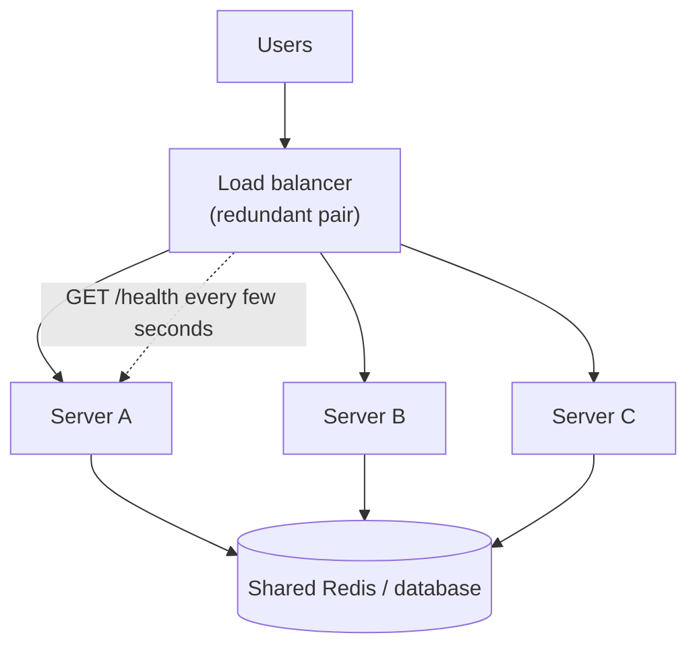
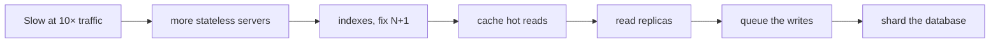

# Scaling & Load Balancing

> When one server can't handle the traffic, add more servers and put a load balancer in front. For that to work, servers must be stateless and you must remove every single point of failure.

Roadmap topic 14 · Stage 4: Scale

**Go deeper:** `13` Requirements & Estimation · `15` Caching · `18` Replication · `19` Partitioning & Sharding · `26` Service Boundaries · `04-backend-engineering/01-Client-Server-Request-Flow` (stateless requests) · `04-backend-engineering/04-Backend-Building-Blocks` (thread pools).

**Marks:** 🟢 must know · 🟡 good to know

---

#### 1. What Is It?

*Vertical = a bigger machine. Horizontal = more machines.*

| | Vertical (scale up) | Horizontal (scale out) |
|---|---|---|
| How | more CPU / RAM on one server | more servers |
| Easy? | yes, no code change | needs a stateless design |
| Limit | hardware limit, expensive | almost unlimited |
| Failure | one server = single point of failure | others keep working |

Typical path: start simple, scale up a bit, then scale out.

| 🟢 Must know | 🟡 Good to know |
|---|---|
| vertical vs horizontal scaling | load balancing algorithms |
| stateless servers, shared session state | sticky sessions |
| load balancer and health checks | L4 vs L7 |
| single points of failure | reverse proxy, API gateway, auto-scaling |
| finding the bottleneck | |

**Signals in an interview:** "traffic grows 10×, what do you change?", "how do you scale this service?", "what if this box dies?", "where do sessions live?"

---

#### 2. How It Works



**Stateless servers.** If any server can serve any request, you can add or remove servers freely.

1. **Stateless:** the server keeps no user data between requests (topic 1 in `04-backend-engineering`).
2. The **stateful** problem: the user's session is in Server A's memory; if the next request lands on Server B, they are "logged out".
3. Fix: keep the session in a **shared store** (Redis or the database), or inside a signed **token**.

**Load balancer and health checks.** A traffic officer that sends each request to a healthy server. It spreads requests, **health-checks** each server (`/health`) and removes a failing one from rotation, and it lets you deploy or replace servers without downtime. The load balancer itself must not be a single point of failure, so run more than one.

**Single points of failure (SPOF).** Ask about every box: "If this dies, does the whole system stop?"

| Component | How to remove the SPOF |
|---|---|
| app server | several servers behind a load balancer |
| load balancer | a redundant pair |
| database | replica with failover (topic 18) |
| cache | a cache cluster |
| data center | multiple zones or regions |

**Finding the bottleneck.** Ask: what breaks first when traffic grows? It is usually the **database**, before the app servers (app servers are easy to add). A typical order of improvement: **index → cache → read replicas → sharding**. Measure CPU, memory, database time and queue length before you scale.



🟡 **Load balancing algorithms.** *Round robin*: servers take turns. *Least connections*: the least busy server gets the next request. *Hashing*: the same client goes to the same server. **Sticky sessions** (the same user always to the same server) are simple but uneven, and a failure loses the session, so prefer stateless.

🟡 **L4 vs L7.** L4 routes by IP and port (fast, simple). L7 routes by URL, headers or cookies (smarter: `/api` to one pool, `/images` to another).

🟡 **Reverse proxy, API gateway, auto-scaling.** A reverse proxy (Nginx) terminates TLS and handles compression and caching. An API gateway is one entry point for auth, rate limiting and routing (topic 26). Auto-scaling adds or removes servers from CPU or request counts.

---

#### 3. Naive vs Better Design

| Situation | Naive | Better |
|---|---|---|
| More traffic | buy a bigger box forever | scale out behind a load balancer |
| Sessions | in server memory | Redis or a signed token |
| Load balancer | one instance | redundant pair |
| Database | one instance with no failover | primary plus replica with failover |
| Servers added | when "it feels slow" | after measuring CPU, DB time, queue length |
| Server dies | clients get errors until someone notices | health checks remove it automatically |
| Routing | sticky sessions everywhere | stateless, any server |

```kotlin
// Naive: per-user state in server memory. Fails as soon as there are two servers.
val sessions = HashMap<String, User>()                 // lives in one JVM only
```

---

#### 4. Code

A load balancer reduced to its core: health checks, round robin and least connections.

```kotlin
class Server(val name: String) {
    @Volatile var healthy = true
    var activeConnections = 0
}

class LoadBalancer(private val servers: List<Server>) {
    private var next = 0

    // Round robin: take turns, skip unhealthy servers
    fun roundRobin(): Server? {
        repeat(servers.size) {
            val s = servers[next % servers.size]
            next++
            if (s.healthy) return s
        }
        return null                                    // nobody is healthy → reply 503
    }

    // Least connections: the least busy healthy server
    fun leastConnections(): Server? = servers.filter { it.healthy }.minByOrNull { it.activeConnections }

    // Hash by client: the same client keeps hitting the same server while the list is stable
    fun byHash(clientId: String): Server? {
        val healthy = servers.filter { it.healthy }
        return if (healthy.isEmpty()) null else healthy[Math.floorMod(clientId.hashCode(), healthy.size)]
    }
}

// How many servers do I need? Peak load ÷ capacity per server, with headroom, plus one for a failure (N+1)
fun serversNeeded(peakQps: Double, qpsPerServer: Double, targetUtilisation: Double = 0.7): Int =
    Math.ceil(peakQps / qpsPerServer / targetUtilisation).toInt() + 1
```

Health endpoint (Ktor shape): *liveness* says "the process is up", *readiness* says "I can take traffic (database reachable)".

```kotlin
get("/health") { call.respondText("ok") }
get("/ready")  { if (db.ping()) call.respondText("ready") else call.respond(HttpStatusCode.ServiceUnavailable) }
```

Nginx as a simple L7 balancer:

```nginx
upstream api {
    least_conn;
    server 10.0.0.1:8080 max_fails=3 fail_timeout=10s;
    server 10.0.0.2:8080 max_fails=3 fail_timeout=10s;
    server 10.0.0.3:8080 backup;
}
server { listen 443 ssl; location /api/ { proxy_pass http://api; } }
```

Checks: three servers A, B, C: `roundRobin()` returns A, B, C, A, B, C. Mark B unhealthy and it returns A, C, A, C. Mark all unhealthy and it returns `null`. With `activeConnections` of 5, 2, 9, `leastConnections()` returns B. `byHash("user-42")` returns the same server on every call. `serversNeeded(6000.0, 500.0)` → `19` (6000 ÷ 500 = 12 servers at full load, 18 at 70% utilisation, plus 1 spare).

---

#### 5. Numbers & Capacity

| Question | Number |
|---|---|
| Throughput of a service | about `threads ÷ time per request` (200 threads, 100 ms ≈ 2,000 req/s) |
| Headroom | run at 50 to 70% of capacity so a failure or spike doesn't topple the rest |
| N+1 | enough servers to survive losing one |
| Failure of 1 of 3 servers | the other two take 50% more load each |
| Failure of 1 of 10 servers | the other nine take about 11% more |
| Health check interval | every 5 to 10 s, remove after 2 to 3 failures |
| Where it breaks first | the database: single primary around thousands of writes/s |

More servers means a smaller share lost per failure, but more connections to the database (`servers × pool` must fit; see `04-backend-engineering` topic 9).

---

#### 6. Common Mistakes & Edge Cases

1. Storing session state in server memory.
2. One load balancer or one database, with no redundancy.
3. Scaling app servers when the database is the bottleneck.
4. Scaling before measuring.
5. Relying on sticky sessions.
6. A health check that only says "process is up" while the database is unreachable.
7. Deploying to all servers at once (use rolling updates, topic 28).
8. Auto-scaling that is slower than the traffic spike (add warm capacity).

Edge cases: one slow server dragging the pool (use least connections and timeouts); a thundering herd when a server comes back and gets all new connections; uneven requests (a few heavy requests make round robin unfair); local files or in-memory caches that differ per server.

---

#### 7. Say This in the Interview

1. "Horizontal scaling needs stateless servers, so sessions go to Redis or a token."
2. "A load balancer spreads requests, health-checks servers and removes the unhealthy ones. I'd run it as a redundant pair."
3. "I'd look for single points of failure in every box: servers, balancer, database, cache, even the data center."
4. "The database is usually the first bottleneck. I'd go index, cache, read replicas, then sharding, and measure before each step."
5. "I'd use least connections or round robin, and avoid sticky sessions."

---

#### 8. Quick Check

1. Why must servers be stateless to scale out?
2. What does a health check do?
3. Traffic grows 10×. In what order do you scale?
4. Three servers, one fails. How much extra load does each survivor take?

<details>
<summary>Answers</summary>

1. So any server can handle any request, and you can add or remove servers freely.
2. It pings each server regularly and removes failing ones from rotation.
3. Stateless servers behind a load balancer, then index, cache, read replicas, and finally sharding.
4. 50% more (each of the two takes 1.5 × its old load).

</details>

---

#### 9. Practice

**Interview questions**

1. Vertical vs horizontal scaling?
2. Traffic grows 10×. What do you change, in order?
3. Why must servers be stateless?
4. What does a load balancer do?
5. What are single points of failure, and how do you remove them?
6. Where do you store sessions with many servers?

**Hands-on**

1. Run two copies of your Notes API behind Nginx and kill one while sending requests.
2. Move an in-memory session into Redis or a JWT and confirm both servers accept it.
3. Add `/health` and `/ready` endpoints and point the balancer's health check at them.

**LeetCode design problems**

| # | Question | Link to this topic |
|---|---|---|
| 146 | [LRU Cache](https://leetcode.com/problems/lru-cache/) (Medium) | the next step: a cache in front of the database |
| 1396 | [Design Underground System](https://leetcode.com/problems/design-underground-system/) (Medium) | per-key state kept in a shared store |
| 355 | [Design Twitter](https://leetcode.com/problems/design-twitter/) (Medium) | a read-heavy feed |

**Remember:** horizontal scaling needs stateless servers · a load balancer spreads traffic and runs health checks · find and remove every single point of failure · the database is usually the first bottleneck · improvement order: index → cache → replicas → sharding.
