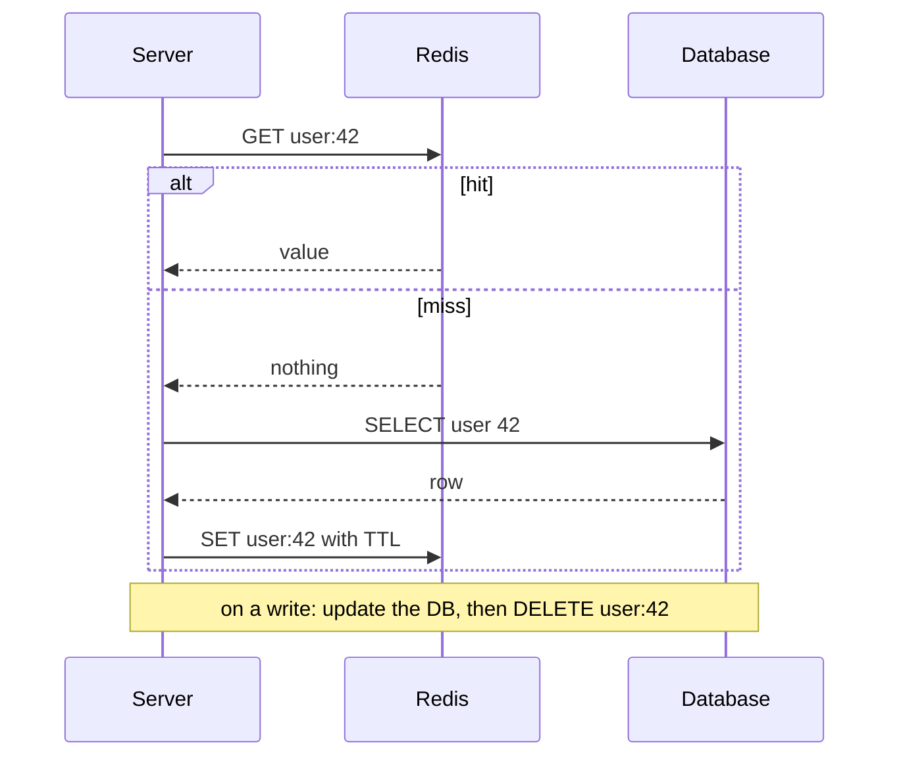
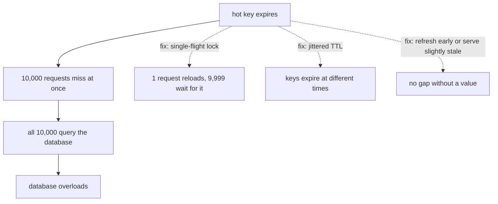

# Caching

> Keep a copy of frequently used data in a fast place, so you don't repeat slow work. The hard part is keeping the copy correct.

Roadmap topic 15 · Stage 4: Scale

**Go deeper:** `10-database/13-Caching-and-Redis` · `04-backend-engineering/10-Indexes-and-Query-Performance` (fix the query first) · `16` File Storage & CDN · `23` Consistency & CAP · `33` Follow-Up Topics (Bloom filter) · `06-mobile-engineering/09-Local-Storage-and-Offline-First` (the app-side cache).

**Marks:** 🟢 must know · 🟡 good to know

---

#### 1. What Is It?

*Same idea as caching images or API responses in your app.*

- **Cache hit:** the data is in the cache (fast).
- **Cache miss:** it isn't, so you go to the source (slow) and usually store the result.
- **Why:** faster responses and less load on the database.

```text
App cache → CDN → server memory → Redis → database
(nearest, fastest)                          (farthest, slowest)
```

| 🟢 Must know | 🟡 Good to know |
|---|---|
| hit vs miss, where caches live | write-through / write-back |
| cache-aside | cache penetration (keys that don't exist) |
| TTL, eviction (LRU), invalidation | in-process vs shared cache |
| stale data | HTTP cache headers |
| stampede and hot keys | |
| user-specific data in cache keys | |

**Signals in an interview:** "the feed is slow", "read-heavy", "the database is the bottleneck", "what happens when the data changes?", "what if a hot key expires?"

---

#### 2. How It Works

**Cache-aside** (the most common pattern): the application manages the cache.



Read: look in the cache; on a hit return it; on a miss read the database, put the value in the cache (with a TTL) and return it. Write: update the database, then **delete** (invalidate) the cache entry so the next read reloads fresh data.

**TTL, eviction, invalidation.**

1. **TTL (time to live):** the entry expires after N seconds. A simple safety net.
2. **Eviction:** when the cache is full, remove something. **LRU** (least recently used) is the common policy.
3. **Invalidation:** remove or update entries when the data changes. This is the hard part, so keep it simple.

**Stale data.** A cache can be out of date until the TTL expires or it is invalidated. Decide per feature how stale is acceptable: a profile photo (minutes, fine), an account balance (never stale). A shorter TTL means fresher data but a lower hit rate.

**Stampede and hot keys.**

*Stampede:* a popular key expires and thousands of requests miss at the same moment, all hitting the database.



*Hot key:* one key gets extreme traffic (a celebrity profile) and overloads one cache node. Fix: keep a copy in server memory (a small in-process cache) or replicate the key across nodes.

🟡 **Write-through / write-back.** Write-through writes the cache and database together: the cache is always fresh, but writes are slower. Write-back writes the cache first and the database later: very fast, but data is lost if the cache dies before it is flushed.

🟡 **Cache penetration.** Requests for keys that **don't exist** always miss and always hit the database (often an attack). Fix: cache the "not found" result briefly, or use a Bloom filter (topic 33).

🟡 **In-process vs shared cache.**

| | In-process (server memory) | Shared (Redis, Memcached) |
|---|---|---|
| Speed | fastest | fast (a network hop) |
| Consistency | each server has its own copy, so copies differ | one copy for all servers |
| Survives restart | no | yes (Redis can persist) |

🟡 **HTTP cache headers** let the client and the CDN cache for you: `Cache-Control: max-age=60` (reuse for 60 seconds), and `ETag` + `If-None-Match` (validate; `304 Not Modified` if unchanged). OkHttp and URLSession follow these headers, so correct headers save mobile data.

**User-specific data.** A shared cache is used by everyone. Never serve one user's cached data to another: include the user ID in the key for personal data (`feed:user:42`), and keep authorization checks correct even when the data comes from the cache.

---

#### 3. Naive vs Better Design

| Situation | Naive | Better |
|---|---|---|
| Every read | query the database | cache-aside for read-heavy, rarely changing data |
| Entries | no TTL, never invalidated | TTL as a safety net + delete on write |
| Expiry | all keys get the same TTL | TTL + random jitter |
| Hot key expires | every request reloads it | single-flight: one reloads, the rest wait |
| Missing keys | always hit the database | cache "not found" briefly, or a Bloom filter |
| Personal data | shared key `feed` | key `feed:user:42` |
| Cache as truth | the only copy of the data | always a copy; the database is the truth |
| Freshness | one TTL for everything | TTL chosen per feature |

```kotlin
// Naive: no TTL, no invalidation, no limit. Grows forever and serves stale data.
val cache = HashMap<String, String>()
fun getUser(id: Long) = cache.getOrPut("user:$id") { db.loadUser(id) }
```

---

#### 4. Code

```kotlin
import kotlinx.coroutines.*
import java.util.concurrent.ConcurrentHashMap
import kotlin.random.Random

// ---------- LRU: a LinkedHashMap in access order evicts the least recently used ----------
class LruCache<K, V>(private val capacity: Int) {
    private val map = object : LinkedHashMap<K, V>(16, 0.75f, true) {
        override fun removeEldestEntry(eldest: MutableMap.MutableEntry<K, V>?) = size > capacity
    }
    @Synchronized fun get(key: K): V? = map[key]
    @Synchronized fun put(key: K, value: V) { map[key] = value }
}

// ---------- TTL with an injectable clock (so tests control time) ----------
class TtlCache<K, V>(private val ttlMs: Long, private val now: () -> Long) {
    private data class Entry<V>(val value: V, val expiresAt: Long)
    private val map = ConcurrentHashMap<K, Entry<V>>()
    fun get(key: K): V? {
        val e = map[key] ?: return null
        if (now() >= e.expiresAt) { map.remove(key); return null }
        return e.value
    }
    fun put(key: K, value: V, jitterMs: Long = 0) {
        map[key] = Entry(value, now() + ttlMs + (if (jitterMs > 0) Random.nextLong(jitterMs) else 0))
    }
    fun invalidate(key: K) { map.remove(key) }
}

// ---------- cache-aside ----------
class UserService(private val db: (Long) -> String?, private val cache: TtlCache<String, String>) {
    var dbCalls = 0
        private set
    fun get(id: Long): String? {
        val key = "user:$id"
        cache.get(key)?.let { return it }                      // hit
        dbCalls++
        val value = db(id) ?: return null                      // (a negative cache entry would go here)
        cache.put(key, value, jitterMs = 5_000)                // fill, with jitter
        return value
    }
    fun update(id: Long, newValue: String, save: (Long, String) -> Unit) {
        save(id, newValue)                                     // 1. update the database
        cache.invalidate("user:$id")                           // 2. delete the cache entry
    }
}

// ---------- single-flight: concurrent misses on one key share a single load ----------
class SingleFlight<K : Any, V> {
    private val inFlight = ConcurrentHashMap<K, Deferred<V>>()
    suspend fun load(key: K, scope: CoroutineScope, loader: suspend () -> V): V {
        val deferred = inFlight.computeIfAbsent(key) {
            scope.async(start = CoroutineStart.LAZY) {
                try { loader() } finally { inFlight.remove(key) }
            }
        }
        return deferred.await()
    }
}

// ---------- the numbers behind a cache ----------
fun averageLatencyMs(hitRatio: Double, cacheMs: Double, dbMs: Double) = hitRatio * cacheMs + (1 - hitRatio) * (cacheMs + dbMs)
fun databaseQps(totalQps: Double, hitRatio: Double) = totalQps * (1 - hitRatio)
```

HTTP headers for a profile picture that changes rarely:

```http
HTTP/1.1 200 OK
Cache-Control: public, max-age=3600
ETag: "v7"
```

Checks: `LruCache(2)`: `put(1,"a")`, `put(2,"b")`, `get(1)` → `"a"`, `put(3,"c")` evicts key 2, so `get(2)` → `null` and `get(3)` → `"c"`. `UserService`: the first `get(42)` makes `dbCalls == 1`, a second `get(42)` is a hit and `dbCalls` stays `1`; after `update(42, …)` the next `get(42)` loads again (`dbCalls == 2`) and returns the new value. A `TtlCache(ttlMs = 1000)` with a fake clock returns the value at `t = 999` and `null` at `t = 1000`. 100 coroutines calling `SingleFlight.load("hot", scope) { loads++; delay(50); "v" }` at once all get `"v"` and `loads == 1`. `averageLatencyMs(0.95, 1.0, 20.0)` → `2.0`; `databaseQps(10_000.0, 0.95)` → `500.0`.

---

#### 5. Numbers & Capacity

| Item | Number |
|---|---|
| Redis operation | about 0.1 to 1 ms over the network, around 100K operations per second per node |
| In-process lookup | about 100 ns |
| Hit ratio of 95% | the database sees 5% of the reads: 10,000 QPS becomes 500 QPS |
| Memory for a cache | 10M entries × 1 KB ≈ 10 GB per copy |
| Hit ratio vs size | the first slice of memory buys the most; the hottest 20% of keys often serve 80% or more of reads |
| TTL choice | seconds for fast-changing data, minutes to hours for profiles and catalogs |

Cache only when the read is expensive and repeated. First fix the query and the index (topic 10 in `04-backend-engineering`).

---

#### 6. Common Mistakes & Edge Cases

1. Caching without an invalidation plan.
2. No TTL.
3. Caching user-specific data under a shared key.
4. Everything expires at the same time (stampede).
5. Treating the cache as the only copy of the data.
6. Caching data that changes constantly.
7. Updating the cache before the database (a failed write leaves a wrong value).
8. A race: a slow reader refills the cache with an old value just after a writer invalidated it. Keep TTLs short and invalidate after the write commits.
9. Caching errors or `null` results with a long TTL.

Edge cases: the cache is down (the system must still work, only slower; protect the database with rate limits and single-flight); a deploy that changes the cached object's shape (version the key: `user:v2:42`); very large values; clock differences between servers affecting TTLs.

---

#### 7. Say This in the Interview

1. "I'd cache read-heavy, rarely changing data such as profiles and feeds in Redis, with a TTL as a safety net."
2. "Cache-aside: read the cache, and on a miss read the database and fill the cache. On a write, update the database and delete the key."
3. "A popular key expiring causes a stampede. I'd use a single-flight lock, jitter the TTLs, and refresh early."
4. "Stale data is the trade-off. I choose the TTL per feature: a profile photo can be minutes old, a balance must not be cached."
5. "Personal data is keyed by user, and permissions are still checked on cached responses."

---

#### 8. Quick Check

1. What does an LRU cache evict?
2. A hot key expires and the database spikes. Name two fixes.
3. Hit ratio 90% and 20,000 QPS. What does the database see?
4. Why delete the cache entry on a write instead of updating it?

<details>
<summary>Answers</summary>

1. The least recently used entry when it is full.
2. Single-flight (only one request reloads), TTL jitter, refresh early or serve slightly stale.
3. 2,000 QPS.
4. Deleting is simpler and safer: the next read loads a correct value, and there is no window where an old write overwrites a newer one.

</details>

---

#### 9. Practice

**Interview questions**

1. What do you cache, where, and what happens when the data changes?
2. Explain cache-aside.
3. What is a cache stampede, and how do you prevent it?
4. How do you handle stale data?
5. What is LRU?
6. In-process cache vs Redis?

**Hands-on**

1. Put Redis in front of the feed endpoint of your Notes API and measure p95 before and after.
2. Add TTL jitter and show that a burst of misses no longer happens at one instant.
3. Add a `/users/{id}` response with `Cache-Control` and `ETag` and test it with `curl -I`.

**LeetCode design problems**

| # | Question | Link to this topic |
|---|---|---|
| 146 | [LRU Cache](https://leetcode.com/problems/lru-cache/) (Medium) | the eviction policy |
| 460 | [LFU Cache](https://leetcode.com/problems/lfu-cache/) (Hard) | evict the least frequently used |
| 981 | [Time Based Key-Value Store](https://leetcode.com/problems/time-based-key-value-store/) (Medium) | values with timestamps |
| 706 | [Design HashMap](https://leetcode.com/problems/design-hashmap/) (Easy) | the structure under a cache |

**Remember:** cache-aside: read cache → miss → database → fill; write: update the database → invalidate the key · always set a TTL, know LRU · stale data is the trade-off, decide per feature · stampede: lock, jitter, refresh early; hot keys: replicate · never mix users' data in a shared key.
