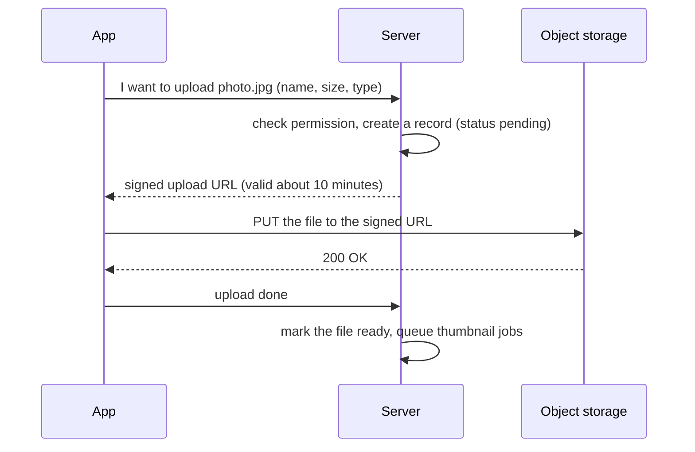
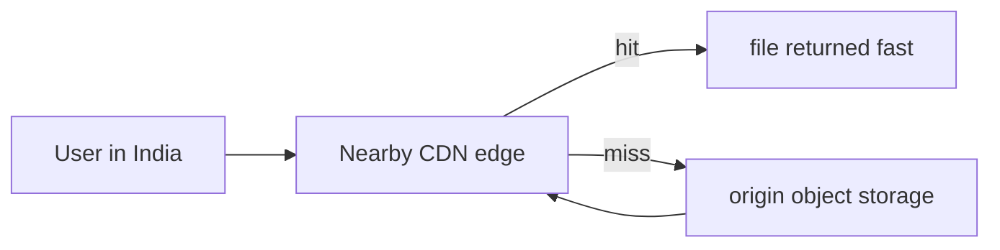

# File Storage & CDN

> Store big files (photos, videos) in object storage, not in the database. Let the app upload directly with a signed URL, and serve files through a CDN so they load fast everywhere.

Roadmap topic 16 · Stage 4: Scale

**Go deeper:** `15` Caching · `21` Queues, Events & Background Jobs (thumbnails) · `30` Mobile-Specific Topics (resumable uploads, image loading) · `32` Practice Designs (file storage, video streaming) · `04-backend-engineering/05-Authentication-and-Authorization` · `06-mobile-engineering/09-Local-Storage-and-Offline-First`.

**Marks:** 🟢 must know · 🟡 good to know

---

#### 1. What Is It?

*Object storage is a giant, cheap, reliable folder in the cloud (Amazon S3, Google Cloud Storage).*

1. It stores files as **objects** with a key (`photos/2025/abc.jpg`).
2. Very durable, scales almost without limit, and is cheap.
3. **Don't** store files in the database (slow, expensive) or on the server's disk (lost when the server is replaced, not shared between servers).
4. The database keeps only **metadata** and the file's key.

```text
files table:  id | owner_id | key (photos/abc.jpg) | size | type | status | created_at
storage:      photos/abc.jpg → the actual bytes
```

| 🟢 Must know | 🟡 Good to know |
|---|---|
| object storage, metadata in the database | multipart, large and resumable uploads |
| upload and download flow | thumbnails, cleanup |
| signed URLs | |
| CDN basics | |

**Signals in an interview:** "design file sharing / photo upload / video streaming", "where do you store images?", "how does a 500 MB upload survive a bad network?", "how do you serve files fast worldwide?"

---

#### 2. How It Works

**Upload with a signed URL.** The server hands out a short-lived permission slip; the app uploads directly to storage.



Why: the big file never passes through your servers (saving bandwidth and CPU), and the URL is temporary and limited to one file.

**Download.** Public files (profile pictures) are served through the CDN. Private files (documents): the server checks permission and returns a **signed download URL** that expires. Signed URLs control access without proxying the file. Stable CDN URLs also give the best hit rate in the app's image cache (Coil, Glide, SDWebImage).

**CDN (Content Delivery Network).** Copies of your files placed on servers close to users.



1. Lower latency, because the file travels a shorter distance.
2. Less load on your origin servers and storage.
3. Best for static, popular files: images, videos, app assets.
4. **Updating files:** use versioned file names (`logo-v3.png`, or a content hash) or invalidate the CDN cache. Otherwise users keep old copies until the TTL ends.

🟡 **Multipart, large and resumable uploads.** Mobile networks drop; don't restart a 500 MB upload from zero. Split the file into **chunks**, track which are done, **resume** from the last one, retry failed chunks with backoff, and combine them on the storage side.

🟡 **Thumbnails and cleanup.** Create several sizes (thumbnail, medium, full) in a background job so the app loads small images first. Validate **size and type** (consider virus scanning). **Clean up** abandoned uploads (uploaded but never confirmed) and orphaned metadata with a scheduled job.

---

#### 3. Naive vs Better Design

| Situation | Naive | Better |
|---|---|---|
| Where files live | in the database or on the server's disk | object storage; key + metadata in the database |
| Uploading | the file passes through the API server | direct upload with a signed URL |
| Private files | public bucket | signed download URLs that expire |
| Delivery | served from the origin | through a CDN |
| Image size | the full image everywhere | thumbnails, sized for the screen |
| Big files | one request, restart on failure | chunked, resumable |
| Updating a file | same name, stale CDN copy | versioned name or invalidation |
| Failed uploads | rows and bytes left behind forever | status field + scheduled cleanup |

```kotlin
// Naive: 500 MB goes through your server, held in memory, then into the database
post("/photos") { val bytes = call.receive<ByteArray>(); db.insertBlob(bytes) }
```

---

#### 4. Code

```kotlin
import java.security.MessageDigest
import javax.crypto.Mac
import javax.crypto.spec.SecretKeySpec

// ---------- a signed URL, reduced to its idea: URL + expiry + HMAC of both ----------
fun sign(path: String, expiresAtEpochSec: Long, secret: String): String {
    val mac = Mac.getInstance("HmacSHA256").apply { init(SecretKeySpec(secret.toByteArray(), "HmacSHA256")) }
    val sig = mac.doFinal("$path|$expiresAtEpochSec".toByteArray()).joinToString("") { "%02x".format(it) }
    return "$path?expires=$expiresAtEpochSec&sig=$sig"
}

fun isValid(path: String, expiresAt: Long, sig: String, secret: String, nowEpochSec: Long): Boolean {
    if (nowEpochSec > expiresAt) return false
    val expected = sign(path, expiresAt, secret).substringAfter("&sig=")
    return MessageDigest.isEqual(expected.toByteArray(), sig.toByteArray())          // constant-time compare
}

// ---------- real S3 presigned upload (AWS SDK for Java v2) ----------
// val presigner = S3Presigner.create()
// val request = PutObjectPresignRequest.builder()
//     .signatureDuration(Duration.ofMinutes(10))
//     .putObjectRequest(PutObjectRequest.builder().bucket("my-bucket").key(key).contentType(type).build())
//     .build()
// val uploadUrl = presigner.presignPutObject(request).url()

// ---------- chunked, resumable upload ----------
data class Chunk(val index: Int, val from: Long, val toExclusive: Long)

fun chunksFor(sizeBytes: Long, chunkBytes: Long): List<Chunk> =
    (0 until Math.ceil(sizeBytes.toDouble() / chunkBytes).toInt()).map { i ->
        Chunk(i, i * chunkBytes, minOf((i + 1) * chunkBytes, sizeBytes))
    }

fun nextChunk(all: List<Chunk>, done: Set<Int>): Chunk? = all.firstOrNull { it.index !in done }   // resume here

// ---------- content-hash file names make CDN caching safe ----------
fun contentHashName(bytes: ByteArray, extension: String): String =
    MessageDigest.getInstance("SHA-256").digest(bytes).take(4).joinToString("") { "%02x".format(it) } + "." + extension
```

Metadata and cleanup in SQL:

```sql
CREATE TABLE files (
  id BIGSERIAL PRIMARY KEY, owner_id BIGINT NOT NULL, object_key TEXT NOT NULL UNIQUE,
  size_bytes BIGINT NOT NULL, content_type TEXT NOT NULL,
  status TEXT NOT NULL DEFAULT 'pending',            -- pending → ready
  created_at TIMESTAMPTZ NOT NULL DEFAULT now()
);
-- scheduled job: remove abandoned uploads (and delete their objects)
DELETE FROM files WHERE status = 'pending' AND created_at < now() - interval '1 day';
```

Android side: upload straight to the signed URL.

```kotlin
val request = Request.Builder().url(signedUrl).put(file.asRequestBody("image/jpeg".toMediaType())).build()
client.newCall(request).execute().use { check(it.isSuccessful) }
```

Checks: with `secret = "k"`, `sign("/photos/abc.jpg", 1000, "k")` gives a URL whose signature `isValid(...)` accepts at `now = 900`, rejects at `now = 1001` (expired), and rejects if the path or expiry is changed. `chunksFor(500_000_000, 8_000_000)` → 63 chunks, the last one `4_000_000` bytes long; `chunksFor(10, 5)` → `[0,5)` and `[5,10)`. `nextChunk(chunks, setOf(0, 1, 2))` → the chunk with index `3`; with all indexes done → `null`. `contentHashName(sameBytes, "png")` is the same name every time and changes when one byte changes.

---

#### 5. Numbers & Capacity

| Item | Number |
|---|---|
| Object storage durability | about 11 nines (99.999999999%) |
| Storage cost | cents per GB per month; transfer out costs more than storage |
| Photo | original about 2 MB, thumbnail about 20 KB (100× smaller) |
| CDN hit ratio | 90 to 99% for popular static files |
| Upload time | 100 MB over a 10 Mbit/s mobile uplink ≈ 80 seconds, so resumable uploads matter |
| Chunk size | 5 to 16 MB per chunk is typical |
| Signed URL lifetime | minutes for uploads, minutes to hours for downloads |

1M photos a day at 2 MB is 2 TB a day: it belongs in object storage and the CDN, with only about 1 KB of metadata per file in the database.

---

#### 6. Common Mistakes & Edge Cases

1. Passing big files through the API server.
2. Storing files in the database or on local disk.
3. Making private files publicly accessible.
4. Signed URLs that never expire.
5. No cleanup of abandoned uploads.
6. Serving full-size images to small screens.
7. Trusting the `Content-Type` and file name the client sends (validate the type and size, and sign the allowed `Content-Length` and `Content-Type`).
8. Reusing the same file name after an update (stale CDN copy).

Edge cases: the upload succeeds but the "done" call never arrives (the status stays `pending`; a cleanup job or a storage event fixes it); the user deletes the file but the CDN still serves it (invalidate or expire); two uploads with the same key; very small files (skip multipart); files in different countries (regional buckets and data laws).

---

#### 7. Say This in the Interview

1. "Files go to object storage, and the database holds only the key and metadata."
2. "The client asks my API for a signed URL, uploads directly to storage, then confirms. The big file never goes through my servers."
3. "Public files are served through a CDN. Private ones use short-lived signed download URLs after a permission check."
4. "For large files on mobile I use chunked, resumable uploads with retries."
5. "Thumbnails are produced in a background job, and a scheduled job cleans abandoned uploads. Updated files get versioned names so the CDN never serves a stale copy."

---

#### 8. Quick Check

1. Why upload with a signed URL instead of through the API?
2. How do you make a CDN show a new version of `logo.png`?
3. What goes in the database for an uploaded photo?
4. 500 MB with 8 MB chunks: how many chunks?

<details>
<summary>Answers</summary>

1. The large file skips your servers (less bandwidth and CPU), and the URL gives temporary access to one file.
2. Use a versioned or content-hashed file name (`logo-3f2a.png`), or invalidate the CDN cache.
3. The object key, owner, size, type, status and timestamps (metadata), not the bytes.
4. 63 (500 ÷ 8 = 62.5, rounded up).

</details>

---

#### 9. Practice

**Interview questions**

1. A user uploads a profile photo. Walk through the flow.
2. Why not store images in the database?
3. What is a signed URL?
4. What is a CDN, and when do you use it?
5. How do you handle large uploads on a bad network?
6. How do you show a new version of a file when the CDN has cached the old one?

**Hands-on**

1. Implement `POST /files` (returns a signed URL, status `pending`) and `POST /files/{id}/complete` against S3 or MinIO.
2. Upload from your Android app with progress and retry.
3. Put a CDN or a caching proxy in front and compare the first and second load time.

**LeetCode design problems**

| # | Question | Link to this topic |
|---|---|---|
| 588 | [Design In-Memory File System](https://leetcode.com/problems/design-in-memory-file-system/) (Hard, premium) | file paths and metadata |
| 706 | [Design HashMap](https://leetcode.com/problems/design-hashmap/) (Easy) | key to object |
| 535 | [Encode and Decode TinyURL](https://leetcode.com/problems/encode-and-decode-tinyurl/) (Medium) | short stable keys |

**Remember:** files go in object storage, the database keeps metadata · signed URLs let the app upload and download directly · a CDN puts files close to the user · chunked, resumable uploads matter on mobile · generate thumbnails in the background and clean up orphans.
