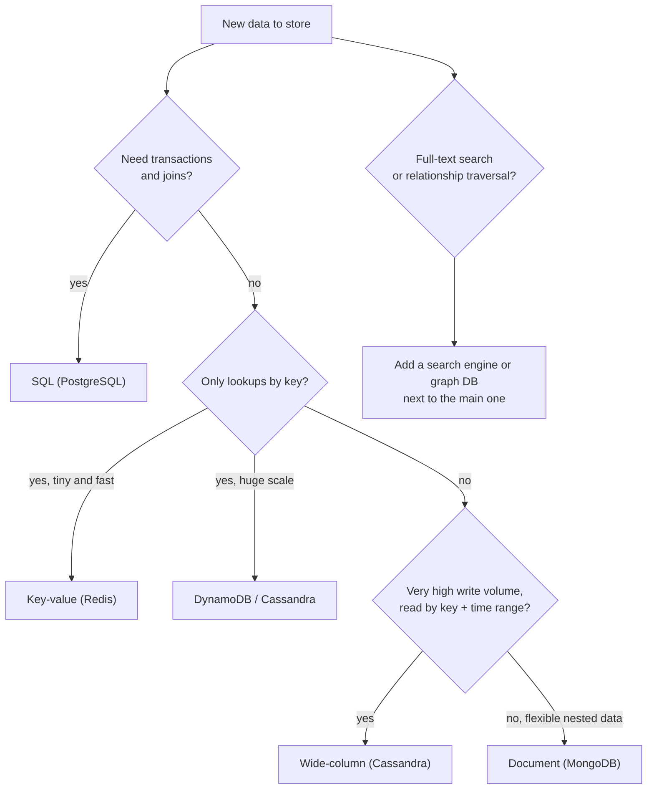
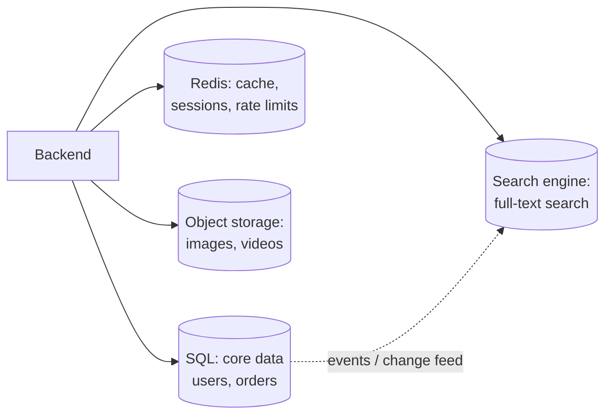

# Choosing a Database

> There is no best database. Pick one from how your app reads and writes data, what it must guarantee, and how big it will get. Always explain why.

Roadmap topic 17 · Stage 4: Scale

**Go deeper:** `10-database/11-Choosing-a-Database` · `10-database/12-NoSQL-Families` · `04-backend-engineering/08-Databases-SQL-and-Data-Modeling` · `18` Replication · `19` Partitioning & Sharding · `23` Consistency & CAP.

**Marks:** 🟢 must know · 🟡 good to know

---

#### 1. What Is It?

*Pick by data shape, query pattern and consistency need, not by trend.*

| Type | Idea | Examples | Good for |
|---|---|---|---|
| **Relational (SQL)** | tables, joins, ACID transactions | PostgreSQL, MySQL | users, orders, payments, most business data |
| **Key-value** | look up a value by key | Redis, DynamoDB | sessions, cache, counters, simple lookups |
| **Document** | JSON-like documents | MongoDB | flexible or nested data, quick schema changes |
| **Wide-column** | huge tables spread over many machines | Cassandra | very high write volume: messages, activity logs, time-series |
| 🟡 **Graph** | relationships are the data | Neo4j | social graph, recommendations |
| 🟡 **Search engine** | full-text search and ranking | Elasticsearch, OpenSearch | search, autocomplete |
| 🟡 **Time-series** | metrics over time | InfluxDB, TimescaleDB | monitoring, sensor data |

**The default is SQL.** It gives strong consistency, a flexible query language and transactions, and scales a long way with indexes, caching and read replicas. Sharding is the hard part (topic 19).

NoSQL trade-off: easier scaling and flexible data, but **weaker joins and transactions** and query limits.

| 🟢 Must know | 🟡 Good to know |
|---|---|
| relational vs non-relational | graph, search, time-series |
| key-value, document, wide-column use cases | |
| choose by access pattern, not popularity | |
| real systems use several stores | |

**Signals in an interview:** "which database would you use for ...?", "SQL vs NoSQL?", "why not one database for everything?", "when do you leave SQL?"

---

#### 2. How It Works

Ask four questions, in this order:

1. **Access pattern:** what queries, how often? By key? With joins? Ranges?
2. **Consistency and transactions:** ACID (payments) or eventual consistency is fine (likes)?
3. **Scale:** data size, read and write QPS, growth.
4. **Data shape:** structured and related, or flexible?



```text
payments / orders        → SQL
session / cache          → key-value (Redis)
chat messages at scale   → wide-column, or sharded SQL
product catalog          → SQL or document
search box               → search engine, fed from the main database
```

**Real systems use several stores** (polyglot persistence): each for what it does best.



The main database is the source of truth. The others are copies or specialised views, so you can rebuild them.

**Rule:** don't choose a database because it is popular. Say the requirement first, then the database.

---

#### 3. Naive vs Better Design

| Situation | Naive | Better |
|---|---|---|
| Choice | "MongoDB because it scales" | "I need transactions across orders and payments, so PostgreSQL" |
| Early stage | NoSQL with no scale problem | SQL with indexes, cache, replicas |
| Everything in one store | search, files and cache in the main database | SQL + Redis + object storage + search |
| Payments | a store without transactions | SQL with ACID |
| Chat at scale | one SQL table, single node | partition by conversation (sharded SQL or wide-column) |
| Search | `LIKE '%word%'` | a search engine fed from the database |
| Justification | none | requirement first, then the store, then the trade-off |

```sql
-- Naive "search": a full scan on every keystroke
SELECT * FROM products WHERE description LIKE '%running shoes%';
```

---

#### 4. Code

How the same domain looks in different stores.

```sql
-- SQL: orders with integrity
CREATE TABLE orders (
  id BIGSERIAL PRIMARY KEY, user_id BIGINT NOT NULL REFERENCES users(id),
  total_cents BIGINT NOT NULL CHECK (total_cents >= 0), status TEXT NOT NULL,
  created_at TIMESTAMPTZ NOT NULL DEFAULT now()
);
```

```text
# Key-value (Redis): a session that expires, and a counter
SET session:abc123 '{"userId":42}' EX 3600
INCR rate:login:ip:203.0.113.5
EXPIRE rate:login:ip:203.0.113.5 60
```

```json
{ "_id": "p1", "name": "Shoe", "price_cents": 4999, "attributes": { "color": "red", "sizes": [40, 41, 42] } }
```

```sql
-- Wide-column (Cassandra CQL): chat messages, partitioned by conversation, newest first
CREATE TABLE messages (
  conversation_id uuid, sent_at timeuuid, sender_id uuid, body text,
  PRIMARY KEY ((conversation_id), sent_at)
) WITH CLUSTERING ORDER BY (sent_at DESC);
-- the only fast query: the latest 50 messages of one conversation
SELECT * FROM messages WHERE conversation_id = ? LIMIT 50;
```

A thinking aid (not a rule) that encodes the questions above:

```kotlin
data class Needs(
    val transactions: Boolean = false, val joins: Boolean = false,
    val writeQps: Int = 100, val keyLookupOnly: Boolean = false,
    val fullText: Boolean = false, val relationshipsAreTheData: Boolean = false
)

fun recommend(n: Needs): List<String> {
    val main = when {
        n.transactions || n.joins -> "SQL"
        n.keyLookupOnly && n.writeQps < 50_000 -> "Key-value (Redis)"
        n.writeQps >= 50_000 -> "Wide-column (Cassandra) or sharded SQL"
        else -> "Document or SQL"
    }
    return buildList {
        add(main)
        if (n.fullText) add("+ search engine")
        if (n.relationshipsAreTheData) add("+ graph database")
    }
}
```

Checks: payments `recommend(Needs(transactions = true, joins = true))` → `["SQL"]`. Sessions `recommend(Needs(keyLookupOnly = true, writeQps = 5_000))` → `["Key-value (Redis)"]`. Chat `recommend(Needs(writeQps = 200_000, keyLookupOnly = true))` → `["Wide-column (Cassandra) or sharded SQL"]`. Product search `recommend(Needs(joins = true, fullText = true))` → `["SQL", "+ search engine"]`.

---

#### 5. Numbers & Capacity

| Store | Rough single-node capability |
|---|---|
| PostgreSQL / MySQL | thousands of writes per second, tens of thousands of indexed reads per second; terabytes of data |
| Redis | about 100K operations per second; limited by RAM |
| Cassandra / DynamoDB | write throughput grows with nodes (hundreds of thousands per second across a cluster) |
| Elasticsearch | search over millions of documents in milliseconds; not a source of truth |

Use the estimate from topic 13: if one SQL node handles your QPS and size with replicas and a cache, stay with SQL. Move only when a measured limit appears.

---

#### 6. Common Mistakes & Edge Cases

1. Picking a database because it is trendy.
2. Choosing NoSQL "for scale" with no scale problem.
3. Needing transactions on a store that doesn't support them.
4. Not saying **why** in the interview.
5. Using one store for everything (search in SQL `LIKE`, files in the database).
6. Treating the search index or cache as the source of truth.
7. Designing the schema before knowing the queries (especially in wide-column and key-value stores, where the key *is* the query).

Edge cases: data that is relational today but must be sharded later (choose keys that will shard well); reporting queries that hurt the transactional database (send them to a replica or a warehouse); multi-region requirements; schema flexibility needs that change over time.

---

#### 7. Say This in the Interview

1. "I'd start with PostgreSQL: the data is relational and I need transactions for orders and payments."
2. "For sessions and rate limits I'd use Redis, because they are key lookups that need to be very fast and can expire."
3. "Chat messages are write-heavy and read by conversation and time, so a wide-column store, or SQL sharded by conversation ID."
4. "Images go to object storage, and I'd feed a search engine from the main database for the search box."
5. "I'd move away from SQL only when a measured scale or access-pattern problem can't be solved with indexes, caching, replicas or sharding."

---

#### 8. Quick Check

1. Which database for a bank transfer?
2. Why is Redis a poor only-database for orders?
3. Which store for "latest 50 messages in a conversation" at 200K writes/s?
4. Is a search index the source of truth?

<details>
<summary>Answers</summary>

1. SQL: ACID transactions.
2. It is memory-bound, has limited querying and weak durability by default, and no rich transactions or joins.
3. A wide-column store (or sharded SQL) partitioned by conversation and ordered by time.
4. No. It is a derived copy; rebuild it from the main database.

</details>

---

#### 9. Practice

**Interview questions**

1. Which database for chat messages, and why?
2. SQL vs NoSQL?
3. Why not use one database for everything?
4. When do you move away from SQL?
5. What is a key-value store good for?

**Hands-on**

1. For the Notes API, list its queries and justify PostgreSQL in two sentences.
2. Model the chat message table above and write the one query it supports well.
3. Add Redis for sessions and rate limits in front of your service.

**LeetCode design problems**

| # | Question | Link to this topic |
|---|---|---|
| 706 | [Design HashMap](https://leetcode.com/problems/design-hashmap/) (Easy) | key-value |
| 981 | [Time Based Key-Value Store](https://leetcode.com/problems/time-based-key-value-store/) (Medium) | time-series style access |
| 642 | [Design Search Autocomplete System](https://leetcode.com/problems/design-search-autocomplete-system/) (Hard, premium) | search structures |

**Remember:** default to SQL · choose by access pattern, consistency needs and scale · know key-value, document and wide-column and their use cases · real systems use SQL + Redis + object storage + search · always justify the choice.
