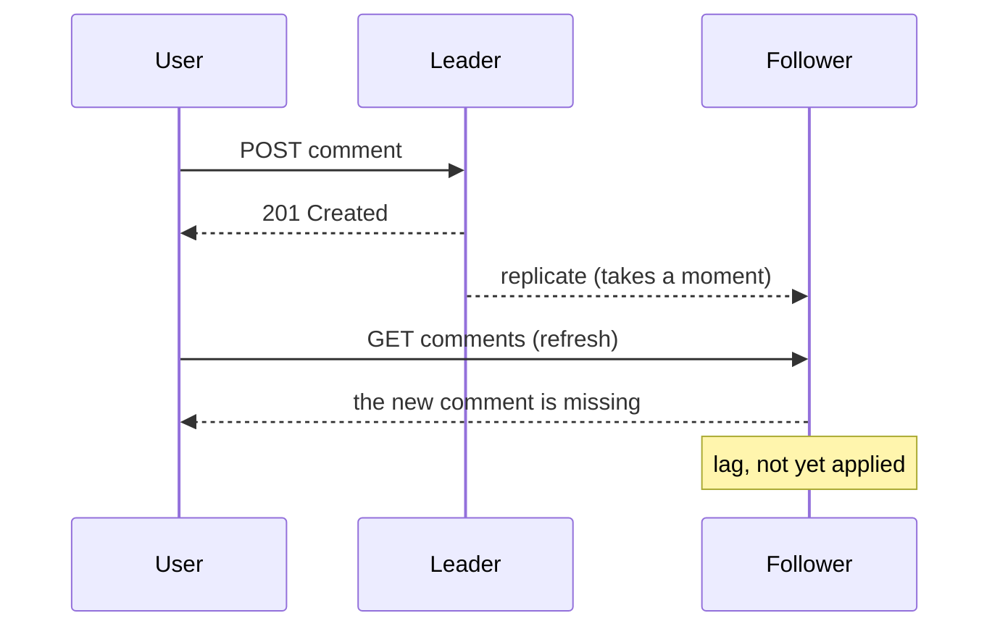
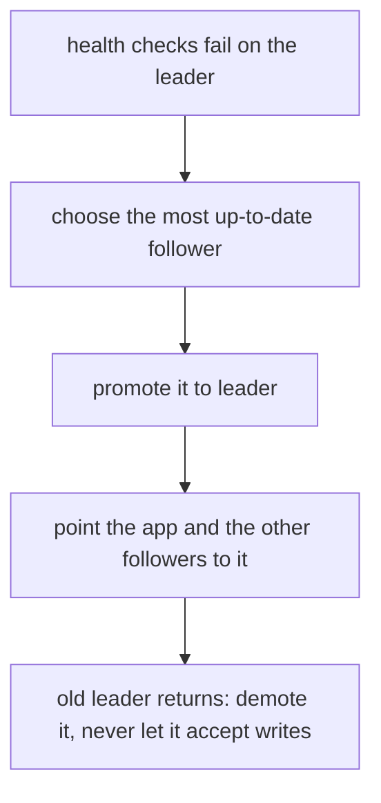

# Replication

> Keep copies of your database on several servers. Copies serve more reads and survive a server failure. The price: copies can be slightly behind.

Roadmap topic 18 · Stage 4: Scale

**Go deeper:** `10-database/14-Replication-and-High-Availability` · `14` Scaling & Load Balancing (single points of failure) · `19` Partitioning & Sharding · `23` Consistency & CAP · `29` Backup, Recovery, Security & Cost (RPO, RTO).

**Marks:** 🟢 must know · 🟡 good to know

---

#### 1. What Is It?

*One database takes all writes (the leader). Others copy from it and serve reads (followers, read replicas).*

```text
Writes → Leader ──copies changes──→ Follower 1 ──→ Reads
                               └──→ Follower 2 ──→ Reads
```

1. **Read scaling:** spread reads across followers.
2. **Availability:** if the leader dies, a follower can take over.
3. Heavy queries on followers protect the leader.

The limit: **writes still go to one leader.** Replication does not scale writes (that needs sharding, topic 19).

| 🟢 Must know | 🟡 Good to know |
|---|---|
| leader–follower, read replicas | multi-leader and leaderless (names only) |
| sync vs async | |
| replication lag and stale reads | |
| failover | |
| replication is not a backup | |

**Signals in an interview:** "the primary dies, what happens?", "reads are too heavy", "a user posts and doesn't see their post", "is a replica a backup?"

---

#### 2. How It Works

**Sync vs async.** Does the leader wait for the copy before saying "done"?

| | Synchronous | Asynchronous |
|---|---|---|
| Leader waits for the follower? | yes | no |
| Write speed | slower | faster |
| Data loss if the leader dies | very little | recent writes may be lost |
| Follower freshness | up to date | can lag |

Most systems use asynchronous replication, or one synchronous follower and the rest asynchronous.

**Replication lag and stale reads.** A follower can be milliseconds or seconds behind.



Fixes:

1. **Read-your-writes:** after a user writes, read their own data from the leader for a short time.
2. Use followers only where slight staleness is fine (feeds, counts).
3. Read critical data (balance, payment status) from the leader.

**Failover.** When the leader dies, promote a follower.



Risks: **lost writes** (with async replication the newest writes may not have reached the follower), and **split brain** (the old leader comes back and two servers think they are the leader; prevent with proper leader election and fencing).

**Replication is not a backup.** A mistake (a bad `DELETE`, corrupted data) is **copied to all replicas** within seconds. You still need separate backups and tested restores (topic 29).

🟡 **Multi-leader and leaderless** (names only). *Multi-leader:* several nodes accept writes (for example one per region); needs conflict resolution. *Leaderless:* any node accepts writes, and reads and writes use quorums (Cassandra, DynamoDB style; topic 23).

---

#### 3. Naive vs Better Design

| Situation | Naive | Better |
|---|---|---|
| Heavy reads | scale up the single database | add read replicas |
| After a write | read from any replica | read-your-writes: the leader for a short time |
| Balance or payment status | read from a follower | read from the leader |
| Leader failure | page someone and hope | tested, automatic failover |
| Safety net | "we have replicas" | replicas **and** backups with tested restores |
| Writes too heavy | add more replicas | shard (topic 19) |
| Durability | async only, for money | one synchronous follower for critical data |

```kotlin
// Naive: every read goes to a random replica, even right after the user's own write
fun readAnywhere(replicas: List<Db>) = replicas.random().query("SELECT ...")
```

---

#### 4. Code

A small simulation of lag and read-your-writes, and a failover chooser.

```kotlin
class Node { val data = HashMap<String, String>() }

class ReplicatedStore(private val lagMs: Long, private val now: () -> Long) {
    val leader = Node()
    val follower = Node()
    private val pending = ArrayDeque<Triple<Long, String, String>>()          // (apply at, key, value)

    fun write(key: String, value: String) {
        leader.data[key] = value
        pending.addLast(Triple(now() + lagMs, key, value))                    // the follower gets it later
    }

    fun replicate() {
        while (pending.isNotEmpty() && pending.first().first <= now()) {
            val (_, key, value) = pending.removeFirst()
            follower.data[key] = value
        }
    }
}

// Route reads: the writer sees their own writes (from the leader) for stickyMs after writing
class Router(private val store: ReplicatedStore, private val stickyMs: Long, private val now: () -> Long) {
    private val lastWrite = HashMap<String, Long>()

    fun write(user: String, key: String, value: String) {
        store.write(key, value)
        lastWrite[user] = now()
    }

    fun read(user: String, key: String): String? {
        store.replicate()
        val recentlyWrote = lastWrite[user]?.let { now() - it < stickyMs } == true
        return (if (recentlyWrote) store.leader else store.follower).data[key]
    }
}

// Failover: promote the most up-to-date follower and count the writes that may be lost
data class Replica(val name: String, val appliedIndex: Long)

fun pickNewLeader(followers: List<Replica>): Replica = followers.maxByOrNull { it.appliedIndex }!!
fun lostWrites(leaderIndex: Long, promoted: Replica) = leaderIndex - promoted.appliedIndex
```

Postgres settings and the lag query:

```sql
-- leader: wait for at least one of two named standbys before COMMIT returns
-- synchronous_standby_names = 'ANY 1 (replica1, replica2)'
-- synchronous_commit = on

-- on a replica: how far behind is it?
SELECT now() - pg_last_xact_replay_timestamp() AS replication_lag;
```

Checks: with `lagMs = 100`, `stickyMs = 2000`: user A writes the comment at `t = 0`; `router.read("A", key)` at `t = 10` → the comment (from the leader); `router.read("B", key)` at `t = 10` → `null` (the follower is behind); `router.read("B", key)` at `t = 150` → the comment. After `t = 2000`, A reads from the follower again. `pickNewLeader(listOf(Replica("f1", 98), Replica("f2", 100)))` → `f2`; with the leader at index `105`, `lostWrites(105, f2)` → `5`.

---

#### 5. Numbers & Capacity

| Question | Number |
|---|---|
| Typical async lag | milliseconds; seconds under load; minutes if a replica is overloaded or a long query blocks it |
| Read capacity | roughly `replicas + 1` times a single node, if reads spread evenly |
| Write capacity | unchanged: one leader |
| Failover time | tens of seconds to a couple of minutes (detection + promotion) |
| Synchronous commit | adds a network round trip to every write (about 1 ms in the same region, 100 ms or more across regions) |
| RPO with async | the lag at the moment of failure; with sync, about zero |

Three replicas turn a 5,000 read QPS service into roughly 20,000 read QPS, but a write-heavy service gets nothing.

---

#### 6. Common Mistakes & Edge Cases

1. Thinking replicas scale writes.
2. Reading critical data from lagging followers.
3. Counting replication as a backup.
4. No plan, or no testing, for failover.
5. Ignoring lag when designing user-facing flows.
6. Reading your own write from a replica (the missing-comment bug).
7. Letting an old leader accept writes after it returns (split brain).

Edge cases: a long-running query on a replica delays replay; a monotonic-reads problem (the user sees newer data, then older data, because two requests hit different replicas; route a user to one replica); schema migrations that must be compatible with replicas still on the old version; promoting a replica that is far behind.

---

#### 7. Say This in the Interview

1. "One leader takes the writes and followers serve reads. That scales reads and adds availability, but not write throughput."
2. "Replication is asynchronous, so followers lag. After a user writes, I read their data from the leader for a short time (read-your-writes), and I read balances and payment status from the leader."
3. "If the leader dies, failover promotes the most up-to-date follower. The risks are losing recent writes and split brain, so I use leader election and fencing."
4. "A replica is not a backup, because a bad delete replicates too. I also keep backups with tested restores."

---

#### 8. Quick Check

1. Do read replicas help a write-heavy workload?
2. Why can a user miss their own new post after refreshing?
3. What is split brain?
4. Why is a replica not a backup?

<details>
<summary>Answers</summary>

1. No. All writes still go to the single leader.
2. The refresh read from a follower that hadn't received the write yet (replication lag).
3. Two nodes both believe they are the leader and accept conflicting writes.
4. Mistakes and corruption are copied to every replica within seconds.

</details>

---

#### 9. Practice

**Interview questions**

1. The primary database dies. What happens to users?
2. How does replication help scale?
3. Sync vs async replication?
4. A user posts and doesn't see their post after refreshing. Why?
5. Is a replica a backup?

**Hands-on**

1. Run PostgreSQL with one streaming replica (Docker), write to the leader and read the lag query on the replica.
2. Add read-your-writes routing to your Notes API.
3. Kill the leader and practise promoting the replica.

**LeetCode design problems**

| # | Question | Link to this topic |
|---|---|---|
| 981 | [Time Based Key-Value Store](https://leetcode.com/problems/time-based-key-value-store/) (Medium) | versions and timestamps, like replication logs |
| 355 | [Design Twitter](https://leetcode.com/problems/design-twitter/) (Medium) | read-heavy feeds served from copies |
| 432 | [All O`one Data Structure](https://leetcode.com/problems/all-oone-data-structure/) (Hard) | structures behind counters |

**Remember:** leader takes writes, followers serve reads · async replication means lag and stale reads, so use read-your-writes · failover = promote a follower, with the risks of lost writes and split brain · replication is not a backup · replication scales reads, not writes.
