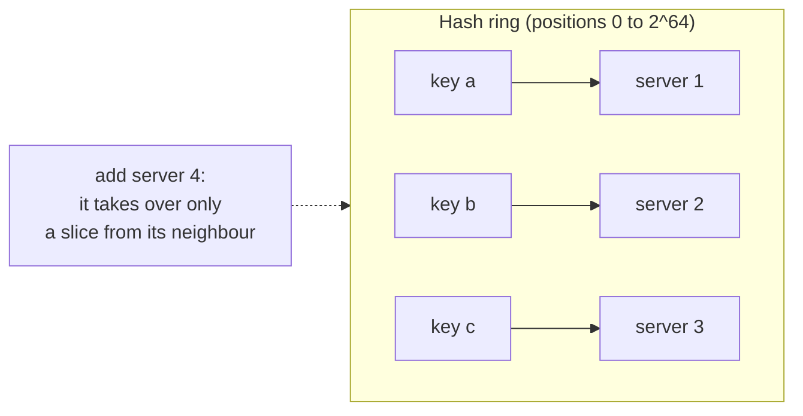
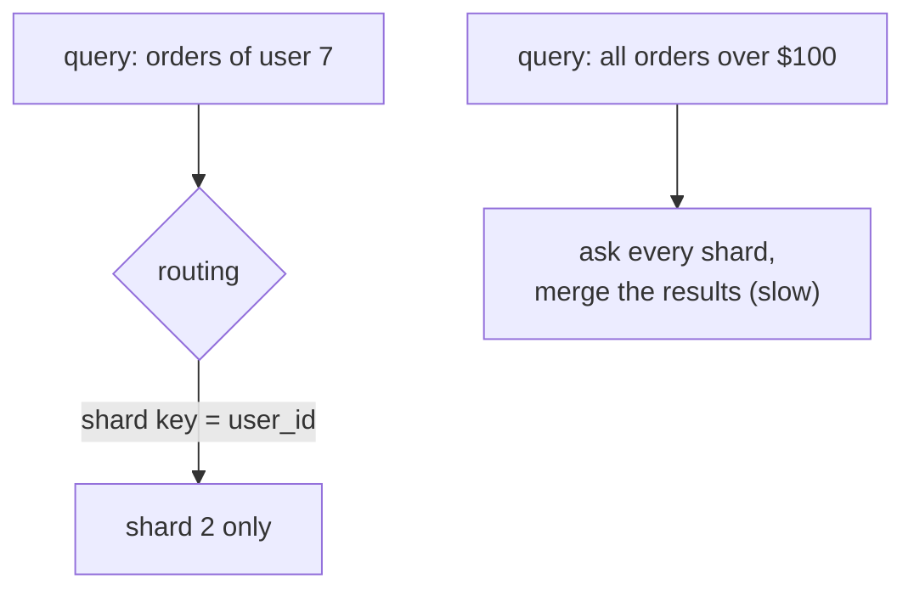

# Partitioning & Sharding

> When one database can't hold all the data or handle all the writes, split the data across several databases. Each one (a shard) holds a part. The hard part is choosing how to split.

Roadmap topic 19 · Stage 4: Scale

**Go deeper:** `10-database/15-Partitioning-and-Sharding` · `15` Caching (consistent hashing in caches) · `17` Choosing a Database · `18` Replication · `20` Unique ID Generation · `23` Consistency & CAP.

**Marks:** 🟢 must know · 🟡 good to know

---

#### 1. What Is It?

*Split data only when one machine cannot cope.*

1. One database has limits: storage, write throughput, memory.
2. Replication scales reads, not writes and not total data size.
3. **Sharding is complex. Try these first:** indexes, caching, read replicas, a bigger machine, archiving old data.
4. Shard when data or write volume truly doesn't fit on one machine.

```text
users A–H → shard 1
users I–P → shard 2
users Q–Z → shard 3
```

| 🟢 Must know | 🟡 Good to know |
|---|---|
| why and when to shard | resharding |
| hash vs range partitioning | directory-based sharding |
| choosing a shard key | |
| hotspots and rebalancing | |
| consistent hashing | |
| cross-shard queries and transactions | |

**Signals in an interview:** "the database can't take the write load", "design chat / a URL shortener / a key-value store at scale", "how do you pick a shard key?", "what happens when you add a node?"

---

#### 2. How It Works

**Hash vs range partitioning.** Two ways to decide which shard holds a row.

| | Hash | Range |
|---|---|---|
| How | `shard = hash(key) % N` | key ranges (A–H, 1–1000, dates) |
| Data spread | even | can be uneven (hotspots) |
| Range queries | hard (data is scattered) | easy (data is together) |
| Good for | user IDs, even load | time series, ordered scans |

Simple hash-mod has a flaw: when `N` changes, almost every key moves (75% when going from 3 to 4 shards). Consistent hashing fixes it.

**Choosing a shard key.** The shard key decides balance, speed and problems. A good key has many distinct values (high cardinality), spreads load evenly, and **matches the main query** so most requests hit one shard.

```text
chat messages:  conversation_id → all messages of a chat on one shard
user data:      user_id         → a user's data together
bad:            country         → a few huge shards
bad:            created_date    → all new writes hit one shard (hotspot)
```

**Hotspots and rebalancing.** A *hotspot* is one shard getting far more traffic (a celebrity account, all of today's writes). Uneven data makes some shards much bigger. *Rebalancing* moves data when you add shards. It is slow and risky, so plan for it with many small partitions and consistent hashing.

**Consistent hashing.** Adding or removing a server moves only a small part of the data.



1. Place servers and keys on a **ring** (a circle of hash values).
2. A key belongs to the **next server clockwise**.
3. Adding a server takes over only a slice from its neighbour: about `1/N` of the keys move, not all.
4. **Virtual nodes** (many points per server on the ring) spread the load evenly.

Used in caches, distributed databases and load balancing.

**The costs of sharding.**



1. **Cross-shard queries** are slow and complex (joins across shards).
2. **Cross-shard transactions** are hard. Avoid them by keeping related data on one shard.
3. More operations: backups, schema changes and monitoring per shard.
4. Changing the shard key later is very painful.

🟡 **Resharding, directory-based sharding.** *Resharding* splits or merges shards as data grows; do it gradually with double-writing and validation. *Directory-based:* a lookup table says which shard holds which key; flexible, but the directory becomes a critical component to protect.

---

#### 3. Naive vs Better Design

| Situation | Naive | Better |
|---|---|---|
| When | shard on day one | index, cache, replicate, upgrade first; shard when measured |
| Placement | `hash(key) % N` | consistent hashing with virtual nodes |
| Key | `created_date` or `country` | `user_id` / `conversation_id` (high cardinality, matches the query) |
| Joins | across shards in every request | keep related data on one shard; denormalise if needed |
| Growth | no plan | many small partitions, a documented rebalancing process |
| IDs | auto-increment per shard (duplicates) | globally unique IDs (topic 20) |
| Hot entity | one shard melts | split or cache the hot key, add a random suffix |

```kotlin
// Naive: adding one server remaps about 75% of the keys, so a cache cluster loses most of its data at once
fun shardFor(key: String, shards: Int) = Math.floorMod(key.hashCode(), shards)
```

---

#### 4. Code

```kotlin
import java.nio.ByteBuffer
import java.security.MessageDigest
import java.util.TreeMap

fun hash64(s: String): Long = ByteBuffer.wrap(MessageDigest.getInstance("MD5").digest(s.toByteArray())).long   // first 8 bytes

class ConsistentHashRing(private val virtualNodes: Int = 100) {
    private val ring = TreeMap<Long, String>()

    fun addServer(name: String) { repeat(virtualNodes) { ring[hash64("$name#$it")] = name } }
    fun removeServer(name: String) { repeat(virtualNodes) { ring.remove(hash64("$name#$it")) } }

    // the next point clockwise (>= the key's hash), wrapping around to the first point
    fun serverFor(key: String): String {
        val entry = ring.ceilingEntry(hash64(key)) ?: ring.firstEntry()
        return entry.value
    }
}

// Compare: how many of the keys change servers when a 4th server joins?
fun movedFraction(keys: List<String>, before: (String) -> String, after: (String) -> String): Double =
    keys.count { before(it) != after(it) }.toDouble() / keys.size

// Range partitioning: sorted boundaries → shard index
fun rangeShard(key: Long, upperBounds: LongArray): Int {      // e.g. [1000, 2000, Long.MAX_VALUE]
    val i = upperBounds.indexOfFirst { key < it }
    return if (i >= 0) i else upperBounds.lastIndex
}

// Spreading a hot key: add a small random suffix to writes, read all suffixes and merge
fun hotKeyWriteTarget(key: String, buckets: Int = 10) = "$key#${(0 until buckets).random()}"
```

SQL that fits a shard-by-user design (every query carries the shard key):

```sql
SELECT id, text, sent_at FROM messages WHERE conversation_id = ? ORDER BY sent_at DESC LIMIT 50;   -- one shard
-- avoid: SELECT count(*) FROM messages WHERE sender_id = ?;   -- touches every shard
```

Checks (100,000 keys `key-0 … key-99999`, servers `s1 s2 s3`, then adding `s4`): with `hash % N` about **75%** of the keys move. With the ring and **100 virtual nodes** about **25%** move (24.7% in a run), which is the ideal `1/4`. With only **1 virtual node per server** the load is uneven (about 47% / 26% / 27% of the keys on the three servers), while with 100 it is about 35% / 33% / 32%. `serverFor("user:42")` returns the same server on every call. `removeServer("s2")` re-homes only the keys that were on `s2`. `rangeShard(500, longArrayOf(1000, 2000, Long.MAX_VALUE))` → `0`; `rangeShard(1500, …)` → `1`; `rangeShard(2500, …)` → `2`.

---

#### 5. Numbers & Capacity

| Question | Number |
|---|---|
| When is one node not enough? | beyond a few terabytes of hot data, or beyond thousands to tens of thousands of writes per second |
| Shards needed | `max(total data ÷ data per node, write QPS ÷ writes per node)` (plus headroom) |
| Moved on adding a server | `1/N` of the keys with consistent hashing, about `(N−1)/N` with hash-mod |
| Virtual nodes | 100 to 256 per server is typical |
| Partitions vs servers | create many more partitions than servers (for example 1,024 partitions on 8 servers) so you can move whole partitions |

Example: 20 TB of data and 40K writes per second, a node that comfortably handles 4 TB and 10K writes per second → `max(5, 4)` = 5 shards, so plan 8 for headroom.

---

#### 6. Common Mistakes & Edge Cases

1. Sharding too early.
2. A shard key that creates hotspots (date, country).
3. Needing cross-shard joins all the time.
4. Using `hash % N` with no plan for adding servers.
5. No rebalancing plan.
6. Auto-increment IDs on each shard (duplicate IDs).
7. A shard key that doesn't match the main query, so every request fans out to all shards.
8. Forgetting that a global secondary index or a unique constraint across shards needs extra design.

Edge cases: one very hot entity (a celebrity user, a viral group chat); a shard that fills up faster than the others; schema changes that must run on every shard; backups per shard that must be consistent with each other; transactions that touch two users on different shards (use a saga or an outbox, topic 26).

---

#### 7. Say This in the Interview

1. "I'd shard last: indexes, caching, replicas and a bigger machine first. I'd shard only when data size or write volume doesn't fit on one node."
2. "For chat I'd shard by `conversation_id`: reads are per conversation, so they hit one shard, and the load spreads across many conversations. A very hot group chat is the risk."
3. "I'd use consistent hashing with virtual nodes, so adding a server moves about `1/N` of the keys instead of nearly all."
4. "The costs are cross-shard queries and transactions, hotspots, rebalancing and more operations. I'd keep related data on one shard and use globally unique IDs."

---

#### 8. Quick Check

1. Why does `hash % N` hurt when you add a server?
2. Is `created_date` a good shard key?
3. What do virtual nodes fix?
4. Does replication reduce the size of data per node?

<details>
<summary>Answers</summary>

1. Almost every key maps to a different server, so nearly all data moves (or all cache entries miss).
2. No. All new writes land on one shard (a hotspot).
3. They spread the load evenly over the ring and make rebalancing smoother.
4. No. Every replica holds a full copy. Sharding splits the data.

</details>

---

#### 9. Practice

**Interview questions**

1. How would you shard the `messages` table? Which shard key?
2. Hash vs range partitioning?
3. What is consistent hashing?
4. What problems does sharding cause?
5. When would you not shard?

**Hands-on**

1. Run the ring above with 100,000 keys and measure how many move when you add a server, with 1 and 100 virtual nodes.
2. Shard a small table across three PostgreSQL databases by `user_id % 3` and notice what breaks (global queries, IDs).
3. Redo the same with the ring, then add a fourth database.

**LeetCode design problems**

| # | Question | Link to this topic |
|---|---|---|
| 706 | [Design HashMap](https://leetcode.com/problems/design-hashmap/) (Easy) | buckets and hash placement |
| 1244 | [Design A Leaderboard](https://leetcode.com/problems/design-a-leaderboard/) (Medium, premium) | ranking across partitions |
| 295 | [Find Median from Data Stream](https://leetcode.com/problems/find-median-from-data-stream/) (Hard) | combining results from parts |

**Remember:** shard last: index, cache and replicate first · the shard key must have high cardinality, spread load and match the main query · hash = even, range = good for scans but risks hotspots · consistent hashing = minimal data movement · costs: cross-shard queries and transactions, hotspots, rebalancing.
