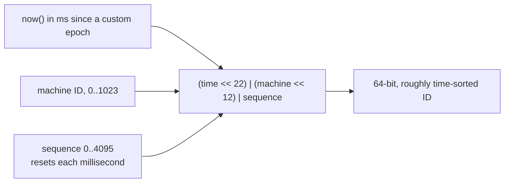

# Unique ID Generation

> Every row, message or order needs a unique ID. On one database that is easy. With many servers or shards you must generate IDs without collisions and without a single bottleneck.

Roadmap topic 20 · Stage 4: Scale (New)

**Go deeper:** `19` Partitioning & Sharding · `22` Reliable Requests & External Services (idempotency) · `30` Mobile-Specific Topics (offline creation) · `32` Practice Designs (URL shortener) · `04-backend-engineering/03-API-Design` (idempotency keys) · `04-backend-engineering/10-Indexes-and-Query-Performance`.

**Marks:** 🟢 must know · 🟡 good to know

---

#### 1. What Is It?

| | Auto-increment | UUID | Snowflake-style |
|---|---|---|---|
| Example | `1, 2, 3...` | `550e8400-e29b-...` | `1789234567890123` |
| Unique across servers? | no (one database) | yes | yes |
| Sortable by time? | yes | no (v4 random), yes (v7) | yes |
| Size | small (8 bytes) | large (16 bytes) | 8 bytes |
| Downside | bottleneck; guessable | random → worse index locality (v4) | needs machine IDs and a good clock |

| 🟢 Must know | 🟡 Good to know |
|---|---|
| auto-increment vs UUID vs Snowflake-style | client-generated IDs for offline apps |
| short codes (URL shortener) | UUIDv7 |

**Signals in an interview:** "design a URL shortener", "IDs across shards", "why not expose sequential IDs?", "the app creates items offline"

---

#### 2. How It Works

**Auto-increment.** The database counts up: `1, 2, 3`. Simple and small; great for a single database. At scale: one database is the bottleneck, several shards produce **duplicate IDs**, and IDs are **guessable** (`/users/101`, `/users/102`).

**UUID.** A random 128-bit ID that any server or app can create on its own. Collisions are practically impossible. Downsides: bigger, and random values scatter inserts across the index (slower writes on big tables). **UUIDv7** is time-ordered, which fixes the index problem. On mobile, an offline app can create a UUID on the phone, so a record has an ID before the server has ever seen it.

**Snowflake-style IDs.** Build the ID from parts, so servers never collide.

```text
| 41 bits timestamp (ms) | 10 bits machine ID | 12 bits sequence |
```



1. Each server has a **machine ID** and its own counter, so no coordination is needed at request time.
2. IDs are **roughly sorted by time**: good for feeds and indexes.
3. It fits in 64 bits, and each machine can make 4,096 IDs per millisecond.
4. Watch out for the clock going backwards, and for assigning unique machine IDs.

**Short codes for a URL shortener.** Generate a unique ID, then encode it in **base62** (`0–9`, `a–z`, `A–Z`).

```text
125 → "21"    (125 = 2 × 62 + 1)       62 → "10"       61 → "Z"
7 characters → 62⁷ = 3,521,614,606,208 ≈ 3.5 trillion codes
```

Alternatives: a random code and a collision check (the unique constraint decides), or a hash of the URL (handle collisions). Sequential IDs are guessable: add randomness or a shuffle if URLs must not be guessable.

🟡 **Client-generated IDs for offline apps.** The app creates a UUID for a new item while offline and syncs later; the ID stays the same. It also makes **retries safe**: the server sees the same ID and doesn't create a duplicate (idempotency).

---

#### 3. Naive vs Better Design

| Situation | Naive | Better |
|---|---|---|
| Many shards | auto-increment in each | Snowflake or UUID |
| Huge write-heavy table | random UUIDv4 primary key | Snowflake or UUIDv7 (time-ordered) |
| Private resources | sequential public IDs | non-guessable IDs, plus ownership checks |
| Short URLs | hash the URL, ignore collisions | counter or random ID + base62 + unique constraint |
| Time-based IDs | trust the clock | handle clock moving back; unique machine IDs |
| Offline creation | wait for the server | client UUID, server accepts it |
| Retries | create a new row every time | the same client ID → the same row |

```kotlin
// Naive: two shards both hand out id = 1
val shard1 = AtomicLong(); val shard2 = AtomicLong()           // 1, 2, 3 ... on each: duplicates when merged
```

---

#### 4. Code

```kotlin
import java.security.SecureRandom
import java.util.UUID

// ---------- Snowflake: 41-bit time | 10-bit machine | 12-bit sequence ----------
class Snowflake(
    private val machineId: Long,
    private val epochMs: Long = 1_700_000_000_000L,
    private val now: () -> Long = System::currentTimeMillis
) {
    private var lastMs = -1L
    private var sequence = 0L

    init { require(machineId in 0..1023) { "machineId must fit in 10 bits" } }

    @Synchronized
    fun next(): Long {
        var ms = now()
        check(ms >= lastMs) { "clock moved backwards" }                 // never reuse a timestamp
        if (ms == lastMs) {
            sequence = (sequence + 1) and 0xFFF                          // 12 bits
            if (sequence == 0L) { while (ms <= lastMs) ms = now() }      // sequence exhausted: wait for the next ms
        } else {
            sequence = 0
        }
        lastMs = ms
        return ((ms - epochMs) shl 22) or (machineId shl 12) or sequence
    }
}

fun machineOf(id: Long) = (id shr 12) and 0x3FF
fun sequenceOf(id: Long) = id and 0xFFF
fun timestampOf(id: Long, epochMs: Long = 1_700_000_000_000L) = (id shr 22) + epochMs

// ---------- base62 for short codes ----------
const val ALPHABET = "0123456789abcdefghijklmnopqrstuvwxyzABCDEFGHIJKLMNOPQRSTUVWXYZ"

fun encodeBase62(n: Long): String {
    if (n == 0L) return "0"
    var x = n
    val sb = StringBuilder()
    while (x > 0) { sb.append(ALPHABET[(x % 62).toInt()]); x /= 62 }
    return sb.reverse().toString()
}

fun decodeBase62(s: String): Long = s.fold(0L) { acc, c -> acc * 62 + ALPHABET.indexOf(c) }

// ---------- UUID v7: a 48-bit millisecond timestamp first, so IDs sort by time ----------
fun uuidV7(nowMs: Long = System.currentTimeMillis(), random: SecureRandom = SecureRandom()): UUID {
    val msb = (nowMs shl 16) or 0x7000L or random.nextInt(0x1000).toLong()        // timestamp | version 7 | 12 random bits
    val lsb = (random.nextLong() and 0x3FFFFFFFFFFFFFFFL) or Long.MIN_VALUE      // variant bits 10 + 62 random bits
    return UUID(msb, lsb)
}
```

URL shortener row and the usual race-free insert:

```sql
CREATE TABLE links (code TEXT PRIMARY KEY, long_url TEXT NOT NULL, created_at TIMESTAMPTZ NOT NULL DEFAULT now());
-- random code: if the insert violates the primary key, generate another code and retry
INSERT INTO links (code, long_url) VALUES ('aZ3kP9q', 'https://example.com/very/long');
```

Checks (`epochMs = 1_700_000_000_000`): with a fixed clock at `epoch + 1000` and `machineId = 5`, the first `next()` is `4194324480` (`1000 << 22` plus `5 << 12`), the second is `4194324481` (the sequence increments), and `machineOf` of both is `5`, `sequenceOf` is `0` and `1`, `timestampOf` is `epoch + 1000`. If `now` returns an earlier time than the last one, `next()` throws "clock moved backwards". `encodeBase62(125)` → `"21"`; `(61)` → `"Z"`; `(62)` → `"10"`; `(0)` → `"0"`; `decodeBase62("21")` → `125`; `encodeBase62(3_521_614_606_207)` → `"ZZZZZZZ"` (the last 7-character code). `uuidV7(1000).version()` → `7`, `.variant()` → `2`, and `uuidV7(1000).toString() < uuidV7(2000).toString()` is `true`.

---

#### 5. Numbers & Capacity

| Item | Number |
|---|---|
| Snowflake capacity | 4,096 IDs per millisecond per machine ≈ 4 million per second per machine; 1,024 machines |
| Snowflake lifetime | 41 bits of milliseconds ≈ 69 years from the custom epoch |
| UUID size | 16 bytes (36 characters as text): a bigger primary key means a bigger index and more memory |
| Base62 length | 6 chars ≈ 56.8 billion, 7 chars ≈ 3.5 trillion, 8 chars ≈ 218 trillion |
| 1,000 new short links per second | about 31.5 billion a year; 7 characters last more than 100 years |

Why sortable IDs matter: inserts with increasing keys append to the right edge of the index and keep pages full; random keys land everywhere and cause page splits and cache misses.

---

#### 6. Common Mistakes & Edge Cases

1. Auto-increment across multiple shards.
2. Random UUIDv4 as the primary key of a huge, write-heavy table (consider v7 or Snowflake).
3. Guessable IDs for private resources (also check ownership).
4. Ignoring clock problems in time-based IDs.
5. Hashing a URL with no collision handling.
6. Two servers started with the same machine ID.
7. Exposing internal IDs that leak counts ("you are our 1,203rd customer").

Edge cases: the sequence overflowing inside one millisecond (wait for the next); leap-second or NTP jumps; a deleted short code that gets reused (keep it reserved); case-insensitive systems breaking base62 (mixed case); profanity in random codes.

---

#### 7. Say This in the Interview

1. "Auto-increment works on one database. Across shards I'd use UUIDs or Snowflake-style IDs: timestamp plus machine ID plus sequence, which are unique, 64-bit and roughly time-ordered."
2. "UUIDs are unique anywhere, including on the phone, but random UUIDv4s hurt index locality, so I'd prefer UUIDv7 or Snowflake for big tables."
3. "For short URLs I'd generate a unique ID and encode it in base62: 7 characters give about 3.5 trillion codes."
4. "I wouldn't expose sequential IDs for private data, and I'd still check ownership on every request."
5. "Client-generated IDs make offline creation and retries safe, because the same ID never creates a second row."

---

#### 8. Quick Check

1. How many IDs can one Snowflake machine generate per millisecond?
2. What is `62⁷` roughly?
3. Why are random UUIDv4 keys slow on a big table?
4. What happens if the system clock moves backwards?

<details>
<summary>Answers</summary>

1. 4,096 (12 bits of sequence).
2. About 3.5 trillion.
3. Inserts land at random places in the index, causing page splits and cache misses.
4. The generator could repeat a timestamp and produce duplicates, so it must refuse (or wait until the clock catches up).

</details>

---

#### 9. Practice

**Interview questions**

1. How do you generate unique IDs across many servers?
2. UUID vs auto-increment?
3. How would you generate short URLs?
4. Why are sortable IDs useful?
5. Why not expose sequential IDs?

**Hands-on**

1. Generate a million Snowflake IDs in a loop, check they are unique and increasing.
2. Build the URL shortener table and handle a primary-key collision by retrying.
3. Let your Android app create the note's UUID, and make `POST /notes` accept a client ID safely (idempotent).

**LeetCode design problems**

| # | Question | Link to this topic |
|---|---|---|
| 535 | [Encode and Decode TinyURL](https://leetcode.com/problems/encode-and-decode-tinyurl/) (Medium) | short codes |
| 1166 | [Design File System](https://leetcode.com/problems/design-file-system/) (Medium, premium) | unique paths as keys |
| 706 | [Design HashMap](https://leetcode.com/problems/design-hashmap/) (Easy) | keys and buckets |

**Remember:** auto-increment = simple, one database; UUID = anywhere; Snowflake = sortable and distributed · base62 encoding for short codes · don't expose sequential IDs · client-generated IDs help offline apps and safe retries.
