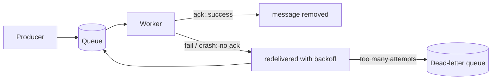
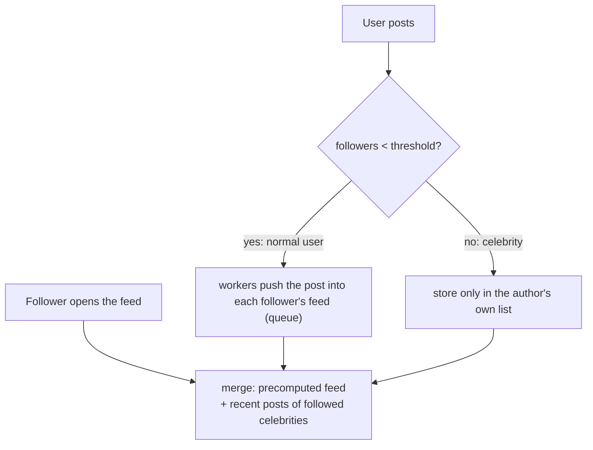
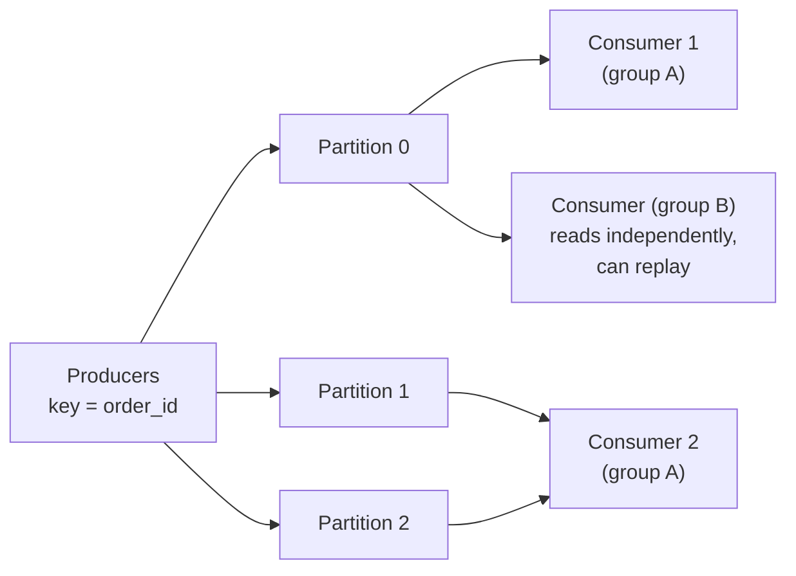

# Queues, Events & Background Jobs

> Don't make the user wait for slow work. Put a message on a queue, reply immediately, and let workers finish the job in the background.

Roadmap topic 21 · Stage 5: Async & Reliability

**Go deeper:** `22` Reliable Requests & External Services · `25` Overload & Failure Handling (backpressure) · `26` Service Boundaries (outbox) · `32` Practice Designs (notification system, news feed) · `04-backend-engineering/01-Client-Server-Request-Flow` (sync vs background) · `06-mobile-engineering/10-Background-Work-and-Notifications` (WorkManager).

**Marks:** 🟢 must know · 🟡 good to know

---

#### 1. What Is It?

*One side adds jobs, another side does them.*

```text
API (producer) → [ Queue ] → Worker (consumer)
 returns fast                  does the slow job
```

1. **Producer:** adds a message (job) to the queue.
2. **Queue:** holds messages until a worker takes them.
3. **Consumer / worker:** takes a message and processes it.

Why use a queue: the user gets a **fast response**; it **absorbs traffic spikes** (the queue grows, workers catch up); it **decouples** services (the producer doesn't need the consumer to be up); failed jobs can be **retried**.

Examples: send an email or push notification, resize an image, generate a report, update a search index.

**Mobile view:** WorkManager (Android) and BGTaskScheduler (iOS) are the same idea on the phone.

| 🟢 Must know | 🟡 Good to know |
|---|---|
| producers, consumers, workers | event streams (Kafka), partitions, replay |
| queue vs publish–subscribe | scheduled and delayed jobs |
| ack, retry, dead-letter queue | |
| at-least-once delivery, idempotent handlers | |
| ordering guarantees (per queue / partition) | |
| fan-out on write vs read (news feed, celebrity problem) | |

**Signals in an interview:** "sending a notification is slow", "design a notification system / news feed", "what if a worker crashes?", "events must stay in order", "a post by a celebrity with 50M followers"

---

#### 2. How It Works

**Queue vs publish–subscribe.**

| | Queue | Pub/Sub |
|---|---|---|
| Delivery | each message goes to **one** worker | each message goes to **every subscriber** |
| Use | share the work | broadcast an event |
| Example | resize-image jobs | "order placed" → email service, analytics, inventory |

**Ack, retry, dead-letter queue.** How a queue handles failure without losing messages.



1. **Ack:** the worker confirms success; only then is the message removed.
2. No ack (crash or failure) means the message is **redelivered**.
3. **Retry with backoff:** wait longer between attempts.
4. **Dead-letter queue (DLQ):** messages that keep failing go here for investigation, so they don't block everything else.

**At-least-once delivery and idempotent handlers.** Most queues guarantee **at-least-once**: a message may arrive **more than once**. So processing it twice must give the same result as once.

```text
bad:   "add 100 to balance"                    → double credit on a retry
good:  "set payment 123 to PAID"  /  check that message ID 7f3 was already processed
```

Store processed message IDs, or rely on unique constraints.

**Ordering guarantees.** A simple queue does not always keep global order, especially with several workers. Ordering is usually guaranteed **only within one queue or partition**. If order matters for one entity (all events of one order), send them to the same partition with a key (`order_id`). Full global ordering limits scale; avoid needing it.

**Fan-out on write vs read (news feed).** How does a post reach the followers' feeds?

| | Fan-out on write (push) | Fan-out on read (pull) |
|---|---|---|
| When | on a post, copy it into every follower's feed | on opening the feed, fetch posts of everyone followed |
| Read | very fast | slower |
| Write | heavy (one post × many followers) | cheap |
| Problem | a celebrity with 50M followers | a slow feed for users following many accounts |



The common answer is the **hybrid**: push for normal users, pull for celebrities, merged at read time. Workers do the fan-out through queues.

🟡 **Event streams (Kafka).** A queue that keeps a log of events so many consumers can read and re-read them.



A **topic** is split into **partitions**; order is guaranteed **within a partition**. In a **consumer group** each partition is read by one consumer. Messages are **kept for a retention period**, so a consumer can **replay** from an earlier **offset**. Good for high volume, analytics and event-driven systems; simple queues (SQS, RabbitMQ) are enough for basic background jobs.

🟡 **Scheduled and delayed jobs.** *Scheduled:* at a time or interval (nightly cleanup, daily report). *Delayed:* after N minutes (release an unpaid ticket hold after 10 minutes). Limit worker concurrency so you don't overload the database or third-party APIs.

---

#### 3. Naive vs Better Design

| Situation | Naive | Better |
|---|---|---|
| Slow work in a request | send the email before replying | save, enqueue, reply `202`/`201` |
| A failing message | retried forever, blocks the queue | backoff, a retry limit, then the DLQ |
| Duplicate delivery | handler adds to a balance | idempotent handler or processed-ID check |
| Ordering | assume global order | partition key per entity |
| Celebrity post | push to 50M feeds | pull for celebrities (hybrid) |
| Traffic spike | scale the API only | a queue absorbs the burst, workers catch up |
| Visibility | none | monitor queue length, age and DLQ size |
| Work the user needs now | queued | keep it synchronous |

```kotlin
// Naive: the user waits for the mail server, and a failure loses the mail
fun publishPost(post: Post) { db.save(post); mailer.sendToAllFollowers(post) }
```

---

#### 4. Code

A tiny in-memory queue with ack, retry and a dead-letter queue, and the idempotent consumer that goes with it.

```kotlin
data class Message(val id: String, val body: String, var attempts: Int = 0)

class JobQueue(private val maxAttempts: Int = 3) {
    private val ready = ArrayDeque<Message>()
    val deadLetters = mutableListOf<Message>()

    fun publish(m: Message) = ready.addLast(m)
    fun poll(): Message? = ready.removeFirstOrNull()?.also { it.attempts++ }
    fun nack(m: Message) { if (m.attempts >= maxAttempts) deadLetters += m else ready.addLast(m) }   // redeliver, or give up
    // ack = simply do not put the message back
}

fun runWorker(queue: JobQueue, handler: (Message) -> Unit) {
    while (true) {
        val m = queue.poll() ?: break
        try { handler(m) } catch (e: Exception) { queue.nack(m) }
    }
}

// Idempotent consumer: a duplicate delivery changes nothing
class PaymentCredits {
    private val processed = HashSet<String>()
    var balance = 0L
        private set
    fun handle(messageId: String, cents: Long) {
        if (!processed.add(messageId)) return          // already applied
        balance += cents
    }
}

// Same key → same partition → ordered
fun partitionFor(key: String, partitions: Int) = Math.floorMod(key.hashCode(), partitions)

// Hybrid feed: push for normal authors, pull for celebrities
data class Post(val id: Long, val authorId: Long, val time: Long)

class HybridFeed(private val celebrityThreshold: Int) {
    private val followersOf = HashMap<Long, MutableList<Long>>()
    private val followingOf = HashMap<Long, MutableList<Long>>()
    private val pushed = HashMap<Long, MutableList<Post>>()           // user → precomputed feed
    private val postsOf = HashMap<Long, MutableList<Post>>()

    fun follow(user: Long, author: Long) {
        followersOf.getOrPut(author) { mutableListOf() }.add(user)
        followingOf.getOrPut(user) { mutableListOf() }.add(author)
    }
    private fun isCelebrity(author: Long) = (followersOf[author]?.size ?: 0) >= celebrityThreshold

    fun post(p: Post) {
        postsOf.getOrPut(p.authorId) { mutableListOf() }.add(p)
        if (!isCelebrity(p.authorId)) followersOf[p.authorId]?.forEach { pushed.getOrPut(it) { mutableListOf() }.add(p) }   // fan-out on write
    }

    fun feed(user: Long, limit: Int): List<Post> {
        val pulled = followingOf[user].orEmpty().filter(::isCelebrity).flatMap { postsOf[it].orEmpty() }                    // fan-out on read
        return (pushed[user].orEmpty() + pulled).sortedByDescending { it.time }.take(limit)
    }
}

// How long to drain a backlog?
fun drainSeconds(backlog: Long, consumeRate: Double, produceRate: Double) =
    if (consumeRate <= produceRate) Double.POSITIVE_INFINITY else backlog / (consumeRate - produceRate)
```

Kafka: the key chooses the partition.

```kotlin
producer.send(ProducerRecord("orders", orderId, eventJson))     // all events of one order stay in order
```

Checks: a handler that always throws on message `"bad"` makes it appear 3 times and then land in `deadLetters`; a handler that throws only the first time on `"flaky"` succeeds on attempt 2 and the queue ends empty. `PaymentCredits().handle("m1", 100)` twice → `balance == 100`. `partitionFor("order-7", 8)` is the same for every call. Feed with threshold 2: B follows A and C, D follows C, and C has 2 followers (a celebrity): A posts at times 1 and 3, C posts at time 2. `feed(B, 10)` → times `[3, 2, 1]` (two pushed from A, one pulled from C); `feed(D, 10)` → `[2]`. The post by C caused 0 feed writes, A's posts caused 1 each. `drainSeconds(600_000, 1000.0, 400.0)` → `1000.0`; `drainSeconds(1, 100.0, 200.0)` → infinity (the backlog never drains).

---

#### 5. Numbers & Capacity

| Question | Number |
|---|---|
| Queue throughput | a managed queue or Kafka handles hundreds of thousands of messages per second across partitions |
| Workers needed | `jobs per second × seconds per job` (200 jobs/s at 0.5 s each → about 100 workers) |
| Backlog drain time | `backlog ÷ (consume rate − produce rate)` |
| Fan-out cost | one post × `F` followers = `F` writes; with 5 posts a day and 500 followers that is 2,500 writes a day per user, but one celebrity post to 50M followers is 50M writes |
| Kafka partitions | the maximum parallelism of one consumer group; choose with growth in mind (10s to 100s) |
| Retry delays | 1 s, 2 s, 4 s, 8 s ... capped (for example at 5 minutes), then the DLQ |

---

#### 6. Common Mistakes & Edge Cases

1. Non-idempotent handlers with at-least-once delivery.
2. No dead-letter queue, so one bad message blocks everything.
3. Assuming global ordering.
4. Unbounded retries with no backoff.
5. Using a queue for work the user needs immediately.
6. No monitoring of queue length and message age.
7. Enqueueing inside a transaction that later rolls back (or committing and then failing to enqueue): use the outbox (topic 26).
8. Huge messages in the queue (put the payload in storage and send a reference).
9. A "poison" message crashing the worker repeatedly.

Edge cases: a worker that finishes after its visibility timeout expired (the message is processed twice); consumers added beyond the number of partitions (idle); a rebalance that pauses consumption; time-ordered events from different partitions arriving out of order; a deleted user still receiving queued notifications.

---

#### 7. Say This in the Interview

1. "The API saves the request, puts a job on a queue, and returns quickly. Workers send the notification with retries and a dead-letter queue."
2. "Delivery is at-least-once, so handlers are idempotent: I store the processed message ID or use a unique constraint."
3. "Order is guaranteed only within a partition, so I key events by `order_id` to keep one order's events together."
4. "For a news feed I use a hybrid fan-out: push to followers' feeds for normal users, pull at read time for celebrities."
5. "I watch queue length, message age and the DLQ, and apply backpressure if consumers fall behind."

---

#### 8. Quick Check

1. Queue or pub/sub for "order placed" going to email, analytics and inventory?
2. A worker crashes after charging but before acking. What happens, and how is it safe?
3. How do you keep all events of one order in order?
4. Why not push a celebrity's post to every follower?

<details>
<summary>Answers</summary>

1. Pub/sub: every subscriber needs a copy.
2. The message is redelivered. An idempotent handler (or a stored message ID or idempotency key) prevents a second charge.
3. Use the order ID as the partition key.
4. It is 50M writes for one post. Pull the celebrity's posts at read time instead.

</details>

---

#### 9. Practice

**Interview questions**

1. Sending a notification is slow. How do you keep the API fast?
2. Queue vs pub/sub?
3. What if a worker crashes halfway?
4. What if a message keeps failing?
5. How do you keep the order of events for one order?
6. Fan-out on write or read for a news feed?
7. Kafka vs a simple queue?

**Hands-on**

1. Add a notification queue (Redis list, SQS or RabbitMQ) to your Notes API with a worker and a DLQ.
2. Make the worker idempotent and prove it by publishing the same message twice.
3. Implement the hybrid feed above and count the writes for a normal user and for a celebrity.

**LeetCode design problems**

| # | Question | Link to this topic |
|---|---|---|
| 622 | [Design Circular Queue](https://leetcode.com/problems/design-circular-queue/) (Medium) | a bounded queue |
| 641 | [Design Circular Deque](https://leetcode.com/problems/design-circular-deque/) (Medium) | double-ended queue |
| 355 | [Design Twitter](https://leetcode.com/problems/design-twitter/) (Medium) | feed with fan-out |
| 1188 | [Design Bounded Blocking Queue](https://leetcode.com/problems/design-bounded-blocking-queue/) (Medium, premium) | producers and consumers |
| 23 | [Merge k Sorted Lists](https://leetcode.com/problems/merge-k-sorted-lists/) (Hard) | merging feeds / partitions |

**Remember:** producer → queue → worker: a fast response, spike protection, retries · ack, retry with backoff, DLQ · at-least-once means idempotent handlers · order is guaranteed only within a partition · feed fan-out: push for normal users, pull for celebrities.
