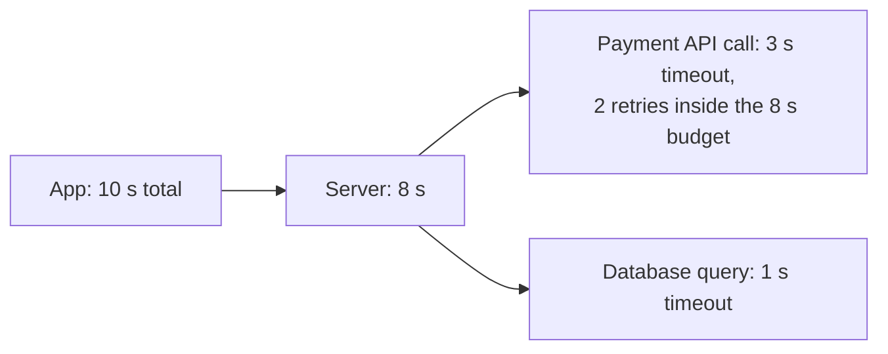
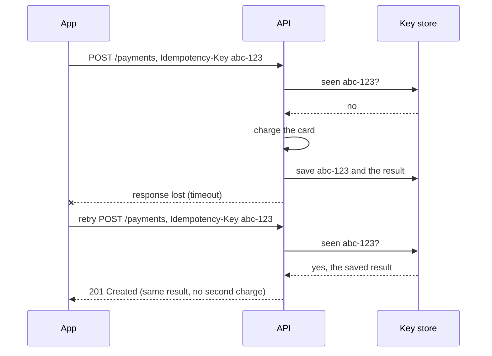

# Reliable Requests & External Services

> Networks and other services fail. Set timeouts, retry the right way, and make repeated requests safe, so a retry never charges someone twice.

Roadmap topic 22 · Stage 5: Async & Reliability

**Go deeper:** `04-backend-engineering/03-API-Design` (idempotency) · `04-backend-engineering/11-Transactions-and-Concurrency` · `21` Queues, Events & Background Jobs · `25` Overload & Failure Handling · `32` Practice Designs (payment system) · `06-mobile-engineering/08-Networking`.

**Marks:** 🟢 must know · 🟡 good to know

---

#### 1. What Is It?

| Tool | In one line |
|---|---|
| **Timeout** | never wait forever |
| **Retry with backoff and jitter** | retry transient failures, wait longer each time, add randomness |
| **Idempotency key** | the same request twice has the same effect as once |
| **Delivery guarantee** | at-most-once, at-least-once, "exactly-once" effect |
| 🟡 **Webhook** | the provider calls you; verify, dedupe, answer fast |
| 🟡 **Reconciliation** | compare your records with theirs |

| 🟢 Must know | 🟡 Good to know |
|---|---|
| timeouts | webhooks: signature, duplicates |
| retries with backoff and jitter | reconciliation |
| idempotency keys | |
| at-most-once vs at-least-once vs "exactly-once" effect | |

**Signals in an interview:** "the payment call timed out, was the user charged?", "how do you retry safely?", "design a payment system / webhook handler", "what is a retry storm?"

---

#### 2. How It Works

**Timeouts.** Set a timeout on **every** call: app → server, server → database, server → another service. Without one, slow calls pile up and use all threads (the system freezes). Set inner timeouts smaller than the caller's own, so failures are handled from the inside out.



**Retries with backoff and jitter.**

1. Retry only **transient** failures (timeouts, `503`, connection reset). Not `400` or `404`.
2. Retry only if the operation is **safe to repeat** (idempotent).
3. **Exponential backoff:** wait longer each time (1 s, 2 s, 4 s, 8 s).
4. **Jitter:** add randomness, so thousands of clients don't retry at the same moment (a *retry storm*).
5. **Limit** the number of retries.

```text
wait = random(0, min(cap, base × 2^attempt))        "full jitter"
```

**Idempotency keys.** The app sends a payment, the network times out, the app retries. Was the user charged once or twice?



Store the key with the result (and an expiry), use the **same key** for every retry of the same action, and reject the same key with a *different* request body.

**Delivery guarantees.**

| | Meaning | Risk |
|---|---|---|
| **At-most-once** | sent once, never retried | may be **lost** |
| **At-least-once** | retried until acknowledged | may be **duplicated** |
| **"Exactly-once"** | processed once | very hard end to end |

In practice: **at-least-once delivery + idempotent processing = an exactly-once effect.**

🟡 **Third-party APIs and webhooks.** External services fail and set limits. Respect the provider's **rate limits** and handle their downtime (queue and retry later). A **webhook** is the provider calling your endpoint when something happens (a payment succeeded):

- **Verify the signature**, so you know it is real.
- Expect **duplicates** and **out-of-order** events.
- Reply `2xx` **quickly** and process the event in the background.

Keep external calls **outside database transactions**.

🟡 **Reconciliation.** Periodically compare your records with the provider's (every payment, for example). It catches missed webhooks and mismatches, and is common in money flows.

---

#### 3. Naive vs Better Design

| Situation | Naive | Better |
|---|---|---|
| Waiting | no timeout | timeouts everywhere, smaller inside than outside |
| Failure | retry immediately and forever | exponential backoff + jitter + a limit |
| Which errors | retry everything | retry only transient errors on idempotent operations |
| Payment retry | retry blindly | idempotency key on every retry |
| Webhook | trust the request body | verify the signature, dedupe by event ID, answer fast |
| Slow provider | call it inside the DB transaction | commit first, call outside, or queue it |
| Trust | assume the webhook always arrives | reconcile daily |
| Guarantee | hope for exactly-once | at-least-once + idempotent handlers |

```kotlin
// Naive: hammers a struggling service, and a timed-out payment may be charged twice
repeat(Int.MAX_VALUE) { try { return paymentApi.charge(userId, cents) } catch (e: Exception) { } }
```

---

#### 4. Code

```kotlin
import java.security.MessageDigest
import java.util.concurrent.ConcurrentHashMap
import javax.crypto.Mac
import javax.crypto.spec.SecretKeySpec
import kotlin.random.Random

// ---------- full-jitter exponential backoff ----------
fun backoffMs(attempt: Int, baseMs: Long = 1_000, capMs: Long = 30_000, random: Random = Random.Default): Long {
    val ceiling = minOf(capMs, baseMs * (1L shl minOf(attempt, 20)))      // 1 s, 2 s, 4 s ... capped
    return random.nextLong(0, ceiling + 1)
}

// worst case time a caller may spend: every attempt times out, then waits the maximum backoff
fun worstCaseMs(timeoutMs: Long, retries: Int, baseMs: Long = 1_000, capMs: Long = 30_000): Long =
    (0..retries).sumOf { timeoutMs } + (0 until retries).sumOf { minOf(capMs, baseMs * (1L shl it)) }

suspend fun <T> retry(times: Int = 4, isTransient: (Throwable) -> Boolean, block: suspend () -> T): T {
    var attempt = 0
    while (true) {
        try { return block() }
        catch (e: Exception) {
            if (!isTransient(e) || attempt >= times) throw e
            kotlinx.coroutines.delay(backoffMs(attempt++))
        }
    }
}

// ---------- idempotency: key → saved result; the same key with a different body is an error ----------
data class Stored(val requestHash: String, val status: Int, val body: String)

class IdempotencyStore {
    private val saved = ConcurrentHashMap<String, Stored>()
    var executions = 0
        private set

    fun handle(key: String, requestBody: String, action: () -> String): Pair<Int, String> {
        val hash = MessageDigest.getInstance("SHA-256").digest(requestBody.toByteArray()).joinToString("") { "%02x".format(it) }
        val stored = saved.computeIfAbsent(key) {              // runs once per key
            executions++
            Stored(hash, 201, action())
        }
        return if (stored.requestHash != hash) 422 to """{"error":"Idempotency-Key reused with a different request"}"""
        else stored.status to stored.body
    }
}

// ---------- webhook: verify the signature and the age, then drop duplicates ----------
fun hmacHex(secret: String, data: String): String {
    val mac = Mac.getInstance("HmacSHA256").apply { init(SecretKeySpec(secret.toByteArray(), "HmacSHA256")) }
    return mac.doFinal(data.toByteArray()).joinToString("") { "%02x".format(it) }
}

class WebhookReceiver(private val secret: String, private val toleranceSec: Long = 300) {
    private val seenEvents = ConcurrentHashMap.newKeySet<String>()

    // signature header: "t=<unix seconds>,v1=<hex hmac of "t.body">"
    fun accept(eventId: String, body: String, signatureHeader: String, nowSec: Long): Boolean {
        val parts = signatureHeader.split(",").associate { it.substringBefore("=") to it.substringAfter("=") }
        val t = parts["t"]?.toLongOrNull() ?: return false
        val sig = parts["v1"] ?: return false
        if (kotlin.math.abs(nowSec - t) > toleranceSec) return false                   // too old: possible replay
        if (!MessageDigest.isEqual(hmacHex(secret, "$t.$body").toByteArray(), sig.toByteArray())) return false
        return seenEvents.add(eventId)                                                 // false = duplicate, ignore it
    }
}

// ---------- reconciliation: find what disagrees ----------
data class Mismatch(val id: String, val ours: Long?, val theirs: Long?)

fun reconcile(ours: Map<String, Long>, theirs: Map<String, Long>): List<Mismatch> =
    (ours.keys + theirs.keys).sorted().mapNotNull { id ->
        if (ours[id] == theirs[id]) null else Mismatch(id, ours[id], theirs[id])
    }
```

Checks: `backoffMs(0)` is between `0` and `1000`; `backoffMs(3)` between `0` and `8000`; `backoffMs(10)` is never more than `30000` (the cap). `worstCaseMs(timeoutMs = 3_000, retries = 2)` → `3 attempts × 3 s + (1 s + 2 s)` = `12000`, which tells you it does not fit inside an 8-second server budget, so use fewer retries or a shorter timeout. `IdempotencyStore.handle("k1", body, action)` called twice with the same body returns `201` and the same body both times, and `executions == 1`; calling it with key `"k1"` and a different body returns `422`. A webhook with a valid `t=…,v1=…` header is accepted once (`true`), the same event ID again is `false`, a changed body is `false`, a timestamp 10 minutes old is `false`. `reconcile(mapOf("p1" to 100, "p2" to 200, "p3" to 300), mapOf("p1" to 100, "p2" to 250, "p4" to 50))` → mismatches `p2 (200 vs 250)`, `p3 (300 vs null)`, `p4 (null vs 50)`.

---

#### 5. Numbers & Capacity

| Item | Rule of thumb |
|---|---|
| Timeouts | connect 1 to 3 s, read a few seconds; tune from the provider's p99 |
| Retries | 2 to 4 attempts; each extra attempt multiplies load on a sick service |
| Retry amplification | with 3 layers each retrying 3 times, one failure can become `3 × 3 × 3 = 27` calls: retry at one layer only |
| Backoff | base 1 s, cap 30 s to 5 min |
| Idempotency key lifetime | 24 hours or more (longer than any client retry window) |
| Webhook timestamp tolerance | about 5 minutes |
| Reconciliation | daily or hourly for money flows |

---

#### 6. Common Mistakes & Edge Cases

1. No timeouts.
2. Retrying immediately and forever.
3. Retrying non-idempotent operations (payments) without an idempotency key.
4. Retrying errors that will never succeed (`400`).
5. Trusting webhooks without checking the signature.
6. Calling slow external services inside a database transaction.
7. Retrying at every layer (retry amplification).
8. Generating a new idempotency key on each retry (it defeats the purpose).
9. Ignoring `429` and `Retry-After`.

Edge cases: the request reached the provider and succeeded but the response was lost (the retry must replay, not repeat); two concurrent requests with the same key (the second waits or gets the first one's result); webhooks arriving before your own database commit; events arriving out of order (compare versions or timestamps); the provider is down for hours (queue and retry later, then reconcile).

---

#### 7. Say This in the Interview

1. "I set a timeout on every call, smaller than the caller's, so failures are handled from the inside out."
2. "I retry only transient errors on idempotent operations, with exponential backoff, jitter and a limit, so a recovering service isn't hit by a retry storm."
3. "For payments the client generates an idempotency key and reuses it on every retry. The server stores key → result and replays it, so there's never a second charge."
4. "Delivery is at-least-once, so processing is idempotent. Together that gives an exactly-once effect."
5. "For webhooks I verify the signature, dedupe by event ID, answer `2xx` quickly and process in the background, and I reconcile with the provider daily."

---

#### 8. Quick Check

1. A payment call timed out. What do you do?
2. Why add jitter?
3. Three layers each retry 3 times. How many calls can one failure cause?
4. Why must a webhook's signature be verified?

<details>
<summary>Answers</summary>

1. Retry with the same idempotency key, or query the payment status. Never create a new key, and reconcile later.
2. So that many clients don't retry at the same instant and overload a recovering service.
3. Up to 27.
4. Anyone can post to your endpoint. The signature proves the provider sent it.

</details>

---

#### 9. Practice

**Interview questions**

1. The payment call times out. Was the user charged? What do you do?
2. How do you retry safely?
3. What is a retry storm?
4. At-most-once vs at-least-once?
5. How do you handle webhooks?

**Hands-on**

1. Add retries with full-jitter backoff to one outgoing call, and log the delays.
2. Implement `Idempotency-Key` on `POST /orders` and test the replay and the mismatch case.
3. Write a webhook endpoint that verifies an HMAC signature and ignores duplicates.

**LeetCode design problems**

| # | Question | Link to this topic |
|---|---|---|
| 359 | [Logger Rate Limiter](https://leetcode.com/problems/logger-rate-limiter/) (Easy, premium) | de-duplicating by key and time |
| 933 | [Number of Recent Calls](https://leetcode.com/problems/number-of-recent-calls/) (Easy) | a sliding window of requests |
| 362 | [Design Hit Counter](https://leetcode.com/problems/design-hit-counter/) (Medium, premium) | counting events in a window |
| 1396 | [Design Underground System](https://leetcode.com/problems/design-underground-system/) (Medium) | matching start and end events |

**Remember:** timeouts on every call · retry transient failures with backoff + jitter + a limit · an idempotency key makes retries safe · at-least-once + idempotent processing = an exactly-once effect · webhooks: verify, dedupe, respond fast.
