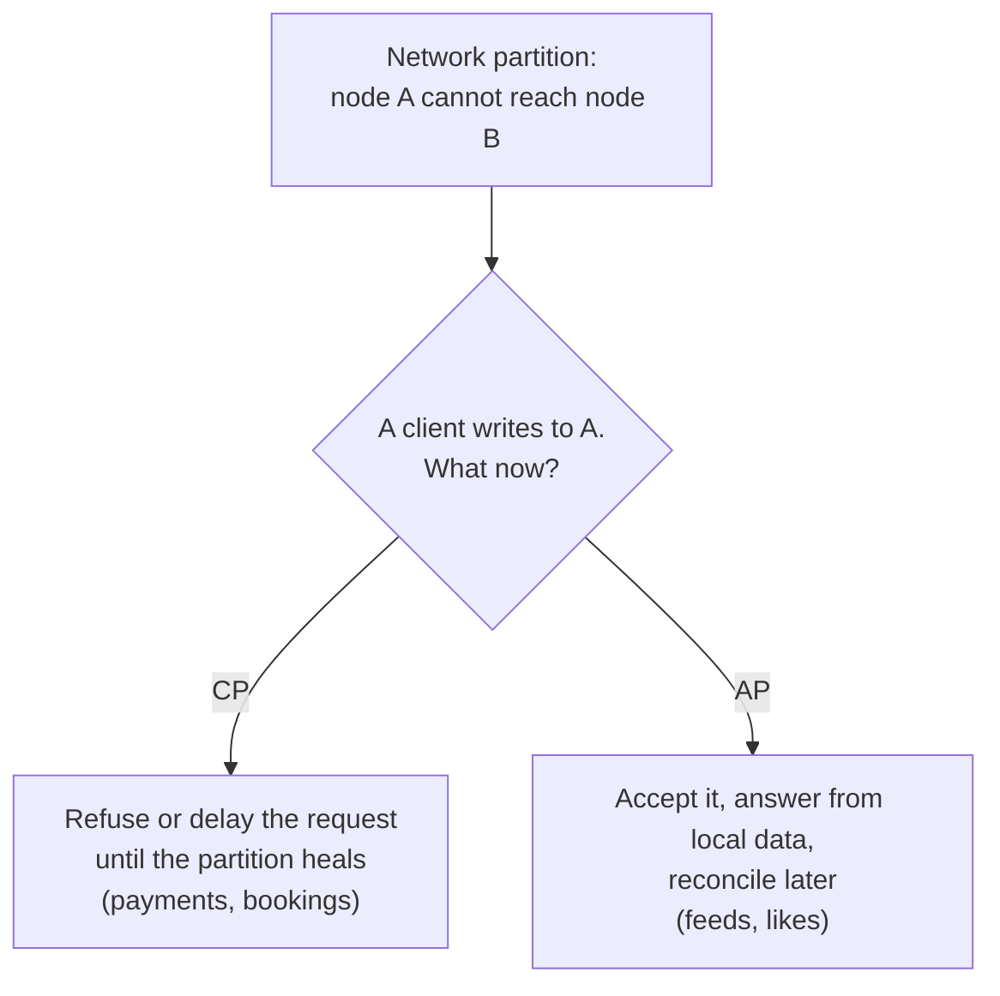
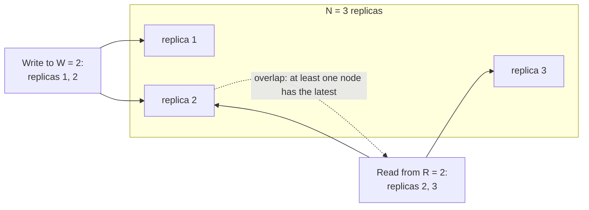

# Consistency & CAP

> When data lives on many servers, they may not agree at every moment. Decide, for each feature, whether users must always see the latest data or can see slightly old data.

Roadmap topic 23 · Stage 5: Async & Reliability

**Go deeper:** `10-database/16-Consistency-CAP-and-Distributed-Data` · `04-backend-engineering/11-Transactions-and-Concurrency` · `15` Caching (stale data) · `18` Replication (lag) · `30` Mobile-Specific Topics (offline sync conflicts) · `33` Follow-Up Topics (clocks, consensus).

**Marks:** 🟢 must know · 🟡 good to know

---

#### 1. What Is It?

*Do all users see the latest write right away, or only after a short delay?*

| | Strong | Eventual |
|---|---|---|
| Meaning | every read sees the latest write | reads may be stale briefly, then all copies agree |
| Cost | slower, less available | faster, more available |
| Example | bank balance, seat booking | like count, feed, follower count |

```text
strong:    write → everyone reads the new value
eventual:  write → some read the old value → soon all read the new value
```

**Mobile view:** an app that shows a new post instantly (optimistic UI) before the server confirms it is a small taste of eventual consistency.

| 🟢 Must know | 🟡 Good to know |
|---|---|
| strong vs eventual consistency | quorums |
| read-your-writes | conflict handling (last-write-wins, merge) |
| CAP during a network partition | |
| choose consistency per feature | |

**Signals in an interview:** "explain CAP", "where is stale data acceptable?", "the user posted and can't see it", "two devices edit the same note offline", "payments vs likes"

---

#### 2. How It Works

**Read-your-writes.** A user must at least see their own changes. Example: you change your profile name and refresh; you must see the new name, even if others see the old one for a few seconds.

1. Read your own data from the leader, or from a cache updated on write, for a short time after writing.
2. Or send a *version token* with the next read, and let only a replica that has caught up serve it.
3. Related: **monotonic reads**: you never see data go back in time (keep a user on the same replica).

**CAP in simple words.** When the network splits, you must choose between correctness and availability.

1. **C**onsistency: all nodes give the latest data.
2. **A**vailability: every request gets an answer.
3. **P**artition tolerance: the system works when the network between nodes breaks.

Networks do fail, so partitions will happen. **During a partition** you choose:



- **CP:** refuse or delay some requests to stay correct.
- **AP:** keep answering, maybe with stale data, and fix it later.

CAP applies only *during a partition*. With no failure you can have both; the trade-off is then latency vs consistency.

**Decide per feature.** Don't pick one consistency level for the whole system.

| Feature | Consistency | Why |
|---|---|---|
| Payment, wallet balance | strong | money must be exact |
| Seat / inventory reservation | strong | prevent double booking |
| Post a comment (the author sees it) | read-your-writes | the author expects it immediately |
| Feed, likes count, views | eventual | a slight delay is harmless |

🟡 **Quorums.** With `N` copies of the data, write to `W` of them and read from `R` of them.



If **R + W > N**, every read set overlaps the latest write set and sees it. Example: N=3, W=2, R=2. Higher `W` or `R` means stronger consistency but slower and less available. It is not a complete guarantee (timing and failure cases exist).

🟡 **Conflict handling.** When two devices edit the same thing offline:

1. **Last-write-wins (LWW):** the newest timestamp wins. Simple, but can lose edits.
2. **Merge:** combine the changes (different fields), or use CRDTs (conflict-free data types) for collaborative editing and counters.
3. **Ask the user** in rare, important cases.

---

#### 3. Naive vs Better Design

| Situation | Naive | Better |
|---|---|---|
| Consistency level | one for the whole system | chosen per feature |
| CAP | "pick any two, always" | a choice made only during a partition |
| After a write | read from any replica | read-your-writes |
| Money | eventual consistency | strong consistency, transactions |
| Likes and views | strong consistency everywhere (slow) | eventual |
| Offline edits | last write silently wins | field-level merge or a CRDT |
| Quorum | `W = 1, R = 1` and hope | `R + W > N` where reads must be fresh |
| Clocks | trust device clocks for ordering | server-assigned versions or logical clocks |

```kotlin
// Naive LWW on device clocks: a phone with a wrong clock wins every conflict
fun merge(a: Edit, b: Edit) = if (a.deviceTimeMs > b.deviceTimeMs) a else b
```

---

#### 4. Code

```kotlin
// ---------- a quorum store: N replicas, write to some, read from some ----------
data class Versioned(val version: Long, val value: String)

class QuorumStore(n: Int) {
    private val replicas = List(n) { HashMap<String, Versioned>() }

    fun write(key: String, value: String, version: Long, targets: List<Int>) =
        targets.forEach { replicas[it][key] = Versioned(version, value) }

    fun read(key: String, targets: List<Int>): String? =
        targets.mapNotNull { replicas[it][key] }.maxByOrNull { it.version }?.value        // newest version wins
}

fun overlaps(n: Int, w: Int, r: Int) = r + w > n

// ---------- read-your-writes with a version token ----------
fun canServe(replicaAppliedVersion: Long, clientMinVersion: Long) = replicaAppliedVersion >= clientMinVersion

// ---------- conflict handling ----------
data class Edit(val title: String?, val body: String?, val timeMs: Long, val nodeId: Int)

// Last-write-wins on the whole record (ties broken by node id so every replica picks the same winner)
fun lww(a: Edit, b: Edit): Edit = when {
    a.timeMs != b.timeMs -> if (a.timeMs > b.timeMs) a else b
    else -> if (a.nodeId > b.nodeId) a else b
}

// Field-level merge: each field takes the newest edit that actually changed it
fun mergeFields(a: Edit, b: Edit): Edit {
    fun <T> pick(x: T?, tx: Long, y: T?, ty: Long): T? = when {
        x == null -> y
        y == null -> x
        else -> if (tx >= ty) x else y
    }
    return Edit(pick(a.title, a.timeMs, b.title, b.timeMs), pick(a.body, a.timeMs, b.body, b.timeMs), maxOf(a.timeMs, b.timeMs), a.nodeId)
}

// A CRDT counter (grow-only): merging is "max per node", so merging twice changes nothing
class GCounter(private val nodeId: String) {
    private val counts = HashMap<String, Long>()
    fun increment() { counts[nodeId] = (counts[nodeId] ?: 0) + 1 }
    fun value() = counts.values.sum()
    fun merge(other: GCounter) { other.counts.forEach { (k, v) -> counts[k] = maxOf(counts[k] ?: 0, v) } }
}
```

Checks (`N = 3`): write `"v2"` to replicas `[0, 1]` (W = 2) and read from `[1, 2]` (R = 2) → `"v2"` (replica 1 is in both). Write to `[0]` only (W = 1) and read from `[1, 2]` (R = 2): `R + W = 3 = N`, no overlap → `null` or an old value. `overlaps(3, 2, 2)` → `true`; `overlaps(3, 1, 2)` → `false`; `overlaps(5, 3, 3)` → `true`. `canServe(replicaAppliedVersion = 41, clientMinVersion = 42)` → `false` (read from the leader instead). LWW: device A sets the title to "A" at `t = 10`, device B sets it to "B" at `t = 12` → `"B"`, and A's edit is lost. `mergeFields(Edit("A", null, 10, 1), Edit(null, "text", 12, 2))` → title `"A"` and body `"text"` (both survive). `GCounter`: node1 increments 3 times, node2 twice → after merging both ways, `value()` is `5` on each; merging the same counter again keeps `5`.

---

#### 5. Numbers & Capacity

| Setting (N = 3) | W | R | Strong reads? | Behaviour |
|---|---|---|---|---|
| fast writes, slower reads | 1 | 3 | yes (1 + 3 > 3) | writes survive 2 failures, reads need all |
| balanced | 2 | 2 | yes | tolerates 1 node down for both |
| fast reads | 3 | 1 | yes | writes need all nodes |
| fast everything | 1 | 1 | no | eventual, may read stale |

| Question | Number |
|---|---|
| Typical replication lag | milliseconds to seconds |
| Cross-region synchronous write | adds a full round trip (100 ms or more) |
| Latency vs consistency (PACELC) | even with no partition, stronger consistency costs latency |

---

#### 6. Common Mistakes & Edge Cases

1. Choosing one consistency level for everything.
2. Thinking CAP means "pick any 2" at all times.
3. Ignoring that a user must see their own writes.
4. Using eventual consistency for money.
5. Ignoring conflict handling for offline edits.
6. Trusting wall-clock time across devices for ordering.
7. Believing a quorum guarantees linearizability under all failures.

Edge cases: a user sees data go backwards (non-monotonic reads) because requests hit different replicas; two requests that look concurrent (use versions or vector clocks, topic 33); a counter that must never go below zero (needs strong consistency or reservations); deletes that get "resurrected" by a stale replica (use tombstones).

---

#### 7. Say This in the Interview

1. "Strong consistency means a read always sees the latest write. Eventual means it may be stale briefly and then converges. I choose per feature."
2. "During a network partition I must choose: consistency (reject or delay requests) or availability (answer with possibly stale data). Payments and bookings are CP; feeds and like counts are AP."
3. "The author of a change always sees it: I read their data from the leader for a short time after a write."
4. "With `N` replicas I keep `R + W > N` when reads must see the latest write."
5. "For offline edits I merge by field or use a CRDT rather than silently overwriting with last-write-wins."

---

#### 8. Quick Check

1. N = 5, W = 3, R = 3. Are reads guaranteed to overlap the latest write?
2. Should a like counter be strongly consistent?
3. During a partition, a CP system does what?
4. Why is last-write-wins risky?

<details>
<summary>Answers</summary>

1. Yes: 3 + 3 = 6 > 5.
2. No, eventual consistency is fine; a slightly old count is harmless.
3. It refuses or delays some requests to stay correct.
4. It silently drops the older edit, and device clocks can be wrong.

</details>

---

#### 9. Practice

**Interview questions**

1. Strong vs eventual consistency?
2. Explain CAP.
3. Where would you accept stale data in a social app, and where not?
4. What is read-your-writes, and how do you provide it?
5. What is a quorum?
6. Two devices edit the same note offline. What happens?

**Hands-on**

1. Run the quorum store above with `W = 1, R = 1` and then `W = 2, R = 2`, and find the cases that read stale data.
2. Add a `version` column to notes and implement field-level merge for `PATCH` conflicts.
3. Build a G-Counter for likes across two instances.

**LeetCode design problems**

| # | Question | Link to this topic |
|---|---|---|
| 1146 | [Snapshot Array](https://leetcode.com/problems/snapshot-array/) (Medium) | versions of values |
| 981 | [Time Based Key-Value Store](https://leetcode.com/problems/time-based-key-value-store/) (Medium) | pick the newest version at a time |
| 635 | [Design Log Storage System](https://leetcode.com/problems/design-log-storage-system/) (Medium, premium) | ordered events by timestamp |

**Remember:** strong = always the latest, eventual = catches up · read-your-writes for the person who made the change · CAP: during a partition choose consistency or availability · decide per feature: money and bookings strong, feeds and counts eventual · quorum: R + W > N.
