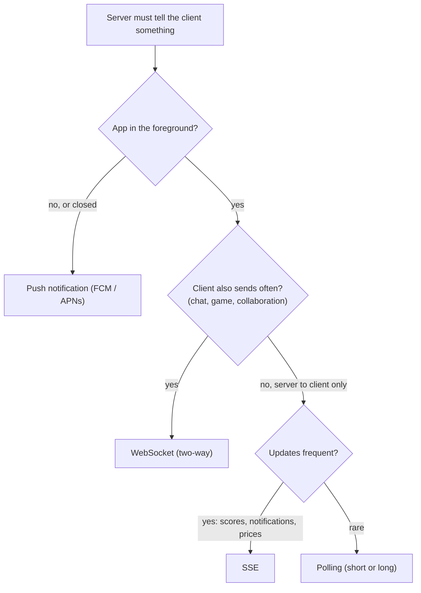
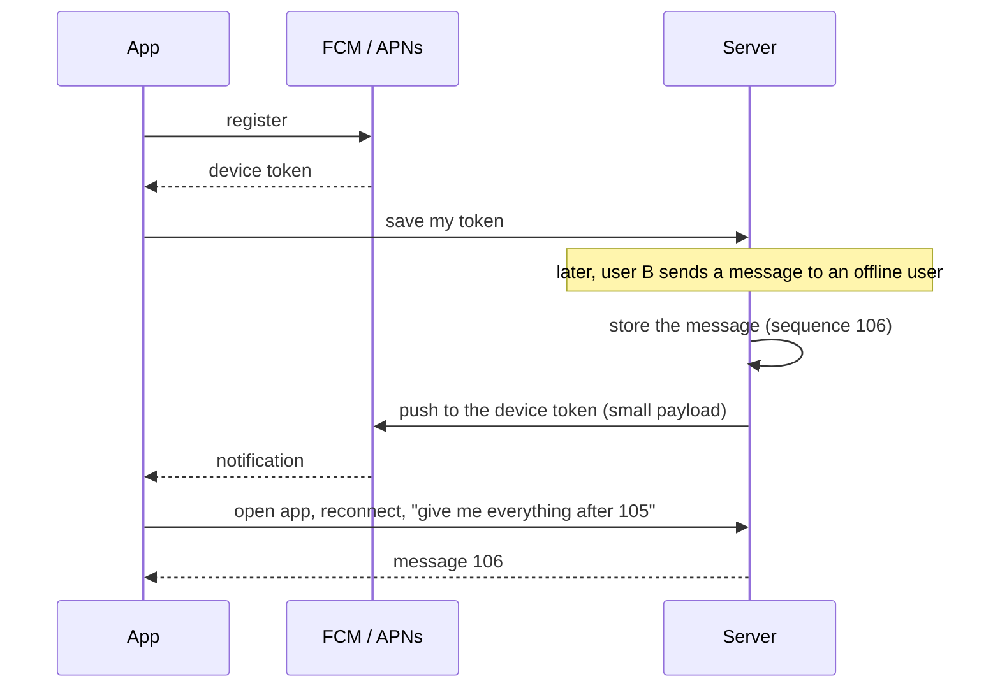
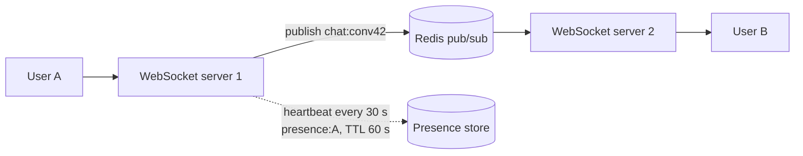

# Real-Time Communication & Push

> Normal HTTP is "client asks, server answers". For chat, live scores or notifications, the server must send data when something happens. There are several ways, and on mobile the OS limits them.

Roadmap topic 24 · Stage 5: Async & Reliability

**Go deeper:** `21` Queues, Events & Background Jobs · `23` Consistency & CAP · `30` Mobile-Specific Topics · `32` Practice Designs (chat, notification system) · `22` Reliable Requests (backoff) · `06-mobile-engineering/10-Background-Work-and-Notifications` (FCM on the device) · `06-mobile-engineering/08-Networking`.

**Marks:** 🟢 must know · 🟡 good to know · (New) added beyond the original roadmaps

---

#### 1. What Is It?

*Three ways to get fresh data from the server to the app, and one way to reach a closed app.*

| Method | How | Good | Bad |
|---|---|---|---|
| **Short polling** | the app asks every N seconds | simplest | wasteful, delayed, drains battery |
| **Long polling** | the server holds the request until there is news, then answers | near real-time over plain HTTP | reconnect after each message |
| **WebSocket** | one persistent **two-way** connection | low latency both ways | stateful connections to manage |
| **SSE** (server-sent events) | persistent connection, **server → client only** | simple, auto-reconnect | one direction only |
| **Push (FCM / APNs)** | the OS delivers a notification to the device | reaches closed apps | best effort, small payload |

| 🟢 Must know | 🟡 Good to know |
|---|---|
| short polling, long polling | scaling WebSockets, presence |
| WebSockets, SSE | |
| choosing a method | |
| reconnect and missed-message recovery | |
| (New) push notifications (FCM / APNs) | |

**Signals in an interview:** "design chat / live scores / a notification system", "how does an offline user get the message?", "what if the connection drops?", "how do you scale WebSockets?"

---

#### 2. How It Works

**Choosing a method.** Ask: which direction? how fast? how many users?



**Connection management.** Connections break all the time, especially on mobile.

1. **Heartbeat / ping:** detect dead connections.
2. **Reconnect with backoff** (and jitter), so a server restart doesn't cause a reconnect storm.
3. **Missed-message recovery:** while disconnected, the client misses messages. Give each message an **ID or sequence number**. On reconnect the client says "my last message was 105" and the server sends everything after it.
4. Authenticate the connection when it opens, and re-check on reconnect.

**Push notifications (FCM / APNs).** How to reach a user whose app is closed. **FCM** (Firebase Cloud Messaging) is for Android, **APNs** (Apple Push Notification service) for iOS. The OS **stops background connections** (like WebSockets), so push wakes the user up.



Delivery is **best effort, not guaranteed**, and the payload is small (a few KB). Send a small message or an ID and let the app **fetch the details** when it opens. Handle token refresh and remove invalid tokens.

🟡 **Scaling WebSockets and presence.** Each connection holds server memory, so one server handles a limited number. Users connect to **different servers**; to send to user B on server 2, use a **pub/sub** channel (Redis, for example) between servers. **Presence** (online/offline): heartbeats with a short TTL in a fast store. Use a load balancer that supports WebSockets.



---

#### 3. Naive vs Better Design

| Situation | Naive | Better |
|---|---|---|
| Updates | poll every second | WebSocket / SSE for live data, push for closed apps |
| Reconnect | retry instantly, forever | exponential backoff with jitter |
| Missed messages | lost | sequence numbers and "give me everything after N" |
| Offline user | message dropped | store it, send a push, sync on open |
| Push payload | the full private message | a small notification or ID; the app fetches |
| Push guarantee | treated as reliable | best effort; the app syncs on open |
| Many servers | direct server-to-server calls | pub/sub between servers |
| Presence | a flag in the database | heartbeats with a TTL |

```kotlin
// Naive: polls every second, forever, even in the background
while (true) { api.getMessages(); delay(1_000) }
```

---

#### 4. Code

Server side (Ktor shapes) and the logic that makes them reliable.

```kotlin
// ---------- SSE: server → client ----------
get("/events") {
    call.response.cacheControl(CacheControl.NoCache(null))
    call.respondTextWriter(contentType = ContentType.Text.EventStream) {
        eventFlow.collect { event ->                            // eventFlow: a Flow<Event> of server events
            write("id: ${event.id}\ndata: ${event.json}\n\n")   // the id lets the browser resume with Last-Event-ID
            flush()
        }
    }
}

// ---------- WebSocket: two-way chat ----------
webSocket("/chat") {
    val userId = authenticate(call)                             // authenticate when the connection opens
    for (frame in incoming) {
        if (frame is Frame.Text) {
            val message = saveMessage(userId, frame.readText())     // 1. store first (assign a sequence number)
            publish("chat:${message.conversationId}", message)       // 2. then fan out through pub/sub
        }
    }
}
```

```kotlin
import kotlin.random.Random

// ---------- missed-message recovery ----------
data class ChatMessage(val seq: Long, val text: String)

class ConversationLog {
    private val messages = ArrayList<ChatMessage>()
    fun append(text: String): ChatMessage = ChatMessage(messages.size + 1L, text).also { messages += it }
    fun after(lastSeq: Long, limit: Int = 100): List<ChatMessage> = messages.filter { it.seq > lastSeq }.take(limit)
}

// ---------- presence with a TTL ----------
class Presence(private val ttlMs: Long, private val now: () -> Long) {
    private val lastSeen = HashMap<String, Long>()
    fun heartbeat(userId: String) { lastSeen[userId] = now() }
    fun isOnline(userId: String) = lastSeen[userId]?.let { now() - it < ttlMs } == true
}

// ---------- pub/sub between servers (in-memory stand-in for Redis PUBLISH / SUBSCRIBE) ----------
class PubSub {
    private val subscribers = HashMap<String, MutableList<(String) -> Unit>>()
    fun subscribe(channel: String, handler: (String) -> Unit) { subscribers.getOrPut(channel) { mutableListOf() }.add(handler) }
    fun publish(channel: String, message: String) = subscribers[channel].orEmpty().forEach { it(message) }
}

// ---------- reconnect with full-jitter backoff (as in topic 22) ----------
fun reconnectDelayMs(attempt: Int, baseMs: Long = 1_000, capMs: Long = 30_000, random: Random = Random.Default): Long =
    random.nextLong(0, minOf(capMs, baseMs * (1L shl minOf(attempt, 20))) + 1)
```

Android client: a WebSocket that remembers the last sequence and reconnects.

```kotlin
val request = Request.Builder().url("wss://api.example.com/chat?lastSeq=$lastSeq").build()
val socket = client.newWebSocket(request, object : WebSocketListener() {
    override fun onMessage(ws: WebSocket, text: String) { lastSeq = parse(text).seq; ui.show(text) }
    override fun onFailure(ws: WebSocket, t: Throwable, r: Response?) { scheduleReconnect(attempt++) }   // backoff + jitter
})
```

Push payload (FCM): small, with an ID the app uses to fetch the content.

```json
{ "message": { "token": "<device token>",
    "data": { "type": "new_message", "conversationId": "42", "seq": "106" },
    "android": { "priority": "high" } } }
```

Checks: `ConversationLog` with 110 messages: `after(105)` → sequences `106 … 110`; `after(110)` → empty; `after(0, limit = 100)` → the first 100. `Presence(ttlMs = 60_000)`: heartbeat at `t = 0`, `isOnline` is `true` at `t = 59_999` and `false` at `t = 60_000`. A `PubSub` with server 2 subscribed to `"chat:42"`: server 1 publishing `"hi"` triggers server 2's handler once, and a different channel is not triggered. `reconnectDelayMs(0)` is between `0` and `1000`; `(5)` between `0` and `30000`.

---

#### 5. Numbers & Capacity

| Question | Number |
|---|---|
| Polling load | 10M users polling every 10 s = 1,000,000 requests per second, mostly empty; WebSockets hold the connection instead |
| Connections per server | tens of thousands, up to about 100K+ with tuning (memory per connection about 10 to 50 KB) |
| Servers for 1M connected users | about 10 to 100, depending on the limit and headroom |
| Heartbeat | every 20 to 30 s; presence TTL about 2 × the heartbeat |
| Push payload | about 4 KB maximum (FCM); send IDs, not content |
| Reconnect storm | 1M clients reconnecting at once after a deploy: jitter spreads it over 30 s to 1 min |

Battery: each radio wake-up is expensive. Batch low-priority updates and prefer push over a constantly open connection when the app is in the background.

---

#### 6. Common Mistakes & Edge Cases

1. Polling every second.
2. No reconnect strategy, or reconnecting instantly on failure.
3. No way to recover missed messages.
4. Relying on push as guaranteed delivery.
5. Putting large or sensitive data inside push payloads.
6. Ignoring that connections are stateful when scaling (no pub/sub between servers).
7. Sending to a connection before storing the message (a crash loses it).
8. Not removing invalid device tokens (wasted pushes).

Edge cases: a client connected on two devices; messages out of order across servers (use the sequence number from one source per conversation); a half-open connection (the client thinks it is connected, so use heartbeats); rolling deploys that drop every connection (drain gradually); users changing networks (Wi-Fi to mobile) mid-stream.

---

#### 7. Say This in the Interview

1. "For chat I'd use WebSockets: two-way and low latency. For one-way live updates, SSE. For occasional updates, polling."
2. "A message is stored first with a sequence number, then delivered. If the client is offline, I send a push (FCM/APNs) with a small payload."
3. "On reconnect the client says 'my last sequence is 105' and the server returns everything after it, so nothing is lost."
4. "I reconnect with exponential backoff and jitter, so a server restart doesn't cause a reconnect storm."
5. "To scale, many WebSocket servers sit behind a load balancer, and Redis pub/sub routes a message to the server where the recipient is connected. Presence uses heartbeats with a TTL."

---

#### 8. Quick Check

1. Which method for a live stock ticker (server to client only)?
2. The app was offline for an hour. How does it get missed chat messages?
3. Why can't push be the only delivery mechanism?
4. How many servers for 1M connections at 50K each?

<details>
<summary>Answers</summary>

1. SSE (or a WebSocket if you also need two-way).
2. It reconnects and asks for messages after its last known sequence number.
3. Push is best effort and small, and the user may disable it. The message must be stored and synced on open.
4. 20 at full load, so plan about 30 to 40 for headroom and failures.

</details>

---

#### 9. Practice

**Interview questions**

1. How do you deliver a chat message to a user who is offline?
2. WebSocket vs SSE vs polling?
3. How do you handle disconnects?
4. How do you scale WebSockets?
5. Why use push notifications when you have WebSockets?

**Hands-on**

1. Build a WebSocket chat endpoint in Ktor with message storage and sequence numbers.
2. Add "reconnect and fetch after `lastSeq`" to your Android client.
3. Send a real FCM message to your device from a small script.

**LeetCode design problems**

| # | Question | Link to this topic |
|---|---|---|
| 355 | [Design Twitter](https://leetcode.com/problems/design-twitter/) (Medium) | posts and a timeline |
| 1472 | [Design Browser History](https://leetcode.com/problems/design-browser-history/) (Medium) | ordered state |
| 933 | [Number of Recent Calls](https://leetcode.com/problems/number-of-recent-calls/) (Easy) | a sliding window of events |
| 359 | [Logger Rate Limiter](https://leetcode.com/problems/logger-rate-limiter/) (Easy, premium) | de-duplicating notifications |

**Remember:** polling → long polling → SSE → WebSocket, by need · reconnect with backoff and recover missed messages by sequence number · push (FCM/APNs) reaches closed apps and is best effort · scale WebSockets with pub/sub between servers · send small pushes and fetch the details in the app.
