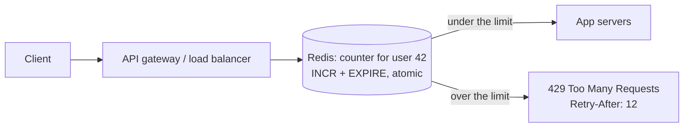
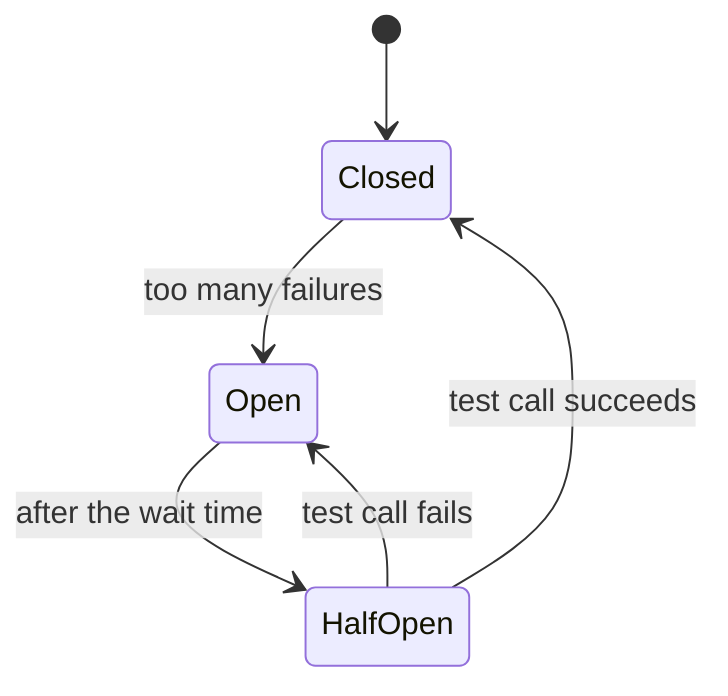

# Overload & Failure Handling

> When traffic is too high or a dependency is failing, the system must protect itself: limit requests, slow producers, stop calling broken services, drop low-priority work, and keep the core features running.

Roadmap topic 25 · Stage 5: Async & Reliability

**Go deeper:** `14` Scaling & Load Balancing · `21` Queues (backpressure) · `22` Reliable Requests (timeouts, retries) · `27` Observability · `32` Practice Designs (rate limiter) · `04-backend-engineering/06-Backend-Security-Essentials` (login rate limiting) · `06-mobile-engineering/08-Networking`.

**Marks:** 🟢 must know · 🟡 good to know

---

#### 1. What Is It?

| Tool | Protects against |
|---|---|
| **Rate limiting** | abuse, buggy retry loops, overload from one client |
| **Backpressure** | consumers that can't keep up with producers |
| **Circuit breaker** | calling a dependency that is already failing |
| **Load shedding** | more work than capacity: drop the least important first |
| **Graceful degradation** | a failed non-core part taking down the core |
| 🟡 **Bulkheads** | one slow dependency using up all the resources |

| 🟢 Must know | 🟡 Good to know |
|---|---|
| rate limiting: token bucket, sliding window | bulkheads |
| rate limiter placement and shared state (Redis, atomic updates) | |
| backpressure | |
| circuit breaker | |
| load shedding | |
| graceful degradation | |

**Signals in an interview:** "design a rate limiter", "a downstream service is down, what does yours do?", "traffic spikes 10×", "queues keep growing", "how do you keep checkout working when recommendations are slow?"

---

#### 2. How It Works

**Rate limiting.** Limit how many requests a client can make in a time period.

| Algorithm | Idea | Note |
|---|---|---|
| **Token bucket** | a bucket refills with tokens at a fixed rate; each request uses one; empty = reject | allows short **bursts** |
| **Sliding window** | count requests in the last N seconds | smooth and accurate |
| **Fixed window** | count per calendar minute | simple, but allows bursts at window edges (2 × limit in a short time) |

Limit **per user, IP or API key**, and per endpoint. Reject with `429 Too Many Requests` and a `Retry-After` header; the client should obey `429` and back off.

**Placement and shared state** (the classic interview design).



1. Place it at the **API gateway / load balancer**, before the app servers.
2. With many servers the counters must be **shared**: keep them in **Redis**.
3. Use **atomic operations** (`INCR` with expiry, or a Lua script) so two servers don't race.
4. Decide what happens if Redis is down: **fail open** (allow) or **fail closed** (block). Usually fail open for general APIs, fail closed for login and payments.

**Backpressure.** If consumers can't keep up, slow the producers. Without it, queues grow forever and memory or latency explodes. Options: **bounded queues** (reject or block when full), tell producers to slow down (`429`/`503`), or scale up consumers. Monitor queue length and the age of the oldest message.

**Circuit breaker.** Stop calling a service that is failing, so you don't make things worse.



- **Closed:** normal, calls go through.
- **Open:** calls fail immediately (fast), with no load on the broken service.
- **Half-open:** allow a few test calls.

It saves threads and time (no waiting for timeouts), gives the failing service time to recover, and pairs with a **fallback** (cached data, a default value).

**Load shedding.** When you can't serve everything, choose what to drop. Reject excess or **low-priority** requests early (`503`) so the important ones succeed: drop analytics and recommendations before payments and login. Serving most users well beats serving everyone badly.

**Graceful degradation.** Keep the core working when parts fail.

| If this fails | Degrade like this |
|---|---|
| recommendations service | hide the section or show popular items |
| image service | show placeholders |
| fresh feed | show a cached feed |
| search | "search unavailable"; the rest of the app works |

🟡 **Bulkheads.** Separate resources (thread pools, connection pools) per dependency or feature, so one slow dependency can't use up everything. Like watertight compartments in a ship.

---

#### 3. Naive vs Better Design

| Situation | Naive | Better |
|---|---|---|
| Rate limit | a counter inside each server | shared counters in Redis with atomic operations |
| Algorithm | fixed window (edge bursts) | token bucket or sliding window |
| Client told | connection reset | `429` with `Retry-After` |
| Queue | unbounded | bounded, with rejection or producer slowdown |
| Failing dependency | wait for the timeout on every call | circuit breaker plus a fallback |
| Overload | everything slows down | shed low-priority requests |
| Optional features | their failure fails the page | degrade gracefully |
| Resources | one shared thread pool | a bulkhead per dependency |

```kotlin
// Naive: per-server counter. With 10 servers a user really gets 10 × the limit, and the map grows forever.
val counts = HashMap<String, Int>()
fun allow(user: String) = counts.merge(user, 1, Int::plus)!! <= 100
```

---

#### 4. Code

```kotlin
import java.util.concurrent.Semaphore
import java.util.concurrent.TimeUnit

// ---------- token bucket: bursts allowed, steady average rate ----------
class TokenBucket(private val capacity: Int, private val refillPerSecond: Double, private val now: () -> Long) {
    private var tokens = capacity.toDouble()
    private var last = now()
    fun tryTake(): Boolean {
        val t = now()
        tokens = minOf(capacity.toDouble(), tokens + (t - last) / 1000.0 * refillPerSecond)
        last = t
        return if (tokens >= 1.0) { tokens -= 1.0; true } else false
    }
    fun retryAfterSeconds(): Long = Math.ceil((1.0 - tokens) / refillPerSecond).toLong().coerceAtLeast(1)
}

// ---------- sliding window log: exact, but stores a timestamp per request ----------
class SlidingWindowLog(private val limit: Int, private val windowMs: Long, private val now: () -> Long) {
    private val times = ArrayDeque<Long>()
    fun allow(): Boolean {
        val t = now()
        while (times.isNotEmpty() && times.first() <= t - windowMs) times.removeFirst()
        return if (times.size < limit) { times.addLast(t); true } else false
    }
}

// ---------- fixed window counter: cheap, but allows 2 × limit around the boundary ----------
class FixedWindow(private val limit: Int, private val windowMs: Long, private val now: () -> Long) {
    private var windowStart = now()
    private var count = 0
    fun allow(): Boolean {
        val t = now()
        if (t - windowStart >= windowMs) { windowStart = t - (t - windowStart) % windowMs; count = 0 }
        return if (count < limit) { count++; true } else false
    }
}

// sliding window counter: an approximation using two fixed windows (memory: two numbers per key)
fun slidingWindowCount(previous: Int, current: Int, elapsedFractionOfWindow: Double) =
    previous * (1 - elapsedFractionOfWindow) + current

// ---------- circuit breaker ----------
class CircuitBreaker(private val failureThreshold: Int, private val openMs: Long, private val now: () -> Long) {
    enum class State { CLOSED, OPEN, HALF_OPEN }
    var state = State.CLOSED
        private set
    private var failures = 0
    private var openedAt = 0L

    fun <T> call(fallback: () -> T, block: () -> T): T {
        if (state == State.OPEN) {
            if (now() - openedAt >= openMs) state = State.HALF_OPEN else return fallback()      // fail fast
        }
        return try {
            val result = block()
            failures = 0; state = State.CLOSED
            result
        } catch (e: Exception) {
            failures++
            if (state == State.HALF_OPEN || failures >= failureThreshold) { state = State.OPEN; openedAt = now() }
            fallback()
        }
    }
}

// ---------- load shedding by priority ----------
enum class Priority { CRITICAL, NORMAL, LOW }

class LoadShedder(private val capacity: Int) {
    var inFlight = 0
    fun admit(p: Priority): Boolean {
        val limit = when (p) { Priority.LOW -> capacity * 0.6; Priority.NORMAL -> capacity * 0.8; Priority.CRITICAL -> capacity.toDouble() }
        return if (inFlight < limit) { inFlight++; true } else false                          // false → reply 503
    }
    fun done() { inFlight-- }
}

// ---------- bulkhead: a separate small pool per dependency ----------
class Bulkhead(maxConcurrent: Int) {
    private val permits = Semaphore(maxConcurrent)
    fun <T> run(waitMs: Long = 50, fallback: () -> T, block: () -> T): T {
        if (!permits.tryAcquire(waitMs, TimeUnit.MILLISECONDS)) return fallback()          // dependency is saturated
        try { return block() } finally { permits.release() }
    }
}
```

Redis, atomically (a Lua script runs as one step):

```lua
-- fixed-window counter per key
local c = redis.call('INCR', KEYS[1])
if c == 1 then redis.call('EXPIRE', KEYS[1], ARGV[1]) end
return c
```

```kotlin
// Kotlin (Lettuce): the app compares the result with the limit
val count = redis.eval<Long>(script, ScriptOutputType.INTEGER, arrayOf("rl:user:42:${epochMinute}"), "60")
if (count > 100) call.respond(HttpStatusCode.TooManyRequests)
```

A bounded queue as backpressure (Kotlin channels):

```kotlin
val jobs = Channel<Job>(capacity = 100)
val accepted = jobs.trySend(job).isSuccess          // false → reply 503, the queue is full
```

Checks: `TokenBucket(capacity = 5, refillPerSecond = 1.0)`: five calls pass, the sixth fails; `retryAfterSeconds()` → `1`; 2 seconds later two more calls pass. `SlidingWindowLog(3, 1000)`: allowed at `t = 0, 100, 200`, rejected at `300`, allowed again at `1001`. `FixedWindow(3, 1000)`: 3 allowed at `t = 900` and 3 more at `t = 1100` (6 requests in 200 ms: the edge burst). `slidingWindowCount(8, 3, 0.25)` → `9.0`. `CircuitBreaker(failureThreshold = 3, openMs = 10_000)`: three failing calls open it, the fourth returns the fallback without calling the block (the block ran 3 times); at `t = 10_000` the next call is a half-open test; if it succeeds the state is `CLOSED`, if it fails it is `OPEN` again. `LoadShedder(100)` with 60 in flight: `LOW` rejected, `NORMAL` admitted; with 80 in flight `NORMAL` rejected and `CRITICAL` still admitted until 100. A `Channel(capacity = 2)`: the third `trySend` is not successful.

---

#### 5. Numbers & Capacity

| Item | Typical value |
|---|---|
| Per-user API limit | 60 to 600 requests per minute; login 5 per minute per account; password reset 3 per hour |
| Redis cost | about one atomic operation per request (around 100K operations per second per node) |
| Memory of a sliding window log | 8 bytes per request; 10M users × 100 requests ≈ 8 GB, so use the sliding window counter (two numbers per key) |
| Circuit breaker | open after 5 failures or a 50% error rate over a window; wait 10 to 60 s |
| Load shedding thresholds | start dropping low priority at about 60% of capacity, normal at about 80% |
| Queue bound | enough for a few seconds of peak (rate × seconds); beyond that, reject |

---

#### 6. Common Mistakes & Edge Cases

1. Per-server rate limits with no shared state.
2. Non-atomic counters (race conditions).
3. Unbounded queues.
4. Retrying into an overloaded service without backoff.
5. Treating all traffic equally under overload.
6. No fallback when a dependency fails.
7. A circuit breaker with no half-open probing (it never closes again).
8. Rate limiting only by IP: users behind one NAT block each other. Combine user and IP.
9. Forgetting `Retry-After`, so clients retry at once.

Edge cases: clock differences between servers (use Redis time or a monotonic counter); Redis outage (fail open or closed, per endpoint); a whale customer who needs a higher limit (per-plan limits); synchronized client retries after a block is lifted (jitter); health checks counted against the limit.

---

#### 7. Say This in the Interview

1. "The rate limiter runs at the gateway. I'd use a token bucket or sliding window, keyed by user, with counters in Redis updated atomically. Over the limit gets `429` with `Retry-After`."
2. "Token bucket allows bursts at a steady average rate. Fixed window is cheap but allows double the limit around the boundary."
3. "A circuit breaker has three states: closed, open (fail fast), and half-open (test calls). I pair it with a fallback."
4. "Under overload I shed low-priority work first, use bounded queues for backpressure, and degrade non-core features instead of failing the whole page."
5. "I isolate dependencies with bulkheads, so one slow service can't use all my threads."

---

#### 8. Quick Check

1. Why does a fixed window allow bursts?
2. What does an open circuit breaker do with a new call?
3. Where does the counter of a distributed rate limiter live, and why must the update be atomic?
4. Which requests do you drop first?

<details>
<summary>Answers</summary>

1. A client can use the full limit at the end of one window and again at the start of the next.
2. It fails immediately (returns the fallback) without calling the dependency.
3. In a shared store such as Redis; atomic so that two servers can't both read the old count and both allow.
4. Low-priority work (analytics, recommendations), keeping payments and login.

</details>

---

#### 9. Practice

**Interview questions**

1. Design a rate limiter. Where does it run, and where is the state?
2. Token bucket vs sliding window?
3. What is a circuit breaker?
4. What is backpressure?
5. What is load shedding?
6. A downstream service is down. What does your service do?

**Hands-on**

1. Add a Redis-backed rate limiter to your Notes API for login, and return `429` with `Retry-After`.
2. Wrap one outgoing call in the circuit breaker and test the open, half-open and closed transitions.
3. Make an optional feature fail gracefully and show the fallback in your Android app.

**LeetCode design problems**

| # | Question | Link to this topic |
|---|---|---|
| 359 | [Logger Rate Limiter](https://leetcode.com/problems/logger-rate-limiter/) (Easy, premium) | per-key limit in a window |
| 933 | [Number of Recent Calls](https://leetcode.com/problems/number-of-recent-calls/) (Easy) | sliding window |
| 362 | [Design Hit Counter](https://leetcode.com/problems/design-hit-counter/) (Medium, premium) | counting in a window |
| 622 | [Design Circular Queue](https://leetcode.com/problems/design-circular-queue/) (Medium) | a bounded buffer |
| 1188 | [Design Bounded Blocking Queue](https://leetcode.com/problems/design-bounded-blocking-queue/) (Medium, premium) | backpressure |

**Remember:** rate limit with a token bucket or sliding window, per user, `429` + `Retry-After` · a distributed limiter = Redis + atomic operations · circuit breaker: closed → open → half-open · backpressure, load shedding and graceful degradation protect the core · bulkheads isolate failures.
