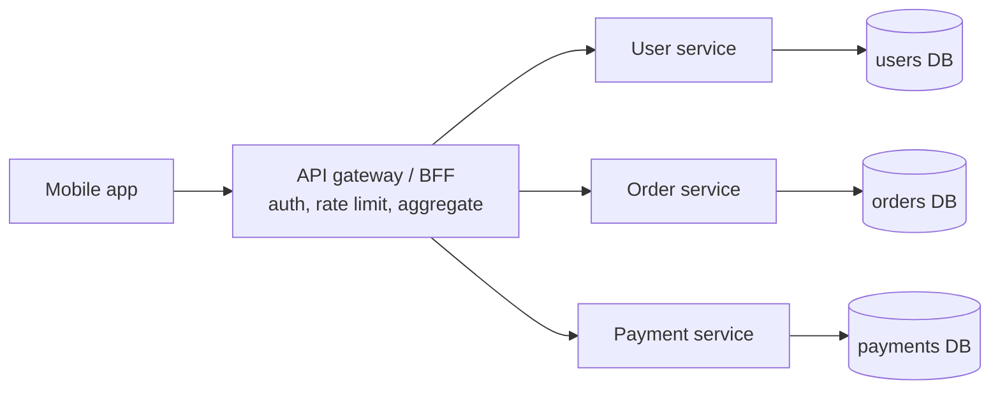
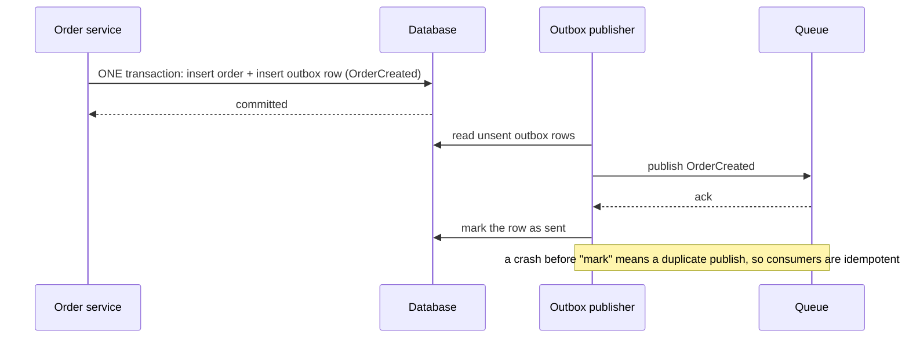
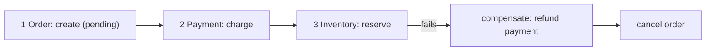
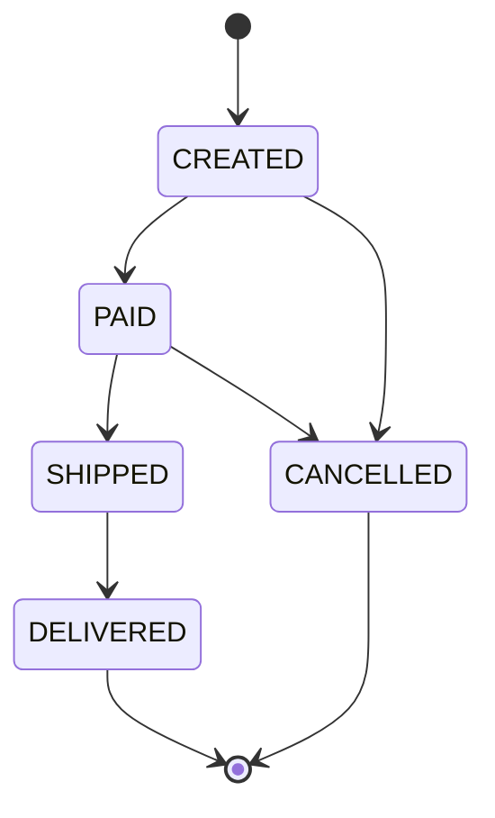

# Service Boundaries & Architecture

> Should the backend be one application or many small services? How do services talk to each other, and how do you keep data correct across them?

Roadmap topic 26 · Stage 6: Architecture & Production

**Go deeper:** `09-architecture` (patterns and structure in depth) · `14` Scaling & Load Balancing (API gateway) · `21` Queues, Events & Background Jobs · `22` Reliable Requests · `25` Overload & Failure Handling · `32` Practice Designs (payment system) · `06-mobile-engineering/06-App-Architecture`.

**Marks:** 🟢 must know · 🟡 good to know

---

#### 1. What Is It?

| | Monolith | Microservices |
|---|---|---|
| Shape | one deployable application | many small services, each owns a feature and its data |
| Good | simple to develop, test and deploy | independent deploys and scaling, team autonomy |
| Bad | grows large; one deploy for everything | network calls, partial failures, hard data consistency, complex operations |

**Advice:** start with a **modular monolith** (clear internal modules). Split into services only when team size, scale or deploy independence really needs it.

| 🟢 Must know | 🟡 Good to know |
|---|---|
| monolith vs microservices | transactional outbox, change data capture (CDC) |
| sync vs async service communication | sagas |
| API gateway, BFF | business states and valid transitions |
| | service discovery, data ownership per service |
| | code structure and low-level design basics (separate prep) |

**Signals in an interview:** "monolith or microservices?", "how do the services talk?", "how do you keep an order and a payment consistent?", "how do you avoid losing an event after a database write?", "what does the mobile app call?"

---

#### 2. How It Works

**Sync vs async communication.** Wait for the answer, or send an event and move on.

| | Synchronous (REST / gRPC) | Asynchronous (events / queue) |
|---|---|---|
| How | call and wait | publish an event and continue |
| Good | simple, immediate answer | decoupled, resilient, absorbs spikes |
| Bad | the caller is blocked; failures chain | harder to trace, eventual consistency |

Use **sync** when the caller needs the answer now (get a price). Use **async** for work that can happen later (send an email, update analytics).

**API gateway and BFF.** The **API gateway** is the single entry point for clients: authentication, rate limiting, routing to services, logging. A **BFF (Backend for Frontend)** is a backend shaped for one client type (the mobile app): it combines calls to several services into one response, so the app makes **fewer requests** and gets exactly the data it needs.



**Each service owns its data.** Other services use its API, not its database; a shared database couples services and makes independent changes impossible. **Service discovery** (DNS or a service registry) is how services find each other's addresses.

🟡 **Transactional outbox and CDC.** The problem: save data to the database and send an event. If one succeeds and the other fails, the system becomes inconsistent.



No event is lost, because the event is saved together with the data. **CDC (change data capture)** reads the database's change log and publishes changes as events: an alternative way to feed the outbox.

🟡 **Sagas.** A multi-service workflow with no single database transaction. Example: place an order.



Each step has a **compensating action** that undoes it. A saga is coordinated by events (*choreography*) or by a central coordinator (*orchestration*). Results are eventually consistent, and every step must be idempotent.

🟡 **Business states and valid transitions.** Model important entities as **state machines** and allow only valid transitions, in code and in the database.



`SHIPPED → CREATED` is not allowed. This makes retries, duplicates and bugs easier to reason about.

🟡 **Code structure and low-level design.** Small modules with clear responsibilities, explicit dependencies and interfaces. Composition over inheritance. Design patterns only when they solve a real problem. Low-level design (class design) is a **separate preparation** from system design.

---

#### 3. Naive vs Better Design

| Situation | Naive | Better |
|---|---|---|
| Starting | 20 microservices on day one | a modular monolith, split on a real need |
| Data | services share one database | each service owns its data; others call its API |
| Calls | long chains of synchronous calls | async events for work that can wait |
| Save + publish | write to the database, then publish (can lose the event) | transactional outbox |
| Cross-service transaction | distributed transaction / "hope" | saga with compensations |
| Order status | a free-text string anyone can change | a state machine with allowed transitions |
| Mobile client | calls 6 services directly | a BFF returns one shaped response |
| Failures | ignore partial failure | timeouts, retries, fallbacks, idempotency |

```kotlin
// Naive: if the publish fails (or the process dies here), the order exists but nobody hears about it
fun placeOrder(order: Order) { db.save(order); queue.publish(OrderCreated(order.id)) }
```

---

#### 4. Code

```kotlin
import kotlinx.coroutines.*

// ---------- outbox: the event is saved in the same transaction as the data ----------
// SQL (one transaction):
//   INSERT INTO orders (...) VALUES (...);
//   INSERT INTO outbox (id, topic, payload) VALUES (:id, 'order.created', :json);
// Publisher loop:
//   SELECT * FROM outbox WHERE sent_at IS NULL ORDER BY id LIMIT 100 FOR UPDATE SKIP LOCKED;
//   ... publish each row ...;  UPDATE outbox SET sent_at = now() WHERE id IN (...);

data class OutboxRow(val id: Long, val payload: String, var sent: Boolean = false)

class Outbox {
    val rows = mutableListOf<OutboxRow>()
    fun publishPending(broker: (OutboxRow) -> Boolean) {         // broker returns true on ack
        for (row in rows.filter { !it.sent }) if (broker(row)) row.sent = true       // marked only after the ack
    }
}

// ---------- saga with compensations ----------
interface Step { val name: String; fun execute(); fun compensate() }

class Saga(private val steps: List<Step>) {
    val log = mutableListOf<String>()
    fun run(): Boolean {
        val done = ArrayDeque<Step>()
        for (step in steps) {
            try { step.execute(); done.addLast(step); log += "ok ${step.name}" }
            catch (e: Exception) {
                log += "fail ${step.name}"
                while (done.isNotEmpty()) { val d = done.removeLast(); d.compensate(); log += "undo ${d.name}" }
                return false
            }
        }
        return true
    }
}

// ---------- a state machine for an order ----------
enum class OrderState { CREATED, PAID, SHIPPED, DELIVERED, CANCELLED }

private val allowed = mapOf(
    OrderState.CREATED to setOf(OrderState.PAID, OrderState.CANCELLED),
    OrderState.PAID to setOf(OrderState.SHIPPED, OrderState.CANCELLED),
    OrderState.SHIPPED to setOf(OrderState.DELIVERED),
    OrderState.DELIVERED to emptySet(),
    OrderState.CANCELLED to emptySet()
)
fun canMove(from: OrderState, to: OrderState) = to in allowed.getValue(from)
// In SQL the guard is part of the update:  UPDATE orders SET status = 'SHIPPED' WHERE id = :id AND status = 'PAID';  → 0 rows = invalid or duplicate

// ---------- BFF: call services in parallel, degrade when an optional one is slow ----------
data class Profile(val name: String)
data class Order(val id: Long)
data class HomeResponse(val profile: Profile, val recentOrders: List<Order>)

class UserService(val profile: suspend (Long) -> Profile)
class OrderService(val recent: suspend (Long) -> List<Order>)

suspend fun homeScreen(userId: Long, users: UserService, orders: OrderService): HomeResponse = coroutineScope {
    val profile = async { withTimeout(300) { users.profile(userId) } }              // required: failure fails the call
    val recent = async {
        runCatching { withTimeout(300) { orders.recent(userId) } }.getOrDefault(emptyList())     // optional: degrade to empty
    }
    HomeResponse(profile.await(), recent.await())                                    // total time is the slowest call, not the sum
}
```

Checks: `Outbox` with a broker that fails the first time: after the first `publishPending` the row is still unsent; after the second it is sent (and a crash between publishing and marking would publish it twice, hence idempotent consumers). A `Saga` of `create order`, `charge`, `reserve` where `reserve` throws gives `log = [ok create order, ok charge, fail reserve, undo charge, undo create order]` and `run()` returns `false`; if all steps succeed it returns `true` and the log has three `ok` lines. `canMove(PAID, SHIPPED)` → `true`; `canMove(SHIPPED, CREATED)` → `false`; `canMove(DELIVERED, CANCELLED)` → `false`. `homeScreen` with an order service that takes 5 s still returns the profile with `recentOrders = []` after about 300 ms; with a profile service that takes 5 s it fails with a timeout.

---

#### 5. Numbers & Capacity

| Question | Rule of thumb |
|---|---|
| When to split | more teams than a monolith's deploy can serve; a hot part needing independent scaling; different release cadence; a clear data boundary |
| Cost of a network call | 0.5 ms inside a data center versus about 100 ns for a method call: roughly 5,000× slower, and it can fail |
| Chained sync calls | availability multiplies: 5 services at 99.9% each give about 99.5% (`0.999⁵`) |
| Latency of a chain | the sum of the calls; parallelise independent calls (the BFF) |
| Outbox publisher | polling every 100 ms to 1 s, or CDC for lower delay |
| Saga steps | keep to 3 to 5; more means more compensations and more failure combinations |

---

#### 6. Common Mistakes & Edge Cases

1. Microservices too early.
2. Services sharing one database.
3. Long chains of synchronous calls.
4. Ignoring failures between services (no timeouts, retries or fallbacks).
5. Publishing events outside the database transaction.
6. No plan for distributed workflows that fail halfway.
7. Distributed monolith: services that must always be deployed together.
8. A saga whose compensation can fail too (make compensations idempotent and retryable).
9. Business states stored as free text with no guarded transitions.

Edge cases: duplicate events (idempotent consumers); out-of-order events (versions or state checks); an event that arrives before the data it refers to is visible; a service that is down during a saga (retry the step, then compensate); changing a service's API (keep it backward compatible, as with mobile clients).

---

#### 7. Say This in the Interview

1. "I'd start with a modular monolith and split a service out only when team size, scaling or deploy independence needs it. Microservices add network failures and data-consistency problems."
2. "Synchronous when the caller needs the answer now, asynchronous events for work that can happen later."
3. "The mobile app talks to an API gateway or a BFF that aggregates calls, so the phone makes fewer requests."
4. "To avoid losing an event after a database write I use a transactional outbox: the event is saved in the same transaction and published separately, with idempotent consumers."
5. "For a multi-service workflow I use a saga with compensating actions, and model orders as a state machine with guarded transitions."
6. "Each service owns its data; others use its API."

---

#### 8. Quick Check

1. Why does a shared database hurt microservices?
2. The order is saved but the event publish fails. How does the outbox help?
3. What does a saga do when step 3 of 3 fails?
4. Five services in a sync chain, each 99.9% available. What is the chain's availability?

<details>
<summary>Answers</summary>

1. It couples the services: one cannot change its schema without breaking the others.
2. The event is written in the same transaction as the order, so it is never lost; the publisher sends it later.
3. It runs the compensating actions for steps 2 and 1 (refund, cancel).
4. About 99.5% (`0.999⁵`).

</details>

---

#### 9. Practice

**Interview questions**

1. When would you split a monolith? What gets harder?
2. REST vs gRPC vs events between services?
3. What is an API gateway?
4. How do you avoid losing an event after a database write?
5. How do you handle a transaction across services?
6. Why should each service own its data?

**Hands-on**

1. Split the Notes API into a modular monolith with `auth`, `notes` and `notifications` modules and no cross-module database access.
2. Add an outbox table and a publisher to the notification flow.
3. Draw the state machine of an order and enforce it with a guarded `UPDATE`.

**LeetCode design problems**

| # | Question | Link to this topic |
|---|---|---|
| 1396 | [Design Underground System](https://leetcode.com/problems/design-underground-system/) (Medium) | modelling entities and events |
| 355 | [Design Twitter](https://leetcode.com/problems/design-twitter/) (Medium) | services around users, posts, feeds |
| 380 | [Insert Delete GetRandom O(1)](https://leetcode.com/problems/insert-delete-getrandom-o1/) (Medium) | a small, clean component |
| 588 | [Design In-Memory File System](https://leetcode.com/problems/design-in-memory-file-system/) (Hard, premium) | class design |

**Remember:** start with a modular monolith, split with a reason · sync when you need the answer now, async for the rest · API gateway / BFF for clients, especially mobile · outbox = no lost events, saga = compensating steps · each service owns its data.
