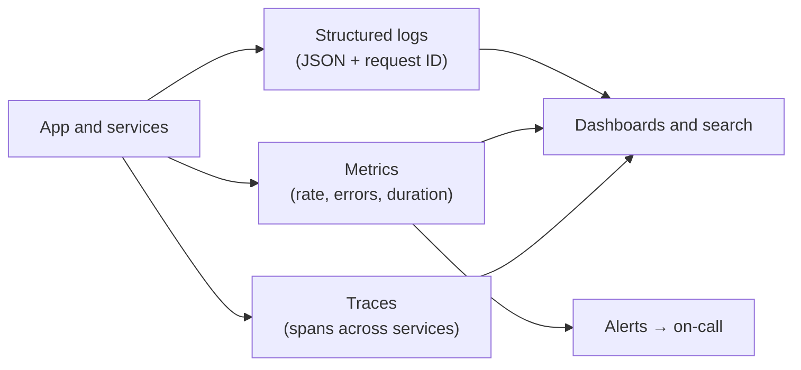
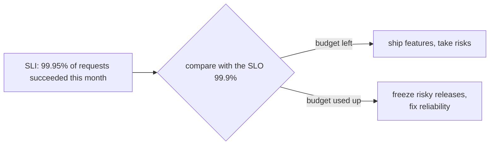
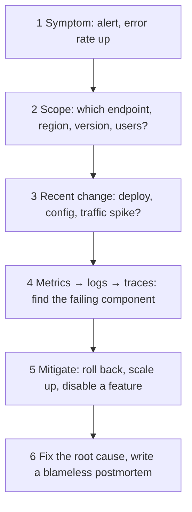

# Observability

> Once your system is live you can't attach a debugger. Logs, metrics and traces tell you what is happening, and alerts tell you when something is wrong.

Roadmap topic 27 · Stage 6: Architecture & Production

**Go deeper:** `10-database/19-Operations-and-Monitoring` · `04-backend-engineering/04-Backend-Building-Blocks` (logging basics) · `04-backend-engineering/07-Testing-and-Debugging` (percentiles, profiling) · `13` Requirements & Estimation (percentiles, availability) · `28` Deployment & Release (watch releases) · `06-mobile-engineering/15-Build-Release-and-Monitoring`.

**Marks:** 🟢 must know · 🟡 good to know

---

#### 1. What Is It?

*Three kinds of data that tell you what the system is doing.*

| | What it is | Answers |
|---|---|---|
| **Logs** | text records of events | "What happened in this request?" |
| **Metrics** | numbers over time (counts, rates, latency) | "Is the system healthy? Is it getting worse?" |
| **Traces** | one request followed across services | "Where did the time go?" |

| 🟢 Must know | 🟡 Good to know |
|---|---|
| logs with request IDs, metrics, tracing | incident debugging, postmortems |
| health and readiness checks | mobile crash reporting |
| actionable alerts | |
| SLI and SLO | |

**Signals in an interview:** "latency doubled at 2 a.m., how do you find the cause?", "how do you know the system is healthy?", "what do you alert on?", "what is an SLO?"

---

#### 2. How It Works



1. **Structured logs** (JSON) with a **request ID** on every line, so you can follow one request through all services.
2. **Never** log passwords, tokens or personal data.
3. Pass the request ID (correlation ID) from service to service, and even from the app.

**What to measure.** The three signals for any service (**RED**):

1. **R**ate: requests per second.
2. **E**rrors: how many fail (4xx / 5xx).
3. **D**uration: latency, using p50, p95, p99.

Also watch CPU, memory, database connections, queue length and cache hit rate. For resources, the **USE** method: utilisation, saturation, errors.

**Health and readiness checks.**

1. **Health (liveness):** is the process alive? If not, restart it.
2. **Readiness:** can it serve traffic now (database connected, cache warm)? If not, the load balancer stops sending requests.
3. Load balancers and orchestrators use these to remove bad servers automatically.

**Actionable alerts.** Alert on **symptoms users feel** (error rate, latency), not on every small metric. Every alert needs a clear **action** (a runbook); too many alerts cause alert fatigue and people ignore them. Use severity: page someone at night only for real user impact.

**SLI, SLO.** A number you track, and the target you promise.

1. **SLI** (indicator): what you measure, such as the percentage of successful requests or p95 latency.
2. **SLO** (objective): the target: "99.9% of requests succeed", "p95 < 300 ms".
3. **SLA**: a contract with customers, with penalties.
4. The gap between 100% and the SLO is your **error budget**. It tells you how much risk you can take with new releases.



🟡 **Incident debugging.** A calm order of steps when production breaks.



**Mitigate first** (stop the pain), investigate after.

🟡 **Mobile crash reporting.** The same job as backend monitoring, but inside the app. Use crash reporting and analytics (Crashlytics or similar). Send the request ID or app version with errors to connect app problems with backend logs. Track app-side latency and error rates by version, because the user's experience includes the network.

---

#### 3. Naive vs Better Design

| Situation | Naive | Better |
|---|---|---|
| Logs | free text, no ID | structured JSON with a request ID |
| Latency | the average | p50 / p95 / p99 |
| Alerts | alert on every metric | alert on user-visible symptoms, each with a runbook |
| Health | none; bad servers stay in rotation | liveness and readiness probes |
| Targets | "make it fast and reliable" | an SLO with an error budget |
| Incident | investigate first | mitigate first (rollback), then investigate |
| Sensitive data | log the request body | mask or omit credentials and personal data |
| Mobile | only backend logs | crash reporting with app version and request ID |

```kotlin
// Naive: no way to tie this line to one request, and it leaks a credential
println("login failed for ${user.email} password=${password}")
```

---

#### 4. Code

```kotlin
import kotlinx.serialization.json.buildJsonObject
import kotlinx.serialization.json.put
import java.util.UUID
import kotlin.math.ceil

// ---------- request ID: keep a sane incoming one, otherwise make a new one ----------
fun requestId(incomingHeader: String?): String =
    incomingHeader?.takeIf { it.matches(Regex("[A-Za-z0-9-]{8,64}")) } ?: UUID.randomUUID().toString()

// ---------- structured log line ----------
fun logJson(level: String, msg: String, requestId: String, fields: Map<String, String> = emptyMap()): String =
    buildJsonObject {
        put("level", level); put("msg", msg); put("requestId", requestId)
        fields.forEach { (k, v) -> put(k, v) }
    }.toString()

// ---------- RED from raw requests ----------
data class Req(val status: Int, val durationMs: Int)

fun percentile(values: List<Int>, p: Double): Int {
    val sorted = values.sorted()
    return sorted[(ceil(p / 100.0 * sorted.size).toInt().coerceIn(1, sorted.size)) - 1]
}

fun ratePerSecond(requests: List<Req>, windowSeconds: Int) = requests.size.toDouble() / windowSeconds
fun errorRate(requests: List<Req>) = requests.count { it.status >= 500 }.toDouble() / requests.size

// ---------- SLO arithmetic ----------
fun errorBudgetMinutes(slo: Double, days: Int) = (1 - slo) * days * 24 * 60
fun allowedFailures(slo: Double, totalRequests: Long) = ((1 - slo) * totalRequests).toLong()
fun burnRate(observedErrorRate: Double, slo: Double) = observedErrorRate / (1 - slo)    // 1.0 = using the budget exactly on schedule
```

Ktor and Micrometer wiring (shape):

```kotlin
install(CallId) { header(HttpHeaders.XRequestId); generate { UUID.randomUUID().toString() }; verify { it.isNotBlank() } }
install(CallLogging) { callIdMdc("requestId") }                      // every log line now carries requestId
install(MicrometerMetrics) { registry = PrometheusMeterRegistry(PrometheusConfig.DEFAULT) }

get("/health") { call.respondText("ok") }                            // liveness
get("/ready")  { if (db.ping() && cache.ping()) call.respondText("ready") else call.respond(HttpStatusCode.ServiceUnavailable) }
```

A symptom-based alert (Prometheus):

```yaml
- alert: HighErrorRate
  expr: sum(rate(http_server_requests_seconds_count{status=~"5.."}[5m])) / sum(rate(http_server_requests_seconds_count[5m])) > 0.02
  for: 5m
  labels: { severity: page }
  annotations: { summary: "5xx rate above 2% for 5 minutes", runbook: "https://wiki.example.com/runbooks/high-5xx" }
```

On the phone, tie crashes to the backend:

```kotlin
FirebaseCrashlytics.getInstance().setCustomKey("lastRequestId", requestId)
```

Checks: `requestId("abc12345-def")` returns it unchanged; `requestId(null)` and `requestId("bad id!")` return a fresh UUID. `logJson("INFO", "created note", "r-1", mapOf("noteId" to "7"))` → `{"level":"INFO","msg":"created note","requestId":"r-1","noteId":"7"}`. For 100 requests in 10 s with durations 94 × 100 ms, 5 × 400 ms and 1 × 2000 ms: `ratePerSecond` → `10.0`; `percentile(durations, 50.0)` → `100`; `95.0` → `400`; `99.0` → `400`; the single slow request only shows up at p100. With 5 of the 100 requests answered `500`, `errorRate` → `0.05`. `errorBudgetMinutes(0.999, 30)` → `43.2`; `(0.9999, 30)` → `4.32`. `allowedFailures(0.999, 10_000_000)` → `10000`. `burnRate(0.01, 0.999)` → `10.0` (the 30-day budget would be gone in 3 days).

---

#### 5. Numbers & Capacity

| Item | Rule of thumb |
|---|---|
| 99.9% over 30 days | 43.2 minutes of error budget |
| 99.99% over 30 days | 4.3 minutes |
| Alert on burn rate | page when the burn rate is above 10 for 5 to 10 minutes (the budget would vanish in days) |
| Log volume | 1 KB per request × 1,000 requests/s ≈ 86 GB per day: sample debug logs, keep errors |
| Metrics cardinality | one label with millions of values (user ID) explodes storage; use bounded labels (endpoint, status) |
| Trace sampling | keep 1 to 10% of traces, plus every error and slow request |
| Retention | high-resolution metrics for days, aggregated for months |

---

#### 6. Common Mistakes & Edge Cases

1. No request ID in logs.
2. Only average latency, no percentiles.
3. Too many alerts, or alerts nobody can act on.
4. Logging sensitive data.
5. No health checks, so bad servers stay in rotation.
6. Debugging before mitigating during an outage.
7. User IDs or URLs with IDs as metric labels (high cardinality).
8. A readiness check that depends on an optional service, so a small failure takes every server out of rotation.
9. Alerting on causes (CPU 80%) instead of symptoms (errors, latency).

Edge cases: clock skew breaking trace ordering; logs lost when a container dies (ship them off the host); a deploy that changes metric names and silently breaks alerts; a "healthy" service returning wrong data (add business metrics such as orders per minute).

---

#### 7. Say This in the Interview

1. "Logs tell me what happened in a request, metrics tell me whether the system is healthy over time, and traces show where the time went across services. Every log line carries a request ID."
2. "For each service I watch rate, errors and duration, using p95 and p99, not the average."
3. "I'd alert on what users feel, such as error rate and latency, and every alert has a runbook. Liveness and readiness probes take bad servers out of rotation."
4. "An SLO of 99.9% gives an error budget of about 43 minutes a month; when it is used up, we slow risky releases."
5. "In an incident I check scope, then the recent change, then metrics, logs and traces; I mitigate first by rolling back, and write a blameless postmortem."

---

#### 8. Quick Check

1. Metrics, logs or traces: "which service in the chain is slow"?
2. What is the error budget for a 99.9% SLO over 30 days?
3. Why not use `userId` as a metric label?
4. An alert fires at 3 a.m. What do you do first?

<details>
<summary>Answers</summary>

1. Traces.
2. About 43 minutes.
3. Too many distinct values (high cardinality) blow up metric storage; use logs or traces for per-user detail.
4. Scope the impact and check for a recent change, then mitigate (roll back or disable the feature) before investigating the root cause.

</details>

---

#### 9. Practice

**Interview questions**

1. Latency doubled at 2 a.m. How do you find the cause?
2. Logs vs metrics vs traces?
3. What is a request ID, and why use one?
4. What are SLI and SLO?
5. What makes a good alert?

**Hands-on**

1. Add request IDs to your Notes API logs (header in, MDC, JSON out) and follow one request through them.
2. Expose Prometheus metrics, build one dashboard (rate, error rate, p95), and add the alert above.
3. Add Crashlytics to your Android app and send the app version with each backend call.

**LeetCode design problems**

| # | Question | Link to this topic |
|---|---|---|
| 362 | [Design Hit Counter](https://leetcode.com/problems/design-hit-counter/) (Medium, premium) | request counting |
| 933 | [Number of Recent Calls](https://leetcode.com/problems/number-of-recent-calls/) (Easy) | rate in a window |
| 295 | [Find Median from Data Stream](https://leetcode.com/problems/find-median-from-data-stream/) (Hard) | streaming percentiles |
| 1396 | [Design Underground System](https://leetcode.com/problems/design-underground-system/) (Medium) | averages over events |

**Remember:** logs, metrics and traces, tied together with a request ID · RED: rate, errors, duration (use percentiles) · liveness vs readiness checks · SLI = the measurement, SLO = the target · alert on user impact · mitigate first, find the root cause after.
