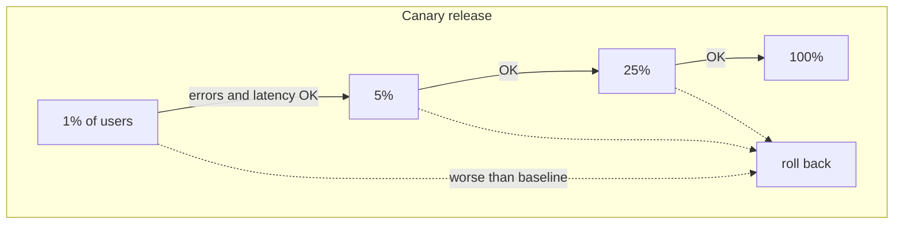
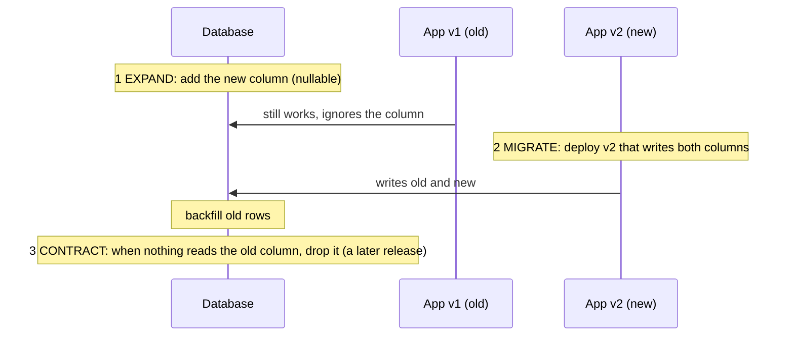

# Deployment & Release

> Getting new code to production safely. Automate build and tests, release to a few users first, and always be able to roll back. Old app versions must keep working.

Roadmap topic 28 · Stage 6: Architecture & Production

**Go deeper:** `27` Observability (watch releases) · `29` Backup, Recovery, Security & Cost · `30` Mobile-Specific Topics (old app versions, force-update) · `04-backend-engineering/03-API-Design` (backward compatibility) · `10-database/10-Schema-Migrations-and-Evolution` · `06-mobile-engineering/15-Build-Release-and-Monitoring`.

**Marks:** 🟢 must know · 🟡 good to know

---

#### 1. What Is It?

*Every change is built, tested and deployed by a pipeline.*

1. **CI (continuous integration):** on every change, automatically **build and test**. Bad code is caught early.
2. **CD (continuous delivery / deployment):** automatically deliver passing builds to staging and production.
3. Separate **environments**: development, staging (a production copy for testing), production.

```text
commit → build → tests → deploy to staging → checks → deploy to production
```

| 🟢 Must know | 🟡 Good to know |
|---|---|
| CI/CD | Docker basics |
| rolling, blue-green and canary releases; rollback | feature flags, force-update |
| backward compatibility, safe database migrations | graceful shutdown |

**Signals in an interview:** "how do you deploy without downtime?", "how do you roll back?", "a breaking database change", "how do old app versions affect a release?"

---

#### 2. How It Works

**Safe release strategies.**

| Strategy | How | Good | Bad |
|---|---|---|---|
| **Rolling** | replace servers a few at a time | no downtime, simple | old and new versions run together for a while |
| **Blue-green** | two full environments; switch traffic from blue (old) to green (new) | instant switch and rollback | needs double the resources |
| **Canary** | send 1 to 5% of traffic to the new version first, then increase | problems are caught with small impact | more setup and monitoring |



Always have a **rollback plan** (redeploy the previous version quickly) and watch error rate and latency right after a release. **Mobile view:** app releases use the same ideas: staged rollout on Google Play, phased release on the App Store, and feature flags to switch a feature off without a new build.

**Backward compatibility and safe migrations.** During a rollout, **old and new server versions run together**, and **old app versions** still call your API. Never break the contract (topic 3 in `04-backend-engineering`). For database changes use **expand → migrate → contract**:



Never make a change that the **previous** code version can't work with, or you can't roll back.

🟡 **Docker basics.** An **image** is a packaged app with everything it needs; a **container** is a running image. The same package runs the same way on a laptop, staging and production. Know ports (which port the app listens on), volumes (data outside the container) and environment variables (config). Kubernetes (a system that runs many containers) is only a name at this level.

🟡 **Feature flags, force-update.** A **feature flag** turns a feature on or off without deploying; roll it out to a percentage of users or switch it off fast if it breaks. A **staged rollout / A/B test** releases to a few users and compares results. A **force-update** makes very old app versions update when the API can no longer support them.

🟡 **Graceful shutdown.** When a server is stopped during a deploy, finish the requests in progress instead of cutting them: stop accepting new requests, wait for current ones to finish (with a time limit), close connections, then exit.

---

#### 3. Naive vs Better Design

| Situation | Naive | Better |
|---|---|---|
| Deploying | manual, copy files by hand | a pipeline: build, test, deploy |
| Release | 100% at once | canary or rolling |
| Failure | fix forward under pressure | rollback in minutes |
| Database | rename a column in one step | expand → migrate → contract |
| API | remove a field | add only, keep old fields until old apps are gone |
| Feature risk | a new build to disable it | feature flag |
| Stopping servers | kill -9 | graceful shutdown with a drain period |
| Environments | test on production | development, staging, production |

```sql
-- Naive: the old code (still running during the rollout) breaks the moment this runs
ALTER TABLE users RENAME COLUMN email TO contact_email;
```

---

#### 4. Code

CI pipeline (GitHub Actions) and Docker image:

```yaml
name: ci
on: [push, pull_request]
jobs:
  build:
    runs-on: ubuntu-latest
    steps:
      - uses: actions/checkout@v4
      - uses: actions/setup-java@v4
        with: { distribution: temurin, java-version: 17 }
      - run: ./gradlew test
      - run: docker build -t notes-api:${{ github.sha }} .
```

```dockerfile
FROM gradle:8-jdk17 AS build
WORKDIR /app
COPY . .
RUN gradle installDist --no-daemon

FROM eclipse-temurin:17-jre
WORKDIR /app
COPY --from=build /app/build/install/notes-api /app
ENV PORT=8080
EXPOSE 8080
CMD ["bin/notes-api"]
```

Expand → migrate → contract, in three releases:

```sql
-- Release 1 (EXPAND): add the new column; old code ignores it
ALTER TABLE users ADD COLUMN contact_email TEXT;
-- Release 2 (MIGRATE): the app writes both; backfill old rows in batches
UPDATE users SET contact_email = email WHERE contact_email IS NULL AND id BETWEEN 1 AND 10000;
-- Release 3 (CONTRACT): once nothing reads `email`, drop it
ALTER TABLE users DROP COLUMN email;
```

Kotlin helpers: sticky percentage rollout, release gate, force-update check, graceful shutdown.

```kotlin
// A stable bucket 0..99 per user and feature: the same user always gets the same answer
fun bucket(userId: Long, feature: String) = Math.floorMod((feature + userId).hashCode(), 100)
fun isEnabled(userId: Long, feature: String, percent: Int) = bucket(userId, feature) < percent

// Promote the canary only if it is not clearly worse than the current version
fun canPromote(canaryErrorRate: Double, baselineErrorRate: Double, tolerance: Double = 1.5, minRequests: Int, canaryRequests: Int) =
    canaryRequests >= minRequests && canaryErrorRate <= baselineErrorRate * tolerance + 0.001

// Force-update: the API answers 426 for app versions that are no longer supported
fun needsForceUpdate(appVersionCode: Int, minSupported: Int) = appVersionCode < minSupported

// How many users are exposed to a bad release at each stage?
fun blastRadius(totalUsers: Long, percent: Int) = totalUsers * percent / 100
```

```kotlin
// Graceful shutdown (Ktor): stop taking new requests, give in-flight ones time to finish
val server = embeddedServer(Netty, port = 8080, module = Application::module)
Runtime.getRuntime().addShutdownHook(Thread { server.stop(gracePeriodMillis = 5_000, timeoutMillis = 15_000) })
server.start(wait = true)
```

Checks: `isEnabled(42, "new-feed", 10)` returns the same answer on every call. Over 100,000 user IDs, `isEnabled(id, "new-feed", 10)` is `true` for about 10% (between 9% and 11%). `canPromote(0.004, 0.003, minRequests = 1000, canaryRequests = 5000)` → `true`; with a canary error rate of `0.02` → `false`; with only `200` canary requests → `false` (not enough data). `needsForceUpdate(120, 150)` → `true`. `blastRadius(10_000_000, 1)` → `100000`; at 5% → `500000`. Expand: after release 1, old code (which never mentions `contact_email`) still works; this is why rollback is safe.

---

#### 5. Numbers & Capacity

| Item | Rule of thumb |
|---|---|
| Canary stages | 1% → 5% → 25% → 50% → 100%, waiting 10 to 60 minutes (or enough requests) between stages |
| Rollback time | a good pipeline redeploys the previous version in minutes |
| Rolling update | replace 1 or a small percentage of servers at a time; keep capacity above peak |
| Blue-green | 2 × resources during the switch |
| Drain period | longer than your slowest normal request (for example 30 s) |
| Migration backfill | batches of thousands of rows, throttled, so replicas and locks aren't overwhelmed |
| Mobile staged rollout | Play Console: 1% → 100%; App Store: 7-day phased release |

---

#### 6. Common Mistakes & Edge Cases

1. Manual, untested deployments.
2. Database changes that break the previous version.
3. No rollback plan.
4. Releasing to 100% at once.
5. Removing a field or endpoint that old apps still use.
6. Killing servers without a graceful shutdown.
7. A migration that locks a huge table (add columns without defaults that rewrite the table, build indexes concurrently).
8. Releasing the app and the backend change that it depends on in the wrong order (backend first, always).
9. Feature flags that are never cleaned up.

Edge cases: a rollback after the new code has already written data in a new format; long-running requests during a deploy; two migrations running at once; a canary that gets only low-value traffic (so errors are not representative); a flag service outage (default to a safe value).

---

#### 7. Say This in the Interview

1. "A pipeline builds and tests every change, deploys to staging, and then to production."
2. "I'd release as a canary: 1% of traffic first, watch error rate and latency, then increase. If it is worse than the baseline I roll back by redeploying the previous version."
3. "For a breaking database change I expand, migrate, contract: add the column, deploy code that writes both and backfill, then remove the old column in a later release. Each step is compatible with the previous code, so rollback always works."
4. "Old app versions keep calling the API for years, so I only add fields, version if needed, and use a force-update as a last resort."
5. "Feature flags let me switch a feature off without a deploy, and servers shut down gracefully so in-flight requests finish."

---

#### 8. Quick Check

1. Why must a database change work with the *previous* code version?
2. Rolling vs blue-green vs canary: which needs double resources?
3. How does a feature flag give a stable 10% rollout?
4. What is the first release in a column rename?

<details>
<summary>Answers</summary>

1. During a rollout both versions run together, and a rollback means the old code runs again on the new schema.
2. Blue-green.
3. Hash the user ID (and the feature name) into a bucket 0 to 99 and enable the feature when the bucket is below 10.
4. Expand: add the new nullable column, leaving the old one in place.

</details>

---

#### 9. Practice

**Interview questions**

1. How do you deploy a breaking database change without downtime?
2. Rolling vs blue-green vs canary?
3. How do you roll back?
4. How do old app versions affect a release?
5. What is a feature flag?

**Hands-on**

1. Set up the CI workflow above for your Notes API and make it fail on a broken test.
2. Containerise the API and run it locally with `docker run -e DATABASE_URL=... -p 8080:8080`.
3. Rename a column using the three-release plan on a local database while a script keeps calling the API.

**LeetCode design problems**

| # | Question | Link to this topic |
|---|---|---|
| 1146 | [Snapshot Array](https://leetcode.com/problems/snapshot-array/) (Medium) | versions you can return to |
| 1472 | [Design Browser History](https://leetcode.com/problems/design-browser-history/) (Medium) | moving back and forward between states |
| 981 | [Time Based Key-Value Store](https://leetcode.com/problems/time-based-key-value-store/) (Medium) | values by version |

**Remember:** CI builds and tests, CD deploys · canary / blue-green / rolling plus a rollback plan · expand → migrate → contract for database changes · backward compatible for old servers and old apps · feature flags for safe rollouts.
