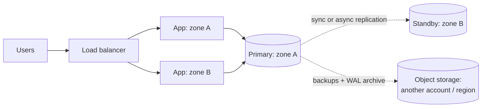

# Backup, Recovery, Security & Cost

> Plan for the day something goes badly wrong. Have backups you have tested, know how much data and time you can afford to lose, protect the data, and keep an eye on cost.

Roadmap topic 29 · Stage 6: Architecture & Production

**Go deeper:** `10-database/17-Backup-Recovery-and-Data-Migration` · `10-database/18-Database-Security-and-Privacy` · `18` Replication (not a backup) · `27` Observability · `28` Deployment & Release · `33` Follow-Up Topics (multi-region) · `04-backend-engineering/06-Backend-Security-Essentials`.

**Marks:** 🟢 must know · 🟡 good to know

---

#### 1. What Is It?

*A backup only counts if you can restore it.*

| 🟢 Must know | 🟡 Good to know |
|---|---|
| backups and tested restores | multi-AZ vs multi-region |
| RPO and RTO | encryption, least privilege, secrets manager |
| | compute, storage and bandwidth costs |

1. Take **regular backups** of the database and important files, and store them **separately** (another location or account).
2. **Test restoring.** A backup you have never restored is only a guess.
3. **Point-in-time recovery (PITR):** restore the database to a specific moment (just before a bad deploy).
4. Replication is not a backup (topic 18).
5. Rule of thumb: **3 copies, 2 kinds of storage, 1 off-site.**

**Signals in an interview:** "what are your RPO and RTO?", "what if a developer drops the table?", "what if a region goes down?", "how do you keep cost down?"

---

#### 2. How It Works

**RPO and RTO.** Two numbers that drive every recovery plan.


1. **RPO (recovery point objective):** how much **data** you can afford to lose (for example 5 minutes).
2. **RTO (recovery time objective):** how long you can be **down** (for example 1 hour).
3. Smaller RPO and RTO cost more (more frequent backups, standby systems).
4. Ask the business what is acceptable, then design for it.

| Approach | RPO | RTO |
|---|---|---|
| Nightly full backup | up to 24 hours | hours (restore time) |
| Backups + WAL archiving (PITR) | minutes | hours |
| Async replica, manual failover | seconds to minutes (the lag) | minutes to an hour |
| Sync replica + automatic failover | about 0 | seconds to a couple of minutes |
| Active–active multi-region | about 0 | about 0 (with the hardest consistency) |

🟡 **Multi-AZ vs multi-region.** Survive one data center failing, or a whole region.

| | Multi-AZ | Multi-region |
|---|---|---|
| Protects from | one data center failing | a whole region failing |
| Complexity | low (often built in) | high (data sync, latency, cost) |
| Use | standard for production | only when the requirements justify it |

Multi-region options: **active–passive** (a standby region takes over) or **active–active** (both serve traffic; harder data consistency).



🟡 **Security basics for production.**

1. **Encryption** in transit (HTTPS/TLS) and at rest (disks, backups).
2. **Least privilege:** each service and person gets only the access they need.
3. **Secrets manager** for keys and passwords. Rotate them.
4. **Audit logs:** who did what.
5. Personal data: collect the minimum, allow deletion.

🟡 **Cost trade-offs.** Every design choice has a price; mention it.

1. **Compute:** right-size servers, use auto-scaling, don't overprovision.
2. **Storage:** set retention rules and move old data to cheaper storage.
3. **Bandwidth:** data leaving the cloud costs money; a **CDN** reduces origin traffic.
4. A cache is often cheaper than a bigger database.

---

#### 3. Naive vs Better Design

| Situation | Naive | Better |
|---|---|---|
| Backups | on the same server or disk | separate account / region, encrypted |
| Restore | never tried | scheduled restore tests with a timer |
| Targets | "we back up sometimes" | agreed RPO and RTO per system |
| Bad `DELETE` | restore last night's backup | point-in-time recovery to just before |
| Replicas | counted as backups | replicas **and** backups |
| Regions | multi-region without a requirement | multi-AZ by default |
| Access | everyone is admin | least privilege, audit logs |
| Cost | discovered on the bill | estimated up front (storage, egress), CDN and retention |

```bash
# Naive: a backup that lives next to the data and has never been restored
pg_dump notes > /var/lib/postgresql/backup.sql
```

---

#### 4. Code

PostgreSQL backups and point-in-time recovery:

```bash
# Logical backup, copied away from the server
pg_dump --format=custom --file=notes-$(date +%F).dump notes
aws s3 cp notes-$(date +%F).dump s3://my-backups-other-account/notes/ --sse AES256

# postgresql.conf: ship the write-ahead log continuously (this is what makes PITR possible)
#   archive_mode = on
#   archive_command = 'aws s3 cp %p s3://my-backups-other-account/wal/%f'
#   archive_timeout = 300          # at least every 5 minutes → RPO of about 5 minutes

# Restore: base backup + replay the log to a chosen moment (recovery settings)
#   restore_command = 'aws s3 cp s3://my-backups-other-account/wal/%f %p'
#   recovery_target_time = '2025-01-10 09:29:00+00'
```

A restore drill, scripted so that it runs every week:

```bash
createdb notes_restore_test
pg_restore --dbname=notes_restore_test notes-latest.dump
psql notes_restore_test -c "SELECT count(*) FROM notes;"      # compare with production's expected size
dropdb notes_restore_test
```

Least privilege in an IAM-style policy (the app can write backups but not read or delete other data):

```json
{ "Version": "2012-10-17",
  "Statement": [ { "Effect": "Allow", "Action": ["s3:PutObject"], "Resource": "arn:aws:s3:::my-backups-other-account/notes/*" } ] }
```

The arithmetic you should be able to do on a whiteboard:

```kotlin
const val MB_PER_GB = 1000.0

fun restoreMinutes(sizeGb: Double, mbPerSecond: Double) = sizeGb * MB_PER_GB / mbPerSecond / 60

fun rpoWithinTarget(backupOrWalIntervalMinutes: Int, rpoMinutes: Int) = backupOrWalIntervalMinutes <= rpoMinutes

fun backupStorageGb(fullGb: Double, dailyChangeGb: Double, retentionDays: Int) = fullGb + dailyChangeGb * retentionDays

fun meets321(copies: Int, mediaTypes: Int, offsiteCopies: Int) = copies >= 3 && mediaTypes >= 2 && offsiteCopies >= 1

// Example prices only. Look up the real ones.
fun egressCost(gbPerMonth: Double, pricePerGb: Double = 0.09, cdnHitRatio: Double = 0.0) = gbPerMonth * (1 - cdnHitRatio) * pricePerGb
```

Checks: `restoreMinutes(1000.0, 200.0)` → `83.3` (a 1 TB database restores in about 83 minutes at 200 MB/s, so an RTO of 15 minutes needs a standby, not a restore). `rpoWithinTarget(5, 15)` → `true`; `(1440, 15)` → `false` (nightly backups cannot meet a 15-minute RPO). `backupStorageGb(500.0, 20.0, 30)` → `1100.0`. `meets321(3, 2, 1)` → `true`; `(2, 1, 0)` → `false`. `egressCost(100_000.0)` → `9000.0` per month; `egressCost(100_000.0, cdnHitRatio = 0.95)` → `450.0`.

---

#### 5. Numbers & Capacity

| Item | Rule of thumb |
|---|---|
| Restore speed | 100 to 500 MB/s from object storage into a fast disk; 1 TB takes 30 to 170 minutes |
| WAL archive interval | 1 to 5 minutes gives an RPO of minutes |
| Retention | daily for 7 to 30 days, weekly for 3 months, monthly for a year (as the business needs) |
| Restore test | at least monthly; after every major schema change |
| Multi-AZ availability | roughly 99.95% to 99.99% for a managed database |
| Egress | cents per GB; 100 TB a month is thousands of dollars without a CDN |
| Where cost hides | cross-region traffic, NAT gateways, idle replicas, unbounded logs, old snapshots |

---

#### 6. Common Mistakes & Edge Cases

1. Never testing a restore.
2. Backups stored next to the original data (or in the same account that an attacker or an accident can wipe).
3. No agreed RPO or RTO.
4. Over-engineering multi-region with no requirement.
5. Ignoring bandwidth costs.
6. Broad access permissions for everyone.
7. Encrypting backups but losing the key.
8. Backing up the database but not the object storage and configuration.
9. Counting replication as backup.

Edge cases: a bad migration discovered three days later (PITR is not enough if the retention is two days); ransomware or an insider deleting backups (immutable, versioned storage with a separate account); a restore that works but the application can't run on it (restore the whole flow in the drill); GDPR deletion requests versus old backups (document the retention).

---

#### 7. Say This in the Interview

1. "I'd state numbers: for example RPO of 5 minutes and RTO of one hour, then design to meet them: continuous WAL archiving for point-in-time recovery, a replica with failover, and a tested restore."
2. "A replica is not a backup, because a bad delete replicates. Backups go to a separate account and I restore them regularly in a test environment."
3. "Multi-AZ is the normal baseline. I'd add multi-region, active–passive first, only if the availability requirement justifies the complexity and cost."
4. "Encryption in transit and at rest, least-privilege access, secrets in a secrets manager and audit logs."
5. "I'd mention cost when choosing: right-size compute, use a CDN and caching to cut egress, and set retention rules."

---

#### 8. Quick Check

1. A 1 TB restore runs at 200 MB/s. Can you meet an RTO of 15 minutes by restoring?
2. What makes point-in-time recovery possible?
3. What does 3-2-1 mean?
4. Why is multi-region not the default?

<details>
<summary>Answers</summary>

1. No: it takes about 83 minutes. You need a standby that is already running.
2. A base backup plus a continuous archive of the write-ahead log, replayed up to the chosen moment.
3. Three copies, on two kinds of storage, with one off-site.
4. It adds data-sync complexity, latency and cost, and most systems don't need it.

</details>

---

#### 9. Practice

**Interview questions**

1. What are your RPO and RTO for this system, and how do you meet them?
2. Is replication a backup?
3. How do you protect against a data center or region failure?
4. How do you know your backups work?
5. How do you reduce cost?

**Hands-on**

1. Back up your Notes API database, restore it into a new database, and time it.
2. Delete a row, then practise a point-in-time restore on a local PostgreSQL with WAL archiving.
3. Estimate the monthly storage and egress cost of 1M photos a day (topic 16).

**LeetCode design problems**

| # | Question | Link to this topic |
|---|---|---|
| 1146 | [Snapshot Array](https://leetcode.com/problems/snapshot-array/) (Medium) | snapshots you can return to |
| 981 | [Time Based Key-Value Store](https://leetcode.com/problems/time-based-key-value-store/) (Medium) | state at a point in time |
| 588 | [Design In-Memory File System](https://leetcode.com/problems/design-in-memory-file-system/) (Hard, premium) | state to back up and restore |

**Remember:** backups plus tested restores · RPO = data you can lose, RTO = time you can be down · multi-AZ is normal, multi-region only when needed · least privilege, encryption, secrets manager · mention cost when you compare options.
