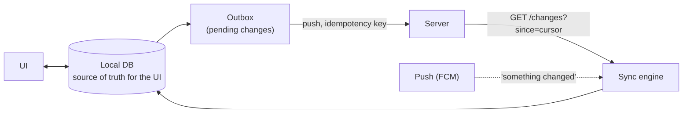
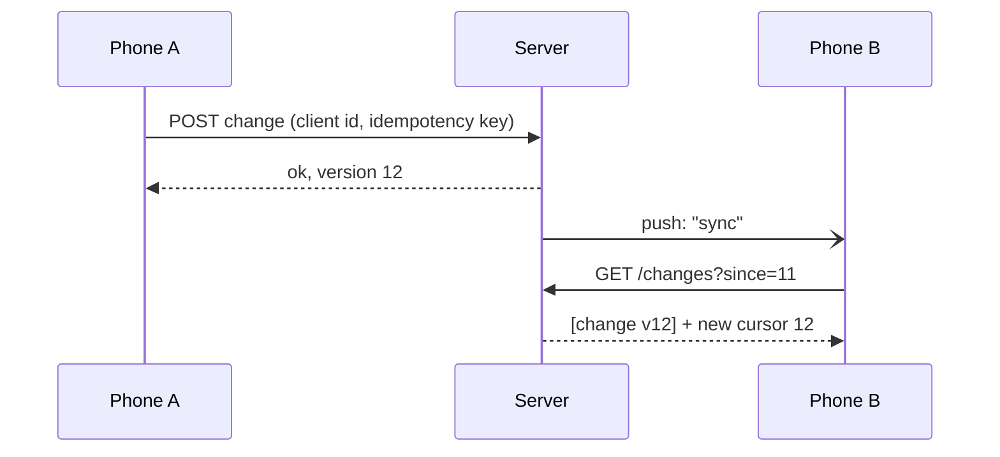

# Mobile-Specific Topics

> Your users are on phones: unreliable networks, limited battery and data, and old app versions that never go away. This is where a mobile engineer stands out in a system design interview.

Roadmap topic 30 · Stage 7: Mobile (New topic)

**Go deeper:** `06-mobile-engineering` (client architecture, Room, WorkManager) · `04-backend-engineering/03-API-Design` (compatibility, pagination) · `04-backend-engineering/05-Authentication-and-Authorization` (token refresh) · `16` File Storage & CDN · `20` Unique IDs · `22` Reliable Requests · `23` Consistency & CAP · `24` Real-Time & Push.

**Marks:** 🟢 must know · 🟡 good to know

---

#### 1. What Is It?

*Design as if the network will fail, because it will.*

| 🟢 Must know | 🟡 Good to know |
|---|---|
| flaky networks: timeouts, retries, cached data first | battery and data saving |
| old app versions and backward compatibility | adaptive video streaming |
| offline-first and sync (outbox, delta sync, conflicts) | certificate pinning and app attestation |
| infinite scroll and image loading | |
| push and token refresh | |

1. **Flaky network:** set timeouts, retry safe requests with backoff and jitter, show cached data first.
2. **Old app versions:** users don't update, so the API only grows (add, never remove).
3. **Offline-first:** the app reads and writes a **local database**; a sync engine talks to the server.
4. **Feeds:** cursor pagination, prefetch, and CDN images in the right size.
5. **Tokens:** when many requests fail with `401`, refresh **once**.

**Signals in an interview:** "design a notes/chat/feed app", "works offline", "syncs across devices", "old versions", "poor network", "battery".

---

#### 2. How It Works

**Offline-first.** The UI only ever talks to the local database.



1. The user edits a note: write to the local DB and add an entry to the **outbox**. The UI updates at once.
2. When the network is available, send the outbox. Use **client-generated IDs** and **idempotency keys**, so a retry never creates a duplicate.
3. Then **pull** only what changed: `GET /changes?since=<cursor>`. Include **deletions** as tombstones.
4. **Conflict** (same item edited on two devices): last-write-wins, merge fields, or ask the user.
5. A push message only says "sync now"; the sync engine fetches the data.



**Flaky networks.**

1. A **timeout** on every call (connect, read, overall). Never wait forever.
2. Retry **only safe or idempotent** requests, with backoff and jitter (topic 22).
3. Show **cached data first**, then refresh. Show clear loading, error and retry states.
4. Decide what works offline and say so (read yes, edit yes, search maybe not).

**Old app versions.**

1. Old versions stay in use for years, and they keep calling your backend.
2. **Add fields; never remove or rename.** The app **ignores unknown fields**.
3. Version the API (`/v2`) only when a break is unavoidable. Keep `/v1` alive until usage drops.
4. A **force-update** screen for versions you can't support (topic 28). **Feature flags** switch features from the server.

**Infinite scroll and images.**

1. **Cursor pagination** (not page numbers, which skip or repeat items when data changes). Prefetch the next page before the end.
2. Serve images from a **CDN** in the right size: a thumbnail in lists, the full image on the detail screen.
3. Cache images in memory and on disk. Show placeholders and load lazily.

**Push and token refresh.**

1. Push (FCM/APNs) reaches closed apps. It is best effort (topic 24), so send a small payload and let the app fetch details.
2. When the access token expires (`401`), refresh **once**, retry the request, and make parallel requests wait for that one refresh.

🟡 **Battery and data.**

1. **Batch** requests; avoid constant polling.
2. **Compress** responses (`gzip`) and send only needed fields.
3. Use **delta sync** and conditional requests (`ETag` → `304 Not Modified`).
4. Respect OS **background limits**; schedule work with WorkManager.

🟡 **Adaptive video.** Video is cut into small segments in several qualities (HLS or DASH). The player picks the quality that the current speed allows, and segments come from a CDN.

🟡 **Pinning and attestation.** Certificate pinning makes the app trust only your server's certificate (plan rotation carefully). App attestation (Play Integrity on Android, App Attest on iOS) shows that the request comes from your genuine app. Never ship secrets inside the app.

---

#### 3. Naive vs Better Design

| Situation | Naive | Better |
|---|---|---|
| Network | assume it works | timeouts, retries with backoff, cached data first |
| Edit | send to server, wait, then update UI | write local first, sync from an outbox |
| Retry | repeat a `POST` blindly (duplicates) | client ID + idempotency key |
| Refresh data | download everything each time | delta sync with a cursor and tombstones |
| Same item edited twice | the last request to arrive wins silently | explicit rule: LWW, merge or ask |
| API change | rename a field | add a new field, keep the old one |
| Feed | page numbers; full-size images | cursor, prefetch, CDN thumbnails |
| Token expiry | each request refreshes the token | one refresh, the others wait |
| Updates | poll every few seconds | push "sync now", then pull |

```kotlin
// Naive: waits on the network and loses the edit if it fails
suspend fun saveNote(text: String) {
    api.post(text)          // offline → exception, text lost
    reloadAllNotes()        // downloads everything
}
```

---

#### 4. Code

**Room: the local database is the source of truth** (Android):

```kotlin
@Entity
data class NoteEntity(
    @PrimaryKey val id: String,      // generated on the device (UUID)
    val text: String,
    val updatedAt: Long,
    val deleted: Boolean = false,    // tombstone: hidden from the UI, kept until synced
    val dirty: Boolean = false       // true = not yet sent to the server (the outbox)
)

@Dao
interface NoteDao {
    @Query("SELECT * FROM NoteEntity WHERE deleted = 0 ORDER BY updatedAt DESC")
    fun observe(): Flow<List<NoteEntity>>                    // the UI watches this

    @Query("SELECT * FROM NoteEntity WHERE dirty = 1")
    suspend fun pending(): List<NoteEntity>                  // the outbox

    @Upsert suspend fun save(note: NoteEntity)
}
```

**The server side of delta sync** (every change gets an increasing `version`; deletes are rows with `deleted = 1`):

```sql
SELECT id, body, updated_at, deleted, version
FROM notes
WHERE version > :cursor
ORDER BY version
LIMIT 100;            -- the client stores the largest version it received as its next cursor
```

**Applying server changes with a conflict rule** (pure Kotlin, easy to test):

```kotlin
data class Note(val id: String, val text: String, val updatedAt: Long, val deleted: Boolean = false)
data class ServerChange(val note: Note, val version: Long)

fun resolve(mine: Note, server: Note): Note =
    if (server.updatedAt >= mine.updatedAt) server else mine      // last write wins

fun applyChanges(
    local: MutableMap<String, Note>,
    pending: MutableMap<String, Note>,          // the outbox: edits not yet sent
    changes: List<ServerChange>,
    cursor: Long
): Long {
    var next = cursor
    for (c in changes.sortedBy { it.version }) {
        val mine = pending[c.note.id]
        val winner = if (mine == null) c.note else resolve(mine, c.note)
        local[c.note.id] = winner
        if (winner === c.note) pending.remove(c.note.id)   // the server won: drop my edit
        next = maxOf(next, c.version)
    }
    return next
}

fun visible(local: Map<String, Note>) = local.values.filter { !it.deleted }.map { it.id }.sorted()
```

Checks: start with `local = {a: ("old", 1)}`, `pending = {a: ("mine", 5)}`, `cursor = 9`, and changes `a("theirs", 3)@10`, `b("new", 4)@11`, `c("x", 2, deleted)@12`. The result: `a` stays `"mine"` (5 beats 3) and is still pending, `b` is added, `c` is stored as a tombstone, `visible(local)` → `[a, b]`, and the new cursor → `12`. If the server's edit of `a` has `updatedAt = 7`, it wins, `a` becomes `"theirs"`, and `a` leaves the outbox.

**Refresh the token once** (parallel requests wait for the same refresh):

```kotlin
class TokenStore(private val refresh: suspend () -> String) {
    private val mutex = Mutex()
    @Volatile private var token = "t0"

    fun current() = token

    suspend fun refreshIfStale(failedToken: String): String = mutex.withLock {
        if (token != failedToken) token             // someone already refreshed: reuse it
        else refresh().also { token = it }
    }
}

// call returns null when the server answered 401
suspend fun <T> callWithRefresh(store: TokenStore, call: suspend (String) -> T?): T? {
    val used = store.current()
    return call(used) ?: call(store.refreshIfStale(used))      // retry once, never loop
}
```

Checks: five coroutines call `callWithRefresh` at the same time with a token that fails with `401`: `refresh` runs **once** (the first coroutine inside the lock refreshes; the others see `token != failedToken` and reuse it), and all five retries succeed with the new token.

**Be tolerant of unknown fields and send idempotency keys:**

```kotlin
val json = Json { ignoreUnknownKeys = true }                 // a newer server can add fields safely

@Serializable data class NoteDto(val id: String, val text: String, val updatedAt: Long = 0)

fun createRequest(note: NoteDto) = Request.Builder()
    .url("https://api.example.com/notes")
    .header("Idempotency-Key", note.id)                      // the client-generated id doubles as the key
    .post(json.encodeToString(note).toRequestBody("application/json".toMediaType()))
    .build()
```

**Conditional request (`ETag`):**

```kotlin
fun fetchProfile(client: OkHttpClient, cached: Cached?): String {
    val req = Request.Builder().url("https://api.example.com/me")
        .apply { cached?.etag?.let { header("If-None-Match", it) } }
        .build()
    client.newCall(req).execute().use { r ->
        return if (r.code == 304) cached!!.body else r.body!!.string()    // 304: nothing was downloaded
    }
}
data class Cached(val etag: String, val body: String)
```

---

#### 5. Performance & Limits

| Item | Number |
|---|---|
| Polling every 30 s with 1M active users | 1,000,000 ÷ 30 ≈ **33,000 requests per second** of mostly empty answers; push + delta sync replaces it |
| Photo | original about 3 MB vs a 300 px thumbnail about 20 KB: about **150×** smaller |
| A list screen with 20 images | 60 MB with originals vs 0.4 MB with thumbnails |
| FCM data message | small payload (about 4 KB); send an id or "sync now", not the data |
| Access token lifetime | usually 5 to 60 minutes; refresh token days to weeks |
| HLS / DASH segment | about 2 to 6 seconds each, in several quality levels |
| Delta page size | 100 to 500 changes per request, repeat until the page is not full |
| Mobile radio | each wake-up costs battery; batching beats many small calls |

---

#### 6. Common Mistakes & Edge Cases

1. Assuming a stable network.
2. Breaking the API for old app versions.
3. Re-downloading everything on every sync.
4. No conflict rule for offline edits.
5. Retrying non-idempotent requests with no idempotency key.
6. Full-size images in list screens.
7. Page-number pagination on a feed that changes while the user scrolls.
8. Every parallel request refreshing the token (and invalidating each other's tokens).
9. Deleting rows locally and server-side with no tombstone, so other devices never learn of the delete.
10. Pinning a certificate with no backup pin or rotation plan: you lock out your own users.

Edge cases: the device clock is wrong (do not trust client `updatedAt` for ordering; let the server assign the version); the sync is interrupted halfway (save the cursor only after the page is applied); the user logs out with unsent changes (warn, or keep them until sent); the app was offline for months (the server compacted old tombstones, so do a full resync); two devices create items offline (client UUIDs avoid ID clashes).

---

#### 7. Say This in the Interview

1. "I'd make it offline-first: a local database is the source of truth for the UI, edits go to an outbox, and a sync engine pushes and pulls."
2. "Client-generated IDs and an idempotency key make retries safe."
3. "Pull with a cursor: `GET /changes?since=`, including tombstones for deletes. The server assigns an increasing version, so I don't depend on device clocks."
4. "For conflicts, I'd start with last-write-wins per item, and merge fields or ask the user when losing an edit would hurt."
5. "Old app versions never go away, so the API only adds fields, the app ignores unknown ones, and I keep a force-update screen as the last resort."
6. "Feeds use cursor pagination with prefetch, and the CDN serves thumbnails; I cache images in memory and on disk."
7. "A push message only says 'sync now'; it's best effort, so the app also syncs on open."

---

#### 8. Quick Check

1. Why should the server assign the change version rather than the phone?
2. 100 requests fail with `401` at the same time. How many token refreshes should happen?
3. A user deletes a note on phone A. How does phone B find out?
4. Why is page-number pagination a bad fit for a feed?

<details>
<summary>Answers</summary>

1. Phone clocks can be wrong; a server counter gives one reliable order and a clean cursor.
2. One. Requests wait for it and retry with the new token.
3. The server keeps a tombstone (a row marked deleted) in the change feed; phone B pulls it with `since=<cursor>`.
4. New items shift the pages, so the user sees duplicates or misses items; a cursor continues from the last item.

</details>

---

#### 9. Practice

**Interview questions**

1. Design an offline-first notes app that syncs across devices.
2. How do you handle old app versions?
3. Design an image-heavy infinite feed for mobile.
4. How do you reduce battery and data usage?
5. What happens when the token expires during many parallel requests?
6. How do you detect and handle a conflict?

**Hands-on**

1. Build the `applyChanges` function above with unit tests for the three scenarios in the checks.
2. Add a Room outbox to a small app and send it with WorkManager when the network returns.
3. Add `ETag` support to one endpoint and watch the `304` responses in the logs.

**LeetCode design problems**

| # | Question | Link to this topic |
|---|---|---|
| 355 | [Design Twitter](https://leetcode.com/problems/design-twitter/) (Medium) | feed with newest-first merge |
| 146 | [LRU Cache](https://leetcode.com/problems/lru-cache/) (Medium) | on-device image or response cache |
| 981 | [Time Based Key-Value Store](https://leetcode.com/problems/time-based-key-value-store/) (Medium) | versions and "state at time T" |
| 588 | [Design In-Memory File System](https://leetcode.com/problems/design-in-memory-file-system/) (Hard, premium) | a tree of items to sync |

**Remember:** plan for failure: timeouts, retries, cached data, offline · never break old app versions · offline-first = local DB + outbox + delta sync + client IDs + conflict rule · cursor pagination + CDN thumbnails · refresh the token once · push says "sync now".
