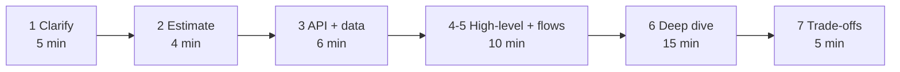
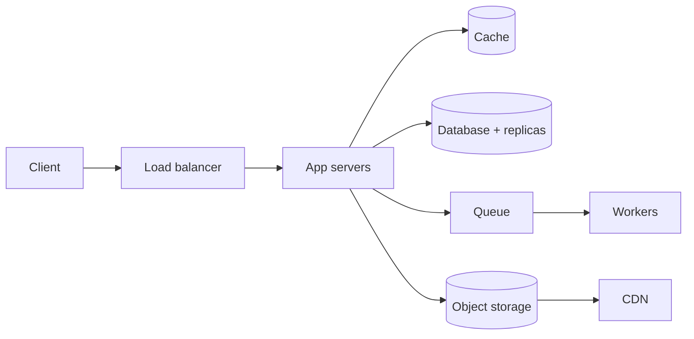

# Interview Answer Structure

> A system design interview is a conversation, not an exam. Follow the same steps every time, think out loud, and explain your trade-offs.

Roadmap topic 31 · Stage 8: Interview

**Go deeper:** `13` Requirements & Estimation · `14`–`30` the building blocks you choose from · `32` Practice Designs · `03-leetcode-patterns/21-Coding-Interview-Answer-Points` (the same habits for coding rounds).

**Marks:** 🟢 must know · 🟡 good to know · (New) added beyond the original roadmaps

---

#### 1. What Is It?

*Follow the same steps every time.*

| 🟢 Must know | 🟡 Good to know |
|---|---|
| the seven steps | ready-made answer points (problem → tool) |
| the 45-minute time split (New) | |
| habits: start simple, trade-offs, fails / 10× / twice | |

```text
1. Clarify requirements and scope
2. Estimate (only what changes the design)
3. Define APIs and the data model
4. Draw a simple high-level design
5. Walk through the main flows
6. Deep-dive into bottlenecks and failures
7. Explain trade-offs and how it can grow
```

The interviewer is checking four things: do you **ask** before building, do you **structure** your thinking, do you know the **building blocks** and when to use them, and can you **explain trade-offs** and failure cases.

**Signals in an interview:** the prompt is one line ("Design X"). The missing detail is on purpose; you are expected to ask.

---

#### 2. How It Works

**The 45-minute round.** Split the time so that you reach the deep dive.



| Step | Time | What to do |
|---|---|---|
| Clarify | 5 min | Users, main flows, scale, what is **out of scope** |
| Estimate | 3–5 min | QPS, storage, read:write ratio; say what each number decides |
| APIs + data model | 5–8 min | 3–5 endpoints, core tables, the key queries |
| High-level design + flows | 10 min | Start simple; walk through 1–2 requests end to end |
| Deep dive | 10–15 min | The hardest part and the failure cases |
| Trade-offs | 5 min | What you chose, what you gave up, how it grows 10× |

**What to do in each step.**

1. **Clarify.** Ask about users, features, scale, platforms. Write down the 3 to 5 features you will cover and say what is out of scope (topic 13).
2. **Estimate.** DAU → QPS → storage. Round the numbers. Say what decision each number drives ("4,000 reads per second → I need a cache").
3. **APIs and data model.** The main endpoints, the main tables, the key queries, and the index each query needs.
4. **High-level design.** Start **simple** (client → server → database), then add components as you justify them.
5. **Main flows.** Walk through one write and one read from the client to the database and back.
6. **Deep dive.** Pick the most interesting problem: the hot key, the fan-out, double booking, the consistency issue. Go deep here.
7. **Trade-offs.** Name the alternatives and why you did not choose them. Say how the design grows.



Add each box only when a requirement or number asks for it.

**Habits that work.**

1. **Start simple, then scale** where the numbers demand it.
2. **Say every trade-off aloud:** "I choose X because …; the downside is …".
3. For **every component** ask three questions: What if it **fails**? What if traffic is **10×**? What if a request arrives **twice**?
4. **Don't name technology first.** Say what you need ("a queue"), then name an example (Kafka or SQS).
5. **Check in:** "Should I go deeper here, or move on?"
6. Use the whiteboard clearly: labelled boxes, arrows for the direction of data.

🟡 **Ready-made answer points.** Match the problem you notice with a standard tool.

| Problem you notice | Say | Topic |
|---|---|---|
| Too many reads | Cache, CDN, read replicas | 15, 16, 18 |
| Too many writes or too much data | Queue, sharding | 19, 21 |
| Slow work in a request | Background job with a queue | 21 |
| Duplicates from retries | Idempotency key | 22 |
| Popular item overloads one node | Replicate hot keys, cache | 15, 19 |
| Dependency failing | Timeout, circuit breaker, fallback | 25 |
| Users see old data after writing | Read your own writes, primary read | 18, 23 |
| Unique IDs across servers | Snowflake, UUIDv7 | 20 |
| Flaky mobile networks | Offline support, retries, delta sync | 30 |
| Nobody knows it is broken | Metrics, alerts, traces | 27 |

---

#### 3. Naive vs Better Design

The difference between a weak and a strong answer:

| | Weak | Strong |
|---|---|---|
| Start | draws boxes in the first minute | asks questions, states scope |
| Numbers | none, or a long calculation | a few rounded ones, each tied to a decision |
| Design | Kafka, microservices, NoSQL on the first slide | simple first, each component justified |
| Flows | boxes and arrows, no story | walks a write and a read end to end |
| Failures | only the happy path | "if this fails … , if it arrives twice … " |
| Depth | wide and shallow | one deep dive on the hardest part |
| Trade-offs | "this is the best way" | "X because …; the downside is …" |
| Interviewer changes a rule | panics or restarts | says what changes, changes only that |

---

#### 4. Code

There is no program in this round, but keep a few reflexes. A small worked example of the numbers you say out loud for a URL shortener (100M new URLs a month, 100 reads per write):

```kotlin
const val SECONDS_PER_DAY = 86_400L

fun qps(perDay: Long) = perDay / SECONDS_PER_DAY.toDouble()

// 100M new URLs a month, read:write = 100:1, 500 bytes per record, kept 10 years
fun urlShortenerNumbers(newPerMonth: Long = 100_000_000, readWrite: Int = 100, bytes: Int = 500, years: Int = 10): Map<String, Double> {
    val writeQps = newPerMonth / (30 * SECONDS_PER_DAY).toDouble()
    return mapOf(
        "writeQps" to writeQps,
        "readQps" to writeQps * readWrite,
        "storageGb" to newPerMonth * bytes / 1e9 * 12 * years
    )
}

// Split a round of any length in the same proportions as the 45-minute plan
fun timeSplit(totalMinutes: Int): List<Pair<String, Int>> {
    val plan = listOf("Clarify" to 5, "Estimate" to 4, "API + data" to 6, "High-level + flows" to 10, "Deep dive" to 15, "Trade-offs" to 5)
    return plan.map { (name, m) -> name to Math.round(m * totalMinutes / 45.0).toInt() }
}
```

Checks: `urlShortenerNumbers()` → write about `38.6` per second, read about `3,858` per second, storage `6,000` GB (6 TB) over ten years. So "reads are 100× writes, thousands of requests per second: cache the hot links; 6 TB fits on one database, but plan for sharding if it grows 10×." `timeSplit(45)` sums to `45`; `timeSplit(60)` → `7, 5, 8, 13, 20, 7` (sum `60`).

A one-minute **opening script** you can reuse:

```text
"Let me confirm what we are building: [one sentence]. Who are the users, and how many?
 The core features are A, B and C; I'll leave D and E out of scope.
 Scale: roughly X million users a day, mostly reads. Is that right?
 I'll estimate quickly, sketch the API and data, draw a simple design,
 and then spend most of our time on [the hardest part]."
```

---

#### 5. Numbers & Capacity

How long each habit should take (a guide, not a rule):

| Piece | Aim for |
|---|---|
| Questions in the clarify step | 4 to 6, not 20 |
| Estimates | 3 to 4 numbers, rounded (QPS, storage, read:write) |
| Endpoints | 3 to 5 |
| Tables or entities | 2 to 5 |
| Components in the first diagram | 4 to 5, then add |
| Deep dives | 1 or 2, not 5 |
| Trade-off statements | at least one per major decision |
| Check-ins | every 10 minutes or so |

---

#### 6. Common Mistakes & Edge Cases

1. Jumping straight to the design without questions.
2. Starting with a complicated design.
3. Naming Kafka, microservices or NoSQL without a reason.
4. Only describing the happy path (no failures).
5. Spending all the time on the diagram and none on the deep dive.
6. Not explaining trade-offs.
7. Silence: not thinking out loud.
8. Long calculations on the whiteboard; round and move on.
9. Defending a choice against a hint instead of listening.

Edge cases: you have never built this kind of system (use the same steps; say what you need, then name an example); the interviewer changes a requirement halfway (this is normal, say what it affects and change only that); you don't know a detail (say so, state an assumption, and move on); you run out of time (cut estimates before the deep dive).

---

#### 7. Say This in the Interview

1. "Before I design, let me ask a few questions to understand the scope."
2. "I'll start with the simplest design that works and add components when the numbers ask for them."
3. "This number tells me I need X, so I'll add a cache here."
4. "For each component: what if it fails, what if load grows 10×, what if a request arrives twice?"
5. "I chose X over Y because …; the cost is …"
6. "The most interesting problem here is …; may I go deeper on it?"
7. "If the requirement changes to …, then only this part changes: …"

---

#### 8. Quick Check

1. Which step gets the most time in a 45-minute round?
2. What do you say about a technology you want to use?
3. Name the three questions you ask about every component.
4. The interviewer says "now the users are global". What do you do?

<details>
<summary>Answers</summary>

1. The deep dive (10 to 15 minutes).
2. Say the need first ("a queue"), then an example (Kafka or SQS), and why.
3. What if it fails? What if traffic is 10×? What if a request arrives twice?
4. Say what it affects (latency, data location, replication, consistency), change only those parts (CDN, regional replicas, routing), and name the new trade-off.

</details>

---

#### 9. Practice

**Interview questions**

1. How do you start a system design question?
2. How do you decide what to go deep on?
3. What if you have never built this kind of system?
4. What if the interviewer changes a requirement halfway?
5. How do you decide when a design is "done"?

**Hands-on**

1. Pick a design from topic 32. Run the 45-minute timer and record yourself. Count the minutes you spent on each step.
2. Write your opening script for three different prompts.
3. For one design, list every component and answer "fails / 10× / twice" for each.

**LeetCode design problems** (to practise structuring a small design)

| # | Question | Link to this topic |
|---|---|---|
| 146 | [LRU Cache](https://leetcode.com/problems/lru-cache/) (Medium) | clarify, API, data structure, trade-offs, in 20 minutes |
| 355 | [Design Twitter](https://leetcode.com/problems/design-twitter/) (Medium) | feed design on a small scale |
| 362 | [Design Hit Counter](https://leetcode.com/problems/design-hit-counter/) (Medium, premium) | requirements, scale and then structure |
| 1472 | [Design Browser History](https://leetcode.com/problems/design-browser-history/) (Medium) | clarify operations, then the data model |

**Remember:** clarify → estimate → API + data → high-level → flows → deep dive → trade-offs · start simple, scale where needed · for each part ask: fails? 10×? twice? · explain trade-offs every time · think out loud and check in.
