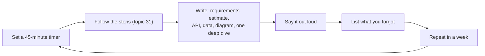

# Practice: Projects & Designs

> Reading isn't enough. Build a few small backends, and practise designs on paper in a fixed order. Start early; don't wait until you finish all the theory.

Roadmap topic 32 · Stage 8: Interview

**Go deeper:** `31` Interview Answer Structure · `13`–`30` the concepts each design uses · `33` Follow-Up Topics · `04-backend-engineering/12-Checkpoint-Project-Notes-API` · `03-leetcode-patterns/22-Practice-Plan-and-Problem-Sets`.

**Marks:** 🟢 must know · 🟡 good to know · (New) added beyond the original roadmaps

---

#### 1. What Is It?

*Build small things, then design bigger things, on a timer, out loud.*

| 🟢 Must know | 🟡 Good to know |
|---|---|
| five projects to build | harder designs: video, autocomplete, nearby, crawler, key-value store |
| ten designs, in order | |
| how to practise one design | |

1. **Projects** teach you what a design costs to build (transactions, retries, migrations).
2. **Designs** teach you to explain, using the steps in topic 31.
3. Each design has **one main idea**. Know it, and the rest follows.
4. Repeat the same design a week later. The second pass is where it sticks.

**Signals in an interview:** the prompt is one of the classics (URL shortener, rate limiter, chat, feed, notifications, booking, payments).

---

#### 2. How It Works

**Build these projects (in order).**

| # | Project | Practises |
|---|---|---|
| 1 | **Notes API** | CRUD, SQL, migrations, validation, pagination (`04-backend-engineering/12`) |
| 2 | **Extend it** | Auth, ownership checks, tests, deployment |
| 3 | **Notification workflow** | Queue, worker, retries, duplicate prevention |
| 4 | **Reservation / inventory API** | Transactions, concurrent requests, expiry, idempotency |
| 5 | **External integration** | Webhooks with signature checks, retries, state transitions (use a sandbox) |

**How to practise one design.**



**The ten designs (in order).**

| # | Design | The one main idea | Topics |
|---|---|---|---|
| 1 | **Notes app** | request flow, APIs, data model | 01–12 |
| 2 | **URL shortener** | unique IDs (base62), read-heavy → cache, `301` vs `302`, expiry | 15, 19, 20 |
| 3 | **File storage & sharing** | signed URLs, metadata, chunked uploads, permissions, CDN, sync | 16 |
| 4 | **Rate limiter** | token bucket, atomic counters in Redis, gateway, `429` | 25 |
| 5 | **Notification system** | API → queue → workers → push/email/SMS providers, preferences, retries, dedup, per-user limits | 21, 22, 24 |
| 6 | **Chat app** | WebSockets, ordering per conversation, delivery states, offline via push, presence | 23, 24 |
| 7 | **News feed** | fan-out on write vs read (hybrid), cursor pagination, caching, celebrities | 15, 19, 21 |
| 8 | **Ticket booking** | seat hold with expiry, transactions or locks, no double booking, idempotent payment | 11, 22 |
| 9 | **Payment system** | idempotency keys, state machine, ledger, webhooks, reconciliation | 22, 26 |
| 10 | **Offline-first sync** (New) | local DB, outbox, delta sync, conflicts, client IDs | 30 |

Good first designs to repeat: **URL shortener, rate limiter, chat, news feed.** They cover most of the core ideas.

🟡 **Harder or specialised designs.**

| Design | Focus on | Needs |
|---|---|---|
| **Video streaming** | upload → transcode into several qualities → segments (HLS) → CDN, adaptive bitrate | 16, 30 (learn transcoding inside this design) |
| **Search autocomplete** | prefix lookup (trie), top suggestions, cache, offline aggregation of query logs | 33 |
| **Nearby places / ride hailing** (New) | geospatial index (geohash, quadtree), location updates | 33 |
| **Web crawler** (New) | URL frontier queue, politeness per site, duplicate detection | 21, 33 |
| **Key-value store / distributed cache** (New) | partitioning, consistent hashing, replication, quorum | 18, 19, 23 |

**Order of learning.**

1. Finish the **Notes API** first.
2. Start the **notes app**, **URL shortener**, **file storage** and **rate limiter** after topic 16. Revisit the URL shortener after topics 18–20.
3. Add the remaining designs as you learn their concepts.
4. Learn specialised ideas (transcoding, geohash) **inside** their design, not separately.

---

#### 3. Naive vs Better Design

How to practise:

| | Naive | Better |
|---|---|---|
| Method | read solutions | design on paper first, then compare |
| Timing | no timer | 45 minutes, with the time split of topic 31 |
| Output | think silently | speak out loud or record yourself |
| Choice of designs | only easy ones | a mix, and the four classics repeatedly |
| Review | "that went OK" | list of what you forgot and what you would change |
| Repetition | never again | same design after a week |
| Answer | memorise "the perfect" design | understand the trade-off behind each box |

---

#### 4. Code

A one-page **template** for every design (copy it into your notes):

```text
DESIGN: ______________                    TIME: 45 min

1. REQUIREMENTS   must-have: ___  ___  ___      out of scope: ___
2. ESTIMATE       DAU ___  → QPS ___ (peak ___)  storage ___   read:write ___
3. API            POST /___   GET /___   (3–5 endpoints)
   DATA           table ___(id, ___, ___)   key query: ___   index: ___
4. HIGH-LEVEL     client → LB → app → cache / DB / queue / storage / CDN
5. FLOWS          write: ___            read: ___
6. DEEP DIVE      hardest part: ___     failure case: ___     duplicate case: ___
7. TRADE-OFFS     chose ___ over ___ because ___ ; cost ___ ; grows 10× by ___
```

Project 4 (reservation) in SQL: **the hold is one atomic statement**, so two users can't both win, and an expired hold can be taken over:

```sql
CREATE TABLE seats (
  id         INTEGER PRIMARY KEY,
  status     TEXT NOT NULL DEFAULT 'free',     -- free | held | sold
  held_by    TEXT,
  held_until BIGINT                            -- epoch seconds
);

UPDATE seats
SET status = 'held', held_by = :user, held_until = :now + 600       -- 10-minute hold
WHERE id = :seat
  AND (status = 'free' OR (status = 'held' AND held_until < :now)); -- only if free or expired
-- rows affected = 1 → you hold it;  0 → someone else does
```

Checks (run on SQLite): Ann holds seat 1 at time 1000 → `1` row. Bob tries at 1100 → `0` rows (still held until 1600). Bob tries at 1700 → `1` row (the hold expired) and `held_until = 2300`. Payment then does `UPDATE … SET status='sold' WHERE id=:seat AND held_by=:user AND held_until >= :now` with an idempotency key.

Project 3 (notification worker) in the shape of a test you can write:

```kotlin
class Notifier(private val send: (String) -> Unit) {
    private val done = mutableSetOf<String>()                   // idempotency: ids already sent
    fun handle(id: String, message: String) {
        if (!done.add(id)) return                               // a duplicate delivery: do nothing
        try { send(message) } catch (e: Exception) { done.remove(id); throw e }   // let the queue retry
    }
}
```

Checks: `handle("n1","hi")` twice → `send` runs **once**. If `send` throws the first time, `handle("n2","x")` rethrows (the queue redelivers) and the second call sends it, so the message is sent once and never lost.

---

#### 5. Numbers & Capacity

A practice plan that fits a normal week:

| Week | Do |
|---|---|
| 1–2 | Notes API + extend it (projects 1–2); design the notes app |
| 3–4 | URL shortener, file storage, rate limiter (one each, timed) |
| 5–6 | Notification system, chat; project 3 (notification workflow) |
| 7–8 | News feed, ticket booking; project 4 (reservation) |
| 9–10 | Payment system, offline-first sync; project 5 (webhooks) |
| 11+ | Repeat the four classics every week or two; add one harder design |

Time boxes: one design = 45 minutes + 15 minutes of review. One project = a weekend.

---

#### 6. Common Mistakes & Edge Cases

1. Only reading, no timed practice.
2. Practising only easy designs.
3. Never repeating a design.
4. Skipping the deep dive and failure cases.
5. Memorising one "perfect" answer instead of understanding trade-offs.
6. Practising silently.
7. Building a project without tests, so you never see the concurrency bugs.

Edge cases: you get a design you have not practised (use the template, find its one main idea, borrow blocks from similar designs); the interviewer asks for the harder variant (global users, 10× scale; change only what the number changes); you are stuck on a project (cut scope, ship the smallest version, then extend).

---

#### 7. Say This in the Interview

1. "This looks like the **news feed** problem. The main question is fan-out on write vs read."
2. "This is a **booking** problem, so the key is no double booking: hold with an expiry and an atomic update."
3. "This one is about **retries**, so I'd put an idempotency key on the request and make the consumer idempotent."
4. "I built something similar: a reservation API where the hold was one conditional `UPDATE`." (use real experience when you have it)

---

#### 8. Quick Check

1. Which four designs cover most core ideas?
2. What is the one main idea of a payment system?
3. Why repeat a design a week later?
4. Why learn geohash inside the "nearby places" design?

<details>
<summary>Answers</summary>

1. URL shortener, rate limiter, chat, news feed.
2. Never charge twice and never lose a payment: idempotency keys, a state machine, a ledger, and reconciliation.
3. You forget details quickly; the second pass shows what stuck and what you need to rebuild.
4. You learn it when you have a reason to use it, so you remember why it exists.

</details>

---

#### 9. Practice

**Interview questions (design prompts)**

1. Design a URL shortener.
2. Design a rate limiter.
3. Design a chat app.
4. Design a news feed.
5. Design a notification system.
6. Design a ticket booking system.
7. Design a payment system.
8. Design an offline-first notes app (mobile).

**Hands-on**

1. Build projects 1 to 5, in order, with tests.
2. Record yourself doing the URL shortener in 45 minutes. Review it using the template.
3. Repeat the same design after a week and compare.

**LeetCode design problems** (the small versions of the big designs)

| # | Question | Link to this design |
|---|---|---|
| 146 | [LRU Cache](https://leetcode.com/problems/lru-cache/) (Medium) | distributed cache |
| 460 | [LFU Cache](https://leetcode.com/problems/lfu-cache/) (Hard) | cache eviction trade-offs |
| 706 | [Design HashMap](https://leetcode.com/problems/design-hashmap/) (Easy) | key-value store |
| 359 | [Logger Rate Limiter](https://leetcode.com/problems/logger-rate-limiter/) (Easy, premium) | rate limiter |
| 362 | [Design Hit Counter](https://leetcode.com/problems/design-hit-counter/) (Medium, premium) | counters / rate limiter |
| 355 | [Design Twitter](https://leetcode.com/problems/design-twitter/) (Medium) | news feed |
| 535 | [Encode and Decode TinyURL](https://leetcode.com/problems/encode-and-decode-tinyurl/) (Medium) | URL shortener |
| 642 | [Design Search Autocomplete System](https://leetcode.com/problems/design-search-autocomplete-system/) (Hard, premium) | autocomplete |
| 588 | [Design In-Memory File System](https://leetcode.com/problems/design-in-memory-file-system/) (Hard, premium) | file storage |
| 1396 | [Design Underground System](https://leetcode.com/problems/design-underground-system/) (Medium) | event tracking |
| 635 | [Design Log Storage System](https://leetcode.com/problems/design-log-storage-system/) (Medium, premium) | log storage |

**Remember:** build small backends and practise timed designs · URL shortener, rate limiter, chat and news feed first · each design has one main idea (fan-out, idempotency, double booking…) · repeat designs and say them aloud · learn specialised ideas inside the design that needs them.
