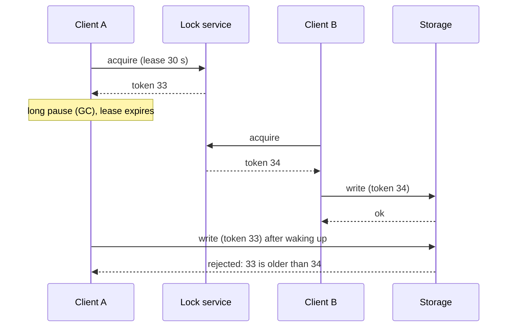
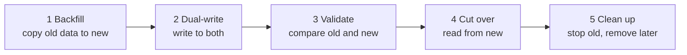

# Follow-Up Topics

> Advanced ideas that senior interviewers sometimes ask. Learn them after you are comfortable with the core designs. At this level, know what each one is for, not how to implement it.

Roadmap topic 33 · Stage 8: Interview

**Go deeper:** `15` Caching (Bloom filter, cache penetration) · `18` Replication (failover) · `19` Sharding · `23` Consistency & CAP · `29` Backup & Recovery (multi-region) · `32` Practice Designs (autocomplete, nearby places, crawler) · `02-algorithm` (trie, heap).

**Marks:** 🟡 good to know (all topics here) · (New) added beyond the original roadmaps

---

#### 1. What Is It?

*Names and purposes, so a follow-up doesn't surprise you.*

| Topic | One line |
|---|---|
| Leader election, consensus | machines agree on one leader, even when some fail (Raft, Paxos) |
| Distributed locks, leases, fencing tokens | only one machine does a job; a lease expires; a fencing token rejects old holders |
| Multi-region | active–passive (standby) or active–active (all serve) |
| Large data migrations | backfill → dual-write → validate → cut over → clean up |
| Search basics (New) | inverted index: word → documents |
| Geospatial (New) | geohash or quadtree cells for "near me" |
| Bloom filter, HyperLogLog, trie (New) | small structures: "maybe present", "about how many", "prefix lookup" |
| Batch vs stream (New) | big chunks at intervals vs events as they arrive |
| Clocks and ordering | machine clocks differ; use logical clocks or sequence numbers |
| CQRS | separate model for writes and for reads |

**Signals in an interview:** "what if two servers both think they are the leader?", "how do you migrate with no downtime?", "find drivers near me", "count unique visitors", "type-ahead suggestions".

---

#### 2. How It Works

**Leader election and consensus.**

1. Many machines must agree on **one leader** (or one value) even when some fail or the network splits.
2. **Consensus algorithms** (Raft, Paxos) do this; they need a **majority** to agree, so 3 nodes survive 1 failure and 5 survive 2.
3. Used in ZooKeeper and etcd, and inside databases for failover. Know the **purpose only**; skip the proofs.

**Distributed locks, leases, fencing tokens.**



1. **Distributed lock:** only one machine works on a resource at a time (for example, run a nightly job on one server).
2. **Lease:** a lock that **expires automatically**, so a crashed holder doesn't block everyone forever.
3. Problem: a slow holder wakes up after its lease expired and still writes.
4. **Fencing token:** a number that increases with every lock. The storage rejects writes with an older token.

**Multi-region.**

1. **Active–passive:** one region serves traffic, another is a standby for disaster recovery. Simpler (topic 29).
2. **Active–active:** several regions serve traffic. Lower latency and better availability, but data conflicts and consistency are hard (topic 23).
3. Route users to the nearest region (DNS or geo routing).

**Large data migrations.** Move data without stopping the service.



Always keep a way to roll back: until the clean-up step the old store still has everything.

**Search basics (New).**

1. **Inverted index:** maps each word to the documents that contain it (like the index at the back of a book).
2. Search engines (Elasticsearch, OpenSearch) add ranking and text processing (stemming, typo tolerance).
3. The search index is a **copy** of your data, updated asynchronously from the main database (so it can lag).

**Geospatial (New).** "Find places or drivers near me."

1. **Geohash** turns a location into a string; nearby places share a prefix. Longer string = smaller cell.
2. **Quadtree** splits the map into smaller squares where there is more data.
3. Query the user's cell **plus its neighbours** (edges of a cell are close to the next cell), then sort by exact distance.

**Small structures (New).**

| Structure | What it does | Trade-off |
|---|---|---|
| **Bloom filter** | "definitely not in the set" or "maybe in the set" | small memory; false positives possible; no deletes. Avoids useless lookups (cache penetration) |
| **HyperLogLog** | counts approximate unique items (unique visitors) | tiny memory (about 12 KB in Redis), error about 1% |
| **Trie** | tree of characters for prefix lookup | used for autocomplete |

**Batch vs stream (New).** **Batch** processes a large set of data at intervals (nightly reports). **Stream** processes events continuously (live fraud detection). Names only: Kafka for the event stream, Spark or Flink for processing.

**Clocks and ordering.**

1. Clocks on different machines **differ** (clock skew), so timestamps can't fully order events.
2. **Logical clocks** and sequence numbers give a consistent order without relying on time.
3. Be careful with "last write wins" using client timestamps.

**CQRS.** *Command Query Responsibility Segregation:* a model for **writes** and a different model for **reads**. Example: write to the main database, then update a read-optimised copy (a search index or feed cache) through events. Name-level only for now.

---

#### 3. Naive vs Better Design

| Situation | Naive | Better |
|---|---|---|
| Run a job on one server | a lock with no expiry | a lease, plus a fencing token if the write is dangerous |
| Pick a leader | "the first server wins" | a consensus tool (etcd, ZooKeeper) or the database's failover |
| Move to a new database | stop, copy, start | backfill, dual-write, validate, cut over, with rollback |
| Order events | compare device timestamps | server-assigned sequence or logical clock |
| Search | `LIKE '%word%'` on a big table | an inverted index |
| "Near me" | compute distance to every row | geohash cell + neighbours, then sort |
| Missing key lookups | every miss hits the database | a Bloom filter in front |
| Unique visitors | a set of every user ID | HyperLogLog |

```kotlin
// Naive "lock": no expiry, no owner check
var locked = false
fun runJob() { if (!locked) { locked = true; work() } }     // a crash leaves it locked forever; two servers don't share this variable
```

---

#### 4. Code

**A lease with Redis** (one machine at a time; it expires on its own):

```text
SET job:nightly <my-id> NX PX 30000       # NX = only if it does not exist; PX = expire in 30 s; returns OK or nil
# renew while working (only if still mine); release with a script that checks the value is <my-id>
```

**Fencing token on the storage side:**

```kotlin
class FencedStore {
    private var lastToken = 0L
    var value = ""
        private set

    fun write(token: Long, newValue: String): Boolean {
        if (token < lastToken) return false      // an old lock holder: reject
        lastToken = token
        value = newValue
        return true
    }
}
```

Checks: `write(33, "A")` → `true`; `write(34, "B")` → `true`; `write(33, "stale")` → `false`, and `value` stays `"B"`.

**Lamport clock** (a logical clock):

```kotlin
class LamportClock {
    private var time = 0L
    fun tick(): Long = ++time                                   // local event or sending a message
    fun receive(remote: Long): Long { time = maxOf(time, remote) + 1; return time }
}
```

Checks: A `tick()` → `1` (and sends `1`). B `receive(1)` → `2`; B `tick()` → `3`. A `receive(3)` → `4`. If event X causes event Y, then `time(X) < time(Y)`, whatever the wall clocks say.

**Dual-write during a migration:**

```kotlin
fun save(note: Note) {
    oldDb.save(note)                                  // still the source of truth
    try { newDb.save(note) }
    catch (e: Exception) { mismatches.add(note.id) }  // do not fail the user; fix it in the validate step
}
```

**Inverted index:**

```kotlin
fun buildIndex(docs: Map<Int, String>): Map<String, Set<Int>> {
    val index = HashMap<String, MutableSet<Int>>()
    for ((id, text) in docs)
        for (word in text.lowercase().split(" ").filter { it.isNotBlank() })
            index.getOrPut(word) { sortedSetOf() }.add(id)
    return index
}

fun search(index: Map<String, Set<Int>>, query: String): Set<Int> =
    query.lowercase().split(" ")
        .map { index[it] ?: emptySet() }
        .reduce { a, b -> a intersect b }                // every word must match
```

Checks with `1:"red running shoes"`, `2:"blue running jacket"`, `3:"red jacket"`: `search("running")` → `{1, 2}`; `search("red jacket")` → `{3}`; `search("green")` → `{}`.

**Geohash** (nearby places share a prefix):

```kotlin
private const val BASE32 = "0123456789bcdefghjkmnpqrstuvwxyz"

fun geohash(lat: Double, lon: Double, length: Int): String {
    var latLo = -90.0; var latHi = 90.0
    var lonLo = -180.0; var lonHi = 180.0
    val out = StringBuilder()
    var evenBit = true; var bit = 0; var ch = 0
    while (out.length < length) {
        if (evenBit) {                                   // even bits halve the longitude range
            val mid = (lonLo + lonHi) / 2
            if (lon >= mid) { ch = ch * 2 + 1; lonLo = mid } else { ch *= 2; lonHi = mid }
        } else {                                         // odd bits halve the latitude range
            val mid = (latLo + latHi) / 2
            if (lat >= mid) { ch = ch * 2 + 1; latLo = mid } else { ch *= 2; latHi = mid }
        }
        evenBit = !evenBit
        if (++bit == 5) { out.append(BASE32[ch]); bit = 0; ch = 0 }
    }
    return out.toString()
}
```

Checks (the same algorithm in Python): `geohash(57.64911, 10.40744, 11)` → `"u4pruydqqvj"`. Two points a few metres apart in San Francisco, `(37.7749, -122.4194)` and `(37.7750, -122.4190)`, both give `"9q8yyk"` at length 6.

**Bloom filter:**

```kotlin
class BloomFilter(private val bits: Int, private val hashes: Int) {
    private val set = java.util.BitSet(bits)

    private fun index(item: String, i: Int): Int {
        val h1 = item.hashCode()
        val h2 = (h1 * -1640531535 ushr 7) or 1          // a second hash from the first (double hashing)
        return Math.floorMod(h1 + i * h2, bits)
    }

    fun add(item: String) { for (i in 0 until hashes) set.set(index(item, i)) }
    fun mightContain(item: String) = (0 until hashes).all { set.get(index(item, it)) }
}
```

Checks: every item that was added always gives `mightContain = true` (no false negatives). For items never added, the chance of a wrong "true" is about `(1 − e^(−kn/m))^k`: for `n = 1,000` items, `m = 10,000` bits and `k = 7` hashes, that is about **0.8%**. Rule of thumb: about 9.6 bits per item for a 1% false-positive rate.

---

#### 5. Numbers & Capacity

| Item | Number |
|---|---|
| Consensus group size | 3 nodes tolerate 1 failure; 5 tolerate 2 (needs a majority) |
| Lease length | seconds to tens of seconds; renew at about a third of the lease |
| Geohash length | 4 chars ≈ 39 × 20 km; 5 ≈ 5 × 5 km; 6 ≈ 1.2 km × 0.6 km; 7 ≈ 150 m × 150 m |
| Bloom filter | about 9.6 bits per item for 1% false positives; 1M items ≈ 1.2 MB |
| HyperLogLog | about 12 KB per counter in Redis, error about 0.8% |
| Migration validation | compare counts and checksums, then sample rows; run for days, not minutes |
| Clock skew between servers | milliseconds with NTP, but seconds are possible after faults |

---

#### 6. Common Mistakes & Edge Cases

1. Learning these before the core topics.
2. Trying to memorise consensus algorithm details.
3. Using a distributed lock with no expiry (a lease).
4. A lease without a fencing token when the work writes to shared storage.
5. Migrating in one step with no validation or rollback.
6. Trusting clocks across machines.
7. Expecting a Bloom filter to delete items or to never say "maybe".
8. Searching only one geohash cell and missing the places just across the edge.

Edge cases: split brain with two leaders (consensus plus fencing); the search index is behind the database (accept the lag or read from the database for the user's own writes); a migration where new writes arrive while backfilling (dual-write starts before or during backfill, then validate); a hot geohash cell such as a stadium (use finer cells or a quadtree).

---

#### 7. Say This in the Interview

1. "Leader election lets one node coordinate and another take over safely. I'd use a tool like etcd or ZooKeeper rather than build consensus."
2. "A lock needs a lease so a crashed holder can't block forever, and a fencing token so a paused holder can't write after its lease expired."
3. "I'd migrate in five steps: backfill, dual-write, validate, cut over, clean up, with a rollback until the end."
4. "Nearby drivers: store location in a geohash or quadtree cell, query the user's cell and its neighbours, then sort by exact distance."
5. "Search uses an inverted index, which is a copy of the data updated asynchronously."
6. "A Bloom filter answers 'definitely not here' cheaply, which avoids database lookups for keys that don't exist."
7. "I don't trust wall clocks across machines. I'd use a server-assigned sequence or a logical clock."

---

#### 8. Quick Check

1. Why does a lease alone not make a lock safe?
2. A Bloom filter says "no". Can the item be in the set?
3. Why query neighbouring geohash cells?
4. In which migration step do you switch reads to the new store?

<details>
<summary>Answers</summary>

1. A paused holder can wake up after the lease expired and still write; a fencing token lets the storage reject it.
2. No. "No" is always right; "yes" means "maybe".
3. A point near a cell's edge has close neighbours in the next cell.
4. Step 4, the cut-over, after validation shows old and new match.

</details>

---

#### 9. Practice

**Interview questions**

1. Why do we need leader election?
2. What is a fencing token?
3. Active–passive vs active–active?
4. How do you migrate a large database with no downtime?
5. How would you find nearby drivers?
6. What is a Bloom filter used for?
7. How does search find text quickly?
8. Why not use timestamps from phones to order messages?

**Hands-on**

1. Write the `FencedStore` and `LamportClock` classes with unit tests from the checks.
2. Build a tiny inverted index and a prefix trie for autocomplete.
3. Run a mock migration: backfill a second table, dual-write, compare counts, then switch reads.

**LeetCode design problems**

| # | Question | Link to this topic |
|---|---|---|
| 208 | [Implement Trie (Prefix Tree)](https://leetcode.com/problems/implement-trie-prefix-tree/) (Medium) | trie for autocomplete |
| 642 | [Design Search Autocomplete System](https://leetcode.com/problems/design-search-autocomplete-system/) (Hard, premium) | trie plus top suggestions |
| 1188 | [Design Bounded Blocking Queue](https://leetcode.com/problems/design-bounded-blocking-queue/) (Medium, premium) | locks and waiting |
| 1146 | [Snapshot Array](https://leetcode.com/problems/snapshot-array/) (Medium) | versions, as in sequence numbers |
| 295 | [Find Median from Data Stream](https://leetcode.com/problems/find-median-from-data-stream/) (Hard) | stream processing |
| 432 | [All O`one Data Structure](https://leetcode.com/problems/all-oone-data-structure/) (Hard) | counters with fast min and max |
| 380 | [Insert Delete GetRandom O(1)](https://leetcode.com/problems/insert-delete-getrandom-o1/) (Medium) | sampling from a set |

**Remember:** know the purpose of consensus, locks, leases and fencing tokens · migration: backfill → dual-write → validate → cut over · geohash or quadtree for location, inverted index for search · Bloom filter, HyperLogLog and trie: know what each is for · don't trust clocks across machines.
