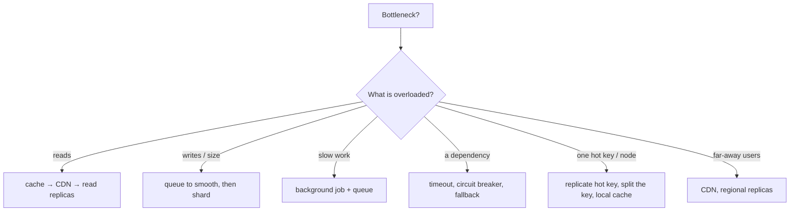

# System Design Cheat Sheet

> One-page revision for the night before an interview. The full explanations are in notes 13–33.

---

#### 1. Key Takeaways

1. **Steps:** clarify → estimate → API + data → high-level → flows → deep dive → trade-offs. 45 minutes ≈ 5 / 4 / 6 / 10 / 15 / 5. Start simple. For every box ask: **fails? 10×? twice?**
2. **Estimate only what changes the design.** QPS = requests per day ÷ 86,400; peak = 2 to 10× the average. Judge latency by p95 / p99. Availability 99.9% ≈ 8.8 hours of downtime a year; 99.99% ≈ 53 minutes.
3. **Scale out with stateless servers** behind a load balancer with health checks. Find the bottleneck first. Remove single points of failure.
4. **Cache-aside** for read-heavy data. TTL with jitter, single-flight against stampedes, replicate hot keys. Stale data is the price.
5. **Files go to object storage; metadata to the database.** Upload with signed URLs and resumable chunks. Serve through a CDN with content-hash file names.
6. **Choose a database by access pattern, not popularity.** Start with relational. Replicas scale reads (and lag); a replica is **not** a backup. Shard only when one machine can't cope; the shard key decides everything. Use consistent hashing with virtual nodes.
7. **IDs:** auto-increment (single DB), UUIDv7 (sortable), Snowflake (41 / 10 / 12 bits), base62 for short codes. Client-generated IDs for offline apps.
8. **Queues** take slow work out of the request. Delivery is at-least-once, so **consumers must be idempotent**. Failed messages go to a dead-letter queue. Fan-out on write for most users, on read for celebrities.
9. **Reliable requests:** timeout, retry with exponential backoff and **full jitter**, idempotency key, signed webhooks, reconciliation. "Exactly-once" is at-least-once plus idempotency.
10. **Consistency is chosen per feature.** During a network partition (CAP) pick consistency or availability. Read-your-writes for the user's own data. Quorum `R + W > N`.
11. **Real time:** polling → long polling → SSE → WebSocket. Push (FCM) wakes a closed app and says "sync". Always recover missed messages after reconnecting.
12. **Protect yourself:** rate limit (token bucket), circuit breaker, load shedding, bulkheads, backpressure, graceful degradation.
13. **Services:** a modular monolith first; microservices when teams or scale demand it. Outbox for "save and publish", saga for multi-service workflows, a state machine for business states.
14. **Observe:** logs with request IDs, metrics (RED), traces. Alert on the SLO burn rate, not on every blip.
15. **Release safely:** CI/CD, canary, feature flags, **expand → migrate → contract** for schema changes, force-update as the last resort.
16. **Recover:** tested backups, **RPO** (data you can lose) and **RTO** (time you can be down). Multi-AZ by default; multi-region only if needed.
17. **Mobile:** assume a flaky network; offline-first with a local DB + outbox + delta sync; never break old app versions; refresh the token once.

---

#### 2. Numbers and Rules of Thumb

| Topic | Remember |
|---|---|
| Seconds per day | 86,400 (round to 100,000 for quick maths) |
| 1M requests per day | ≈ 12 requests per second |
| Availability downtime per year | 99% ≈ 3.65 days · 99.9% ≈ 8.8 h · 99.99% ≈ 53 min |
| Servers needed | peak QPS ÷ per-server QPS, plus 1 spare (N + 1) |
| Memory vs disk vs network | memory ≈ 100 ns · SSD ≈ 100 µs · same-region network ≈ 0.5 ms · cross-continent ≈ 100+ ms |
| Cache | 80/20 rule: cache the hot 20% of the data |
| Consistent hashing | adding a node moves about 1/N of the keys (hash % N moves most of them) |
| Snowflake ID | 1 sign + 41 time + 10 machine + 12 sequence ≈ 4,096 IDs per ms per machine |
| Quorum | `R + W > N` gives strong reads (N=3, R=2, W=2) |
| Backoff | 100 ms, 200, 400, 800 … capped, with full jitter `random(0, cap)` |
| Restore time | 1 TB at 200 MB/s ≈ 83 minutes |
| Polling at 1M users every 30 s | ≈ 33,000 requests per second |
| Bloom filter | ≈ 9.6 bits per item for 1% false positives |
| Consensus | 3 nodes survive 1 failure, 5 survive 2 |
| Image size | thumbnail ≈ 20 KB vs original ≈ 3 MB |

---

#### 3. Patterns and How to Identify Them

| Problem you notice | Think of | Note |
|---|---|---|
| "how many users / how much storage?" | DAU → QPS → storage | 13 |
| too many reads | cache, CDN, read replicas | 15, 16, 18 |
| one server isn't enough | stateless servers + load balancer | 14 |
| big files, images, video | object storage, signed URLs, CDN | 16 |
| "SQL or NoSQL?" | access pattern, consistency, scale | 17 |
| read-your-own-write is stale | primary read, session pinning | 18, 23 |
| data too big for one machine | sharding, consistent hashing | 19 |
| IDs across servers; short URLs | Snowflake, UUIDv7, base62 | 20 |
| slow work in a request | queue + workers | 21 |
| duplicates after retry | idempotency key, idempotent consumer | 21, 22 |
| celebrity with millions of followers | hybrid fan-out | 21 |
| flaky external API | timeout, backoff + jitter, circuit breaker | 22, 25 |
| two users, one seat | atomic update, hold with expiry | 11, 32 |
| partition: consistency or availability? | CAP, choose per feature | 23 |
| live updates, chat | WebSocket / SSE, reconnect, push | 24 |
| traffic spike, abusive client | rate limit, load shedding | 25 |
| save to DB and publish an event | transactional outbox | 26 |
| multi-step workflow across services | saga, state machine | 26 |
| "how do you know it's broken?" | RED metrics, SLO, tracing | 27 |
| change the schema without downtime | expand → migrate → contract | 28 |
| a bad deploy | canary, feature flag, rollback | 28 |
| "what if the data center dies?" | multi-AZ, backups, RPO / RTO | 29 |
| offline edits, sync | local DB, outbox, delta sync | 30 |
| leader, locks | consensus, lease, fencing token | 33 |
| "near me" | geohash / quadtree | 33 |
| text search | inverted index | 33 |



---

#### 4. Templates to Memorise

**Opening (one minute)**

```text
"Let me confirm what we're building: [one sentence]. Core features: A, B, C. Out of scope: D, E.
 Scale: X million users a day, mostly reads. I'll estimate quickly, sketch the API and data,
 draw a simple design, and spend most of the time on [the hardest part]."
```

**Estimate**

```text
DAU 10M × 20 requests = 200M/day ÷ 86,400 ≈ 2,300 QPS average → peak ≈ 5× ≈ 12,000 QPS
Storage: 1M new items/day × 1 KB = 1 GB/day ≈ 365 GB/year
```

**Cache-aside**

```text
read: cache → miss → DB → put in cache (TTL + jitter)        write: update DB → delete the cache key
```

**Idempotent consumer / request**

```text
if (seen(messageId)) return;  process();  markSeen(messageId)   // in the same transaction as the effect
Idempotency-Key: <uuid>   → store key → result; replay the stored result on a retry
```

**Retry delay (full jitter)**

```kotlin
fun delayMs(attempt: Int, base: Long = 100, cap: Long = 10_000) = Random.nextLong(0, minOf(cap, base shl attempt) + 1)
```

**Token bucket:** refill `rate` tokens per second up to `capacity`; a request takes one token or gets `429`.

**Outbox:** in one transaction write the data and an `outbox` row; a relay publishes the row, then marks it sent (consumers are idempotent).

**Delta sync:** `GET /changes?since=<cursor>` → changes with a version, including tombstones → store the max version as the next cursor.

**Safe schema change:** add nullable column → deploy code that writes both → backfill → switch reads → drop the old column.

**Migration:** backfill → dual-write → validate → cut over → clean up (keep a rollback until the end).

**Fencing token:** the lock service hands out an increasing number; storage rejects a write with a smaller one.

**Seat hold:** `UPDATE seats SET held_by = :u, held_until = :now + 600 WHERE id = :id AND (status = 'free' OR held_until < :now)`; 1 row = success.

---

#### 5. Naive to Better

| Naive | Better |
|---|---|
| draw boxes in the first minute | ask questions, state scope |
| Kafka and microservices from the start | simple first, add what the numbers need |
| session in server memory | shared session store or a token; stateless servers |
| `hash(key) % N` | consistent hashing with virtual nodes |
| cache without TTL | TTL + jitter, single-flight |
| retry immediately and forever | backoff + jitter, a limit, circuit breaker |
| retry `POST` blindly | idempotency key |
| save to DB, then publish (dual write) | transactional outbox |
| a replica counted as a backup | backups + tested restores |
| lock with no expiry | lease + fencing token |
| poll every second | push "sync now", then pull |
| refetch all data | delta sync with a cursor |
| trust device clocks | server-assigned version or logical clock |
| rename a field | add a new field; keep the old one |
| deploy to everyone at once | canary + feature flag + rollback |
| alert on every error | alert on SLO burn rate |
| ignore failures | fails? 10×? twice? for every box |

---

#### 6. Common Mistakes and Edge Cases

1. Jumping to the design without questions; no scope; no numbers.
2. Over-engineering: microservices, Kafka, NoSQL, multi-region with no requirement.
3. Only the happy path: no failures, no duplicates, no retries.
4. No trade-offs ("this is the best way"); silence.
5. Sharding too early, or with a bad key (hot shard, cross-shard queries).
6. Cache stampede, hot key, stale reads after a write.
7. Non-idempotent consumers or retries; retrying forever; no dead-letter queue.
8. Fan-out on write for celebrities; offset pagination on feeds.
9. A lock with no lease or no fencing; trusting clocks across machines.
10. Backups never restored; replication treated as backup.
11. Breaking old app versions; no force-update plan; no conflict rule for offline edits.
12. Edge cases: split brain, thundering herd after an outage, a message processed twice, a client clock that is wrong, the response lost after the commit, a hot celebrity or hot cell, a retry storm.

---

#### 7. What to Say Out Loud

1. "Before I design, let me ask about users, scale and scope."
2. "I'll start with the simplest design that works and add components when the numbers ask for them."
3. "4,000 reads per second and a read-heavy workload tell me to add a cache; here is how I keep it fresh."
4. "Delivery is at-least-once, so the consumer is idempotent."
5. "For this feature I choose availability over consistency, because …; for payments I choose consistency."
6. "I'd rate limit at the gateway with a token bucket, and use a circuit breaker with a fallback for the dependency."
7. "RPO is 5 minutes and RTO is 1 hour, so I need continuous log archiving, a replica, and a tested restore."
8. "I chose X over Y because …; the cost is …; at 10× I would …"

---

#### 8. Practice Order

| Step | Do |
|---|---|
| 1 | Estimate three systems (feed, chat, photo upload) on paper in 5 minutes each (13) |
| 2 | Design the URL shortener in 45 minutes, out loud (20, 15, 19) |
| 3 | Design the rate limiter (25) and the chat app (24) |
| 4 | Design the news feed (21) and the notification system (21, 22) |
| 5 | Design ticket booking and payments (11, 22, 26) |
| 6 | Design the offline-first notes app (30) |
| 7 | Repeat the four classics a week later; add one harder design (32, 33) |
| 8 | Read this sheet, then the "Say This in the Interview" part of your weakest notes |
