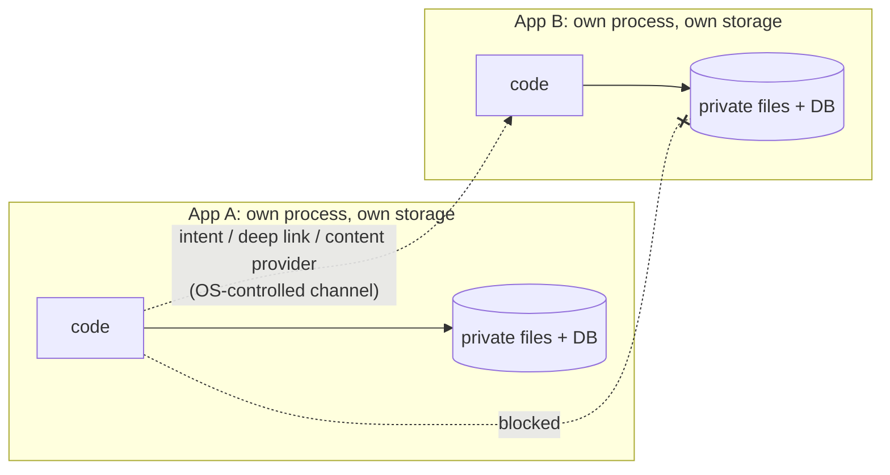
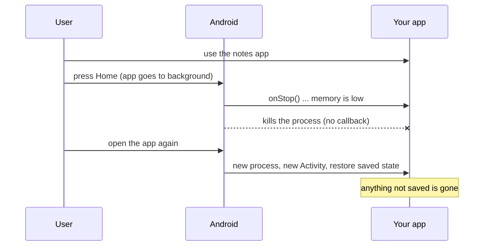

# Mobile Platform Basics

> A phone is not a small server. The OS owns the process, can kill it at any time, and expects you to ask before touching anything sensitive. Almost every mobile-specific bug traces back to forgetting one fact from this topic.

Roadmap topic 1 · Stage 1: Foundations

**Go deeper:** `4` App Components & Lifecycle (process death) · `3` Coroutines & Flow (keeping the main thread free) · `19` Permissions · `15` Build & Release · `16` iOS & Swift · `05-system-design/30-Mobile-Specific-Topics` (old app versions).

**Marks:** 🟢 must know · 🟡 good to know · (New) beyond the basics

---

#### 1. What Is It?

*The rules of the environment your code runs in.*

| 🟢 Must know | 🟡 Good to know |
|---|---|
| app sandbox | Android vs iOS: main differences |
| runtime permissions | how an app starts |
| the main (UI) thread rule | app stores: review and policies |
| the OS can kill your app | tools: Android Studio, Gradle, ADB |
| APK, AAB, IPA, Google Play | |
| OS versions, min / target SDK, device variety | |
| old app versions live for years | |

1. **Sandbox:** each app runs in its own process with private storage.
2. **Permissions:** sensitive things (camera, location, notifications) are asked for when needed, and the user can say no.
3. **Main thread:** one thread draws the UI. Never block it.
4. **Process death:** in the background the OS may kill your process to free memory.
5. **Old versions:** users do not all update, so the backend must support many app versions at once.

**Signals in an interview:** "what happens when the user leaves the app?", "why did the screen reset?", "why is the app frozen?", "how do you support old versions?", "min SDK vs target SDK".

---

#### 2. How It Works

**The sandbox.** Apps cannot reach into each other. They use channels the OS controls.



**The main thread.** All drawing and touch handling run on one thread. If it is busy, the screen freezes.

1. A frame must be ready in about **16 ms** (60 Hz) or **8 ms** (120 Hz). Slow work makes frames drop (jank).
2. If the main thread is blocked for about **5 seconds** while the user is touching the screen, Android shows **ANR** (Application Not Responding) (topic 11).
3. Network, database, file and heavy CPU work always go to another thread (topic 3).

**Process death.** The OS, not you, decides when the process ends.



State that must survive is saved in `SavedStateHandle`, a database, or `DataStore` (topics 4, 9).

**Permissions.**

1. Ask **in context** (when the user taps "Take photo"), not at app start.
2. The user may deny. The app must still work in a sensible way.
3. Full flow in topic 19.

**Package and distribution.**

| | Android | iOS |
|---|---|---|
| Installable package | **APK** | **IPA** |
| What you upload | **AAB** (App Bundle); Google Play builds a device-specific APK from it | archive through Xcode |
| Testing track | internal / closed / open testing | TestFlight |
| Store | Google Play | App Store |

**OS versions and devices.**

1. **minSdk:** the oldest Android version the app installs on.
2. **targetSdk:** the version the app is built and tested for; it opts into that version's new behaviour. Stores require a recent target.
3. **compileSdk:** the API you can call at compile time.
4. Screens vary (phones, tablets, foldables) and so do densities (topic 14). Check that a feature exists before using it.

🟡 **Android vs iOS.**

| | Android | iOS |
|---|---|---|
| App model | components: activities, services, receivers, providers | scenes and view controllers |
| Background work | WorkManager, foreground services; Doze limits | background tasks, silent push; strict limits |
| Language / UI | Kotlin, Compose | Swift, SwiftUI |
| Store review | usually faster | usually stricter and slower |

🟡 **How an app starts.** The OS creates the **process**, runs the **Application class** (global setup), then starts the first **Activity**. Heavy work in `Application.onCreate` slows the cold start (topic 11).

🟡 **App stores.** Both review apps: permissions, privacy declarations, content, stability. The listing (screenshots, description, privacy labels) is part of the product.

🟡 **Tools.** **Android Studio** (IDE), **Gradle** (build), **ADB** (command line to a device), emulator (convenient) vs **real device** (use it for performance, battery, camera and sensors).

---

#### 3. Naive vs Better Design

| Situation | Naive | Better |
|---|---|---|
| State in the background | keep it in a field or a global | `ViewModel` + `SavedStateHandle` / database |
| Slow work | call it on the main thread "just once" | `withContext(Dispatchers.IO)` or a worker |
| Permission denied | crash or block the whole app | explain, offer a fallback, keep the rest working |
| New API | call it on every device | check `Build.VERSION.SDK_INT` |
| Old app versions | assume everyone updates | add-only API, ignore unknown fields, force-update as the last resort |
| Testing | only the emulator on a new phone | a real mid-range device, and an old OS version |

```kotlin
// Naive: a global survives rotation but not process death, and leaks the Activity
object Cache { var lastNote: String = ""; var activity: Activity? = null }
```

---

#### 4. Code

Gradle settings in `build.gradle.kts`:

```kotlin
android {
    namespace = "com.example.notes"
    compileSdk = 35
    defaultConfig {
        applicationId = "com.example.notes"
        minSdk = 26          // installs on Android 8.0 and newer
        targetSdk = 35       // built and tested for the newest behaviour
        versionCode = 12     // integer, must grow with every upload
        versionName = "1.4.0"
    }
}
```

Using a new API safely:

```kotlin
fun openAppLanguageSettings(context: Context) {
    if (Build.VERSION.SDK_INT >= Build.VERSION_CODES.TIRAMISU) {        // Android 13+
        context.startActivity(Intent(Settings.ACTION_APP_LOCALE_SETTINGS, Uri.fromParts("package", context.packageName, null)))
    } else {
        // older phones: show our own language picker
    }
}
```

Keep the main thread free:

```kotlin
class NotesViewModel(private val repo: NotesRepository) : ViewModel() {
    fun load() = viewModelScope.launch {                 // starts on Main
        val notes = withContext(Dispatchers.IO) { repo.readAll() }   // slow work off the main thread
        _state.value = notes                             // back on Main
    }
}
```

Survive process death:

```kotlin
class EditorViewModel(private val saved: SavedStateHandle) : ViewModel() {
    var draft: String
        get() = saved["draft"] ?: ""
        set(value) { saved["draft"] = value }            // restored after the OS kills the process
}
```

Reproduce process death on your machine:

```bash
adb shell input keyevent HOME                    # put the app in the background
adb shell am kill com.example.notes              # kills the process, only works for a background app
adb shell monkey -p com.example.notes 1          # reopen it and check the screen state
```

Tolerate unknown fields (new server, old app):

```kotlin
val json = Json { ignoreUnknownKeys = true }
```

Catch main-thread mistakes in debug builds:

```kotlin
if (BuildConfig.DEBUG) {
    StrictMode.setThreadPolicy(StrictMode.ThreadPolicy.Builder().detectAll().penaltyLog().build())
}
```

---

#### 5. Performance & Limits

| Item | Number |
|---|---|
| Frame budget | 16.6 ms at 60 Hz, 8.3 ms at 120 Hz |
| ANR | input not handled for about 5 s; broadcast receiver about 10 s (foreground) |
| Play Vitals "slow" start (check current values) | cold ≥ 5 s, warm ≥ 2 s, hot ≥ 1.5 s |
| Play Vitals bad-behaviour thresholds (check current) | crash about 1.1% and ANR about 0.47% of daily users |
| Release lifetime | old app versions stay in use for years; the long tail is real |
| Process death | no callback; `onStop` is your last chance to save |

---

#### 6. Common Mistakes & Edge Cases

1. Assuming the process stays alive in the background.
2. Doing slow work on the main thread "just this once".
3. Designing only for the newest OS and newest devices.
4. Treating permission denial as a rare case instead of a normal path.
5. Assuming all users are on the latest app version.
6. Testing only on the emulator.
7. Heavy work in `Application.onCreate`.

Edge cases: low-memory device (process dies sooner); the user denies a permission twice (the system stops showing the dialog); a feature missing on an old OS; a device with a very small or very large screen; the app is killed while a network call is in flight.

---

#### 7. Say This in the Interview

1. "Each app runs in a sandbox. Apps talk through intents, deep links and content providers, never by reading each other's storage."
2. "The main thread draws the UI, so I move network, database and heavy work to coroutines on another dispatcher."
3. "In the background the OS can kill the process, so I keep important state in `SavedStateHandle` or a database and test it with `adb shell am kill`."
4. "minSdk is the oldest OS I support; targetSdk is what I tested against and opts into new behaviour."
5. "Old app versions live for years, so the backend only adds fields and I keep a force-update path."
6. "I ask for permissions in context and design the denied path first."

---

#### 8. Quick Check

1. What is the difference between a configuration change and process death?
2. Why is an AAB uploaded instead of an APK?
3. Why can't App A read App B's database?
4. Which thread must not do network calls?

<details>
<summary>Answers</summary>

1. A configuration change (rotation) recreates the Activity but keeps the process and the `ViewModel`. Process death ends the whole process and also clears the `ViewModel`.
2. Google Play builds a smaller APK for each device from the bundle.
3. Each app runs in its own process with private storage, enforced by the OS.
4. The main thread.

</details>

---

#### 9. Practice

**Interview questions**

1. What happens when the OS kills your app in the background?
2. Why can't an app read another app's files directly?
3. What is minSdk vs targetSdk?
4. Why do old app versions matter so much on mobile?
5. What is the difference between an APK and an AAB?
6. How would you test that your app survives process death?

**Hands-on**

1. Type text in a note screen, press Home, run `adb shell am kill`, reopen. Does the text survive? Fix it with `SavedStateHandle`.
2. Turn on StrictMode in debug and find one main-thread violation in your app.
3. Run the app on a device with the lowest minSdk you support.

**Coding warm-ups (LeetCode)**

| # | Question | Link to this topic |
|---|---|---|
| 1114 | [Print in Order](https://leetcode.com/problems/print-in-order/) (Easy) | work on different threads in a fixed order |
| 146 | [LRU Cache](https://leetcode.com/problems/lru-cache/) (Medium) | memory is limited; the OS and caches evict |

**Remember:** each app is sandboxed · never block the main thread · the OS can kill your process, so save state · design the denied-permission path · old app versions live for years.
