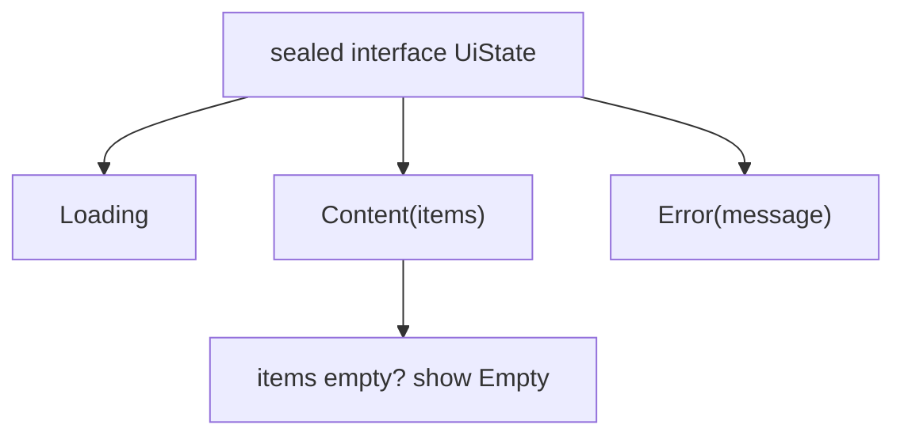

# Kotlin Essentials

> Kotlin removes whole classes of bugs (null crashes, shared mutable state) if you use its features on purpose. Interviewers check that you model state with sealed types, avoid `!!`, and know the collection operators.

Roadmap topic 2 · Stage 1: Foundations

**Go deeper:** `3` Coroutines & Flow · `6` App Architecture (UI state) · `5` UI with Jetpack Compose · `01-data-structure` and `02-algorithm` (the data structures behind the collections).

**Marks:** 🟢 must know · 🟡 good to know

---

#### 1. What Is It?

*The Kotlin features that matter for Android work and interviews.*

| 🟢 Must know | 🟡 Good to know |
|---|---|
| null safety: `?.`, `?:`, `!!` | generics and variance (`in`, `out`) |
| `val` vs `var`, immutability by default | `object`, `companion object` |
| data classes, sealed types, enums | delegation: `by lazy`, property delegates |
| default and named arguments, extension functions | `inline`, value classes |
| lambdas, higher-order functions | Java interop |
| collections and operators, sequences | idiomatic style |
| scope functions: `let`, `apply`, `also`, `run`, `with` | |

1. **Null safety:** the type system tells you which values can be null. The compiler makes you handle it.
2. **Immutability:** `val`, read-only collections and `copy()` make state easy to reason about.
3. **Sealed types:** a closed set of cases; `when` must cover all of them. This is how you model UI state.
4. **Functions as values:** lambdas and operators replace loops.

**Signals in an interview:** "how does Kotlin handle null?", "sealed class vs enum", "`let` vs `apply`", "`List` vs `Sequence`", "what does `by lazy` do?".

---

#### 2. How It Works

**Null safety.**

| Syntax | Meaning |
|---|---|
| `String` | never null |
| `String?` | may be null |
| `s?.length` | `null` if `s` is null, else the length |
| `s ?: "none"` | the right side if `s` is null |
| `s!!` | crash with an exception if null (avoid) |
| `s?.let { … }` | run the block only when not null |
| `requireNotNull(s) { "message" }` | fail early with a clear message |

**`val` vs `var`.** `val` is assigned once (a read-only reference); `var` can change. Prefer `val`. `List` is read-only; `MutableList` can change. Prefer read-only types in public APIs.

**Modelling state.**



1. **Data class:** holds values; gives `equals`, `hashCode`, `toString`, `copy`, destructuring.
2. **Sealed class or interface:** a closed hierarchy. The compiler checks that `when` handles every subtype, so adding a state breaks the build until you handle it.
3. **Enum:** a fixed set of simple constants (no per-case data). Use a sealed type when a case carries data.

**Functions.** Default and named arguments replace overloads. An **extension function** adds a function to an existing type without changing it. A **lambda** is a function value. A **higher-order function** takes or returns functions.

**Collections.** Read-only `List`, `Set`, `Map` plus operators: `map`, `filter`, `groupBy`, `associateBy`, `fold`, `sumOf`, `firstOrNull`, `any`, `all`, `sortedBy`, `distinct`, `chunked`, `zip`. Each operator on a `List` creates a new list. A **`Sequence`** is lazy: it processes element by element and only as far as needed, which helps with large data or `first()`.

**Scope functions.**

| Function | Object is | Returns | Typical use |
|---|---|---|---|
| `let` | `it` | lambda result | null check, convert a value |
| `apply` | `this` | the object | configure an object |
| `also` | `it` | the object | side effect (log) in a chain |
| `run` | `this` | lambda result | compute with the object as context |
| `with(x)` | `this` | lambda result | call many methods on `x` |

🟡 **Generics and variance.** `List<out E>` is read-only, so `List<String>` can be used where `List<Any>` is expected (`out` = producer). `MutableList<E>` is invariant: it both reads and writes. `in` = consumer (`Comparator<in T>`).

🟡 **`object` and `companion object`.** `object` is a singleton. `companion object` holds "static-like" members of a class (factories, constants). Prefer dependency injection to global singletons (topic 7).

🟡 **Delegation.** `by lazy { … }` runs once, on first use. `by viewModels()`, `by remember` are delegates. Class delegation (`class A(b: B) : B by b`) forwards an interface to another object.

🟡 **`inline` and value classes.** `inline` copies a function's body (and its lambda) to the call site, avoiding lambda allocation; use it for small higher-order helpers. A `@JvmInline value class` wraps one value without a runtime object, so `UserId(1)` cannot be mixed up with `OrderId(1)`.

🟡 **Java interop.** Platform types (`String!`) from Java can be null: check them. `@JvmStatic`, `@JvmOverloads`, `@Throws` help Java callers. Kotlin has no checked exceptions.

🟡 **Idioms.** Expressions over statements (`val x = if (…) a else b`), `when` instead of `if` chains, trailing lambdas, named arguments, `use {}` for closeable resources.

---

#### 3. Naive vs Better Design

| Naive | Better |
|---|---|
| `user!!.email!!.length` | `user?.email?.length ?: 0` |
| `var isLoading; var error; var data` (impossible combinations) | `sealed interface UiState` with three cases |
| a `for` loop with a mutable result list | `filter` + `map` |
| `enum` with a data field per case that differs | `sealed` types |
| `Boolean` flags: `fun show(true, false)` | named arguments or an enum |
| `list.filter{}.map{}.first()` on a huge list | `asSequence()…first()` |
| `Long` ids everywhere | `value class UserId(val value: Long)` |
| `Utils` static helper classes | extension functions and top-level functions |

```kotlin
// Naive: three flags allow nonsense like isLoading = true and error != null
data class NotesState(val isLoading: Boolean, val error: String?, val notes: List<String>?)
```

---

#### 4. Code

Null safety:

```kotlin
data class User(val id: Int, val name: String, val email: String?)

fun domainOf(user: User?): String = user?.email?.substringAfter('@') ?: "unknown"
```

Checks: `domainOf(User(1, "Ann", "ann@x.com"))` → `"x.com"`; `domainOf(User(2, "Bob", null))` → `"unknown"`; `domainOf(null)` → `"unknown"`.

State with a sealed type, and an exhaustive `when`:

```kotlin
sealed interface UiState<out T> {
    data object Loading : UiState<Nothing>
    data class Content<T>(val items: T) : UiState<T>
    data class Error(val message: String) : UiState<Nothing>
}

fun render(state: UiState<List<String>>): String = when (state) {
    UiState.Loading -> "spinner"
    is UiState.Content -> if (state.items.isEmpty()) "empty" else "${state.items.size} items"
    is UiState.Error -> "error: ${state.message}"
}
```

Checks: `render(UiState.Loading)` → `"spinner"`; `render(UiState.Content(emptyList()))` → `"empty"`; `render(UiState.Content(listOf("a","b")))` → `"2 items"`; `render(UiState.Error("offline"))` → `"error: offline"`. Add a fourth subtype and `render` stops compiling until you handle it.

Collection operators:

```kotlin
data class Order(val user: String, val amount: Int)

val orders = listOf(Order("ann", 10), Order("bob", 5), Order("ann", 20))

val totals = orders.groupBy { it.user }.mapValues { (_, list) -> list.sumOf { it.amount } }
val bigSpenders = orders.filter { it.amount >= 10 }.map { it.user }
val sum = orders.fold(0) { acc, o -> acc + o.amount }
```

Checks: `totals` → `{ann=30, bob=5}`; `bigSpenders` → `[ann, ann]`; `sum` → `35`.

Sequences (lazy):

```kotlin
val firstMatch = (1..Int.MAX_VALUE).asSequence().map { it * 2 }.filter { it % 3 == 0 }.first()   // 6
val firstThree = generateSequence(1) { it + 1 }.map { it * 2 }.filter { it % 3 == 0 }.take(3).toList()   // [6, 12, 18]
```

The sequence stops as soon as it has what it needs. A `List` version of the first line would try to build two billion elements.

Extension function, scope functions, default arguments:

```kotlin
fun String.isValidEmail() = contains('@') && substringAfter('@').contains('.')

fun greeting(name: String, punctuation: String = "!", upper: Boolean = false): String {
    val text = "Hello, $name$punctuation"
    return if (upper) text.uppercase() else text
}

val built = StringBuilder().apply { append("a"); append("b") }.toString()      // apply returns the builder
val shout = "  hi ".trim().takeIf { it.isNotEmpty() }?.let { it.uppercase() }    // let converts the value
```

Checks: `"a@b.com".isValidEmail()` → `true`; `"ab".isValidEmail()` → `false`; `"a@b".isValidEmail()` → `false`; `greeting("Ann", upper = true)` → `"HELLO, ANN!"`; `built` → `"ab"`; `shout` → `"HI"`.

Delegation and value classes:

```kotlin
val config: Config by lazy { loadConfigFromDisk() }     // runs once, the first time config is read

@JvmInline value class UserId(val value: Long)
@JvmInline value class NoteId(val value: Long)
fun openNote(id: NoteId) { /* … */ }
// openNote(UserId(1)) does not compile: the types differ, with no runtime wrapper object
```

Variance:

```kotlin
fun printAll(items: List<Any>) = items.forEach(::println)
printAll(listOf("a", "b"))          // OK: List<out E> lets List<String> be a List<Any>
// fun addAll(items: MutableList<Any>) with a MutableList<String> does not compile: it could add an Int
```

---

#### 5. Performance & Limits

| Item | Remember |
|---|---|
| `List` operator chain | each step makes a new list: `O(n)` time and memory per step |
| `Sequence` | one pass, no intermediate lists; better for large data or early exit, slower for tiny lists |
| `data class` `copy` | shallow copy; nested mutable objects are shared |
| `lazy` | thread-safe by default (it locks); `LazyThreadSafetyMode.NONE` when you know it is single-threaded |
| `inline` | removes lambda allocation, but big inline functions grow the bytecode |
| Boxing | `List<Int>` boxes each `Int`; `IntArray` does not |
| `!!` | one crash per misuse; prefer `?:` or `requireNotNull` with a message |

---

#### 6. Common Mistakes & Edge Cases

1. `!!` to silence the compiler; the crash just moves to runtime.
2. Boolean-flag state instead of a sealed type.
3. Exposing `MutableList` or `MutableStateFlow` publicly.
4. Using `var` and mutable collections when `val` would do.
5. `lateinit` for things that can be absent.
6. Using `apply`/`let` nested several levels deep (hard to read).
7. Mixing up `==` (equals) and `===` (same object).
8. Platform types from Java treated as non-null.

Edge cases: `data class` equality ignores properties declared in the body; a `Sequence` can be consumed only once in some cases; `groupBy` on an empty list gives an empty map; `first()` on an empty list throws (`firstOrNull()` does not); `copy()` of a class holding a mutable list shares the list.

---

#### 7. Say This in the Interview

1. "Kotlin separates nullable from non-null types. I use `?.` and `?:` and avoid `!!`."
2. "I model screen state as a sealed interface (Loading, Content, Error), so `when` is exhaustive and impossible states can't exist."
3. "Sealed types can carry different data per case; an enum can't."
4. "`apply` configures and returns the object; `let` transforms a value, often after a null check."
5. "For large collections or early exit I use a `Sequence`, so I don't build intermediate lists."
6. "I keep state immutable and update it with `copy()`."

---

#### 8. Quick Check

1. What does `a?.b ?: c` do?
2. When would you use `sealed` over `enum`?
3. Which scope function returns the object itself and uses `this`?
4. Why is `List<String>` usable as a `List<Any>`?

<details>
<summary>Answers</summary>

1. If `a` is null, use `c`; otherwise `a.b` (and if `a.b` is itself null, use `c`).
2. When different cases carry different data, or when you want exhaustive `when` with data.
3. `apply`.
4. `List` is declared `List<out E>`: it only produces `E`, so it is safe to treat it as a list of a supertype.

</details>

---

#### 9. Practice

**Interview questions**

1. How does Kotlin handle null?
2. `val` vs `var`, and `List` vs `MutableList`?
3. Sealed class vs enum?
4. `let`, `apply`, `also`, `run`, `with`: when each?
5. `List` vs `Sequence`?
6. What does `by lazy` do, and is it thread-safe?
7. What is a value class for?

**Hands-on**

1. Convert a screen state made of flags into a sealed `UiState` and fix all the `when` errors.
2. Rewrite a loop that groups orders by user using `groupBy` and `sumOf`.
3. Add a `value class` for two IDs in your app and see the compiler catch a swapped argument.

**Coding warm-ups (LeetCode)**

| # | Question | Link to this topic |
|---|---|---|
| 1 | [Two Sum](https://leetcode.com/problems/two-sum/) (Easy) | map + null-safe lookup |
| 49 | [Group Anagrams](https://leetcode.com/problems/group-anagrams/) (Medium) | `groupBy` |
| 347 | [Top K Frequent Elements](https://leetcode.com/problems/top-k-frequent-elements/) (Medium) | `groupingBy` / `eachCount` / `sortedByDescending` |
| 819 | [Most Common Word](https://leetcode.com/problems/most-common-word/) (Easy) | strings and collections |
| 1636 | [Sort Array by Increasing Frequency](https://leetcode.com/problems/sort-array-by-increasing-frequency/) (Easy) | `sortedWith(compareBy…)` |

**Remember:** null safety, avoid `!!` · prefer `val` and immutable data · sealed types for state · collection operators over loops · `Sequence` for big data or early exit · scope functions: know what each returns.
